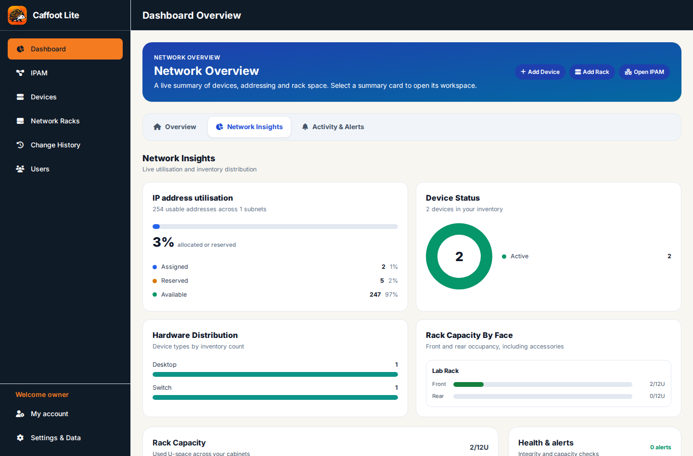

# Caffoot Lite

**Infrastructure, Simplified.** Free, open-source IP address management (IPAM), device inventory and network rack documentation for **small businesses, IT teams and home labs**.

Keep track of your devices, IP addresses and network racks in one place. Caffoot Lite combines a shared infrastructure inventory with user permissions and Change History, without requiring a complicated setup.

**[Get started with Docker or Portainer](INSTALLATION.md)** · **[Explore the features](docs/how-tos/features-and-instructions/README.md)** · **[See the roadmap](ROADMAP.md)** · **[Latest release: v2.0.3](https://github.com/Caffoot/Caffoot-Lite/releases/tag/v2.0.3)**

Caffoot Lite runs in Docker with a central SQLite database, shared inventory access and administrator-managed permissions. Administrators and editors use multi-factor authentication (MFA).

## Install Caffoot Lite

**Official Docker image:** `ghcr.io/caffoot/caffoot-lite:v2.0.3` (Raspberry Pi 5 ARM64 and PC AMD64).

Before installing, confirm the [v2.0.3 release](https://github.com/Caffoot/Caffoot-Lite/releases/tag/v2.0.3) and container build are published and the image is publicly accessible. This is a Docker application: **GitHub's automatic source-code ZIP and tarball are not the Docker installation package.**

For Portainer, use the current-release [`portainer-v2.0.3.yaml`](portainer-v2.0.3.yaml) from the repository root into **Stacks → Add stack → Web editor**, adjust your server address and port, and deploy. For new installations, Docker creates the persistent named volume automatically; no host directory is required. For Docker Compose builds from source, use [`compose.yaml`](compose.yaml) and [`Dockerfile`](Dockerfile) at the repository root.

**Read the [installation and HTTPS guide](INSTALLATION.md)** for complete Portainer/Docker Compose steps, initial administrator setup, MFA, reverse proxy, certificate trust and data backups. No public registration is offered.

## Features

- **Devices:** track hardware, software, physical and virtual systems, historical/custom fields and relationships.
- **IPAM:** document IPv4 blocks, subnets, VLANs, gateways, reservations and device address allocations.
- **Network Racks:** visualise cabinets, front/rear mounting positions, rack units and accessories.
- **Shared inventory:** multiple users, section-based read/edit permissions, authenticated changes and temporary device editing reservations.
- **Management:** administrator-controlled user accounts, MFA and familiar Change History.

See the [complete Features and Instructions user guides](docs/how-tos/features-and-instructions/README.md) for detailed examples, controls and screenshots.

## What's next?

We're developing a more polished, professional interface for Caffoot Lite v2.1, with improved navigation and streamlined workflows. Read the [public roadmap](ROADMAP.md) for the current release, approved development and future ideas. v2.1 is not yet released and has no promised release date.

## Help Build Caffoot Lite

**Caffoot Lite is an open-source community project, and everyone is welcome to help.** You don't need to be a developer or have written code before.

You can contribute by reporting a bug, testing the application, improving a help guide, suggesting a useful feature, answering a question or sharing a clear example. Even pointing out something confusing is valuable.

- **[Suggest A Feature Or Future Improvement](https://github.com/Caffoot/Caffoot-Lite/issues/new/choose)** — open one issue per idea. Check the [Future Ideas Index #222](https://github.com/Caffoot/Caffoot-Lite/issues/222) first to see whether it is already being discussed.
- **[Report A Bug Or Ask A Question](https://github.com/Caffoot/Caffoot-Lite/issues/new/choose)** — choose the relevant issue form and explain it in your own words.
- **[Improve The Documentation](https://github.com/Caffoot/Caffoot-Lite/issues/new/choose)** — suggest clearer wording, screenshots or missing instructions, with no programming required.
- **[Explore Good First Issues](https://github.com/Caffoot/Caffoot-Lite/labels/good%20first%20issue)** and **[Help Wanted](https://github.com/Caffoot/Caffoot-Lite/labels/help%20wanted)** — find appropriately scoped tasks where community help would be useful.
- **[Community Participation Guide](docs/Community-Participation.md)** — find out what labels mean and how to get involved.
- **[CONTRIBUTING.md](CONTRIBUTING.md)** — the shared naming, documentation, plain-English code-comment and review standards for all contributors, including maintainers.

**Every idea and its decisions belong in its own GitHub issue**, not in a new comment on the future-ideas index. The product owner sets priorities and decides what gets built. Suggesting an improvement is always welcome and never requires a technical specification. Please [report potential security vulnerabilities privately](SECURITY.md), not in public issues.

## Migrating your standalone inventory

Export a fresh JSON backup using **published Caffoot Lite v1.3.3**. Users of earlier standalone HTML editions must first upgrade to v1.3.3. After setting up your administrator account, go to **Settings & Data → Import Inventory**, review the proposed replacement and confirm it. This is a **one-way migration**, not a routine database backup. It does not replace user accounts, MFA or permissions.

## Where Your Data Is Stored

**New installations:** Docker manages a persistent `caffoot_data` volume, mounted at `/data` inside Caffoot Lite. The actual Docker volume name may be prefixed by your Compose project or Portainer stack name. Find it under **Portainer → Volumes**.

**Existing installations:** Keep your original `/data` mapping when updating, whether it is a named volume or custom host directory. Switching to a different, empty volume does **not** migrate your existing database and can make the application appear empty.

**Optional custom location:** You may replace `caffoot_data:/data` with a host bind mount such as `/srv/caffoot-lite/data:/data`. Give the container's non-root UID/GID `10001:10001` access to the directory. See the [installation guide](INSTALLATION.md).

## Backups and HTTPS

The authoritative database and HTTPS certificate material live under the persistent Docker `/data` mount (`caffoot.sqlite3` and `tls/`). Keep this directory when restarting or recreating the container. Back it up with trusted **external** Docker/volume/file backup tools; for a manual consistent copy, stop the container first. Keep securely protected backups away from the host and verify that they can be restored. No in-app ongoing Docker JSON backup/restore is provided.

For direct HTTPS, verify and trust the application certificate before entering credentials. Configure reverse proxies for HTTPS upstream connections, trusted certificates and restricted exposure of the published Docker port. See [INSTALLATION.md](INSTALLATION.md).

## Documentation

- [Installation, HTTPS, Portainer and backup instructions](INSTALLATION.md)
- [Releases and version history](https://github.com/Caffoot/Caffoot-Lite/releases)
- [Detailed user guides and screenshots](docs/how-tos/features-and-instructions/README.md)
- [Contributing To Caffoot Lite — mandatory naming, UI and documentation standards](CONTRIBUTING.md)
- [Development Guide](docs/development-guide/README.md)
- [Public roadmap](ROADMAP.md)
- [Future Ideas Index](https://github.com/Caffoot/Caffoot-Lite/issues/222)
- [Standalone v1.3.3 release for inventory migration](https://github.com/Caffoot/Caffoot-Lite/releases/tag/v1.3.3)
