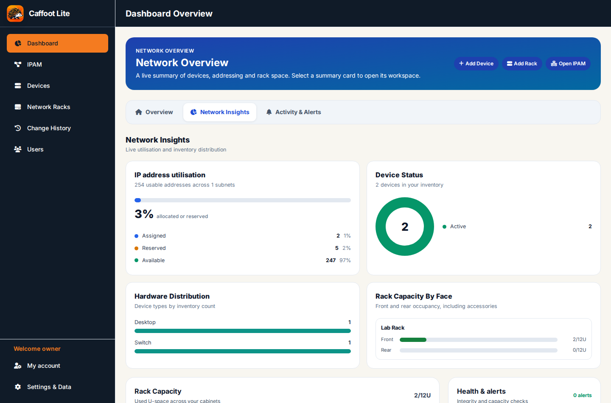
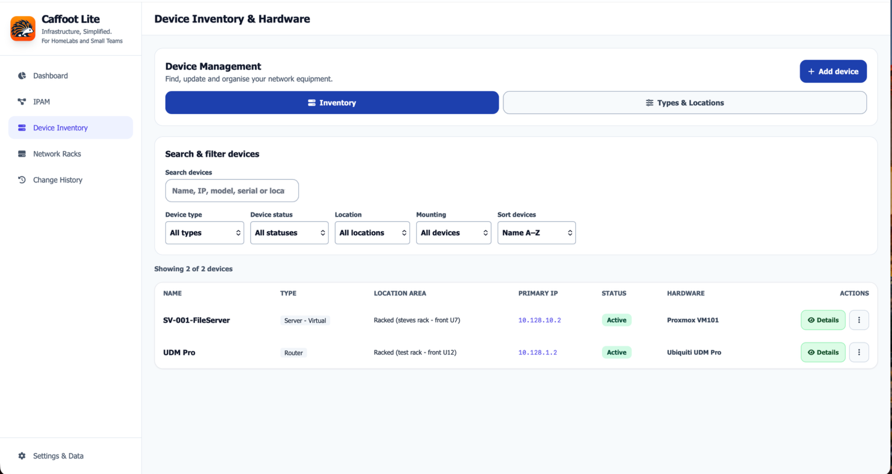
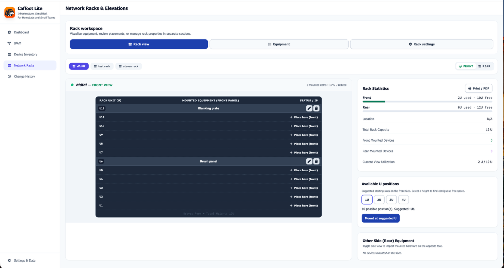

# Caffoot Lite — Free Offline IPAM & Network Inventory Software

**Infrastructure, Simplified.**  
*For HomeLabs and Small Teams*

**Caffoot Lite is free, open-source IP address management (IPAM), network device inventory, IT asset tracking and rack management software** for homelabs and small teams. Track network devices and IT assets, document IPv4 subnets, manage IP address allocations and reservations, and organise equipment in racks — all from a standalone HTML file.

No Docker, database, web server or account is required to run the published release. Download the HTML application and open it in a modern browser. Your inventory stays in that browser's local storage, so **regular JSON exports are essential**: browser data loss can mean inventory loss.

## Screenshots

### Dashboard



A clear overview of devices, IPv4 subnets, IP address allocations and rack space.

| Device inventory | Rack management |
| --- | --- |
| [](docs/screenshots/device-inventory.png) | [](docs/screenshots/rack-management.png) |
| Search and organise network devices, hardware details and IP addresses. | Visualise equipment placement, rack utilisation and available U-space. |

Select either thumbnail to view the full-size screenshot.

## At a glance

| Capability | Caffoot Lite |
| --- | --- |
| Network inventory and IT asset tracking | Devices, types, locations and details |
| IP address management (IPAM) | Subnets, addresses, reservations and allocation workflows |
| Rack management | Equipment placement and rack-unit tracking |
| Installation | Open a standalone HTML file; no server required |
| Data portability | JSON export and import for backups |
| Cost | Free, open-source software (MIT source licence) |

## ⚠️ Important — your inventory lives in your browser

**Caffoot Lite does not save your devices, IP addresses, racks or settings inside `Caffoot-Lite.html`.** Your inventory is stored in the **local storage of the browser you use to open it**. There is no server, automatic cloud backup or automatic synchronisation.

**If browser/site data is cleared, your inventory may be permanently lost.** Changing browser or profile, or moving/renaming the HTML file, can also make existing data inaccessible because `file://` storage varies between browsers.

**Export a JSON backup regularly, and ALWAYS before upgrading, moving, renaming or resetting Caffoot Lite.** Store backups somewhere safe outside the browser and verify you can restore them. Backups may contain sensitive infrastructure details.

## 🔐 Security and deployment guidance

**Caffoot Lite is intended primarily for local, offline use. Do not expose the standalone HTML application directly to the public internet.** It has no built-in authentication, role-based access control or secure multi-user backend. Network inventory and exported JSON backups can contain sensitive infrastructure details.

If you choose to serve Caffoot Lite from a web server, restrict access with appropriately configured authentication and authorisation (for example, Authentik integrated with Nginx or another compatible reverse proxy), HTTPS and network access controls. **A reverse proxy alone is not an authentication system**, and adding a login does not eliminate application or browser-storage risks. Test your deployment configuration carefully.

Browser storage is local to the browser/profile and origin; hosting the HTML file does **not** turn Caffoot Lite into a shared, server-backed inventory system. Avoid using it on untrusted or shared computers, protect exported backups, and never assume that an externally hosted copy provides multi-user isolation.

A dedicated security review and deployment-hardening milestone is planned for v1.1.2; that review has **not yet been completed**. Future Caffoot Pro is intended to address managed multi-user deployment, but it should not be treated as an available or security-validated alternative until released and reviewed.

## Update checker notice for older versions

**Using Caffoot Lite v1.0.3 or v1.1.0 and seeing “Could not check releases”?** These versions can fail to recognise the uppercase `V` in a GitHub release tag. Your inventory is not changed by this error, and the application can still run offline. **The update checker cannot repair an older HTML file automatically.**

To update manually, first **download and safely store a JSON backup** from **Settings & Data Management** in your current installation. Then visit the [official Caffoot Lite releases](https://github.com/Caffoot/Caffoot-Lite/releases) and download the latest published release's `Caffoot-Lite.html` or versioned ZIP. Keep the old HTML and backup until you have checked the new file in your browser. **Do not clear browser storage**; moving or renaming local HTML files can affect access to stored inventory. See [INSTALLATION.md](INSTALLATION.md) for the full upgrade precautions.

## Download and run

**[Get the latest stable Caffoot Lite release](https://github.com/caffoot/Caffoot-Lite/releases/latest)** — no installation, Docker or server required.

1. Open the **[latest release page](https://github.com/caffoot/Caffoot-Lite/releases/latest)**.
2. Under **Assets**, download the version-named `Caffoot-Lite-<version>.zip` release package, which includes the standalone app, guides and licences. Alternatively, download `Caffoot-Lite.html` directly from the release assets.
3. If you downloaded the release ZIP, extract it and open `Caffoot-Lite.html` in a modern browser. No Docker, Node.js or web server is needed to run it.

**Want the source code instead?** Click the green **Code** button on the repository page and choose **Download ZIP**. This is the source repository, **not** the ready-to-run release package; building from source requires Node.js and npm.

See the detailed [installation and upgrade guide](INSTALLATION.md) for the complete process and storage precautions.

## Who is Caffoot Lite for?

If you're looking for **free IPAM software**, an **offline network inventory tool**, a **homelab asset manager**, or a simple way to document **subnets, device IP addresses and server racks**, Caffoot Lite is designed for that workflow. It runs locally in your browser without an account or hosted service. It is not a network discovery scanner or a multi-user server.

## What you can manage

- **Devices:** inventory, types, locations and device details.
- **Subnets and IPAM:** IP Address Block hierarchy, CIDR networks, scoped VLANs, addresses, reservations and allocation workflows.
- **Racks:** rack layouts, equipment placement and U-space management.
- **Dashboard:** inventory overview; v1.1.1 development adds clearer **Inventory Health** wording for saved-record consistency, not storage, backup or live-network monitoring.
- **Data Management:** validated JSON backup/restore and reset/recovery tools. A clearer Back Up & Restore, Maintenance & Safety and Advanced Recovery layout is in development for v1.1.1; it is not yet part of the published stable release.
- **Offline use:** a single HTML file with bundled styling, fonts and branding assets.

See the [user guide](USER-GUIDE.md) for the first-run walkthrough and day-to-day tasks.

## Important: protect your data

Caffoot Lite stores inventory in your **browser's local storage**, not in the HTML file or on a server. Browser `file://` storage behaviour varies: changing browser, profile, path or filename may prevent the new file from seeing existing data. Clearing browser data can erase it.

**Export a JSON backup before upgrading, moving/renaming the HTML file, resetting data or changing browsers.** Keep backups safe; they may contain sensitive infrastructure details. Caffoot Lite saves inventory under `caffoot_state`. For upgrades from older versions, export and restore a JSON backup if existing browser data is not visible.

## For developers: build and test

Node.js and npm are needed **only to build from source**, not to run the released HTML:

```sh
cd app
npm install
npm run release
```

The build produces `app/dist/Caffoot-Lite.html`. Automated checks and manual browser testing are recommended before distributing a build. The GitHub Actions build workflow is currently disabled.

**Latest stable hotfix:** v1.1.0.1. The v1.1.0 release references below describe the preceding milestone; use the latest stable release link for current downloads.

## Project and release status

This repository is dedicated to **Caffoot Lite**: its standalone application, build tools, tests and release documentation.

**v1.1.0 was published on 18 October 2026.** The v1.1.1 Settings and documentation improvements are under development, not yet released. Download it from the [v1.1.0 release](https://github.com/caffoot/Caffoot-Lite/releases/tag/v1.1.0) or visit the [latest stable release](https://github.com/caffoot/Caffoot-Lite/releases/latest). See the [v1.1.0 release notes](RELEASE-NOTES-1.1.0.md) and [roadmap](ROADMAP.md) for changes and acceptance status.

## Licence and branding

Source code: [MIT License](LICENSE), copyright (c) 2026 Steven Del-Nevo. Third-party components retain their own licence terms.

The Caffoot name, hedgehog mascot and official project branding are **not** licensed as official branding by the MIT software licence. No registered-trademark claim is made. Do not present a modified build as an official Caffoot release without the owner's permission.


## Backup compatibility and release preparation

The [backup format contract](BACKUP-FORMAT.md) documents versioned JSON exports, legacy imports and compatibility safeguards. Historical testing and release-review records remain available in [RELEASE-ACCEPTANCE.md](RELEASE-ACCEPTANCE.md) and [RELEASE-REVIEW.md](RELEASE-REVIEW.md).
