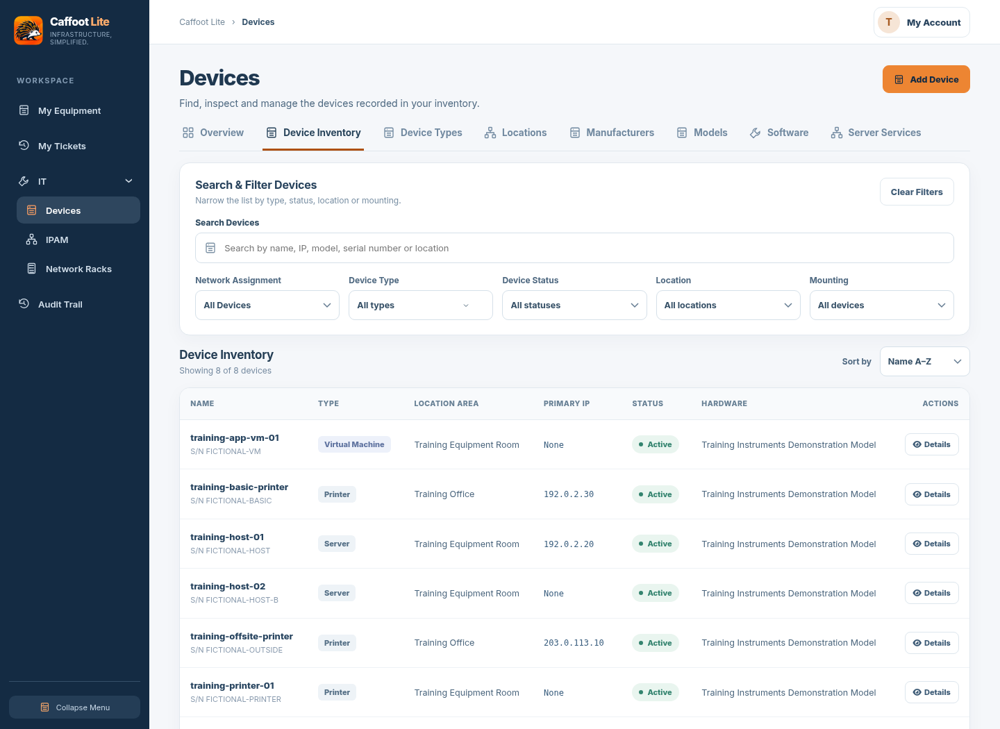
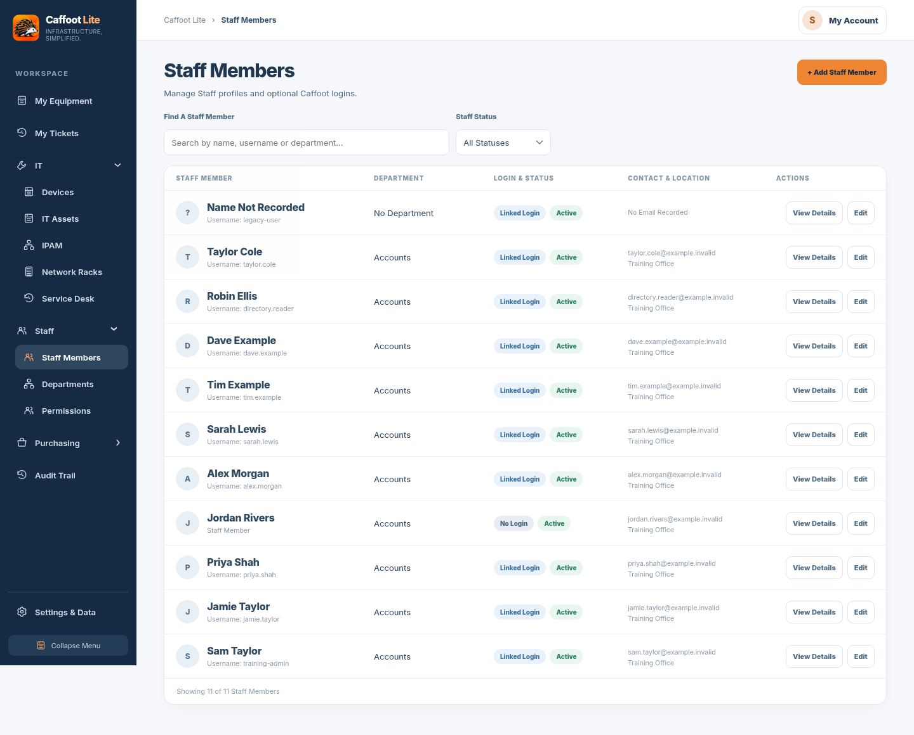
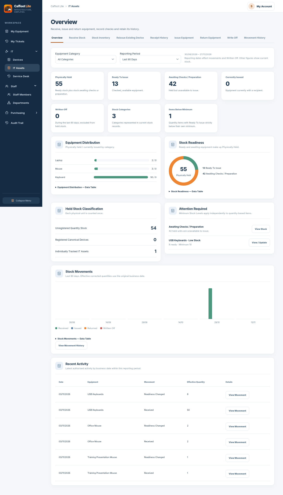
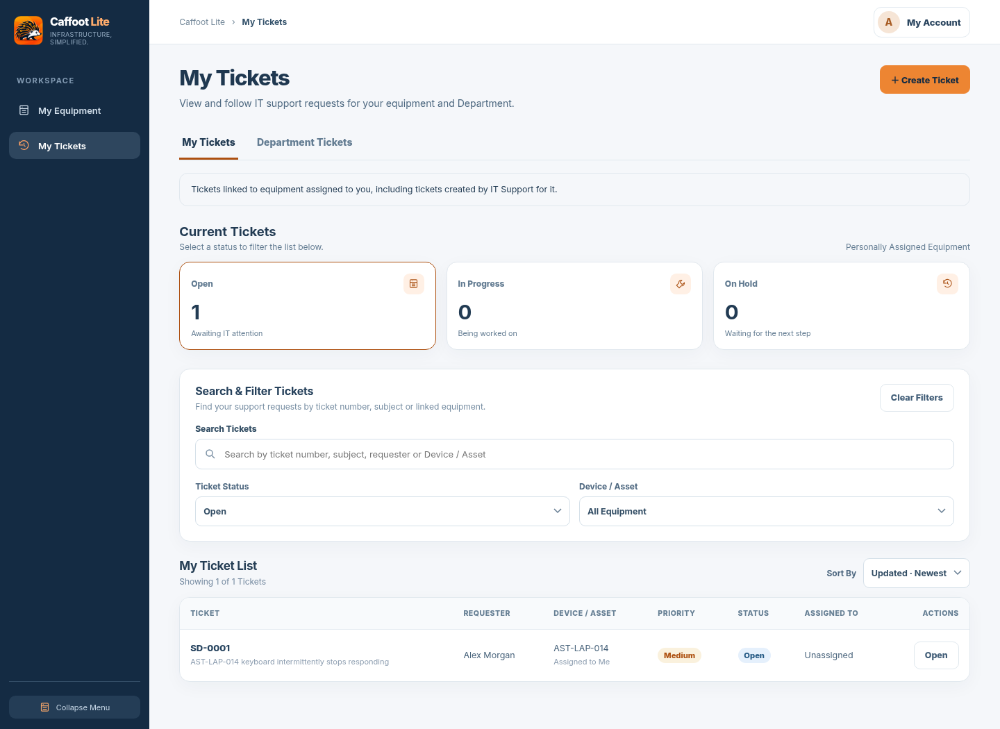

# Caffoot Lite v2.2 — Everyday IT Management

**Simplicity in everything.** 
Your infrastructure. Your users. Your data.

Free, open-source IT management for **small businesses, IT teams and home labs**. Keep infrastructure, people, equipment and support work together in one self-hosted application.

> **v2.2 is unreleased.** This README introduces the implemented v2.2 functionality. **v2.1 remains the current published download** and does not include the new people, stock, purchasing or Service Desk workflows. No public v2.2 image, release date or supported production v2.1 → v2.2 upgrade is available. Use the [published v2.1 installation guide](INSTALLATION.md) for public installations.

Caffoot Lite connects Device inventory, IP address management (IPAM) and Network Racks with Staff Members, Departments, equipment custody and stock. Receive a laptop, register it once, issue it with its accessories, handle a support request, then return, prepare and reissue the same Device. Supplier and lifecycle information stay alongside the equipment, while employees see only their eligible equipment and support conversations.

It runs in Docker with a shared SQLite database, HTTPS, administrator-managed accounts, multi-factor authentication (MFA) and permissions checked by the server. Choose the optional features your organisation needs; switching one off retains its data and permissions. There is no public account registration.

**[Explore the draft v2.2 guides](docs/how-tos/features-and-instructions/v2.2-draft/README.md)** · **[Read the draft release notes](docs/Release-Notes-v2.2.md)** · **[Install published v2.1](INSTALLATION.md)** · **[See the roadmap](ROADMAP.md)**

## Infrastructure In One Place

- **Devices:** find, filter, create, duplicate and maintain physical equipment and virtual machines. Record hardware, serial numbers, software, locations, host/guest relationships and type-specific details, including physical-server boot storage and ZFS information. Five-minute editing reservations protect a Device from competing edits.
- **Flexible networking:** save a Device without an address, record eligible basic IPv4 without managed IPAM, or explicitly link a saved basic address to an existing subnet. Enabling IPAM does not silently convert an address.
- **IPAM:** manage named LAN, Management and VPN subnets, optional VLANs and address blocks, gateways, allocations, notes and reservations. Preview guided subnet batches and bulk address changes before confirming them.
- **Network Racks:** document measured enclosures, front/rear elevations, Device placement, horizontal and vertical 0U accessories, shelves and capacity. Review collisions and dependent equipment; print or save a rack view as PDF.

*Device Inventory shows recorded equipment, including Devices without an IP address. These records describe your estate; they are not a live discovery scan.*

[Devices](docs/how-tos/features-and-instructions/v2.2-draft/Devices.md) · [IPAM](docs/how-tos/features-and-instructions/v2.2-draft/IPAM.md) · [Racks](docs/how-tos/features-and-instructions/v2.2-draft/Racks.md) · [Optional Features](docs/how-tos/features-and-instructions/v2.2-draft/Optional-Features-and-Link-To-IPAM.md)

## People, Accounts And Equipment Access

- **Staff Members:** record people with or without logins, their contact details, employment status and permitted equipment/history. Administrators manage linked accounts from Staff Details, resolve profile differences, reset passwords and review eligibility for administrator appointment.
- **Departments:** maintain independent groups and share eligible Desktops, Laptops or Printers equally across several Departments. Membership grants no application permissions and does not move personal equipment.
- **Roles and permissions:** combine reusable roles with explicit account overrides. The baseline Staff Member role grants no general inventory access; wider access requires MFA. Section permissions and organisation-wide feature switches are separate.
- **My Equipment:** linked employees see eligible personally assigned and current Department equipment without gaining the IT inventory, private notes or previous holders' history. Marking a person Left Company disables their linked login and ends sessions while retaining equipment and records; reactivation does not automatically re-enable sign-in.
- **My Account:** maintain personal details, appearance and security, verify an email address and use configured password recovery. Recovery does not bypass MFA. Administrator-assisted temporary passwords require a personal replacement before workspace access.

*An administrator can distinguish a directory record from its optional login. Ordinary directory readers receive a restricted view.*

[Staff Members](docs/how-tos/features-and-instructions/v2.2-draft/Staff-Members.md) · [Departments](docs/how-tos/features-and-instructions/v2.2-draft/Departments-and-Shared-Equipment.md) · [Accounts, roles and MFA](docs/how-tos/features-and-instructions/v2.2-draft/Roles-Section-Permissions-and-MFA.md) · [Assignments and My Equipment](docs/how-tos/features-and-instructions/v2.2-draft/Device-Assignments-and-My-Equipment.md)

## Stock, Custody And Reuse

Optional **IT Assets** records quantity-based and individually tracked equipment from receipt to final write-off.

- Record deliveries and checks; distinguish **Physically Held**, **Ready To Issue**, **Awaiting Checks** and **Awaiting Preparation**. Physical presence or an unassigned Device does not prove readiness.
- Register a computer from Ready stock without double counting it. Keep its permanent Device identity through issue, physical return, preparation and reissue.
- Issue equipment to Staff or Departments, explicitly associate accessories with Device custody, record partial or damaged returns, and account for missing items. Use checked direct handovers when equipment moves between holders without returning to the storeroom.
- Correct eligible recording errors with an attributed correction that retains the original movement and protects dependent history.
- Review current balances, category/readiness charts, 30/90-day movement reporting and optional per-item **Low Stock** warnings based on Ready quantities.

*Of 55 units physically held in this example, 13 are Ready and 42 need checks or preparation. The reporting period changes movement reporting, not the current held balance.*

[Stock intake](docs/how-tos/features-and-instructions/v2.2-draft/IT-Assets-Stock-Intake.md) · [Issue, return and write-off](docs/how-tos/features-and-instructions/v2.2-draft/IT-Assets-Issue-Return-and-Write-Off.md) · [Registration and reissue](docs/how-tos/features-and-instructions/v2.2-draft/Device-Stock-Registration-and-Reissue.md) · [Accessories and handovers](docs/how-tos/features-and-instructions/v2.2-draft/Associated-Equipment.md) · [Corrections](docs/how-tos/features-and-instructions/v2.2-draft/IT-Assets-Correct-Movement.md) · [Stock reporting](docs/how-tos/features-and-instructions/v2.2-draft/IT-Assets-Dashboard.md)

## Suppliers And Equipment Lifecycle

- **Suppliers and Purchasing:** maintain companies, categories, locations, contacts and work notes. Record Supplier Issues, updates and contact handovers. Explicitly link Suppliers to Devices and original receipts; supplied quantities describe original supply rather than current stock.
- **Equipment Lifecycle:** record purchase, first-service and warranty dates, planned replacement dates and configurable warnings/lifespans. A qualifying first stock issue records first service even with Lifecycle off. Warnings help you plan; they do not purchase, retire or replace equipment automatically.

[Suppliers](docs/how-tos/features-and-instructions/v2.2-draft/Supplier-Management.md) · [Supplier Issues](docs/how-tos/features-and-instructions/v2.2-draft/Supplier-Issues-and-Purchasing.md) · [Supplier links](docs/how-tos/features-and-instructions/v2.2-draft/Equipment-Supplier-Integration.md) · [Lifecycle](docs/how-tos/features-and-instructions/v2.2-draft/Equipment-Lifecycle.md)

## Service Desk, Email And Reporting

- **Employee support:** raise a problem against eligible equipment, follow **My Tickets** or **Department Tickets**, reply, attach permitted files and reopen a returning problem. Shared-ticket confidentiality warnings explain the current Department audience before you write.
- **IT Service Desk:** use the separately permissioned queue to create and assign tickets, set priority/category, add internal notes or employee-visible updates, pause, resolve and reopen work. Per-account unread indicators acknowledge replies only when Updates loads successfully.
- **Privacy and history:** equipment custody and current Department membership govern employee access. Earlier conversations remain with authorised IT when equipment changes hands; a new holder does not inherit another person's conversation.
- **Activity reporting:** distinguish live workload from tickets created, closures, reopenings, technician activity and average working-time resolution over a selected period. Administrators configure Working Hours, Excluded Dates, Ticket Categories and the installation time zone.
- **Email and branding:** configure outgoing SMTP and an IT support mailbox; preview, test, save drafts and publish wording for seven Service Desk and three account/security email templates. Share a company name, colours, footer and optional logo. Saving a ticket does not depend on email arriving.

*An employee follows a request for eligible equipment in My Tickets. Technicians handle work in the separate IT Service Desk.*

[Tickets and reporting](docs/how-tos/features-and-instructions/v2.2-draft/Service-Desk-Tickets.md) · [Service Desk administration](docs/how-tos/features-and-instructions/v2.2-draft/Service-Desk-Administration.md) · [Time zone](docs/how-tos/features-and-instructions/v2.2-draft/Service-Desk-Time-Zone.md) · [Email templates and branding](docs/how-tos/features-and-instructions/v2.2-draft/Email-Templates-and-Company-Branding.md)

## History And Everyday Use

**Audit Trail** provides readable, attributed changes, event-time names, permission-filtered details and authorised JSON history export. Record timelines preserve their original identities. Ticket conversations have their own History; an audit export is not a backup.

The responsive interface supports light/dark themes, independently scrolling desktop navigation, keyboard-accessible **DD/MM/YYYY** date controls and built-in help. Devices, IPAM, Network Racks, IT Assets, Suppliers and Equipment Lifecycle can be enabled independently; Staff and Departments remain core, permission-controlled sections.

[Audit Trail](docs/how-tos/features-and-instructions/v2.2-draft/Audit-Trail.md) · [Navigation and dates](docs/how-tos/features-and-instructions/v2.2-draft/README.md) · [Connected equipment example](docs/how-tos/features-and-instructions/v2.2-draft/Connected-Equipment-Journey.md) · [Connected support example](docs/how-tos/features-and-instructions/v2.2-draft/Connected-Service-Desk-Journey.md)

*Illustrations show the implemented, unreleased v2.2 application in desktop light theme, using fictional records. Available navigation and actions depend on enabled features and permissions.*

## Install The Published Release — v2.1

**v2.1 image reference:** `ghcr.io/caffoot/caffoot-lite:v2.1`. Before pulling, verify the v2.1 GitHub Release, its AMD64/ARM64 image manifest and anonymous registry access. Older releases remain in [version history](https://github.com/Caffoot/Caffoot-Lite/releases).

The root [`portainer-v2.1.yaml`](portainer-v2.1.yaml) is the prepared example. Before using it, verify the release/image exists, then edit the server address and port. **Existing installations must keep their exact `/data` mapping, environment and secrets; never replace a working stack with an empty-volume example.** Historical [v2.0.3 Portainer instructions](docs/historical/portainer/portainer-v2.0.3.yaml) remain available. The branch’s [`compose.yaml`](compose.yaml) and [`Dockerfile`](Dockerfile) build its source revision; they do not provide a released v2.2 installation. Use the published v2.1 source/tag for a v2.1 source build. GitHub source ZIPs are not Docker installation packages.

**Read the [installation and HTTPS guide](INSTALLATION.md)** for complete Portainer/Docker Compose steps, initial administrator setup, MFA, reverse proxy, certificate trust and data backups. No public registration is offered.

The separate [draft v2.2 installation](docs/how-tos/features-and-instructions/v2.2-draft/Installation.md) and [upgrade/recovery guide](docs/how-tos/features-and-instructions/v2.2-draft/Legacy-Import-and-Docker-Upgrade.md) are for separately authorised isolated review. Supported production upgrades and complete-volume recovery for v2.2 remain outstanding.

## Help Build Caffoot Lite

**Caffoot Lite is an open-source community project, and everyone is welcome to help.** You don't need to be a developer or have written code before.

You can contribute by reporting a bug, testing the application, improving a help guide, suggesting a useful feature, answering a question or sharing a clear example. Even pointing out something confusing is valuable.

- **[Suggest A Feature Or Future Improvement](https://github.com/Caffoot/Caffoot-Lite/issues/new/choose)** — open one issue per idea. Check the [existing future requests](https://github.com/Caffoot/Caffoot-Lite/labels/future%20request) first to see whether the idea has already been suggested.
- **[Report A Bug Or Ask A Question](https://github.com/Caffoot/Caffoot-Lite/issues/new/choose)** — choose the relevant issue form and explain it in your own words.
- **[Improve The Documentation](https://github.com/Caffoot/Caffoot-Lite/issues/new/choose)** — suggest clearer wording, screenshots or missing instructions, with no programming required.
- **[Explore Good First Issues](https://github.com/Caffoot/Caffoot-Lite/labels/good%20first%20issue)** and **[Help Wanted](https://github.com/Caffoot/Caffoot-Lite/labels/help%20wanted)** — find appropriately scoped tasks where community help would be useful.
- **[Community Participation Guide](docs/Community-Participation.md)** — find out what labels mean and how to get involved.
- **[CONTRIBUTING.md](CONTRIBUTING.md)** — the shared naming, documentation, plain-English code-comment and review standards for all contributors, including maintainers.

**Every idea and its decisions belong in its own GitHub issue**, not in a new comment on the future-ideas index. The product owner sets priorities and decides what gets built. Suggesting an improvement is always welcome and never requires a technical specification. Please [report potential security vulnerabilities privately](SECURITY.md), not in public issues.

## Migrating Your Standalone Inventory

For the published Docker migration, export a fresh JSON backup using **published Caffoot Lite v1.3.3**. Users of earlier standalone HTML editions must first upgrade to v1.3.3. After setting up your administrator account, go to **Settings & Data → Import Inventory**, review the proposed replacement and confirm it. This is a **one-way migration**, not a routine database backup. It does not replace user accounts, MFA or permissions. The [draft v2.2 import instructions](docs/how-tos/features-and-instructions/v2.2-draft/Legacy-Import-and-Docker-Upgrade.md#import-legacy-inventory) also explain protected Device conflicts: a replacement cannot change or remove equipment with protected relationships.

## Where Your Data Is Stored

**New installations:** Docker manages a persistent `caffoot_data` volume, mounted at `/data` inside Caffoot Lite. The actual Docker volume name may be prefixed by your Compose project or Portainer stack name. Find it under **Portainer → Volumes**.

**Existing installations:** Keep your original `/data` mapping when updating, whether it is a named volume or custom host directory. Switching to a different, empty volume does **not** migrate your existing database and can make the application appear empty.

**Optional custom location:** You may replace `caffoot_data:/data` with a host bind mount such as `/srv/caffoot-lite/data:/data`. Give the container's non-root UID/GID `10001:10001` access to the directory. See the [installation guide](INSTALLATION.md).

## Backups and HTTPS

The authoritative database and HTTPS certificate material live under the persistent Docker `/data` mount (`caffoot.sqlite3`, `tls/`, `account-email-secret.key` when present, and all other installation files). Keep this directory when restarting or recreating the container. Back it up with trusted **external** Docker/volume/file backup tools; for a manual consistent copy, stop the container first. Keep securely protected backups away from the host and verify that they can be restored. No in-app ongoing Docker JSON backup/restore is provided. Inventory or Audit Trail JSON cannot recover accounts, MFA, tickets, attachments, branding, TLS or private email settings.

For direct HTTPS, verify and trust the application certificate before entering credentials. Configure reverse proxies for HTTPS upstream connections, trusted certificates and restricted exposure of the published Docker port. See [INSTALLATION.md](INSTALLATION.md).

## Documentation

- [Draft v2.2 user and administrator guides](docs/how-tos/features-and-instructions/v2.2-draft/README.md)
- [Draft v2.2 release notes](docs/Release-Notes-v2.2.md)
- [Published v2.1 installation, HTTPS, Portainer and backup instructions](INSTALLATION.md)
- [v2.1 release notes](docs/historical/release-notes/Release-Notes-v2.1.md)
- [v2.1 development handover — historical evidence](docs/historical/development-handovers/v2.1.md)
- [v2.0.3 release notes](docs/historical/release-notes/Release-Notes-v2.0.3.md)
- [Releases and version history](https://github.com/Caffoot/Caffoot-Lite/releases)
- [Published v2.1 user guides and screenshots](docs/how-tos/features-and-instructions/README.md)
- [Contributing To Caffoot Lite — mandatory naming, UI and documentation standards](CONTRIBUTING.md)
- [Development Guide](docs/development-guide/README.md)
- [Public roadmap](ROADMAP.md)
- [Ideas under consideration](https://github.com/Caffoot/Caffoot-Lite/labels/future%20request)
- [v2.0.3 development handover (historical)](docs/historical/development-handovers/v2.0.3.md)
- [Security-fix and release checklist, including the owner-controlled one-click publishing process](docs/development-guide/Security-Fixes-and-Releases.md)
- [Standalone v1.3.3 release](https://github.com/Caffoot/Caffoot-Lite/releases/tag/v1.3.3)

**Version history:** [v2.0](https://github.com/Caffoot/Caffoot-Lite/releases/tag/v2.0) introduced the Docker/SQLite multi-user edition. [v2.0.1](https://github.com/Caffoot/Caffoot-Lite/releases/tag/v2.0.1) moved the Docker source to the repository root. v2.0.2 delivered a focused security correction. v2.0.3 updated the documentation, code-reference baseline and existing browser regression coverage without changing the supported inventory data format.

The published v2.1 upgrade changes the existing database to schema 10. Outstanding older-format email proofs are invalidated; account permissions, MFA and inventory are retained. Back up the entire stopped `/data` first. Rollback requires the complete matching pre-upgrade backup and old image; an old binary must not open the upgraded database. See the [upgrade instructions](INSTALLATION.md#upgrading-v203-to-v21). v2.1 was published on 8 November 2026. Verify the relevant public image and architecture before installation; v2.2 remains unreleased.
