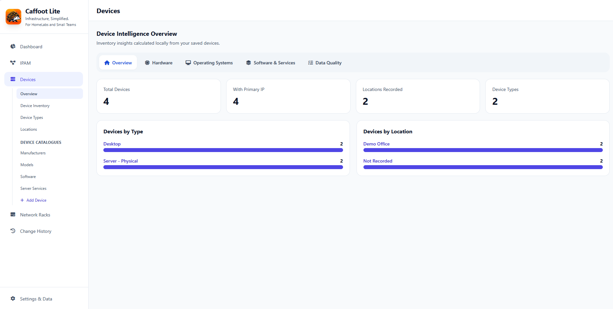
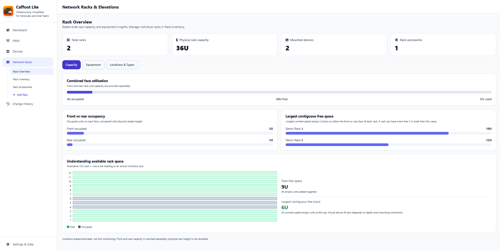

# Caffoot Lite

**Infrastructure, Simplified.**

Free, open-source, offline IP address management (IPAM), network inventory and rack management for homelabs and small teams.

Keep track of devices, IP addresses, subnets, VLANs, locations and network racks in one place. Caffoot Lite runs as a **single HTML file** in a modern browser. No account, Docker, database or web server is needed for the published standalone release.

## Get started in minutes

**[Download the latest stable Caffoot Lite release](https://github.com/Caffoot/Caffoot-Lite/releases/latest)**

1. Open the release page and expand **Assets**.
2. Download `Caffoot-Lite.html` or the versioned `Caffoot-Lite-<version>.zip` package. If you choose the ZIP, extract it first.
3. Open `Caffoot-Lite.html` in a modern browser.
4. Create an IP Address Block and subnet in **IPAM → Manage Subnets**, then add your first device in **Devices → Device Inventory**.
5. Open **Settings & Data → Data Management → Back Up & Restore** and select **Download Backup** to save a JSON copy of your inventory.

You can explore with fictional information before adding details of your real network.

**Please note:** The repository's green **Code → Download ZIP** option downloads the *source code*, not the ready-to-run release. Building from source requires Node.js and npm.

For step-by-step help, see the [installation and upgrade guide](INSTALLATION.md) or [user guide](USER-GUIDE.md).

## What can Caffoot Lite do?

| Area | What you can manage |
| --- | --- |
| **Devices** | Inventory, types, locations, hardware, software and network details |
| **IPAM** | IPv4 address blocks, subnets, VLANs, addresses, allocations and reservations |
| **Network racks** | Racks, mounted equipment, accessories, rack elevations and available space |
| **Overview and data quality** | Inventory summaries and saved-record consistency information |
| **Data management** | JSON backup and restore, maintenance and recovery tools |

Caffoot Lite is a documentation tool, **not** a live network discovery or monitoring service. Read the [feature overview](docs/features/FEATURE-OVERVIEW.md) for more detail.

## See it in action

### Dashboard


### Device and rack overviews

| Devices Overview | Rack Overview |
| --- | --- |
| [](docs/screenshots/devices-overview-v1.3.0.png) | [](docs/screenshots/rack-overview-v1.3.0.png) |

### Inventory and rack elevation

| Device Inventory | Rack Elevation |
| --- | --- |
| [](docs/screenshots/device-inventory.png) | [](docs/screenshots/rack-management.png) |

Select an image to view it at full size.

## Important: keep your inventory safe

**Your inventory is saved in your browser's local storage, not inside the HTML file.** Caffoot Lite does not automatically back up or synchronise data, and it does not use a shared server database.

Clearing browser data can permanently erase your inventory. Changing browser, browser profile, or the location or name of the HTML file can also make existing data unavailable because local file storage varies between browsers.

**Export a JSON backup regularly and always before upgrading, moving or renaming the HTML file, resetting data or changing browsers.** Keep backups somewhere safe outside the browser and check that they can be restored. Restoring a backup replaces the active inventory rather than combining it with existing records. Backups may contain sensitive network information.

Read the [installation and upgrade guide](INSTALLATION.md) for precautions and recovery guidance.

## Security and intended use

**Do not expose Caffoot Lite directly to the public internet.** The standalone application has no built-in login, user isolation or secure multi-user backend. Serving the HTML file from a web server does not turn browser-local storage into a shared inventory.

If you choose to host it, use properly configured authentication and authorisation, HTTPS and network access controls, preferably private network or VPN access. **A reverse proxy alone does not provide authentication.** These controls do not make the application a security-certified multi-user service. Avoid shared or untrusted computers and protect exported backups.

Please read [SECURITY.md](SECURITY.md) before considering a hosted deployment. A comprehensive manual security audit has not been completed.

## Guides and project information

- [Installation, upgrades and troubleshooting](INSTALLATION.md)
- [User guide](USER-GUIDE.md)
- [Feature overview](docs/features/FEATURE-OVERVIEW.md)
- [Roadmap](ROADMAP.md)
- [Current v1.3.0 release notes](RELEASE-NOTES-1.3.0.md)
- [Historical release notes](docs/archive/release-notes/README.md)
- [Documentation index](docs/README.md)
- [Contributing](CONTRIBUTING.md) and [backup format contract](BACKUP-FORMAT.md)

**Current release:** [v1.3.0](https://github.com/Caffoot/Caffoot-Lite/releases/tag/v1.3.0), published 21 October 2026.

Older versions such as v1.0.3 and v1.1.0 may report “Could not check releases” because of an update checker compatibility issue. This does not change inventory. Back up your data and use the [official releases](https://github.com/Caffoot/Caffoot-Lite/releases) and [upgrade instructions](INSTALLATION.md) to update manually.

## Help and feedback

Found a problem or have an idea? Open a [GitHub Issue](https://github.com/Caffoot/Caffoot-Lite/issues) with the version, steps to reproduce and expected behaviour. **Never attach real inventory backups, credentials or private network details to a public issue.** For sensitive security concerns, follow [SECURITY.md](SECURITY.md).

## For developers

The released HTML file needs no build tools. To build from source, install Node.js and npm, then run:

```sh
cd app
npm install
npm run release
```

The build produces `app/dist/Caffoot-Lite.html`. Automated checks and manual browser verification are recommended before distributing a build. The GitHub Actions build workflow is currently disabled. See [contributing guidance](CONTRIBUTING.md) and the [technical documentation](docs/README.md).

## Licence and branding

Caffoot Lite source code is available under the [MIT Licence](LICENSE), copyright © 2026 Steven Del-Nevo. Third-party components retain their own licence terms.

The Caffoot name, hedgehog mascot and official project branding are not licensed as official branding under the MIT software licence. No registered trademark claim is made. Do not present modified builds as official Caffoot releases without the owner's permission.
