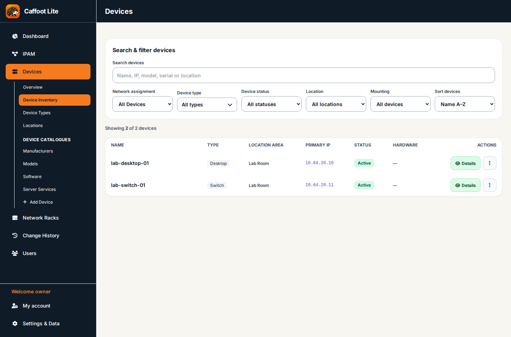
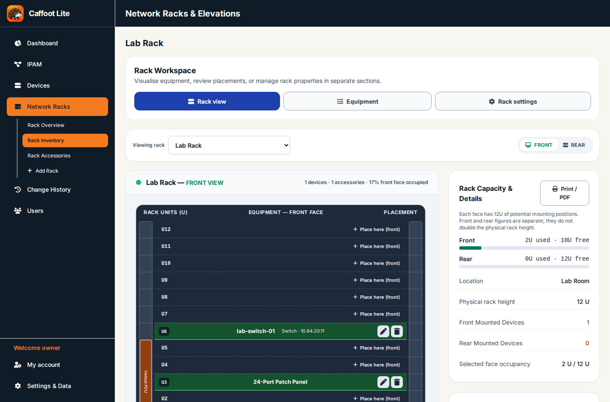

# Caffoot Lite

**Infrastructure, Simplified.** Caffoot Lite is a compact inventory application for small IT teams, homelabs and organisations that want to know what equipment they have, which IP addresses are in use, and where devices are installed.

## Which edition should I use?

| Edition | Status | Where to start |
| --- | --- | --- |
| **Caffoot Lite v1.3.3** | **Published HTML release**. The established, usable single-browser application. | [Download the published release](https://github.com/Caffoot/Caffoot-Lite/releases/tag/v1.3.3) |
| **Caffoot Lite v2.0 — Docker/SQLite** | **Approved release candidate; not published yet.** The familiar inventory with central SQLite, authorised multi-user access and MFA. | [Docker/Portainer installation guide](next/README.md) |

**Caffoot Lite v2.0 has been approved as the next major release version, but it is not published yet.** The `next-test` container image is for acceptance testing, not production. The published v1.3.3 standalone HTML release remains available.

## Features

- **Devices:** maintain equipment records, hardware and software details, physical and virtual machines, locations, relationships and existing historical/custom information.
- **IPAM:** document networks, subnets, VLANs, gateways, device addresses, reservations and notes.
- **Racks:** track cabinets, front and rear rack positions, equipment and accessories, including vertical side-rail items.
- **Change History and managed lists:** review inventory changes and maintain the familiar device types, locations and catalogue settings.

The Docker edition adds **central SQLite storage**, first-run administrator setup, administrator-managed users, section-based read/edit permissions and MFA for administrators and editors. Two users can view the same device, edit different devices simultaneously and see each other's saved changes when navigating or reopening records. Temporary device edit reservations prevent competing edits.

## Application screenshots — Docker/SQLite edition

These are genuine Chromium screenshots of the v2.0 Docker release candidate, using an isolated database and fictional lab inventory. No production inventory or personal account details are shown.

| Device Inventory | Rack Elevation |
| --- | --- |
|  |  |

See the [full Features and Instructions guides](docs/How%20To%27s/Features%20and%20Instructions/README.md) for more genuine screenshots alongside detailed workflows.

## Trying the v2.0 release candidate

The easiest tested method is **Portainer → Stacks → Add stack → Web editor**.

1. Open the [example Portainer stack](next/portainer-stack.yaml) and copy its contents into the Web editor.
2. Change the example server IP and HTTPS port to suit your host. The example uses an external port of `8443`; `8080` is the fixed *internal* container port.
3. Keep a **persistent** mount for `/data`. The example Raspberry Pi host path is `/portainer/Files/AppData/Config/caffoot_data`; choose a suitable path for your installation and set its permissions as described in the [installation guide](next/README.md).
4. Deploy the stack, open your configured HTTPS address, create the first administrator account and complete mandatory MFA enrolment.

The full [installation guide](next/README.md) also explains Docker Compose, HTTPS certificates, reverse proxies, environment settings, database persistence and migration.

### Installation settings in plain English

| Setting | Meaning |
| --- | --- |
| `CAFFOOT_WEB_ADDRESS` | The complete **HTTPS address entered into your browser**, including the external port if needed; for example `https://192.168.1.50:8443`. Behind a proxy, use the public HTTPS website address. |
| `CAFFOOT_SERVER_ADDRESS` | The **IP address or hostname of the Caffoot server**, used for the application's HTTPS certificate. Behind a proxy, this is the HTTPS upstream server address, not necessarily the public website domain. |
| `CAFFOOT_PORT` | The published **host port**; for example `8443`. Leave the container's internal port at `8080`. |

For Docker Compose installations, `CAFFOOT_DATA_PATH` can select the host directory mounted at `/data`. The Portainer Web editor example already specifies its bind mount directly. Set addresses for **your** network rather than copying example IP addresses unchanged.

For direct HTTPS access, Caffoot generates a self-signed certificate. Check its identity and fingerprint and establish trust before entering credentials. Reverse proxies must connect to the upstream through HTTPS and verify its certificate. See the [HTTPS instructions](next/README.md).

## Migrating from the published HTML application

The Docker edition supports a **one-way inventory migration from a fresh JSON backup exported by published v1.3.3**. Users of an earlier HTML edition must first update to v1.3.3, check their inventory and export a new backup.

After setting up the Docker administrator account, use the application's Settings import flow to review the data and explicitly confirm replacement of inventory. The import preserves supported inventory relationships and historical fields, and does **not** replace users, passwords, MFA or permissions. It is not a reverse migration or a general-purpose backup service.

## Protecting your data

The Docker edition saves its database as `/data/caffoot.sqlite3`, with HTTPS certificate files under `/data/tls`. **Keep the persistent `/data` mount when updating or recreating the container.**

Back up and restore that persistent data with **external container, volume or file-backup tools**; there is no built-in ongoing Docker backup/restore feature. A consistent copy can be taken with the container stopped. For a real installation, keep a protected backup **away from the host**, and verify recovery before depending on it. The successful Raspberry Pi test used a temporary local file copy and restore; that does **not** protect against loss of the Pi's storage.

## Documentation and development

- [Features and Instructions — complete user guides](docs/How%20To%27s/Features%20and%20Instructions/README.md) — step-by-step Devices, IPAM, Racks, Users/MFA, Settings/History and migration/backup instructions
- [Docker/Portainer installation and operational guidance](next/README.md)
- [Development Guide](docs/Development%20Guide/README.md) — architecture, SQLite schema, backend/API, authentication, editing reservations, inventory migration and tests
- [Published v1.3.3](https://github.com/Caffoot/Caffoot-Lite/releases/tag/v1.3.3) — existing HTML edition and release resources
- [Approved Docker edition specification — #215](https://github.com/Caffoot/Caffoot-Lite/issues/215)
- [Release preparation and acceptance — #218](https://github.com/Caffoot/Caffoot-Lite/issues/218)

**Release status:** v2.0 is the approved version designation, not yet a published release. The application has passed backend, Chromium and Docker checks, and administrator Dashboard/Settings acceptance on the Raspberry Pi. Final release packaging, image and website publication still require completion and confirmation. See [v2.0 release notes](docs/Release-Notes-v2.0.md) and [release tracker #218](https://github.com/Caffoot/Caffoot-Lite/issues/218).
