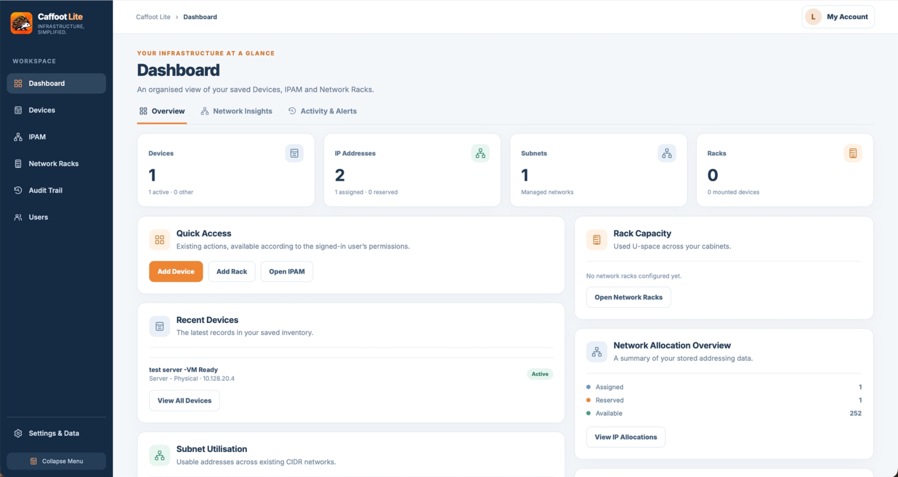
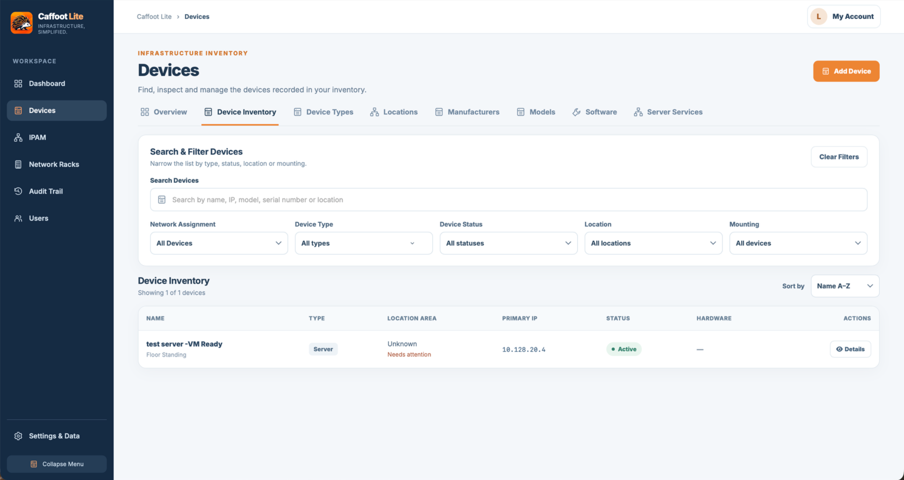
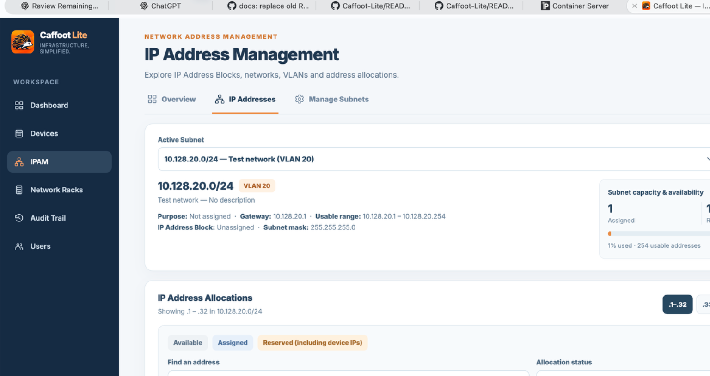
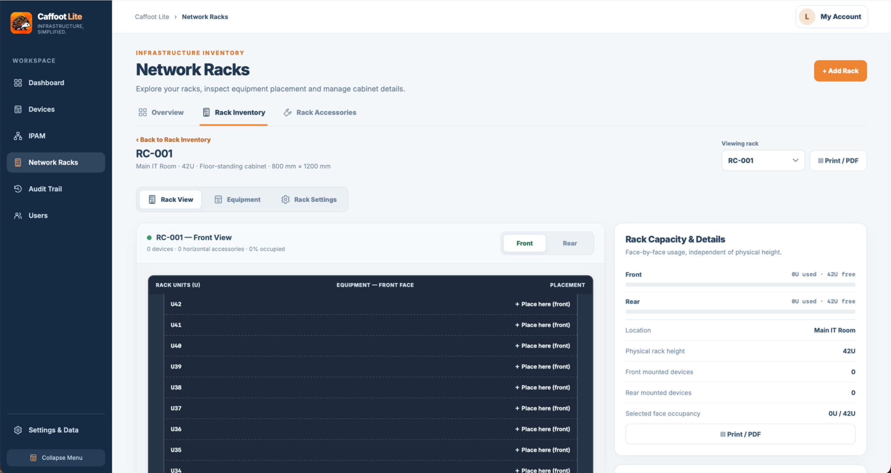

# Caffoot Lite v2.1

**Simplicity in everything.** 
Your infrastructure. Your users. Your data.

Free, open-source IP address management (IPAM), device inventory and network rack documentation for **small businesses, IT teams and home labs**.

**Release and download status:** Check the [official GitHub Releases page](https://github.com/Caffoot/Caffoot-Lite/releases) for the latest published version and verified images. Source code on `main` is not, by itself, proof of a published Docker image.

**In development — v2.2:** [Milestone 01 — Everyday IT Management](https://github.com/Caffoot/Caffoot-Lite/milestone/20) is the agreed next release target. Stage 1 (roles, individual permissions and IT Staff) has been accepted and merged; People, Assets, Suppliers, Service Desk and the other stages remain in development or planning. Work continues on the [`milestone-1` branch](https://github.com/Caffoot/Caffoot-Lite/tree/milestone-1), with [progress tracked in issue #351](https://github.com/Caffoot/Caffoot-Lite/issues/351). **v2.2 is not published or available as a public install image.** The v2.1 installation guidance below remains current.

Caffoot Lite brings IPAM, device inventory, rack documentation and Audit Trail together for small businesses, IT teams and home labs. v2.1 introduces a modern, responsive interface, clearer physical-server/VM forms, subnet-first networking, optional VLANs, guided bulk subnet creation and improved account/email workflows. It retains central SQLite storage, HTTPS, administrator-managed access, MFA and five-minute device editing reservations.

The repository root contains the Docker application's source: `backend/`, `inventory.html`, `setup.html`, `assets/`, `Dockerfile`, `compose.yaml`, `tests/` and documentation. The old `next/` development folder and standalone HTML build copy remain excluded, as established in v2.0.1. The original standalone version remains separately available in the [published v1.3.3 release](https://github.com/Caffoot/Caffoot-Lite/releases/tag/v1.3.3).

Keep track of your devices, IP addresses and network racks in one place. Caffoot Lite combines a shared infrastructure inventory with user permissions and Change History, without requiring a complicated setup.

**[Get started with Docker or Portainer](INSTALLATION.md)** · **[Explore the features](docs/how-tos/features-and-instructions/README.md)** · **[See the roadmap](ROADMAP.md)** · **[Latest published release](https://github.com/Caffoot/Caffoot-Lite/releases/latest)**

*Dashboard from the running Caffoot Lite v2.1 light-theme application.*

### A look at the v2.1 interface

| Device Inventory | IP Address Management |
| --- | --- |
|  |  |

*All four screenshots are cropped from the running v2.1 light-theme application, with macOS and browser controls removed.*

## Install Caffoot Lite

**v2.1 image reference:** `ghcr.io/caffoot/caffoot-lite:v2.1`. Before pulling, verify the v2.1 GitHub Release, its AMD64/ARM64 image manifest and anonymous registry access. Older releases remain in [version history](https://github.com/Caffoot/Caffoot-Lite/releases).

The root [`portainer-v2.1.yaml`](portainer-v2.1.yaml) is the prepared example. Before using it, verify the release/image exists, then edit the server address and port. **Existing installations must keep their exact `/data` mapping, environment and secrets; never replace a working stack with an empty-volume example.** Historical [v2.0.3 Portainer instructions](docs/historical/portainer/portainer-v2.0.3.yaml) remain available. For source builds use [`compose.yaml`](compose.yaml) and [`Dockerfile`](Dockerfile). GitHub source ZIPs are not Docker installation packages.

**Read the [installation and HTTPS guide](INSTALLATION.md)** for complete Portainer/Docker Compose steps, initial administrator setup, MFA, reverse proxy, certificate trust and data backups. No public registration is offered.

## Features

- **Modern, easy-to-use interface:** clear navigation, light and dark themes, layouts that work across desktop and mobile, and built-in help.
- **Devices:** physical hardware, dedicated hypervisor/version selection, eligible hosts/VM resources, historical/custom values, rack-shelf associations and notes that fill the editor.
- **Subnet-first IPAM:** named subnets with explicit LAN/Management/VPN purpose, optional VLAN, optional VPN gateway, derived read-only Device VLAN and available/manual IP entry.
- **Guided subnet planning:** optional organisational blocks, theoretical CIDR capacity and prefix guidance without automatic changes, Consecutive/Every 10th/Custom preview and atomic batches of up to 50 per operation.
- **Network Racks:** existing front/rear placement, valid/invalid previews, horizontal/vertical accessories and printing, with supported shelf relationships and safe removal.
- **Accounts and access:** profiles, verified-email status, username-only recovery with eight-digit challenges, administrator SMTP settings, MFA and section/field permissions. Recovery needs configured delivery and verified email; it does not bypass MFA.
- **Audit Trail:** attributed changes, bounded detail and permission-filtered views alongside inventory history. It is not a backup.

See the [complete Features and Instructions user guides](docs/how-tos/features-and-instructions/README.md) for detailed examples, controls and screenshots.

## What's next?

Read the [public roadmap](ROADMAP.md) for released functionality, future proposals and longer-term product direction. Published versions are listed in [GitHub Releases](https://github.com/Caffoot/Caffoot-Lite/releases); website work follows its own approval and deployment process.

## Help Build Caffoot Lite

**Caffoot Lite is an open-source community project, and everyone is welcome to help.** You don't need to be a developer or have written code before.

You can contribute by reporting a bug, testing the application, improving a help guide, suggesting a useful feature, answering a question or sharing a clear example. Even pointing out something confusing is valuable.

- **[Suggest A Feature Or Future Improvement](https://github.com/Caffoot/Caffoot-Lite/issues/new/choose)** — open one issue per idea. Check the [existing future requests](https://github.com/Caffoot/Caffoot-Lite/labels/future%20request) first to see whether the idea has already been suggested.
- **[Report A Bug Or Ask A Question](https://github.com/Caffoot/Caffoot-Lite/issues/new/choose)** — choose the relevant issue form and explain it in your own words.
- **[Improve The Documentation](https://github.com/Caffoot/Caffoot-Lite/issues/new/choose)** — suggest clearer wording, screenshots or missing instructions, with no programming required.
- **[Explore Good First Issues](https://github.com/Caffoot/Caffoot-Lite/labels/good%20first%20issue)** and **[Help Wanted](https://github.com/Caffoot/Caffoot-Lite/labels/help%20wanted)** — find appropriately scoped tasks where community help would be useful.
- **[Community Participation Guide](docs/Community-Participation.md)** — find out what labels mean and how to get involved.
- **[CONTRIBUTING.md](CONTRIBUTING.md)** — the shared naming, documentation, plain-English code-comment and review standards for all contributors, including maintainers.

**Every idea and its decisions belong in its own GitHub issue**, not in a new comment on the future-ideas index. The product owner sets priorities and decides what gets built. Suggesting an improvement is always welcome and never requires a technical specification. Please [report potential security vulnerabilities privately](SECURITY.md), not in public issues.

## Migrating your standalone inventory

Export a fresh JSON backup using **published Caffoot Lite v1.3.3**. Users of earlier standalone HTML editions must first upgrade to v1.3.3. After setting up your administrator account, go to **Settings & Data → Import Inventory**, review the proposed replacement and confirm it. This is a **one-way migration**, not a routine database backup. It does not replace user accounts, MFA or permissions.

## Where Your Data Is Stored

**New installations:** Docker manages a persistent `caffoot_data` volume, mounted at `/data` inside Caffoot Lite. The actual Docker volume name may be prefixed by your Compose project or Portainer stack name. Find it under **Portainer → Volumes**.

**Existing installations:** Keep your original `/data` mapping when updating, whether it is a named volume or custom host directory. Switching to a different, empty volume does **not** migrate your existing database and can make the application appear empty.

**Optional custom location:** You may replace `caffoot_data:/data` with a host bind mount such as `/srv/caffoot-lite/data:/data`. Give the container's non-root UID/GID `10001:10001` access to the directory. See the [installation guide](INSTALLATION.md).

## Backups and HTTPS

The authoritative database and HTTPS certificate material live under the persistent Docker `/data` mount (`caffoot.sqlite3`, `tls/`, `account-email-secret.key` when present, and all other installation files). Keep this directory when restarting or recreating the container. Back it up with trusted **external** Docker/volume/file backup tools; for a manual consistent copy, stop the container first. Keep securely protected backups away from the host and verify that they can be restored. No in-app ongoing Docker JSON backup/restore is provided.

For direct HTTPS, verify and trust the application certificate before entering credentials. Configure reverse proxies for HTTPS upstream connections, trusted certificates and restricted exposure of the published Docker port. See [INSTALLATION.md](INSTALLATION.md).

## Documentation

- [Installation, HTTPS, Portainer and backup instructions](INSTALLATION.md)
- [v2.1 release notes](docs/historical/release-notes/Release-Notes-v2.1.md)
- [v2.1 development handover — historical evidence](docs/historical/development-handovers/v2.1.md)
- [v2.0.3 release notes](docs/historical/release-notes/Release-Notes-v2.0.3.md)
- [Releases and version history](https://github.com/Caffoot/Caffoot-Lite/releases)
- [Detailed user guides and screenshots](docs/how-tos/features-and-instructions/README.md)
- [Contributing To Caffoot Lite — mandatory naming, UI and documentation standards](CONTRIBUTING.md)
- [Development Guide](docs/development-guide/README.md)
- [Public roadmap](ROADMAP.md)
- [Ideas under consideration](https://github.com/Caffoot/Caffoot-Lite/labels/future%20request)
- [v2.0.3 development handover (historical)](docs/historical/development-handovers/v2.0.3.md)
- [Security-fix and release checklist, including the owner-controlled one-click publishing process](docs/development-guide/Security-Fixes-and-Releases.md)
- [Standalone v1.3.3 release](https://github.com/Caffoot/Caffoot-Lite/releases/tag/v1.3.3)
- [Historical v2.0/v2.0.1 implementation specification #215](https://github.com/Caffoot/Caffoot-Lite/issues/215) and [release tracker #218](https://github.com/Caffoot/Caffoot-Lite/issues/218); [Feature Request form](https://github.com/Caffoot/Caffoot-Lite/issues/new/choose)

**Version history:** [v2.0](https://github.com/Caffoot/Caffoot-Lite/releases/tag/v2.0) introduced the Docker/SQLite multi-user edition. [v2.0.1](https://github.com/Caffoot/Caffoot-Lite/releases/tag/v2.0.1) moved the Docker source to the repository root. v2.0.2 delivered a focused security correction. v2.0.3 updates the documentation, code-reference baseline and existing browser regression coverage without changing the supported inventory data format.

v2.1 upgrades the existing database to schema 10. Outstanding older-format email proofs are invalidated; account permissions, MFA and inventory are retained. Back up the entire stopped `/data` first. Rollback requires the complete matching pre-upgrade backup and old image; an old binary must not open the upgraded database. See the [upgrade instructions](INSTALLATION.md#upgrading-v203-to-v21). v2.1 was published on 8 November 2026. Verify the relevant public image and architecture before installation; future releases and website publication remain separate decisions.
