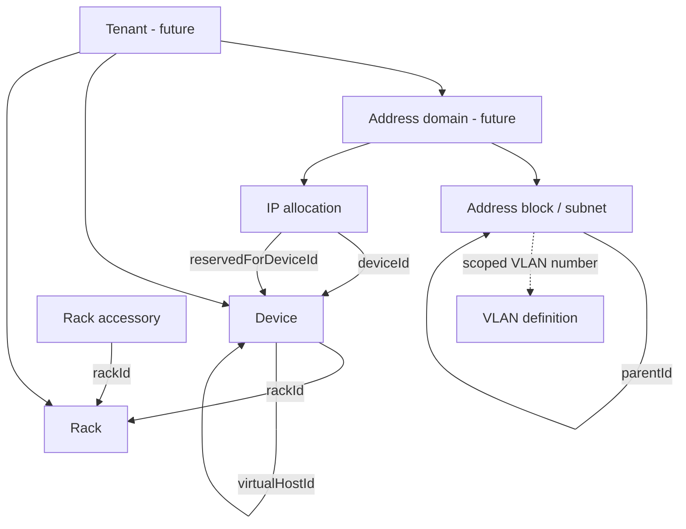

# v1.4.0 — Entity, identity and migration proposal

**Status:** Design proposal for review, not an approved database schema.  
**Baseline:** Published v1.3.0 browser-local inventory, `BACKUP-FORMAT.md` schema 1, `docs/DATA-MODEL-AUDIT.md`.  
**Scope:** Design only; no application behaviour or release artefacts changed.

## Design principles

1. **Inventory remains portable.** JSON import/export must not depend on database-generated row numbers or server-only credentials.
2. **Preserve legacy identifiers.** Existing `id`, `deviceId`, `rackId`, `parentId` and similar references remain valid through migration. Never derive identity from device name, serial number, IP or rack slot.
3. **Separate identities.** A stable internal UUID, a preserved legacy ID and an optional human-friendly Asset ID serve different purposes. Asset IDs may be editable under controlled uniqueness rules; internal UUIDs must not be.
4. **Scope uniqueness explicitly.** IPs, VLAN numbers, display names and Asset IDs may repeat in different organizations or address domains. Do not impose global uniqueness without a business reason.
5. **Keep domain invariants.** Validate relationships and changes before committing; treat related device/IPAM/rack mutations as one transaction.
6. **Never invent tenant isolation by adding a column alone.** Authorization must scope every query, mutation, import/export, audit and background operation.

## Conceptual entities

| Entity | Proposed identifiers and relationships | Notes |
| --- | --- | --- |
| Organization / tenant | `tenant_uuid` | Future capability only. Single-inventory deployments may have one internal scope without showing a tenant UI. |
| Site / location | `site_uuid`, `tenant_uuid` | Existing `deviceLocations` is a managed string catalogue; mapping to sites requires an explicit user-reviewed migration, not automatic guessing. |
| Address domain | `address_domain_uuid`, `tenant_uuid` | Future routing/VRF-like boundary where overlapping IP ranges may legitimately exist. Address-block hierarchy can be scoped here. |
| Address block / subnet | `subnet_uuid`, legacy `id`, optional `parent_subnet_uuid`, `address_domain_uuid` | Preserve `kind`, CIDR, containment and existing parent references. |
| VLAN definition | `vlan_uuid`, legacy `id`, VLAN number, address-block/domain scope | Existing subnet-to-VLAN relationship uses scoped numeric value; do not silently invent a global foreign key. |
| Device | `device_uuid`, legacy `id`, optional `asset_id`, `tenant_uuid` | `virtualHostId` links to a physical host; retain device type and historical metadata. |
| IP allocation | `allocation_uuid`, address, address-domain scope, optional `device_uuid`, optional reserved-for-device UUID | Existing JSON is keyed by IPv4 string; database may use composite unique constraint `(address_domain_uuid, address)` where business rules allow. |
| Rack | `rack_uuid`, legacy `id`, optional site/tenant | Preserve physical dimensions, rack type and U count. |
| Rack placement | Device or accessory, rack UUID, face, U range | May remain embedded on device/accessory or become separate table; constraints must preserve 0U and face semantics. |
| Rack accessory | `accessory_uuid`, legacy `id`, rack UUID | Preserve port counts, type and 0U mounting behaviour. |
| Managed catalogues | scoped option key/UUID and type | Device types, software, server functions and hardware catalogue require individual mapping review. |
| Audit event | `audit_uuid`, actor, tenant, subject, timestamp, operation | Future authenticated actor and immutable history requirements are separate from portable inventory JSON. |

## Proposed identity strategy

- **Phase A — Inventory:** Collect examples of historical IDs and references; audit collisions, nulls, malformed values, duplicates, virtual-host links and reserved IP references.
- **Phase B — Detached migration:** Parse a copy of JSON; assign UUIDs only to entities without them, and create a complete `(entity_type, legacy_id, scope) -> uuid` mapping. Resolve all references against that mapping and reject ambiguity before writing anything.
- **Phase C — Verification:** Check reference counts, round-trip export/import, migration reruns, scoped uniqueness, backup preservation and rollback under injected write failures.
- **Phase D — Adoption:** Only after tests and owner acceptance, use UUIDs for new internal relationships while retaining legacy IDs and JSON compatibility. Record migration version independently of application version.

**Idempotency caveat:** Random UUID generation on every import would not be idempotent. Persist the identity map and/or embedded UUIDs in the migrated state, and define explicit duplicate-import behaviour. Do not assume a repeat import should merge records: v1.3.0 restore replaces the inventory.

## Relationship sketch

*This is a conceptual design, not a representation of currently implemented tenant or address-domain features.*

## Acceptance tests required before implementing

1. Historical schema-0 and schema-1 backups restore without lost records or changed legacy IDs.
2. Imported devices keep their primary IP, reservation, physical-host and rack references.
3. Duplicate/ambiguous legacy IDs are rejected with actionable errors; active data remains unchanged.
4. Two tenant/address-domain fixtures may contain the same IPv4 address and VLAN number without cross-tenant reads or deletes.
5. The same Asset ID may be allowed in separate tenant scopes but not duplicated within its configured scope; editing Asset ID never changes UUID.
6. Deleting a device, subnet, VLAN or rack follows existing safeguards and rolls back as a unit on storage failure.
7. Repeating a migration on already-migrated data creates no new identities and changes no relationships.
8. Importing a backup from an unknown future schema is rejected before mutation.
9. Export does not include user credentials, session secrets or private tenant data outside the selected authorized scope.

## Decisions to review before coding

- Whether UUIDs are stored alongside legacy IDs in future JSON interchange, and whether that requires schema 2.
- The precise uniqueness scope for Asset IDs, IPs and VLANs (tenant, site, address domain, or block).
- Whether address domains are introduced with the first server deployment or deferred until MSP capability.
- Whether a separate rack placement table improves integrity without complicating 0U handling.
- How to migrate optional browser audit history and user preferences.

**Recommendation:** Keep this proposal technology-neutral. Compare SQLite and PostgreSQL only after the identity, scope and transaction contract has been reviewed.
