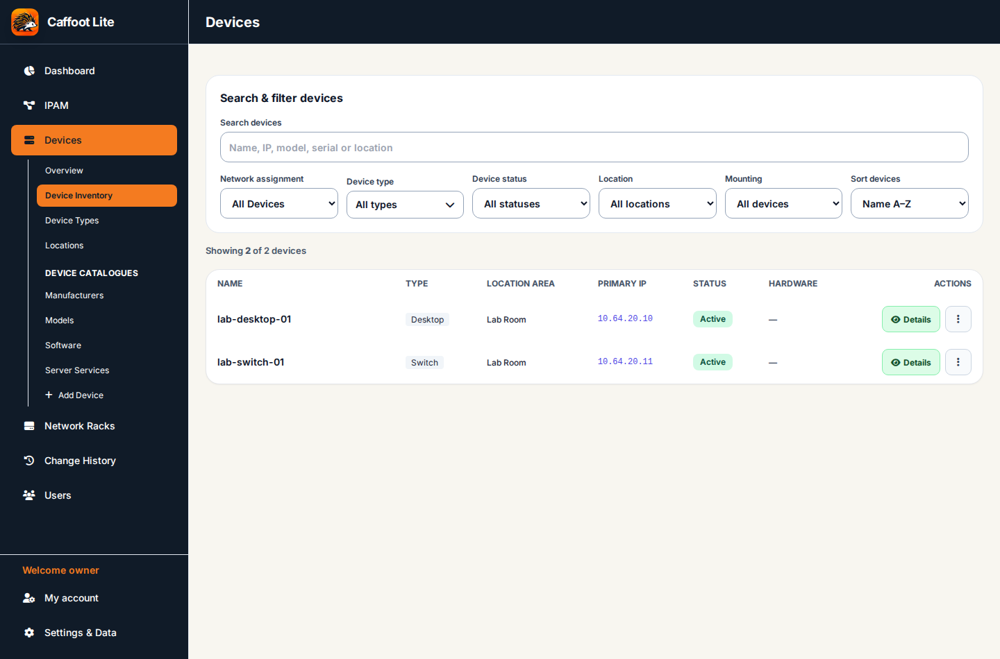
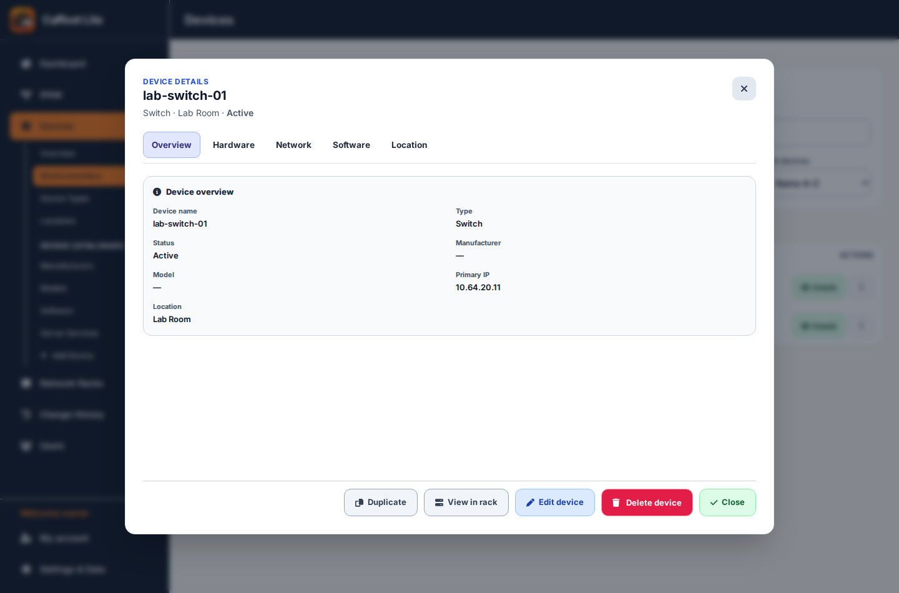

# Devices — Creating, Editing and Managing Equipment

[← All feature guides](README.md)

## What a device record represents

A device can describe a physical server, switch, workstation, printer or another supported type, with its network address, status, location, optional rack position and type-specific hardware/software information. Supported virtual machines have their own host-related details. Caffoot keeps the established v1.3.3 fields and validations; **not every device type presents the same additional fields**.

The **Device Inventory** view shows saved equipment and its primary addresses. All names and addresses in this screenshot are fictional.

## Prepare before you add a device

- Use [IPAM](IPAM.md) to add its addressable subnet (VLAN optional) first.
- Make sure the required device type and location are available in the managed selections.
- Create the rack beforehand if the device is to be mounted in one.
- For a new physical device, an ordinary editor needs **Devices Edit and IPAM Edit**. A rack-mounted new device additionally needs **Racks Edit**. An administrator has the approved administrative access.

## Worked example — add a switch

Imagine recording *lab-switch-01*, a fictional switch on subnet 192.168.50.0/24. The example address 192.168.50.10 must actually be spare if you use it.

1. Open **Devices** and select **Add Device**. The dialog heading is **Add New Device**.
2. Enter a unique **Device Name**, such as *lab-switch-01*. Select **Physical device** under **Device deployment**, then a supported **Physical device type**.
3. Under **Hardware & lifecycle**, choose a suitable **Device Status** (such as Active). Supply manufacturer, model and serial number if known. **Manage Hardware Catalogue** maintains reusable manufacturer/model suggestions.
4. Complete any relevant **Additional details for this device type**, such as hardware properties, installed software or supported service flags. These vary by device type.
5. Under **Mounting & location**, choose **Device Mounting** and **Location Area**. For rack-mounted equipment, select the rack, **Face**, **Start U** and **U Height**. Use a free position for the entire height.
6. Under **Networking → Network Identity**, optionally filter by **IP Address Block**, choose **Subnet Name — CIDR** then use **Choose an Available IP Address** or enter a **Primary IP Address** in the field below it. Both choices update the same address. The read-only VLAN is taken from the subnet or displays **Not assigned**; change a VLAN on the subnet in IPAM, not on the device. If the network is missing, create it in IPAM and return to the form.
7. Optionally fill **Notes / Details**, then select **Save Device**.
8. Reopen the saved record and check the name, hardware, network details and location. In IPAM and Racks, verify the related records where applicable.

The application refuses invalid addresses, incompatible rack positions and other relationship errors; follow the message rather than attempting to force the save.

## View an existing device

The **Details** action opens the familiar read-only device view, with separate tabs for additional information.

Select a device from the inventory. Its read-only details allow you to inspect sections such as Overview, Hardware, Network, Software, Location and History where relevant. Opening and viewing a device **does not reserve it for editing**.

## Edit, save and cancel

1. Open the device details and choose **Edit device**, if you have permission.
2. Caffoot first requests a temporary exclusive edit reservation on that device. The editing form opens only if the reservation is granted.
3. Change only the permitted fields and select **Save Device**. The server checks permissions, current revision, references and validations before storing the change.
4. Select **Cancel** to leave without saving and release your reservation.

If another user already has the reservation, the read-only screen remains available and may show **Currently being edited by [username]**. Another user can edit a *different* device at the same time. Reservations expire if abandoned (normally after five minutes). Navigating or reopening details fetches current saved data.

**Cross-section permissions:** Devices Edit permits ordinary device fields but **not** a primary-IP change if you have only IPAM Read, and **not** a rack movement if you have only Racks Read. The existing editor keeps these restricted values read-only; the backend independently checks any attempted change.

## Duplicate a device

Use the established **Duplicate Device** action on an existing record to start a *new* record using its details as a starting point. Supply a unique hostname and primary IP. The copied serial number/IP are cleared and the mount position needs review. The source device is not overwritten.

## Remove or retire a device

Use **Device Status** to record a supported lifecycle state such as Active, Maintenance or Retired. For permanent deletion, follow the existing delete action and confirmation. Caffoot checks related IP/rack data and refuses invalid destructive operations. Do not remove a record merely to free its IP: first understand the actual dependencies.

## Virtual machines

When an eligible physical hypervisor host exists and is configured accordingly, **Device deployment** offers **Virtual Machine (VM)**. Select a suitable virtual purpose and the physical host, then record resource information such as vCPU, RAM, disk and network adapters where requested. Existing historical VM relationships are preserved.

## v2.1 Device Form Preview

The development branch's Add/Edit/Duplicate layout is ready for private owner review; this does not announce a release.

For an eligible physical server, **General** shows **This physical server hosts virtual machines** immediately beneath its type. Tick it to use the dedicated **Hypervisor Software/OS** and **Version** controls. The ordinary OS card is hidden while hosting is enabled; unticking restores its values. Known host products are offered through this dedicated path. Previously recorded OS/software assignments are retained with an explanation rather than silently removed. Existing guest-change confirmations still apply.

For a VM, choose its purpose, physical host and virtual allocations on **General**. Physical mounting and Hardware controls are hidden. Type-specific choices and saved host relationships remain protected.

**Notes** fills the available form space automatically and keeps all existing formatting/Preview actions. Short windows scroll within the editor while the footer stays accessible. Validation messages appear above the footer and reveal the relevant tab or field. Duplicate uses its subtitle to explain the new record; it still requires a unique name/IP and preserves the original.

## v2.1 Shelf And Software Preview

These changes are on the development branch for private acceptance, not a published release.

For physical **Tabletop / Shelf Mounted** equipment, open **General → Mounting & Rack Configuration**. Leaving **Rack (Optional)** empty records no rack association. Selecting a rack requires an actual **Rack Shelf** in that rack. **+ Add Rack Shelf** opens the existing Horizontal Accessory editor and returns to your Device draft. A successfully saved shelf remains in inventory even if you cancel the Device draft. The device uses the shelf's current location without occupying another U. Details shows the rack, current shelf U and face. Duplicate retains the association while requiring a new identity/address.

Removing a shelf that holds devices requires an explicit choice for each device: another shelf, a newly created replacement, or **Retired**. Retirement keeps the record and clears its active rack/shelf association; history retains the former location. All reviewed changes save together or none do. Another editor's active five-minute reservation prevents the operation. Devices and Racks edit access are required.

OS/version lists are offline suggestions, with **Custom / Other** for saved or unlisted values. Ubuntu Server offers LTS releases; desktop Ubuntu also offers interim releases. pfSense and OPNsense editions have separate release lists. Installed Software suggestions depend on this device's type and OS, including a VM's own guest OS. Check actual package availability for its edition, release and model; a suggestion does not mean it is installed or supported everywhere.

Old, archived, hidden or out-of-context assignments remain checked under **Previously recorded — review**. They remain saved until you deliberately untick them. Changing the OS refreshes suggestions without clearing those selections. Custom catalogue entries, saved versions and historical hardware details remain available. Cancel keeps the original device unchanged.

## v2.1 Device Choice And Location Corrections

Changing device type or virtual purpose refreshes the related OS, version, software and hardware choices straight away. Incompatible new standard OS/version choices are cleared; saved historical values and Custom entries remain available. Previously recorded values are marked for review and remain until you deliberately replace or remove them. Changing an OS edition or hosting product starts its version choice afresh. Cancel leaves the saved device unchanged.

When adding a physical device, selecting a rack defaults **Location Area** to that rack's matching recorded area. A room already recorded on the rack is offered even if it is not yet in the Device location list; this does not create a managed location or save the draft automatically. You can override it freely; later rack changes will then leave your choice alone. Existing devices retain their saved location, and Duplicate initially keeps its copied location. If a rack has no matching area, choose the location normally.

The read-only Details header uses one labelled × control, while the footer keeps its separate **Close** action. Keyboard/Escape and focus return remain available. These development-branch corrections still require the owner's private Pi/Safari acceptance; they are not a published release.

## Troubleshooting

| Problem | Check |
| --- | --- |
| Cannot add device | Required name/type/location, valid IP from an existing subnet, Devices Edit and IPAM Edit |
| Cannot mount | Existing rack, Racks Edit, valid mounting type, free face/U span and appropriate height |
| Can't edit IP or rack fields | You may have Devices Edit but only Read in the related IPAM/Racks section |
| Edit refused | Another user's active device reservation, missing edit permission or MFA |
| Save refused | Required/duplicate field validation or a protected dependency |
| Colleague sees old details | Reopen the device or navigate to the section; no continuous background polling |

Related: [IPAM](IPAM.md), [Racks](Racks.md), [Users/Permissions/MFA](Users-Permissions-and-MFA.md).