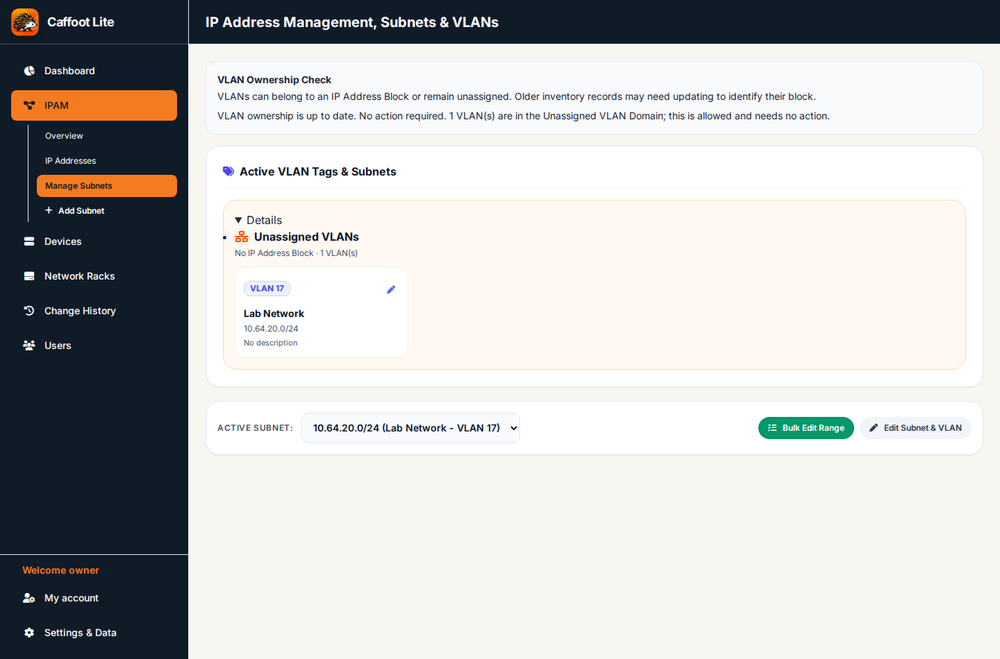
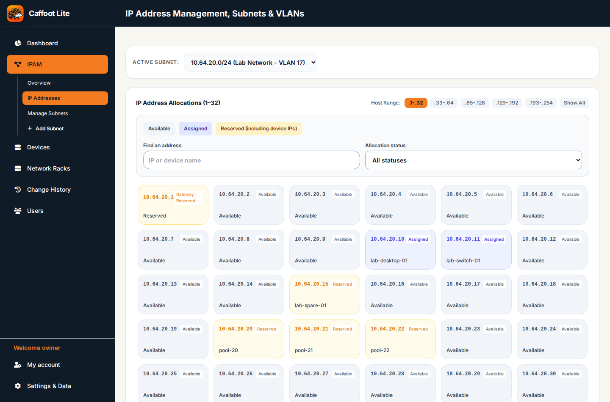

# IPAM — Subnets, VLANs and Individual Addresses

[← All feature guides](README.md)

## Understand the records

An **IP Address Block** groups address space; a **Network / VLAN** is an assignable network with a CIDR, name, VLAN and gateway. The individual IP address grid records **Available**, **Assigned** and **Reserved** states along with an optional hostname and **IPAM Notes**. IPAM notes are about the *address*, not about one particular device.

You need **IPAM Edit** to create/update networks or change independent address allocations. A Devices editor with only IPAM Read cannot alter a primary IP through the device form.

The following genuine views show the fictional **Lab Network** in Manage Subnets and the individual IP allocation grid.

## Worked example — add a Network / VLAN

Use the following fictional test plan only if it does not conflict with your network: CIDR **192.168.50.0/24**, name **Lab Network**, VLAN **50**, gateway **192.168.50.1**.

1. Open **IPAM** from the sidebar and choose **Add Subnet**.
2. In **Subnet Type**, select **Network / VLAN** (the assignable network type).
3. Enter **Subnet CIDR**, **Network / VLAN Name** and a valid **VLAN ID** from 1–4094.
4. Enter **Gateway IP**, which must be valid for that network. If you have a parent IP Address Block, select it when appropriate.
5. Optionally add a **Description** of the subnet (not an individual device).
6. Select **Save Subnet & VLAN**, and correct any CIDR, overlap, gateway or VLAN validation message.
7. Open the network card and review its network details and individual IP address grid.

To group address space instead, select **IP Address Block** in the same creation form. A parent block alone does not allocate IPs to devices; create a suitable Network / VLAN beneath it. **Reserved range** and **Loopback /32** options shown as disabled are not available workflows.

## Edit an individual IP

1. Navigate to the recorded subnet and select an address card, e.g. **192.168.50.10**.
2. The existing dialog is titled **Configure IP: [address]**. Review **Status** (Available, Assigned or Reserved), **Hostname** and **IPAM Notes**.
3. Enter a note such as *Spare address for a lab device*. Choose the status that reflects its actual use and select **Save IP**.
4. Reopen the address to verify the saved value. A colleague opening the address after your save will fetch the current shared value.

Do not change an active device's assigned address to Available merely to bypass another allocation restriction. Device-owned addresses have additional relationship rules.

## Reserve and release a spare address

On an independent, unassigned address, select **Reserved**, write why it is reserved and **Save IP**. To free it later, reopen the same address and change its status back to **Available** when permitted, then save. Check the grid again. When dealing with historical orphaned reservations, use the existing specific review/release control instead of silently deleting its reference.

## Give an address to a device

The usual primary-IP workflow is **Devices → Add Device / Edit Device**. Select an address from an existing Network / VLAN, subject to the allocation and permission checks. Creating a device requires both Devices Edit and IPAM Edit; changing a device's primary IP requires IPAM Edit even when started from Devices.

An IPAM-only editor may maintain independent IPAM records and the authorised IP-owned fields. They do not acquire rights to change unrelated device properties.

## Edit, delete or bulk-manage networks

Open a subnet and use **Edit Subnet** for its supported changes. The existing **Delete Subnet & VLAN** operation checks devices and related allocations before removing anything, and presents its confirmation. Never assume a populated network can be deleted safely.

The IPAM interface also provides existing bulk allocation actions. Check the selected subnet, range and desired statuses before confirming. Avoid using bulk changes on production addresses merely to test the controls.

## Common questions

**Why can't I select an IP for a device?** Check that its Network/VLAN exists, that the address belongs to it, and that the address isn't reserved or assigned incompatibly.

**Why won't a subnet save?** Check valid CIDR/network address, gateway, VLAN range and overlap/duplicate rules.

**Why can't I edit from Devices?** Read rights in IPAM do not permit changing IP-related device fields.

Related: [Devices](Devices.md), [Users and Permissions](Users-Permissions-and-MFA.md).