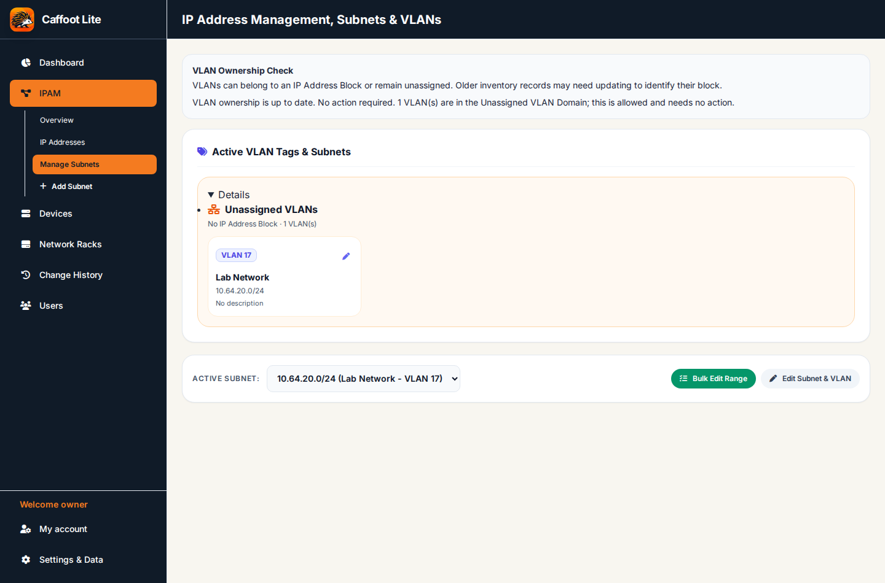
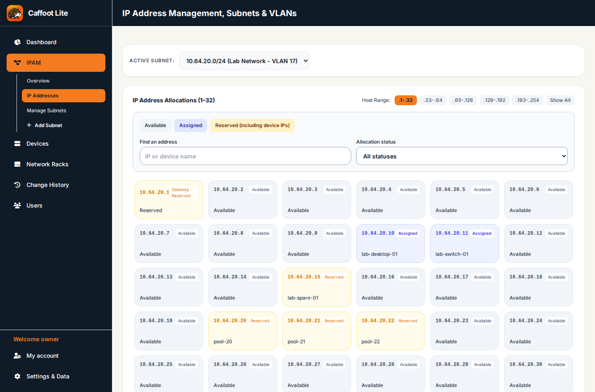

# IPAM — Subnets, VLANs and Individual Addresses

[← All feature guides](README.md)

The subnet-first instructions below describe the **private v2.1 development branch** and its approved #329 workflow. They do not announce a public release.

## Understand the records

An **IP Address Block** optionally groups address space. An addressable **subnet** has a CIDR and name; new subnets also require an explicitly selected purpose: **LAN**, **Management** or **VPN**. A VLAN is optional. LAN and Management need a usable gateway; VPN may omit one. Existing subnets without a purpose display **Not assigned** and remain editable without reclassification. The individual IP address grid records **Available**, **Assigned** and **Reserved** states along with an optional hostname and **IPAM Notes**. IPAM notes are about the *address*, not about one particular device.

You need **IPAM Edit** to create/update networks or change independent address allocations. A Devices editor with only IPAM Read cannot alter a primary IP through the device form.

The following genuine views show the fictional **Lab Network** in Manage Subnets and the individual IP allocation grid.

## Worked example — add one subnet

Use the following fictional test plan only if it does not conflict with your network: CIDR **192.168.50.0/24**, name **Lab Network**, purpose **LAN**, optional VLAN **50**, gateway **192.168.50.1**.

1. Open **IPAM** and select **Add Single Subnet**.
2. Keep **Subnet / Network** as the type. Enter an aligned **Subnet CIDR** from /23 to /30 and a unique **Subnet Name**. Names ignore case and outer spaces; historical duplicate names remain usable until deliberately renamed.
3. Explicitly select **LAN**, **Management** or **VPN**. New records have no preselected purpose.
4. Leave **VLAN ID** empty if unassigned, or enter 1–4094. Do not enter 0 to mean unassigned.
5. Supply a usable **Gateway IP** within the subnet for LAN/Management. VPN can leave this empty; an entered VPN gateway must meet the same address checks.
6. Optionally choose an **IP Address Block** and write a **Description**. Save and review the resulting subnet.

To create an organisational parent instead, select **IP Address Block** in the same form. A block has no gateway/VLAN and does not allocate addresses to devices; create addressable child subnets as needed. Blocks remain optional. Disabled Reserved Range and Loopback options are not available workflows.

## Add multiple subnets

1. Select **Add Multiple Subnets**. Enter **Starting Subnet Address**, **Subnet Prefix** (/23–/30), **Number of Subnets** (1–50) and **Gateway Convention** (First/Last usable IP).
2. Leave **Consecutive** for adjacent ranges, choose **Every 10th Subnet** for ten subnet-sized steps (for /24: .10, .20, .30), or **Custom CIDRs** to edit each range in the preview.
3. If needed, expand **Address Block & Private Range Planning (Optional)**. Keep no block, choose an existing block or enter a new block name and aligned CIDR. A broader /16 block is different from an addressable subnet prefix. Optional RFC1918 quick-fill fills planning inputs only and creates nothing.
4. Select **Preview Subnets**. Give every row a unique name and explicitly selected purpose. VLAN and Description are optional; edit gateways individually where needed. VPN gateways may be cleared. Custom CIDRs must be aligned /23–/30 ranges without overlaps.
5. Correct the visible field/row errors. Back lets you revise generation settings; manual gateways remain and are rechecked. Custom CIDRs survive Back with the same start/prefix/mode; changing those generation settings explicitly recalculates ranges.
6. Review the entire set and select **Save**. The optional new parent and all subnets save together, or none save. A failed row is never skipped silently.

The preview scrolls independently with Back/Cancel/Save visible, and rows stack on mobile. Fifty is the limit for **one operation**, not your installation: further batches into the same block are permitted when ranges and other rules are valid. Audit Trail reports the actual count while retaining the existing bounded detailed history.

Names/descriptions can explain a real VPN range, for example *London ↔ Bristol VPN*. A tunnel which only routes existing LANs does not need a fictional extra subnet. Tunnel relationships, public-IP/WAN and customer-isolated overlapping ranges are outside this workflow.

## Edit an individual IP

1. Navigate to the recorded subnet and select an address card, e.g. **192.168.50.10**.
2. The existing dialog is titled **Configure IP: [address]**. Review **Status** (Available, Assigned or Reserved), **Hostname** and **IPAM Notes**.
3. Enter a note such as *Spare address for a lab device*. Choose the status that reflects its actual use and select **Save IP**.
4. Reopen the address to verify the saved value. A colleague opening the address after your save will fetch the current shared value.

Do not change an active device's assigned address to Available merely to bypass another allocation restriction. Device-owned addresses have additional relationship rules.

## Reserve and release a spare address

On an independent, unassigned address, select **Reserved**, write why it is reserved and **Save IP**. To free it later, reopen the same address and change its status back to **Available** when permitted, then save. Check the grid again. When dealing with historical orphaned reservations, use the existing specific review/release control instead of silently deleting its reference.

## Give an address to a device

The usual primary-IP workflow is **Devices → Add Device / Edit Device**. Optionally filter by Address Block, then choose **Subnet Name — CIDR**. The read-only **VLAN** follows that subnet, or displays **Not assigned**. It cannot be overridden here. Use **Choose an Available IP Address** first, or **Or Enter a Primary IP Address** below it. Both controls set the same saved address, subject to the existing allocation and permission checks. Creating a device requires both Devices Edit and IPAM Edit; changing a device's primary IP requires IPAM Edit even when started from Devices.

An IPAM-only editor may maintain independent IPAM records and the authorised IP-owned fields. They do not acquire rights to change unrelated device properties.

## Edit, delete or bulk-manage networks

Open a subnet and use **Edit Subnet** for its supported changes. The **Delete Subnet** operation checks devices and related allocations before removing anything, and presents its confirmation. Never assume a populated network can be deleted safely.

The separate existing **Bulk Edit Range** allocation action is unchanged; it edits addresses inside one subnet and does not create subnets. Check the selected subnet, range and desired statuses before confirming. Avoid using bulk changes on production addresses merely to test the controls.

## Common questions

**Why can't I select an IP for a device?** Check that an addressable subnet exists, that the address belongs to it, and that the address isn't reserved or assigned incompatibly.

**Why won't a subnet save?** Check valid CIDR/network address, required name/purpose, gateway requiredness and usable address, optional VLAN range and overlap/duplicate rules. A selected block must contain the generated subnets.

**Why can't I edit from Devices?** Read rights in IPAM do not permit changing IP-related device fields.

Related: [Devices](Devices.md), [Users and Permissions](Users-Permissions-and-MFA.md).