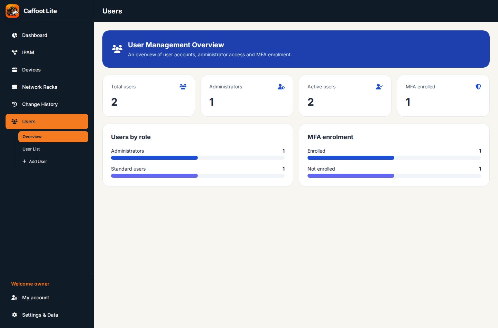

# Users, Permissions and Multi-factor Authentication

**Development branch notice:** The following controls describe published v2.1. On `milestone-1`, Staff Member is the default for all accounts and grants no inventory access. Any wider Read or Edit access, any enabled additional role, or Administrator status requires MFA; existing voluntary enrolment remains required. Existing grants are preserved. Batch 02 adds server-side password-verified mandatory enrolment and eligible voluntary MFA removal. These operations require a fresh sign-in after completion. Batch 03 adds server-side role management with a reviewed preview and confirmation for each change; the old direct-permission request is retired. Membership changes end that account’s sessions; other role/override changes end sessions where effective access or MFA requirements change. Renaming a role alone preserves sessions. Optional notices go only to active verified email recipients and eligible administrators, and cannot guarantee delivery. Batch 04 now connects these flows to the existing Users, sign-in and My Account screens for owner review. This intermediate build must not be deployed. See [Shared Roles And Account Permissions](../../development-guide/Role-Permissions.md).

[← All feature guides](README.md)

*Some screenshots show an earlier Docker edition for orientation. The instructions describe the published v2.1 interface; older images should not be mistaken for new v2.1 captures.*

## On The Milestone Development Branch

**My Account** displays all your assigned roles, including **Staff Member**.
Disabled assigned roles are labelled **Disabled** and do not grant access.
Administrator status appears separately from role memberships. This display
does not change your permissions or MFA requirements.

These additions are for review, not a published release. Existing Overview, User List and Add User tabs remain, with Manage Roles fourth. Administrators can create/manage custom roles, then assign multiple roles in Manage User. Staff Member is automatic and protected; Administrator remains a separate account control.

Each section card shows inherited and effective access. Choose **Inherit** to use role grants, **No Access** to block them deliberately, or **Read/Edit** for an individual override. Each membership or permission change opens **Review Access Change**. Read the before/after access, MFA and session effects, then choose **Confirm Change**. Cancel saves nothing. If the preview becomes outdated, review the refreshed consequences and confirm again. Role creation, edits, disabling and deletion follow the same review process. Personal details, account activation, Administrator controls and deletion remain in Manage User.

An account assigned wider access or an enabled additional role must enrol MFA before normal sign-in. The existing sign-in form shows a QR code/manual key and requests the authenticator's six-digit code. Completion clears the setup details and requires a fresh sign-in with password and authenticator code.

Staff-only users sign in to their existing **My Account** interface at `/account`. This provides their own profile, password, appearance and MFA settings without inventory or administrator access. In **My Account → Security**, eligible enrolled users can open **Remove MFA** and confirm with their current password and code. Successful removal ends all their sessions and requires a fresh sign-in. Administrator status, enabled additional roles or effective wider Read/Edit access prevent removal. Role changes never remove MFA automatically.

Security notices need configured SMTP and eligible verified addresses. A queued notice is not proof that email was delivered.

## Account basics

Caffoot Lite has **no public registration**. The first account on a new database becomes its administrator after mandatory MFA setup. Administrators create additional users under **Users**. New users have **no inventory access until permission is granted**. This protects the inventory from accidental over-sharing.

An administrator's **Users → Overview** displays account counts, roles and MFA enrolment status, as shown using fictional accounts below.

## Create a user — worked example

Imagine you want a colleague to inspect devices and maintain IP address notes without editing equipment properties.

1. Sign in as an administrator with MFA enrolled.
2. Open **Users** in the sidebar and choose **Add User**.
3. Enter a unique **Username** and a suitable **Initial password** in the **Create User** form.
4. Select **Create User**. The account starts with no Devices/IPAM/Racks access.
5. Open **User List**, find the new account and set its section permissions, for example **Devices: Read**, **IPAM: Edit** and **Racks: Read**.
6. Ask the user to sign in and enrol MFA under **My account → Security / Password & MFA** before their editing permission can be used. Administrators cannot grant effective editing or administrative access to a user who has not completed required enrolment.
7. Have them check that Devices and Racks are read-only, while the approved independent IPAM edit operations are available.

The example demonstrates **permission boundaries**: IPAM Edit does not authorise changing arbitrary device fields. Assign roles according to actual responsibilities.

## Understand the permission levels

The three inventory sections have individual access controls:

| Section permission | Behaviour |
| --- | --- |
| No access | Section not available for that account |
| Read | May view authorised inventory and related details; cannot change that section |
| Edit | May change permitted records in that section **after MFA enrolment**, subject to related field permissions |

**Administrators** have the approved system and user-management rights. Ordinary users cannot manage other accounts or use administrator-only Settings & Data.

### Permissions apply to changed fields

The following rules matter when one form includes information from more than one section:

| Operation | Required editing authority |
| --- | --- |
| Change ordinary device name, details or software | **Devices Edit** |
| Create a new device with its required primary IP | **Devices Edit + IPAM Edit** |
| Create a device already mounted in a rack | **Devices Edit + IPAM Edit + Racks Edit** |
| Change a device's primary IP/reservation fields | **IPAM Edit** (and Devices Edit for ordinary device changes) |
| Move, mount or unmount rack equipment | **Racks Edit** |
| Change independent IPAM notes or reservations | **IPAM Edit** |
| Change rack enclosure data | **Racks Edit** |

Having Devices Edit does **not** bypass IPAM Read or Racks Read. The existing Device editor makes those related fields read-only when appropriate. Equally, having Racks Edit alone does not let someone alter unrelated device details. The backend checks actual changes, not just which button was pressed.

## Set up or change MFA

1. Open **My account** and choose its personal security controls.
2. Follow **Set up MFA** / **Password & MFA** when enrolment is required. Use a trusted authenticator app to scan the QR code or enter the secret.
3. Enter the current six-digit code as requested to confirm enrolment.
4. At sign-in, provide your username and password first; enter an authenticator code when prompted.

Administrators and editors must complete MFA. Read-only ordinary accounts do not need it to view their allowed inventory. Keep authenticator secrets private. An administrator cannot override the enrolment rule simply by changing a role selector.

## Change an account's status or permissions

Administrators can review an account in **User List**, adjust allowed section grants or change its active/administrator status using the existing controls. Restrictions protect the current administrator from deleting, disabling or demoting themselves, and prevent removal of the last active administrator. Relevant account-security changes invalidate affected sessions as implemented.

## Two people editing at once

- Both users may view the same device.
- Only one user may hold that device's temporary edit reservation at any time.
- When another user holds it, the read-only detail view may show **Currently being edited by [username]** and disable Edit.
- Different devices may be edited simultaneously.
- Save or Cancel releases the reservation. Abandoned reservations expire after about five minutes.
- Another user reopening a record or navigating to its section sees the latest saved data; there is no permanent real-time polling.

## Troubleshooting

**User sees no inventory:** Grant section permissions in Users. New accounts have none.

**Edit access cannot be enabled or used:** Confirm the user's MFA enrolment.

**A device can be viewed but not edited:** Check the Devices permission and whether another editor currently reserves the device.

**Device can be edited, but IP/rack fields are locked:** Grant the appropriate IPAM/Racks editing right *only if* the user's responsibilities justify it.

See [Devices](Devices.md), [IPAM](IPAM.md), [Racks](Racks.md) and [Getting Started](Getting-Started.md).

## Verified Email And Password Recovery

In My Account → Personal Details, save an optional email address and review its Verified/Not Verified status. Verify Email requires your current password, followed by the eight-digit emailed code; preserve leading zeroes. Codes expire after 15 minutes and are single-use. Editing the saved address removes verification.

Forgot Password? uses **username only**, not email lookup. The neutral response does not confirm account eligibility or delivery. Recovery needs an active account, verified saved address and configured administrator SMTP delivery. Enter the recovery code, new password and authenticator when required. Recovery never bypasses MFA and a successful reset revokes existing sessions. Five failed confirmations exhaust a challenge and the durable account/purpose budget persists across resends/restarts. Delivery failures still need private provider/account investigation. See [Account Recovery](../../development-guide/Account-Recovery.md).
