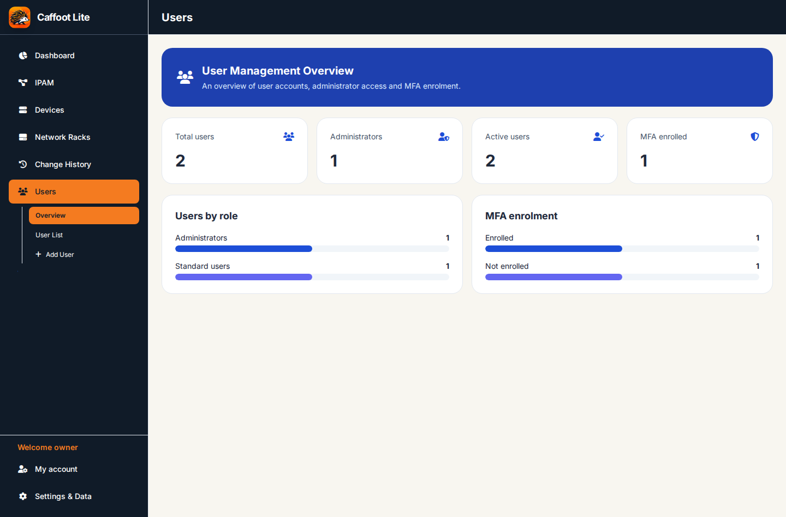

# Users, Permissions and Multi-factor Authentication

[← All feature guides](README.md)

## Account basics

Caffoot Lite has **no public registration**. The first account on a new database becomes its administrator after mandatory MFA setup. Administrators create additional users under **Users**. New users have **no inventory access until permission is granted**. This protects the inventory from accidental over-sharing.

An administrator's **Users → Overview** displays account counts, roles and MFA enrolment status, as shown using fictional accounts below.

## Create a user — worked example

Imagine you want a colleague to inspect devices and maintain IP address notes without editing equipment properties.

1. Sign in as an administrator with MFA enrolled.
2. Open **Users** in the sidebar and choose **Add User**.
3. Enter a unique **Username** and a suitable **Initial password** in the **Create User** form.
4. Select **Create User**. The account starts with no Devices/IPAM/Racks access.
5. Open **User List**, find the new account and set its section permissions, for example **Devices: Read**, **IPAM: Edit** and **Racks: Read**.
6. Ask the user to sign in and enrol MFA under **My account → Security / Password & MFA** before their editing permission can be used. Administrators cannot grant effective editing or administrative access to a user who has not completed required enrolment.
7. Have them check that Devices and Racks are read-only, while the approved independent IPAM edit operations are available.

The example demonstrates **permission boundaries**: IPAM Edit does not authorise changing arbitrary device fields. Assign roles according to actual responsibilities.

## Understand the permission levels

The three inventory sections have individual access controls:

| Section permission | Behaviour |
| --- | --- |
| No access | Section not available for that account |
| Read | May view authorised inventory and related details; cannot change that section |
| Edit | May change permitted records in that section **after MFA enrolment**, subject to related field permissions |

**Administrators** have the approved system and user-management rights. Ordinary users cannot manage other accounts or use administrator-only Settings & Data.

### Permissions apply to changed fields

The following rules matter when one form includes information from more than one section:

| Operation | Required editing authority |
| --- | --- |
| Change ordinary device name, details or software | **Devices Edit** |
| Create a new device with its required primary IP | **Devices Edit + IPAM Edit** |
| Create a device already mounted in a rack | **Devices Edit + IPAM Edit + Racks Edit** |
| Change a device's primary IP/reservation fields | **IPAM Edit** (and Devices Edit for ordinary device changes) |
| Move, mount or unmount rack equipment | **Racks Edit** |
| Change independent IPAM notes or reservations | **IPAM Edit** |
| Change rack enclosure data | **Racks Edit** |

Having Devices Edit does **not** bypass IPAM Read or Racks Read. The existing Device editor makes those related fields read-only when appropriate. Equally, having Racks Edit alone does not let someone alter unrelated device details. The backend checks actual changes, not just which button was pressed.

## Set up or change MFA

1. Open **My account** and choose its personal security controls.
2. Follow **Set up MFA** / **Password & MFA** when enrolment is required. Use a trusted authenticator app to scan the QR code or enter the secret.
3. Enter the current six-digit code as requested to confirm enrolment.
4. At sign-in, provide your username and password first; enter an authenticator code when prompted.

Administrators and editors must complete MFA. Read-only ordinary accounts do not need it to view their allowed inventory. Keep authenticator secrets private. An administrator cannot override the enrolment rule simply by changing a role selector.

## Change an account's status or permissions

Administrators can review an account in **User List**, adjust allowed section grants or change its active/administrator status using the existing controls. Restrictions protect the current administrator from deleting, disabling or demoting themselves, and prevent removal of the last active administrator. Relevant account-security changes invalidate affected sessions as implemented.

## Two people editing at once

- Both users may view the same device.
- Only one user may hold that device's temporary edit reservation at any time.
- When another user holds it, the read-only detail view may show **Currently being edited by [username]** and disable Edit.
- Different devices may be edited simultaneously.
- Save or Cancel releases the reservation. Abandoned reservations expire after about five minutes.
- Another user reopening a record or navigating to its section sees the latest saved data; there is no permanent real-time polling.

## Troubleshooting

**User sees no inventory:** Grant section permissions in Users. New accounts have none.

**Edit access cannot be enabled or used:** Confirm the user's MFA enrolment.

**A device can be viewed but not edited:** Check the Devices permission and whether another editor currently reserves the device.

**Device can be edited, but IP/rack fields are locked:** Grant the appropriate IPAM/Racks editing right *only if* the user's responsibilities justify it.

See [Devices](Devices.md), [IPAM](IPAM.md), [Racks](Racks.md) and [Getting Started](Getting-Started.md).