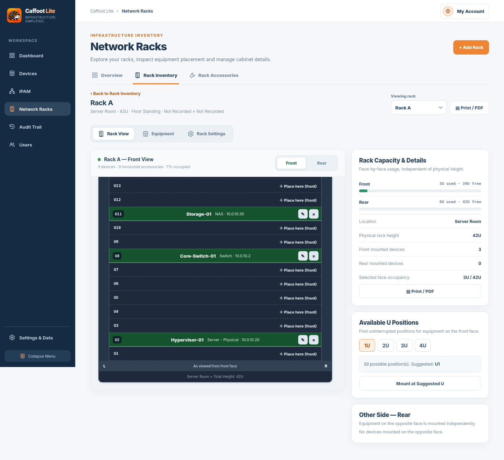

# Racks — Enclosures and Equipment Placement

[← All feature guides](README.md)

*The screenshots show the published v2.1 light-theme interface with fictional demonstration data.*

## What is recorded

Caffoot Lite documents the rack enclosure's name, physical type and dimensions, location, **front/rear faces**, U positions and mounted devices. Existing accessories and supported vertical side-rail items are managed with their separate rack-placement controls. Rack records are linked to Devices; a physical device occupies a defined face and U span.

Users require **Racks Edit** to change rack data or equipment placement. Racks Read permits inspection but not movement.

The published v2.1 rack view below shows **Rack A** with three fictional devices mounted on the front face. Its scrollable rack display is positioned to show the occupied units.

## Worked example — create a rack

Imagine a fictional **Lab Rack** in **Lab Equipment Room**. Measure your own enclosure before entering dimensions.

1. Open **Network Racks**, then select **Add Rack**. The form heading is **Add Network Rack Enclosure**.
2. Enter **Rack Name**, choose a **Rack Type**, and set **Height (U)**, **Width (mm)** and **Depth (mm)**.
3. Choose a standard height or **Custom…** if needed. Height must be a positive whole number between **1 and 100U**, and dimensions must be valid positive millimetre values.
4. Optionally enter **Location Room**, such as *Lab Equipment Room*.
5. Choose **Save Rack** and open the new rack to verify its details and empty U positions.

## Mount a device in a rack

1. Ensure the device already exists in **Devices** with a supported **Rack Mounted** mounting type. It must be eligible for placement.
2. Open the rack and choose an unoccupied U position on the intended face.
3. In **Place Device / Horizontal Accessory at U…**, set **Placement Type** to **Device**.
4. Use **Device** to choose the existing record.
5. Confirm **Rack Face** (**Front** or **Rear**), **Start U** and **Height (U)**, checking that enough contiguous U space is available.
6. Choose **Place Equipment**. Reopen the rack and device details to verify the recorded placement.

Alternatively, where you have the required permissions, set rack, face, start U and height from the Device editor. The same rack-position permission requirements apply regardless of where you start.

## Move or unmount equipment

Use the rack's established placement/editing controls to choose an available new face or U span, then save. If another user holds that device's editing reservation, wait for the save/cancel or expiry rather than attempting a conflicting edit.

A user with **Racks Edit but Devices Read** can use the established rack-placement workflow without gaining general rights to edit the device's name, IP or unrelated properties. A user with **Devices Edit but Racks Read** cannot move a device through its Device editor.

## Add an accessory

Select an available U position and set **Placement Type** to **Horizontal Accessory**. Choose its type, name, face, start U and height, then select **Place Equipment**. Patch panels also offer a port count. Vertical 0U accessories use the separate controls on the side rails; they are not placed through the horizontal dialog.

## Edit the rack versus correcting dimensions

The normal **Edit Rack** action changes ordinary identity/location information. The physical enclosure fields are locked in ordinary edits to avoid accidental dimension changes. Use **Correct Rack Specifications** in Rack Settings if a recorded height, width or depth was wrong. Review the correction before confirming.

A rack cannot be shortened below existing device/accessory positions. Do not use specification correction merely as an alternative to moving equipment.

## Delete safely

The existing delete action only allows an appropriately empty rack to be removed after confirmation. Move or remove mounted devices and accessories first; the app refuses to delete a rack with remaining occupants.

## Troubleshooting

| Problem | What to check |
| --- | --- |
| Device not offered | It exists, is eligible for Rack Mounted, and is not assigned incompatibly elsewhere |
| U position unavailable | Rack height, front/rear face, device U height and other occupants |
| Movement refused | Racks Edit permission, current device reservation, rack occupancy |
| Rack cannot be deleted | Remove/relocate devices and accessories first |

Related: [Devices](Devices.md), [Users and Permissions](Users-Permissions-and-MFA.md).

## Shelves And Existing Placement

Supported tabletop/shelf equipment can retain an optional shelf association through its Device form. The read-only location includes the recorded shelf/rack. Shelf removal uses the existing explicit review: linked equipment must be reassigned or deliberately retired together, atomically, with required permissions. Do not delete shelves to bypass that review. You can also drag supported equipment to a new position; review the preview and any collision warning before saving. **Print / PDF** opens a printable view of the rack.
