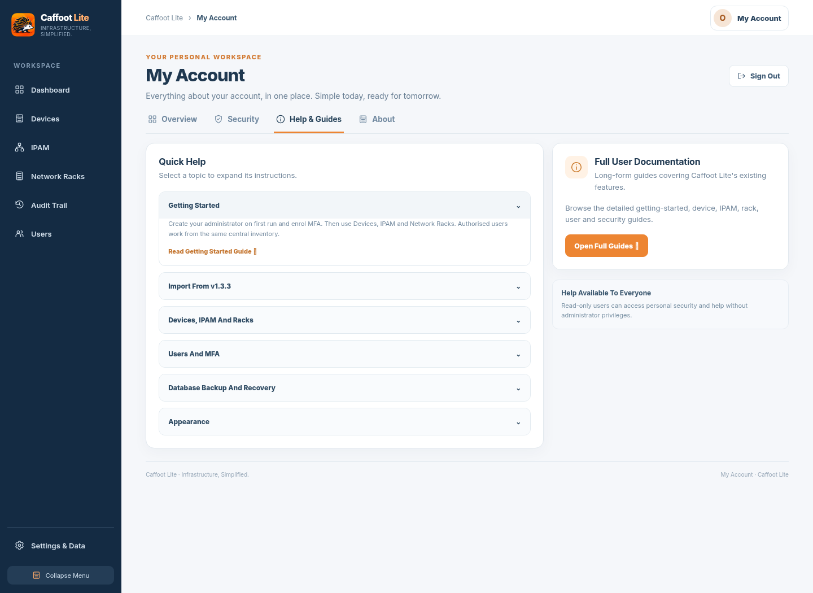

# Settings, Audit Trail and Personal Preferences

[← All feature guides](README.md)

*The screenshots show the published v2.1 light-theme interface with fictional demonstration data.*

## Two different settings areas

**Settings & Data** is an administrator-only system area. **My Account** is available to every signed-in user for personal settings, security and Help & Guides. Keeping them separate means a read-only colleague can update their own password or appearance preference without receiving inventory administration rights.

All signed-in users can find short, locally readable topics under **My Account → Help & Guides**, with links to these longer guides. The published v2.1 screenshot below shows the **Getting Started** topic expanded.

## My Account — step by step

1. Choose **My Account** in the top bar.
2. Select the **Security** section to manage your password and authenticator enrolment. Follow the on-screen prompts in Caffoot Lite.
3. Under **Overview → Personal Preferences → Appearance**, choose **Light**, **Dark** or **System**. Your selection is stored in *this browser*. It does not change another person's appearance.
4. Choose **Help & Guides**. Expand any existing topic to read brief instructions without depending on an external website. Select its guide link to open the longer instructions in a *new tab*, when GitHub is reachable.
5. Choose the **About** tab for the product name, version status, documentation links and licence information.

## Settings & Data (administrator)

Open **Settings & Data** in the sidebar with an administrator account. The existing system controls include:

- **Import Inventory / Import from published v1.3.3:** choose a supported JSON export and review the proposed inventory replacement before confirming it. This is *one-way migration*; not a routine backup/restore service.
- **Database backups:** guidance for external Docker/volume/database backup tooling. The running Docker edition has no ongoing in-browser JSON backup export.
- **Inventory Safety Check:** choose **Check Inventory Safety** to reload the central inventory and run the existing on-demand consistency checks without changing saved records.
- **Danger Zone — Clear System / Clean Start:** a deliberate destructive inventory operation with confirmation. Do not use it as a repair shortcut or without understanding what will be cleared.

Managed device types, manufacturers/models and locations are available through the relevant existing device catalogue controls. They remain governed by their actual permissions; these are not new system-wide settings for every viewer.

## Review Audit Trail

1. Choose **Audit Trail** in the sidebar if your access allows it.
2. Inspect recent entries for successful device changes, IPAM saves or rack movements.
3. Use the existing filtering/review controls shown in that section when available; do not assume history itself is an editor or a data restore facility.
4. To investigate an unexpected entry, reopen the underlying device, address or rack to check the authoritative saved values.

### Example — a change made by a colleague

Suppose *lab-switch-01* receives an updated device note. The editor saves the device. Another authorised user can reopen that device and see its updated note, and review the corresponding entry in **Audit Trail**. The page does not continually poll while a record is already open, but navigating or reopening fetches the latest saved inventory.

## Important cautions

- **Settings & Data** is administrator-only. **My Account** belongs to each signed-in user.
- Appearance choice is browser-local; the shared database stores the authoritative inventory.
- Audit Trail helps explain actions but does not replace a consistent external database backup.
- Clear System and one-way v1.3.3 import have different consequences. Review their confirmation carefully.

See [Users, Permissions and MFA](Users-Permissions-and-MFA.md) and [Migration, Backup and Restore](Migration-Backup-and-Restore.md).

## Email and the audit trail

Administrators configure optional outgoing delivery under **Settings & Data → Email Settings** and can send a test message. Working test delivery does not verify an account address or prove recovery eligibility. Keep mail credentials private. Normal inventory work does not require SMTP.

Audit Trail offers summary and filtering controls for recorded changes. What you can see depends on your permissions; private account events and unrelated inventory sections are protected. Large bulk-subnet operations show their full count even when some individual entries are omitted. These records explain changes; they cannot restore them.
