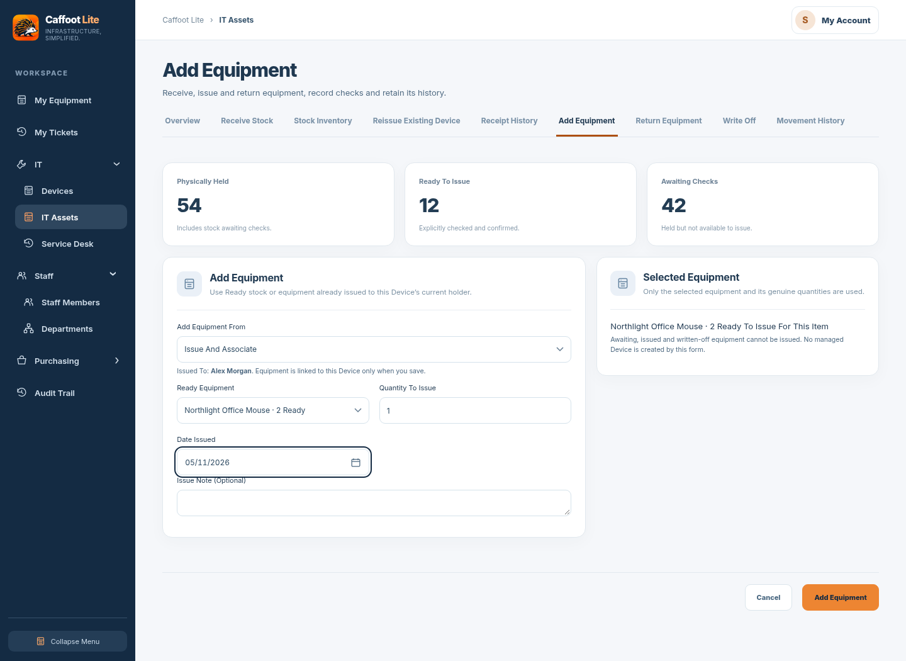
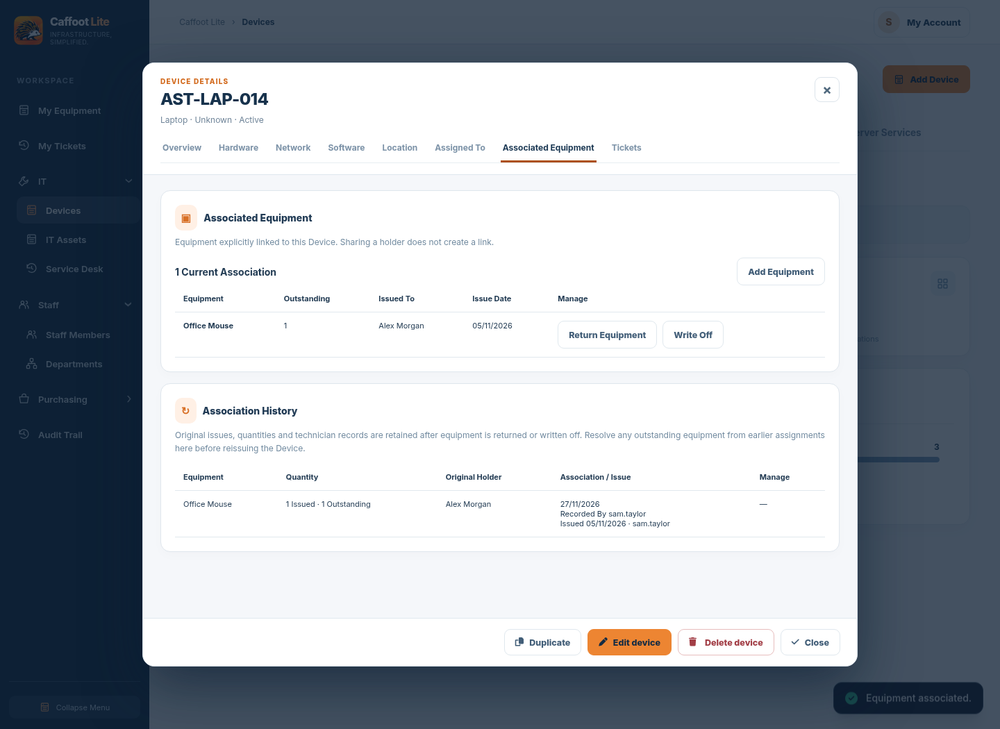
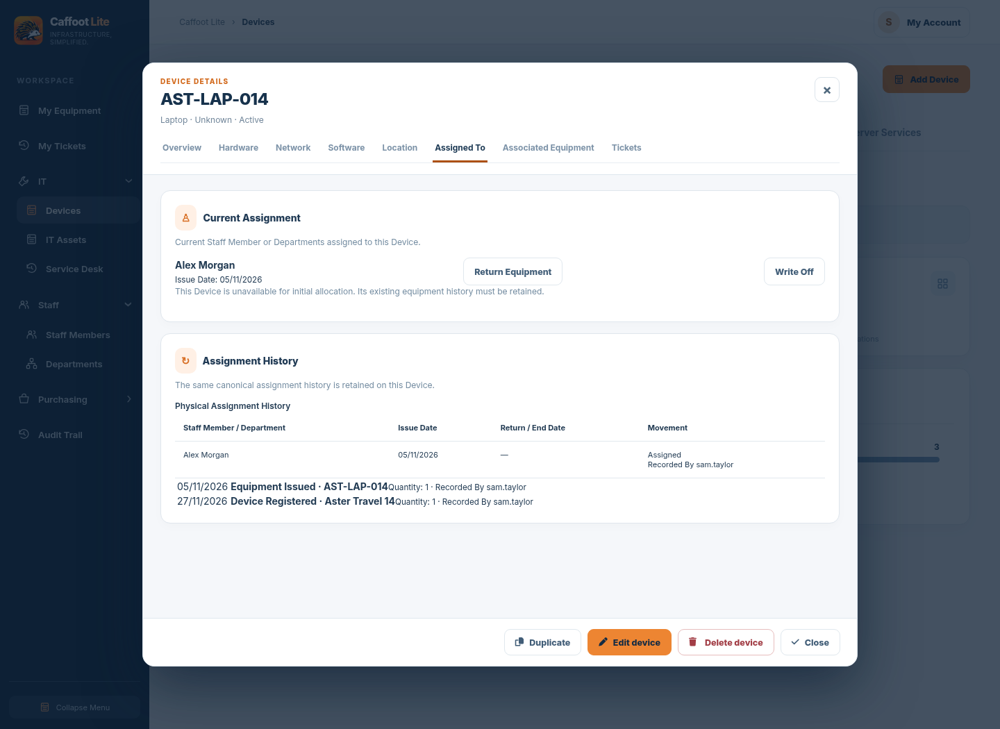
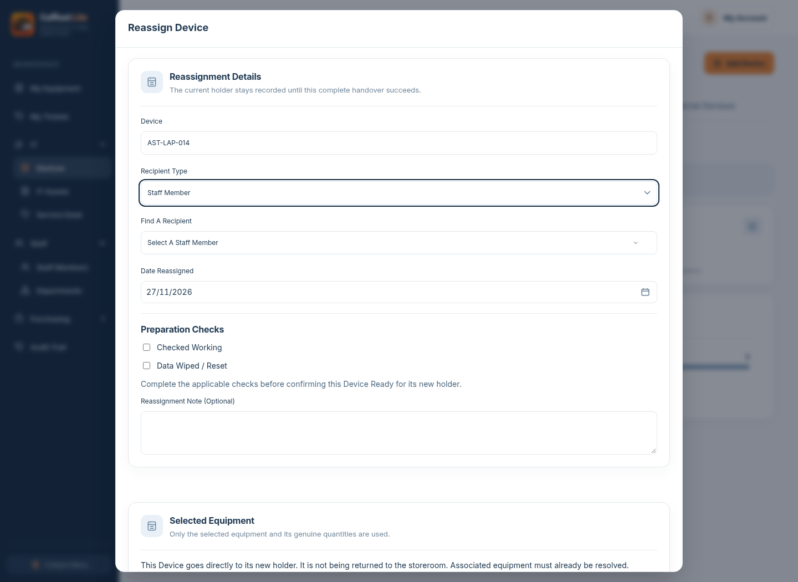
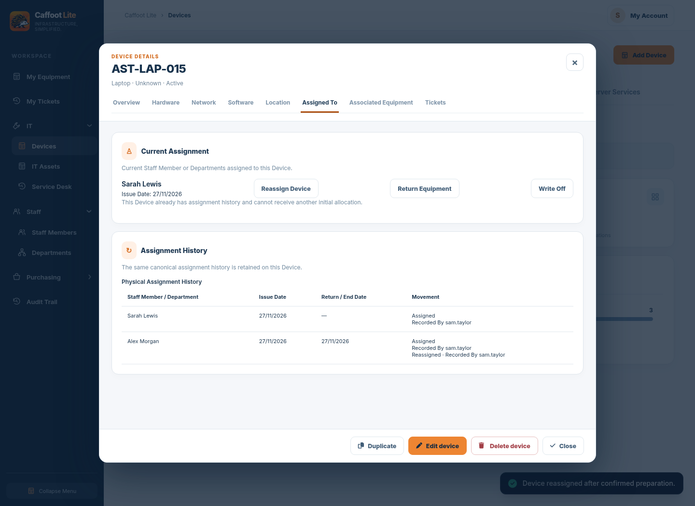
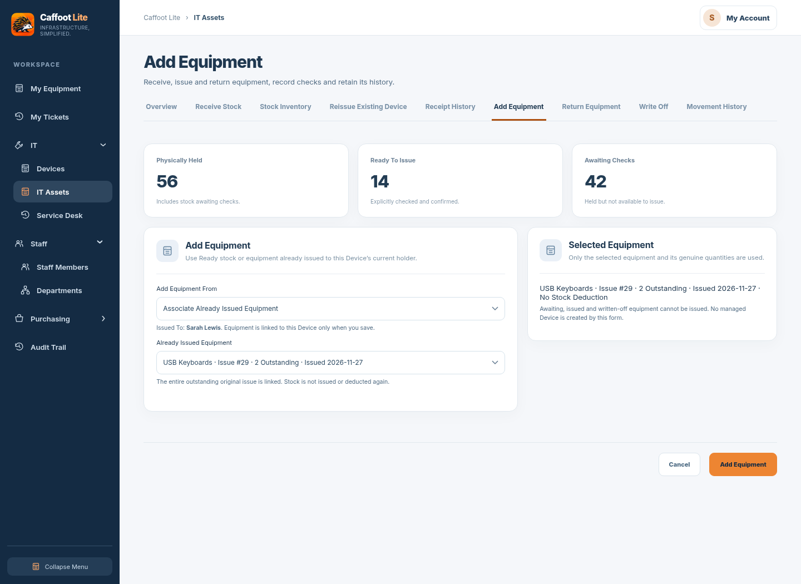

# Associated Equipment And Direct Device Handover

> **Current Batch 7D capture status — 27 November 2026:** [New desktop light illustrations](screenshots/batch-7d/README.md) use the approved merged schema-31 baseline. Independent ChatGPT review and separate owner visual/privacy/caption/alt acceptance remain pending. Earlier written/source and capture-status paragraphs retain their dated scope; the current pack status controls these new images. Published v2.1 and targeted correction-refresh requirements remain unchanged.

> **Draft v2.2 — Unreleased.** These instructions describe the implementation on `milestone-1` at the application baseline identified below. v2.1 remains the published release.

> **Written/source reconciliation:** Batch 4, application baseline `fdc677920bfc52f48f641b3d6d1344c902a6a9b0` (schema 31). Focused independent reviews are recorded and [owner written/source acceptance of Batches 1–6](https://github.com/Caffoot/Caffoot-Lite/issues/366#issuecomment-7200681167) is recorded. Current visual/privacy/caption/alt approval remains outstanding; [Batch 7 reconciliation and proposed capture packs](../../../development-guide/Milestone-01-Batch-7-Review.md) await independent review and owner acceptance. Capture scope and method need separate authorisation. Desktop capture remains deferred; existing images retain their original provenance and are not certified current by this pass. [Source review and exact screenshot requirements](../../../development-guide/Milestone-01-Batch-4-Review.md).

Associated Equipment records which accessories belong with a particular Device's assignment. For example, a technician can explicitly link a monitor, keyboard and mouse to a workstation issued to Alex. Equipment issued to the same person or Department is not linked automatically: Alex's other monitor may belong with a different workstation.

The association refers to the original equipment issue and the Device's actual holder. It does not create another Asset, copy a Device or issue already-issued equipment again. When the workstation changes hands, its accessories must be accounted for through their existing return or write-off processes.

## Before You Start

- **Devices** and **IT Assets** must both be enabled. Viewing the tab needs effective **Devices Read** and **IT Assets Read**; adding equipment needs **Devices Edit** and **IT Assets Edit**.
- The Device must have a current Staff Member or Department assignment before you can add accessories. New equipment cannot be issued to a Left Company Staff Member or archived Department.
- To issue and associate new equipment, the particular stock item or individual unit must already be **Ready To Issue**. Held equipment awaiting checks or preparation is unavailable.
- To associate an existing issue, it must still be outstanding, belong to the exact current holder and be eligible for association. An issue already associated with another Device cannot be linked again.

See [Roles And Permissions](Roles-Section-Permissions-and-MFA.md), [Optional Features](Optional-Features-and-Link-To-IPAM.md) and [Initial Device Assignments](Device-Assignments-and-My-Equipment.md) if the required Device, holder or controls are unavailable.

## View A Device's Accessories

1. Open **IT → Devices** and open the actual Device's details. Check its name and identifying information before changing its equipment.
2. Choose **Associated Equipment**. The first table shows current associations, their **Outstanding** quantities, **Issued To** holder and **Issue Date**.
3. Review **Association History** for earlier holders and resolved equipment. It retains the original issue, quantity, original holder, association date and recorded technician, followed by recorded returns, preparation and write-offs.
4. If a former assignment still has outstanding associated equipment, use its available **Return Equipment** or **Write Off** action in the history table to resolve the actual situation. A Device's empty current association table does not by itself prove every former accessory was resolved.

Read-only users can inspect permitted records but cannot add, return or write off equipment. If either feature or Read permission is unavailable, association records are unavailable through this tab; saved history remains retained.

## Issue And Associate Ready Equipment

Use this route when the accessory is physically available and has not yet been issued.

1. In **Device Details → Associated Equipment**, choose **Add Equipment**.
2. In **Add Equipment From**, keep **Issue And Associate** selected. Check **Issued To** for the Device’s current Staff Member or Departments. When several Departments share the Device, the new accessory issue records the Device’s custody as its recipient.
3. Choose the item under **Ready Equipment**. Read the availability for that selected item.
4. Enter a whole **Quantity To Issue** within its Ready balance. For individually tracked equipment, select the actual Ready units; check their serial numbers or asset tags where recorded. A unit without either identifier still keeps its individual identity.
5. Enter **Date Issued** and an optional **Issue Note**. Review **Selected Equipment** and the fixed recipient.
6. Choose **Add Equipment**. On success, the application returns to the Device's **Associated Equipment** tab. Check the new outstanding association and its original issue.

The issue and association save together. For example, issue a keyboard for an Accounts and Sales workstation through **Issue And Associate**. One stock issue and one explicit association are recorded. If Sales later stops sharing that workstation, the issue and associated quantity stay with the same custody period. For two newly issued keyboards, held and Ready stock each reduce by two, and their original issue is explicitly associated with this Device's holder. If validation fails, neither the issue nor its link is saved. The separate ordinary **Issue Equipment** confirmation is described in [Issue, Return And Write Off](IT-Assets-Issue-Return-and-Write-Off.md); this combined action retains its **Add Equipment** submission.

## Associate Already Issued Equipment

Use this route when the right equipment has already been issued to this exact holder and you need to record which Device it accompanies.

1. Open **Device Details → Associated Equipment → Add Equipment**.
2. Choose **Associate Already Issued Equipment** under **Add Equipment From**.
3. Select **Already Issued Equipment**. Check its equipment identity, original issue reference, date and outstanding quantity. For individually tracked equipment, inspect its recorded serial number or asset tag.
4. Check the original **Issued To** holder against the Device’s current assignment. For Department custody, the original issue must match an eligible Department currently sharing the Device.
5. Choose **Add Equipment**, then check the association on the Device.

The entire outstanding original issue is linked. If three mice remain outstanding on that issue, this action links that issue's three; it is not a way to select one mouse from the line or move it to another person. No further stock is issued or deducted. If the list says **No Eligible Issued Equipment**, check the original recipient, outstanding balance and existing associations rather than creating a second issue.

In both routes, **Cancel** abandons unsaved work; a discard prompt lets you keep editing. A stale or failed save leaves existing records unchanged. Reload after a holder or stock change and select the equipment again using current information.

## Check The Accessory’s Current Department

With **Devices Read** and **IT Assets Read**, open the Device’s **Assigned To** tab to check the current Departments. Then open **Associated Equipment** to confirm the original issue and outstanding quantity. The issue’s recorded **Issued To** value remains part of the stock history.

For example, Accounts originally received a printer cable. When Sales shares the printer and Accounts is removed, Sales can find the cable in **Department Details → Equipment** and eligible Sales members can see it in **My Equipment**. The association, outstanding quantity and original Accounts issue stay on record. For a continuing problem, use **Report A Problem** on the accessory and read the warning before reporting details. [Department ticket confidentiality](Service-Desk-Tickets.md#shared-device-ticket-confidentiality)

## Resolve Returned, Damaged Or Missing Accessories

Use the equipment's real condition and whereabouts to choose the action:

| Actual Situation | Action And Result |
| --- | --- |
| The accessory is physically returned and reusable | Choose **Return Equipment** on its original association. Record the actual return and checks. It is held, but only becomes Ready after applicable preparation is confirmed. |
| The accessory is physically returned broken | Use **Return Equipment** and its **Damaged — Write Off** disposition with a reason. It is recorded as returned and written off, without becoming available stock. |
| The accessory is missing and has not been returned | Choose **Write Off** on the outstanding original issue. Record the exact missing quantity, date and reason. Outstanding reduces without a physical return, held-stock increase or Ready stock. |
| The original issue quantity is a typing mistake | Use [Correct Movement](IT-Assets-Correct-Movement.md) if eligible. A recording error does not justify a fictitious return or damage record. |

Partial returns leave the remaining quantity outstanding with its original holder. A missing quantity-tracked accessory can be written off directly, up to that original issue's outstanding amount. Individually tracked equipment keeps its existing one-unit identity. Writing off or returning the workstation does not automatically write off or return its accessories.

Every explicitly associated outstanding accessory must be resolved before a prepared Device can be reissued from stock or reassigned directly, including accessories linked during a former assignment. Real accessory actions are separate saved events: cancelling a later workstation handover does not undo them.

## Reassign A Workstation Directly

Direct reassignment records a prepared Device moving from its current holder straight to a different Staff Member or Department assignment. Use it for a genuine handover. When equipment actually returns to the storeroom, use [Return → Preparation → Reissue Existing Device](Device-Stock-Registration-and-Reissue.md) instead.

1. Resolve **all** explicitly associated outstanding equipment first using the actual returns, damage dispositions or missing-equipment write-offs above. Accessories do not follow the workstation to its next holder automatically.
2. Open **Device Details → Assigned To → Reassign Device** for the currently assigned physical Device. The selected Device is fixed on the existing form; it is not a bulk reassignment screen.
3. Choose **Recipient Type**. Select the new Staff Member under **Find A Recipient**, or search and tick the applicable Departments for an eligible shared Device. The current single holder is omitted. A changed shared selection can retain one current Department, but an unchanged selection is rejected.
4. Enter the actual **Date Reassigned** and an optional **Reassignment Note**. The date cannot precede the current issue or be in the future.
5. Physically check and prepare the workstation. Complete its displayed **Preparation Checks** only after doing the work. These checks start unchecked.
6. Choose **Confirm Ready And Reassign** as the explicit confirmation that the Device is ready for its new holder.
7. Check the new current holder and dated **Reassigned** entry in **Assignment History**. The old assignment closes, the new assignment opens and the same Device identity remains.

For Desktop, Laptop and physical Server, preparation requires **Checked Working** and **Data Wiped / Reset**. A Printer needs **Cleaned And Checked Working** and confirmation that stored documents, credentials and user data were cleared where applicable; a factory reset is not compulsory for every Printer. Monitor, Keyboard, Mouse and Docking Station require **Cleaned And Checked Working** without a mandatory data wipe. Other equipment requires its displayed working/condition and applicable data-preparation confirmations. These are factual checks, not tick boxes to bypass.

**Cancel** or a failed save keeps the old holder. A successful handover saves its new holder, closure of the old assignment, preparation confirmation and applicable stock custody together. For a registered issued Device, **Movement History** shows **Reassigned**, **Currently Issued → Currently Issued**. The handover does not create a storeroom receipt or add Physically Held/Ready stock. Device status, Location, Rack, network details and specifications stay as recorded.

### Permissions For A Direct Handover

Direct reassignment requires effective **Devices Edit**. A Device with recorded stock history additionally requires enabled **IT Assets** and **IT Assets Edit**. Devices-only reassignment remains available for eligible Devices without stock history when IT Assets is off. Switching IT Assets off never bypasses outstanding accessory resolution or grants stock access. Read-only users cannot reassign.

## Relationship And Cancellation Limits

**Add Equipment** links the original outstanding issue as a whole; it has no partial-line split, generic unlink or accessory transfer button. Use actual returns/write-offs and new issues when physical custody changes. A current empty table can coexist with outstanding history from an earlier holder. Successful association changes no Device identity, and linking an already-issued line changes no Ready or held quantity. All saved returns/write-offs remain even if a later Add Equipment or handover is cancelled.

A shared Device has one custody period. An already-issued standalone accessory must belong to an eligible Department currently sharing it; a new Issue And Associate for multiple Departments uses that Device custody as its recipient. The association follows the current Department selection during that custody, while the original issue label remains historical. It does not make separate physical copies or move old tickets to the new holder. Employee visibility is restricted through [My Equipment](Device-Assignments-and-My-Equipment.md#visibility-empty-results-and-permission-changes); full ticket instructions remain in their specialised guide.

## Worked Example: Alex Leaves And Sarah Receives The Workstation

All names and equipment in this example are fictional. Alex holds workstation `HV-DESK-014`, with one individually tracked monitor, one keyboard and one mouse explicitly associated with that workstation. Sarah is an active Staff Member. There is no other outstanding associated equipment.

1. Technician Morgan checks **Associated Equipment** and confirms the three original issues and their identities.
2. Alex physically returns the monitor and keyboard. Morgan records their actual returns and confirms cleaning/working checks after completing them. Each becomes one held, Ready accessory; its original association and holder history remain.
3. The mouse is missing. Morgan chooses its original issue's **Write Off**, records one missing mouse with a factual reason and the actual date, and saves. Its outstanding quantity becomes zero. Held and Ready mice do not increase.
4. Morgan checks both current associations and **Association History**. All explicitly linked accessory quantities are now resolved.
5. Morgan prepares the workstation, completes its working and data-wipe/reset checks, chooses Sarah in **Reassign Device** and saves **Confirm Ready And Reassign**.
6. Alex's workstation assignment closes and Sarah's opens. The workstation remains one canonical Device. If it was already registered stock, it stays issued throughout; no extra held workstation appears.
7. Morgan issues the returned, Ready monitor and keyboard to Sarah through **Issue And Associate**. They become new issues linked to Sarah's workstation assignment. Alex's original issues, returns and missing-mouse write-off remain visible.

If step 5 fails, Alex stays the workstation's recorded holder. The accessory returns and missing-mouse write-off already saved in steps 2–3 remain valid historical actions. Review the error and current holder before retrying; do not repeat those accessory actions.

## Troubleshooting

| Problem | What To Check |
| --- | --- |
| **Add Equipment** is absent | Both features and both Edit permissions are needed, together with an eligible current holder. First assignment is a separate workflow. |
| Ready stock appears lower than expected | Check the particular item's issue-ready balance. Already issued, awaiting or registered Device stock is not ordinary available accessory stock. |
| An issue is not in **Already Issued Equipment** | It must belong to the exact holder, still be outstanding and not already associated. Another Device's association cannot be silently moved. |
| **Reassign Device** is unavailable | Check permissions, a current physical assignment, required stock access and unresolved accessories from every assignment. The action deliberately blocks ineligible work. |
| The workstation is prepared but reissue is blocked | Preparation does not resolve its accessories. Inspect **Association History** for former outstanding quantities. |
| The holder or equipment changed while editing | Reload before retrying. A stale save cannot transfer equipment using an old assignment or consume unavailable stock. |
| The Device is being edited elsewhere | Finish/cancel that edit or wait for the technician, then reload. Preserve the original Device rather than duplicating it. |

## Related Guides And Screenshot Acceptance

[Issue, Return And Write Off](IT-Assets-Issue-Return-and-Write-Off.md) · [Device Registration And Reissue](Device-Stock-Registration-and-Reissue.md) · [Device Assignments And My Equipment](Device-Assignments-and-My-Equipment.md) · [Departments And Shared Equipment](Departments-and-Shared-Equipment.md).

The [genuine Associated Equipment and handover gallery](../../../development-handovers/evidence/associated-equipment-final/Report.md) preserves development evidence. Its report distinguishes agent inspection from owner visual acceptance. No standalone HTML preview is presented here as an approved application screenshot; outstanding image approval is tracked in the [documentation review items](../../../development-guide/Stage-1-3-Documentation-Review.md).

[← Draft v2.2 Guides](README.md) · [Published v2.1 Guides](../README.md)

[Connected example: a laptop from Supplier and stock to its final write-off](Connected-Equipment-Journey.md).

## Batch 7D Desktop Illustrations

These images follow the fictional training journey. Read the caption to distinguish a draft, a cancelled preview and a saved outcome. [Complete original coverage and limits](screenshots/batch-7d/Coverage.md).

*Draft v2.2 — Issue And Associate will give one Ready mouse to the laptop’s existing Alex custody. The holder is derived from that custody and cannot be freely changed here. Independent review and owner visual acceptance pending.*

*Draft v2.2 — The mouse issue is now explicitly linked to this Device custody. It is not inferred from the same holder, name or purchase. Independent review and owner visual acceptance pending.*

*Draft v2.2 — Alex still holds the laptop. Outstanding associated equipment prevents direct reassignment until each accessory is resolved; changing a person’s Department does not resolve it. Independent review and owner visual acceptance pending.*

*Draft v2.2 — This separate direct-handover draft leaves Sarah as current holder until the complete save succeeds. Working and data-preparation checks are mandatory. It is cancelled, so no new handover is recorded. Independent review and owner visual acceptance pending.*

*Draft v2.2 — This separate AST-LAP-015 demonstration records a checked direct handover from Alex to Sarah on 27/11. It has no storeroom return and does not replace the AST-LAP-014 return/reissue journey. Independent review and owner visual acceptance pending.*

*Draft v2.2 — Associate Already Issued Equipment links the entire two-keyboard outstanding issue for Sarah’s AST-LAP-015 custody. It does not issue stock or deduct quantity again. Independent review and owner visual acceptance pending.*
