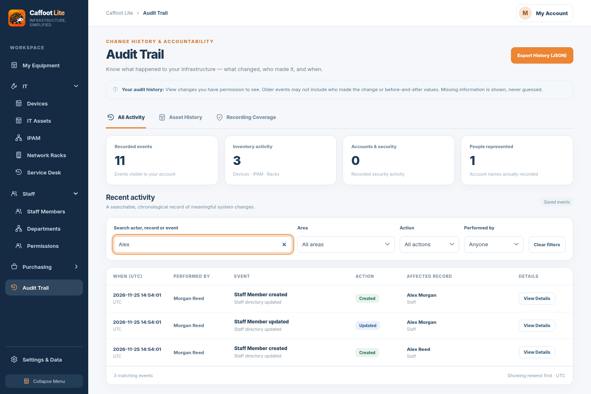
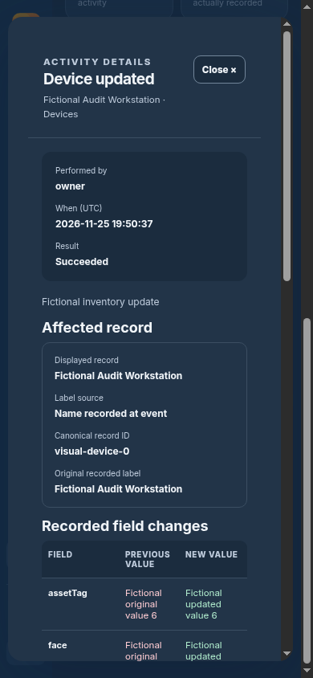
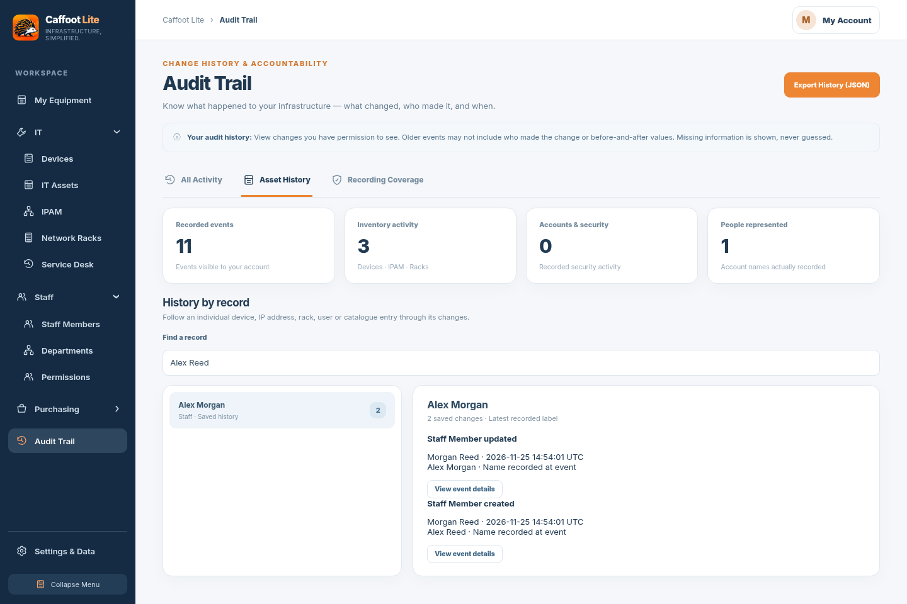

# Read The Audit Trail

> **Draft v2.2 — Unreleased.** Stage 6.6 Batch 2, [#458](https://github.com/Caffoot/Caffoot-Lite/issues/458), [draft PR #466](https://github.com/Caffoot/Caffoot-Lite/pull/466). Owner acceptance remains outstanding. Examples and screenshots use fictional data.

The Audit Trail helps you establish what changed, who performed the recorded action and when. An affected-record name describes the record at the time of the saved event, not necessarily its current name. This is a read-only view: searching, opening details or viewing a timeline does not edit the original events.

## Before you start

Sign in using an active account and complete MFA. Open **Audit Trail** from the existing navigation if your account has access. Your administrator controls the section permissions and optional features that determine which events are available. The change to labels does not grant any new history rights. Some details and complete events may be withheld, including Device-linked stock events when Devices access is unavailable. A missing event or area is not evidence that no change occurred.

## Find an event

1. Open **All Activity**. The list shows authorised saved changes, newest first, with UTC timestamps, recorded actors, actions and affected records.
2. Enter a name, original reference, actor or event wording in **Search actor, record or event**.
3. Select **Area**, **Action** or **Performed by** to narrow the results. The Area choices reflect visible saved history. Staff Member and Department changes appear under Staff; role changes under Users. The Service Desk area covers the existing Clean Start ticket-data summary if visible to you, not ticket conversations.
4. Select **Clear filters** to return to the unfiltered list. If no events match, revise or clear the filters.

For example, a Staff Member named Casey Reed may later be renamed Casey Morgan. The older saved event remains Casey Reed if that name was captured, while the subsequent event displays Casey Morgan. Searching for the original name can still find the earlier recorded change.

## Understand the affected record

Select **View Details** beside an event. The dialogue retains the original actor, UTC time, result, reason and available field changes, and shows:

- **Displayed record:** the name or original reference used in the list.
- **Label source:** Name recorded at event, Name from recorded event values, Original recorded label, or Historical name not recorded.
- **Canonical record ID:** the recorded reference where available; Not recorded if unavailable. A recorded ID alone does not prove continuity across replacement or reset.
- **Original recorded label:** the untouched original audit label, including any internal reference.

Older Staff records may contain only an internal identifier. That is not a fault in the current Staff directory. The Audit Trail cannot reconstruct an unrecorded name using today's record, and does not guess. Older Department names can be shown from trustworthy saved event values, including a deleted Department's recorded name. Use **Close** or Escape to return to the event list without changing history.

## Follow history by record

1. Open **Asset History**.
2. Enter a saved name or canonical reference in **Find a record**. Earlier recorded names can match the history.
3. Select the record in the list. The timeline shows its saved changes and the name attached to each event; **View event details** opens the same detail dialogue.
4. Where identity continuity is verified, the group uses the latest recorded label. Distinct people with the same name are not joined. Where continuity cannot be established, a change is shown independently with **Identity not verified** and **No verified link to other events**. Reused inventory or movement identifiers, imported inventory and Clean Start are reasons to avoid treating an identical identifier as proof of the same historical record.

## Optional Feature Names

For optional-feature setting changes, the affected record displays **IT Assets**, **Equipment Lifecycle** or **Suppliers** for the saved identifiers `it_assets`, `equipment_lifecycle` and `suppliers`. A friendly name recorded with the event takes precedence. When a name is supplied only by this display mapping, **Label source** explains that it is a friendly name for the recorded identifier.

Open **View Details** to inspect **Original recorded label**, any recorded canonical ID and the original before/after values. Searching still matches the original identifier. Unknown identifiers and unrelated events retain their existing presentation. The display does not rewrite historical records or change JSON export.

## Export and recording coverage

Open **Recording Coverage** to see the existing recording information. Select **Export History (JSON)** to download the events your account is permitted to see. The JSON retains original recorded fields, labels and references, and new bounded subject metadata where recorded and authorised. It is not a complete database backup and does not grant access to redacted fields. Store the downloaded file securely; it may contain authorised historical information. Do not use it as an inventory restore file.

If you cannot find a change, clear filters, check the date in UTC and verify permissions with your administrator. If an original name or reference is missing, preserve the event as recorded. Do not edit database rows to repair an audit label. The existing retention and permission rules remain unchanged. Service Desk conversation text and authentication secrets are not added by this feature.

Related: [Roles, Section Permissions And MFA](Roles-Section-Permissions-and-MFA.md), [Staff Members](Staff-Members.md), [Legacy Import And Docker Upgrade](Legacy-Import-and-Docker-Upgrade.md).

## Application Screenshots

*Search finds the saved event-time names and the affected-record row identifies the Staff events.*

*Use the canonical record ID to refer to the specific record in an investigation. Scroll within the dialogue to read the full field list. Escape returns focus to **View Details**.* [Capture provenance](../../../development-handovers/evidence/stage-6-6-batch-3/README.md#capture-provenance)

*The timeline keeps the saved name for each event.* [Desktop and mobile captures and provenance](../../../development-handovers/evidence/stage-6-6-batch-2/README.md#application-screenshots)
