# A Connected Equipment Example — Aster Services

> **Current Batch 7D capture status — 27 November 2026:** [New desktop light illustrations](screenshots/batch-7d/README.md) use the approved merged schema-31 baseline. Independent ChatGPT review and separate owner visual/privacy/caption/alt acceptance remain pending. Earlier written/source and capture-status paragraphs retain their dated scope; the current pack status controls these new images. Published v2.1 and targeted correction-refresh requirements remain unchanged.

> **Current Batch 7C capture status — 27 November 2026:** [New desktop light illustrations](screenshots/batch-7c/README.md) use the approved merged schema-31 baseline. Independent ChatGPT review and separate owner visual/privacy/caption/alt acceptance remain pending. Earlier written/source and capture-status paragraphs retain their dated scope; the current pack status controls these new images. Published v2.1 and targeted correction-refresh requirements remain unchanged.

> **Draft v2.2 — Unreleased.** Written/source reconciliation for documentation Batches 3 and 4, application baseline `fdc677920bfc52f48f641b3d6d1344c902a6a9b0`, schema 31. Focused independent reviews are recorded and [owner written/source acceptance of Batches 1–6](https://github.com/Caffoot/Caffoot-Lite/issues/366#issuecomment-7200681167) is recorded. Current visual/privacy/caption/alt approval remains outstanding; [Batch 7 reconciliation and proposed capture packs](../../../development-guide/Milestone-01-Batch-7-Review.md) await independent review and owner acceptance. Capture scope and method need separate authorisation. Desktop capture remains deferred. [Source and screenshot record](../../../development-guide/Milestone-01-Batch-4-Review.md).

This fictional example connects tasks that already exist. It is not a new application workflow or a compulsory order for every organisation. Follow the detailed linked guide for each form, required field, confirmation and rejection. Record only real physical events and checks in your own installation.

Aster Services buys two matching laptops and two mice from **Northlight Technology Ltd**. **Sam Taylor**, the IT technician, records laptop **AST-LAP-014** for **Alex Morgan** in **Accounts**. Later the laptop is prepared for **Sarah Lewis** in **Sales**. Serial `DEMO-AST-014`, usernames and all names/dates below are fictional. Example movements take place during November 2026; the later replacement date is a calculation, not a future movement to record now.

## Access And Records To Prepare

An administrator enables **Devices**, **IT Assets** and **Suppliers** through **Settings & Data → Optional Features**. Enable **Equipment Lifecycle** if its dates and warnings are to be viewed. These switches retain independent permissions. This example does not require IPAM or Network Racks; adding an actual managed address or rack placement uses those separate permissions.

Sam needs **Devices Edit**, **IT Assets Edit** and **Suppliers Edit**, with confirmed MFA and a current session. Staff/Department administration requires the corresponding Edit rights; creating/enabling logins and security administration also require an administrator. Sam's IT job title or Department does not grant these rights. [Roles and effective access](Roles-Section-Permissions-and-MFA.md)

1. An authorised directory editor creates Accounts and Sales if those real groups do not already exist. Create active Staff records for Alex and Sarah, selecting their respective Departments. A Staff record can hold equipment without a login.
2. If Alex needs self-service, an administrator creates a login on Alex's existing Staff record, such as `alex.morgan`. Keep the baseline Staff Member role unless Alex's duties require more. Supply initial credentials securely; Alex can change the initial password and enrol MFA voluntarily. A baseline employee needs no general inventory rights to use eligible My Equipment.
3. Check the saved Staff identities before allocating anything. Names, optional login, Department membership and account permissions have separate purposes. [Staff creation and linking](Staff-Members.md#create-and-link-an-optional-caffoot-login) · [Departments](Departments-and-Shared-Equipment.md)

## 1. Record The Supplier And Purchasing Context

1. As a Suppliers editor, open **Purchasing → Suppliers → Add Supplier**. Search existing records first.
2. Enter Northlight Technology Ltd, optional business/address information and, if useful, a contact such as **Jo Patel**. Choose applicable Supplier Categories and select **Add Supplier**.
3. Record a factual **Supplier Note**, for example “Delivery reference DEMO-104 covers two laptops and two mice”. Supplier Notes are retained work information, not a purchase order, financial ledger or invoice record.
4. If there is a real delivery problem, use **Notes & Issues → Issues → Add Issue**, with its own title, description, optional category and contacts. Do not create an Issue merely because equipment was purchased. A Supplier Issue changes neither stock nor an employee Service Desk ticket.

[Supplier form, contacts and notes](Supplier-Management.md) · [Purchasing and tracked Issues](Supplier-Issues-and-Purchasing.md)

## 2. Receive The Physical Delivery

1. On the fictional **03/11/2026**, Sam opens **IT → IT Assets → Receive Stock → New Stock Entry**. Choose **Laptop**, **Quantity-Based Stock**, a clear **Model / Description**, Manufacturer and known shared computer specifications. This example uses two identical units with the same recorded configuration.
2. Enter **Quantity Received: 2**, **Date Received: 03/11/2026** and explicitly select Northlight in **Supplier (Optional)**. Typing a matching name alone creates no canonical link. Add a factual Receipt Note if useful.
3. After checking the actual delivery and condition, tick both receipt checks and set **Checked & Ready To Issue: 2**. Choose **Record Receipt**, then inspect the new Receipt History entry. If checks were incomplete, record zero or the genuinely checked part and finish checks later.
4. Record the two mice as a separate quantity-based **Mouse** item, using the same genuine delivery date and Supplier. Do not mix their specifications with the laptops or receive the same delivery twice.

The laptop stock now has two Physically Held and two Ready units; the separate mice item has its own two. No Device or employee assignment exists yet. **Cancel** before saving abandons the proposed receipt; a saved receipt remains in history. [Receive Stock and readiness](IT-Assets-Stock-Intake.md)

## 3. Register One Permanent Device

1. On **04/11/2026**, open **IT → Devices → Add Device → General → Brand New — Get From Stock**. Choose the matching laptop under **Ready Unregistered Computer Stock**.
2. Review the common specifications, enter **Device Name: AST-LAP-014** and optional genuine serial. Complete the normal Device fields, then select **Save Device**. It remains unassigned and Ready.
3. Reopen Stock Inventory: there is one unregistered Ready laptop and one registered Ready Device. Total laptop Physically Held remains two. Do not add the Device row to its stock-item total again.
4. If known, use **Edit device → Hardware** after saving to record **Purchase Date: 03/11/2026** and a confirmed Warranty Expiry. Add Device has no lifecycle date fields. The example paperwork gives **15/12/2026** as the warranty end; use that fact rather than accepting the default 12-month suggestion.
5. A receipt's Supplier association is not automatically copied onto the Device. If Aster also wants a Device association, use **Edit device → General → Supplier (Optional)**, explicitly choose Northlight and save. Its Supplied Equipment view can then list the stock-derived Device without adding another unit to the original receipt quantity.

Registration has not issued anything, declared a first-service date, returned equipment or configured the real machine. Do the actual setup and preparation work required by your organisation. [Device registration](Device-Stock-Registration-and-Reissue.md#register-one-brand-new-device) · [Supplier associations](Equipment-Supplier-Integration.md) · [Lifecycle dates](Equipment-Lifecycle.md)

## 4. Issue To Alex, Or Choose Department Custody

1. When the laptop physically leaves stock on **05/11/2026**, open **IT Assets → Reissue Existing Device**, choose AST-LAP-014, set **Assign To: Staff Member**, select Alex and enter the real **Date Issued** and optional note.
2. Select **Reissue Existing Device** and verify the same original Device now shows Alex in **Assigned To**. Laptop stock becomes one Physically Held, one Ready and one Currently Issued. The Device assignment and stock issue save together.
3. Because this example has a recorded registration, no earlier issue/return/assignment and no saved service date, that first issue also records **Original In Service Date: 05/11/2026**. That narrow automatic capture occurs even with Lifecycle off. A future issue date is rejected when it would capture first service.
4. To give Alex a mouse with the laptop, open its **Associated Equipment → Add Equipment → Issue And Associate**, choose the Ready Mouse item, enter one and the actual issue date, then **Add Equipment**. Mouse held/Ready reduces from two to one. The new original mouse issue is explicitly linked to this Device custody.

**Alternative, not an extra issue:** if this laptop is genuinely shared Department equipment, select **Department** instead of Alex. An eligible Laptop can have one or more current active Departments sharing one physical custody period. All selected Departments have equal shared visibility; no copy is issued to each member. Standalone mouse stock can be issued to a single Department, or Issue And Associate can follow the shared Device custody. Use **Manage Departments** only for Department selection changes during that continuing custody, rather than a physical handover.

[Issue and stock history](IT-Assets-Issue-Return-and-Write-Off.md) · [Reissue and eligibility](Device-Stock-Registration-and-Reissue.md#reissue-an-existing-ready-device) · [Explicit accessories](Associated-Equipment.md)

## 5. View Only The Employee's Permitted Information

1. Alex signs in and opens **My Account → Overview → Open My Equipment**, or **Workspace → My Equipment**.
2. In the personal version of this example, **Assigned to Me** shows AST-LAP-014 and the outstanding mouse. Use **Search Equipment**, **Equipment Type**, **Equipment Kind**, **Clear Filters** and **Details** as needed.
3. Device Details here shows only permitted recorded hardware/operating-system/serial and eligible software names. It supplies no IP/MAC information, credentials, private notes, Supplier purchase details, lifecycle dates, stock totals or former holders. It has no issue/return/write-off controls.
4. In the Department alternative, eligible current members see the laptop under **Shared with My Department**. If Alex moves from Accounts to Sales, the next request follows the new membership; it does not move the Accounts laptop. A saved shared Department selection also controls which current members can see the same Device.

If Alex leaves, an authorised administrator with Staff Members Edit uses **Mark As Left Company**, atomically disabling the linked login and revoking sessions/proofs while keeping equipment outstanding. **Reactivate** on a later return does not re-enable that login. An administrator separately reviews access and uses **Enable Login**. This employment action creates no stock return. [My Equipment safeguards](Device-Assignments-and-My-Equipment.md#my-equipment) · [Employment and login](Staff-Members.md#mark-as-left-company-or-reactivate)

## 6. Return And Reissue, Or Hand Over Directly

For this example, Alex's laptop and mouse physically return on **12/11/2026**.

1. Sam records the original mouse issue's actual return in **Associated Equipment → Return Equipment**. After real cleaning/working checks it can become Ready. If it had been missing, Sam would instead use its original outstanding issue's **Write Off** with a factual reason; missing equipment is not a physical return.
2. Open the original laptop's **Assigned To → Return Equipment**. Record its actual return with Ready zero and damaged zero to put the same Device into **Awaiting Preparation**, retaining its original assignment/history. Laptop held becomes two: one unregistered Ready and this registered awaiting unit.
3. Perform the computer's actual working and data-wipe/reset checks. In **Stock Inventory → Registered Devices In Stock History → View / Update → Prepare Returned Equipment**, confirm them with **Date Checked**, then **Mark Ready To Issue**. Held stays two; both are now Ready.
4. On **13/11/2026**, use **Reissue Existing Device** to issue AST-LAP-014 to Sarah. Held/Ready becomes one, issued becomes one. The previous Alex assignment remains closed; the service date remains 05/11/2026. Issue any accessories to Sarah separately and explicitly associate them if appropriate.

**Direct-handover alternative:** if the laptop goes straight from Alex to Sarah without entering the storeroom, resolve every outstanding accessory first, then use **Assigned To → Reassign Device**. Select the new holder, actual eligible date and note, complete real preparation checks and choose **Confirm Ready And Reassign**. The old holder remains until the complete save succeeds. A stock-registered laptop stays issued throughout, with no held/Ready increase. Cancelling that handover leaves the separately saved accessory actions in history.

Do not perform both alternatives for the same physical event. A recording mistake belongs in **Correct Movement** where supported; never manufacture a receipt or return to repair a displayed balance. Individual Device quantity changes are unsupported. [Return/preparation](IT-Assets-Issue-Return-and-Write-Off.md#return-equipment) · [Direct handover](Associated-Equipment.md#reassign-a-workstation-directly) · [Quantity corrections](IT-Assets-Correct-Movement.md)

## 7. Review Lifecycle Information

1. With Devices Read and both Devices/Lifecycle enabled, open **IT → Lifecycle** on the IT Dashboard.
2. Under the default 90-day warranty warning, the fictional warranty ending 15/12/2026 qualifies as **Warranty Expiring Soon** on 26/11/2026. Open the Device on Hardware to check the actual recorded date.
3. The default Laptop lifespan is three years, so service date 05/11/2026 gives calculated replacement **05/11/2029**. It is not yet a replacement warning on 26/11/2026. An administrator can configure lifespans/warning periods or save an evidenced manual replacement override through the existing controls.

A warning is information for review. It sends no automated renewal request and does not change readiness, custody or operational status. Reissue has not restarted the three-year lifespan. [Lifecycle calculations, warnings and exceptions](Equipment-Lifecycle.md)

## 8. Record A Genuine End Of Use

Suppose the laptop later suffers irreparable damage and physically comes back on the fictional **26/11/2026**. A short equipment life is unusual, but supported: warranty and lifespan do not override its actual condition.

1. Review Sarah's current assignment and all explicit associated accessories, resolving each through its actual return or write-off. The Device action does not resolve accessories automatically.
2. For this physically returned damaged laptop, record **Quantity Returned: 1**, Ready zero and **Damaged — Write Off: 1**, with the actual date and required factual damage/write-off reason, then **Record Return**. The combined return/disposition keeps the same Device and closes Sarah's assignment. It adds no usable held/Ready laptop.
3. If the laptop were genuinely missing instead, use **Write Off** on its original outstanding issued Device, without recording a physical return. These are alternatives for different facts.
4. If its operational record should be **Retired**, use the authorised Device editor and save that separate status change. Retired is not a stock write-off or deletion. Lifecycle retains its dates and excludes Retired from the four active counters; **Include Retired Devices** with **All Conditions** allows applicable historical review.
5. Review Movement History and Assignment History. Original receipt, registration, Alex issue/return, preparation, Sarah reissue and final disposition remain distinct. A written-off Device has no general reactivation/reissue operation. Preserve it and its historical records.

[Write-off and retention](IT-Assets-Issue-Return-and-Write-Off.md#write-off-equipment) · [Device management](Devices.md) · [Retired lifecycle review](Equipment-Lifecycle.md#use-the-it-dashboard)

## Keep The Different Records Clear

| Record | What It Means In This Example |
| --- | --- |
| Device | One permanent AST-LAP-014 identity and technical configuration. |
| Physical stock | Real equipment held by IT, excluding issued/written-off units; registration alone does not change held total. |
| Readiness | Checked/prepared state of held equipment, independent of operational Active/Retired. |
| Assignment/custody | Who currently holds the Device and its earlier holders; Department membership is access to shared custody, not another issue. |
| Associated Equipment | Explicit mouse issue linked to a particular Device assignment; no automatic accessory transfer. |
| Supplier information | Original receipt source, separately confirmed company links and Supplier Issues/notes; no financial processing. |
| Lifecycle | Recorded dates, type lifespan, calculation/override and informational warnings on the same physical Device. |
| Movement/assignment histories | Stock facts and holder relationships with their own references, dates and actors; corrections append facts rather than erase originals. |

The saved balances describe what has been recorded. Verify uncertain saves by inspecting original references before repeating an operation. This example creates no records and claims no newly executed runtime verification or publication approval.

[← Draft v2.2 Guides](README.md)

For a support request while Alex holds AST-LAP-014, follow the [Connected Service Desk Journey](Connected-Service-Desk-Journey.md). It uses the same fictional organisation and equipment and preserves the custody boundary on later handover.

## Batch 7C Desktop Illustrations

These images follow the fictional training journey. Read the caption to distinguish a draft, a cancelled preview and a saved outcome. [Complete original coverage and limits](screenshots/batch-7c/Coverage.md).

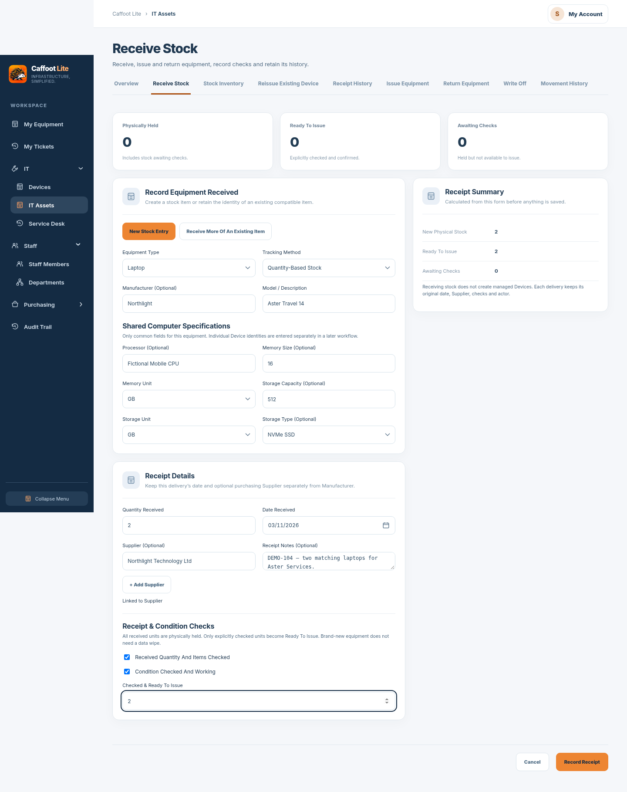

*Draft v2.2 — The unsaved receipt records two checked, Ready laptops with an explicitly selected Northlight link. The summary is a proposal, not saved stock. Independent review and owner visual acceptance pending.*

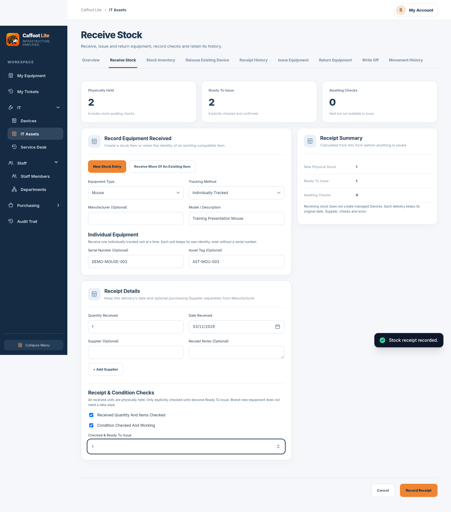

*Draft v2.2 — A separate individually tracked demonstration mouse is an unsaved one-unit receipt. It is additional to the journey’s two quantity-based mice. Independent review and owner visual acceptance pending.*

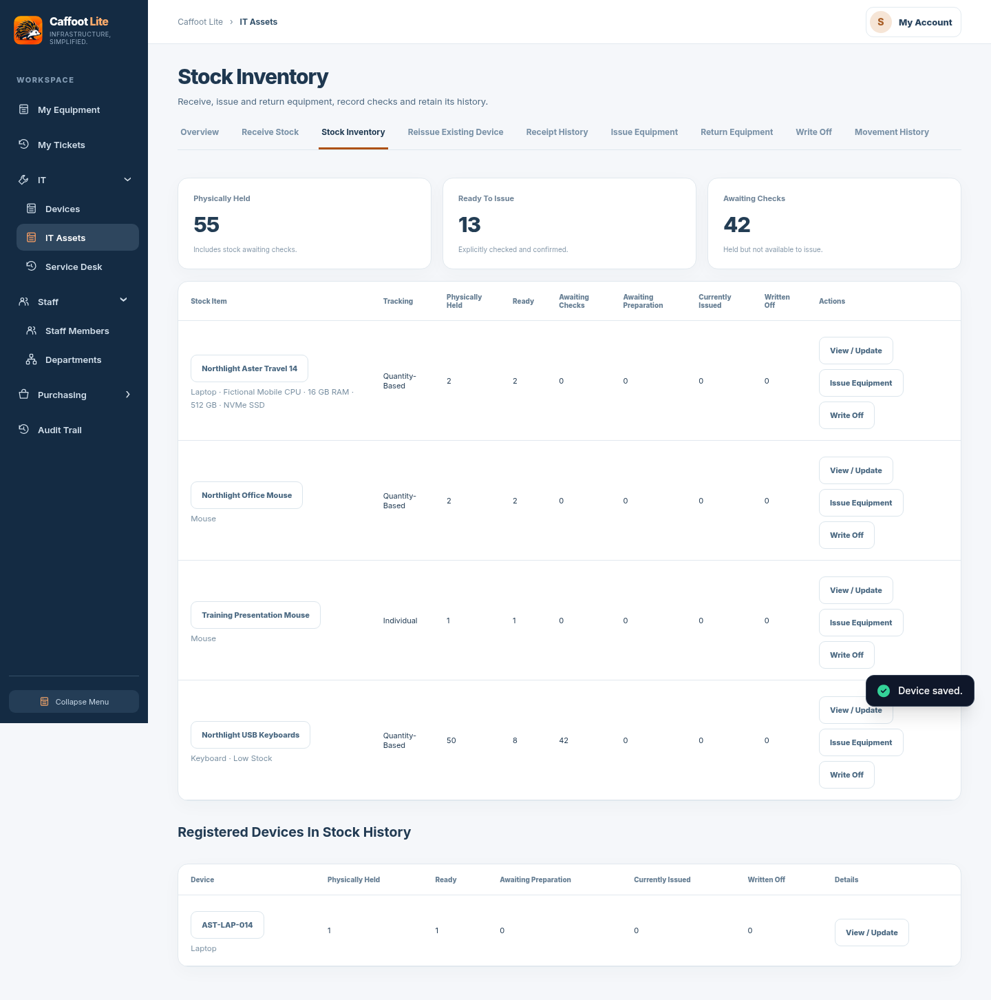

*Draft v2.2 — The laptop item still represents two held units: one unregistered Ready unit plus AST-LAP-014 as a registered Ready Device. Never add the Device row to the item total again. Independent review and owner visual acceptance pending.*

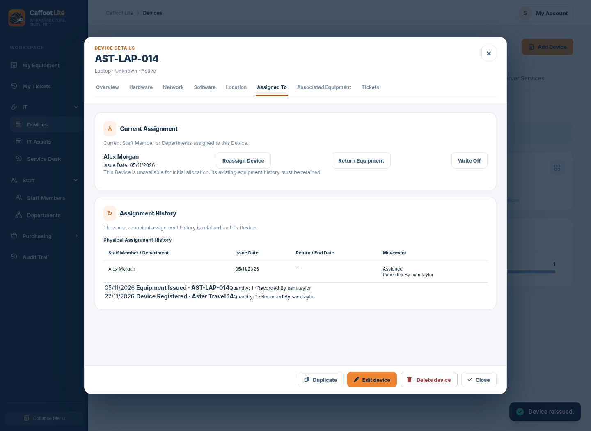

*Draft v2.2 — Saved current custody belongs to Alex. The original Device and assignment history remain the authoritative identity; registration was a different event. Independent review and owner visual acceptance pending.*

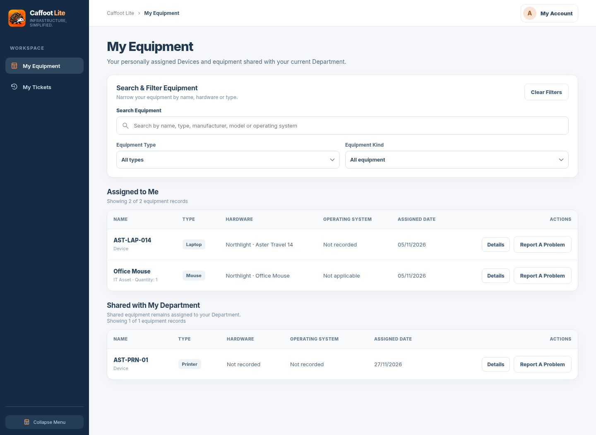

*Draft v2.2 — Alex sees the personally assigned AST-LAP-014 and outstanding mouse, plus the Accounts printer shared through current membership. This is the preserved pre-handover state. Independent review and owner visual acceptance pending.*

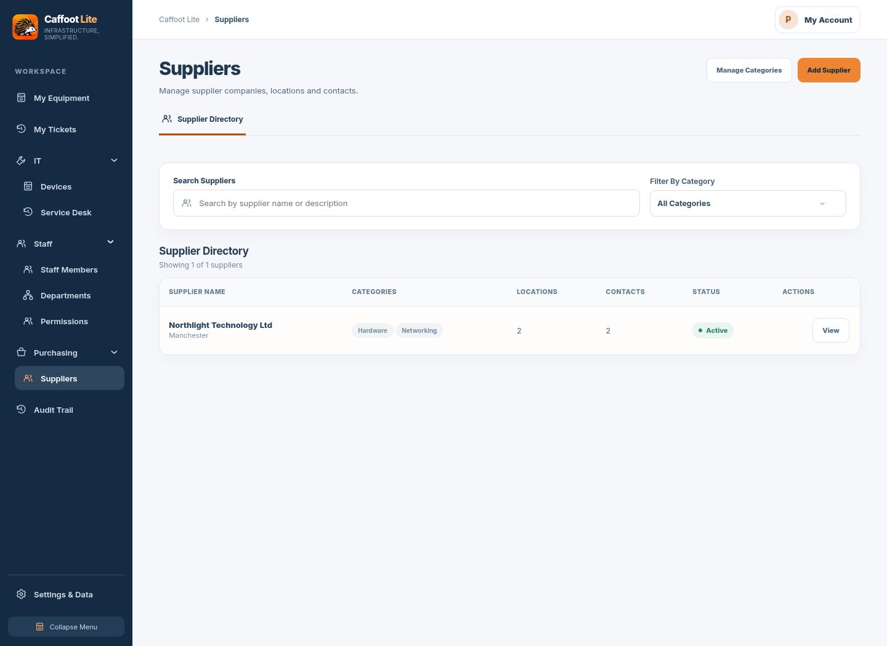

*Draft v2.2 — Original Supplier Directory only: active Northlight, two locations and two contacts. Retain the original fixture, category choices and provenance; this is not a later capture. Independent review and owner visual acceptance pending.*

## Batch 7D Desktop Illustrations

These images follow the fictional training journey. Read the caption to distinguish a draft, a cancelled preview and a saved outcome. [Complete original coverage and limits](screenshots/batch-7d/Coverage.md).

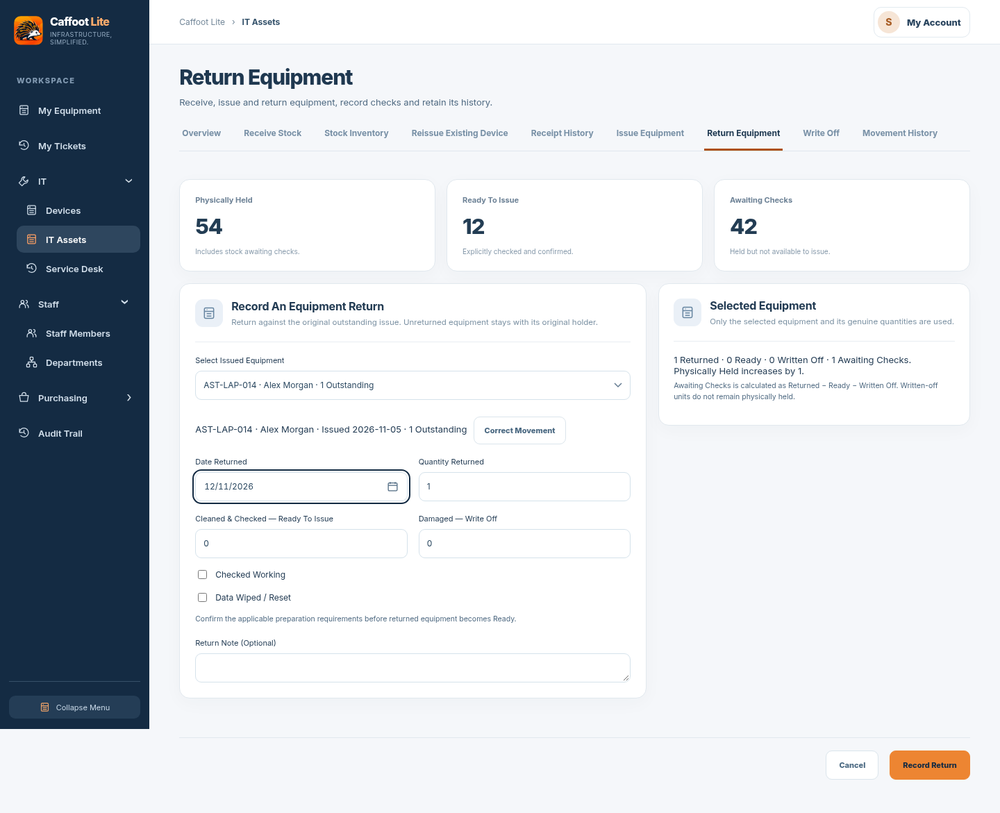

*Draft v2.2 — The laptop’s real physical return closes Alex’s original custody and enters Awaiting Preparation with Ready zero. It is not a mere unassignment. Independent review and owner visual acceptance pending.*

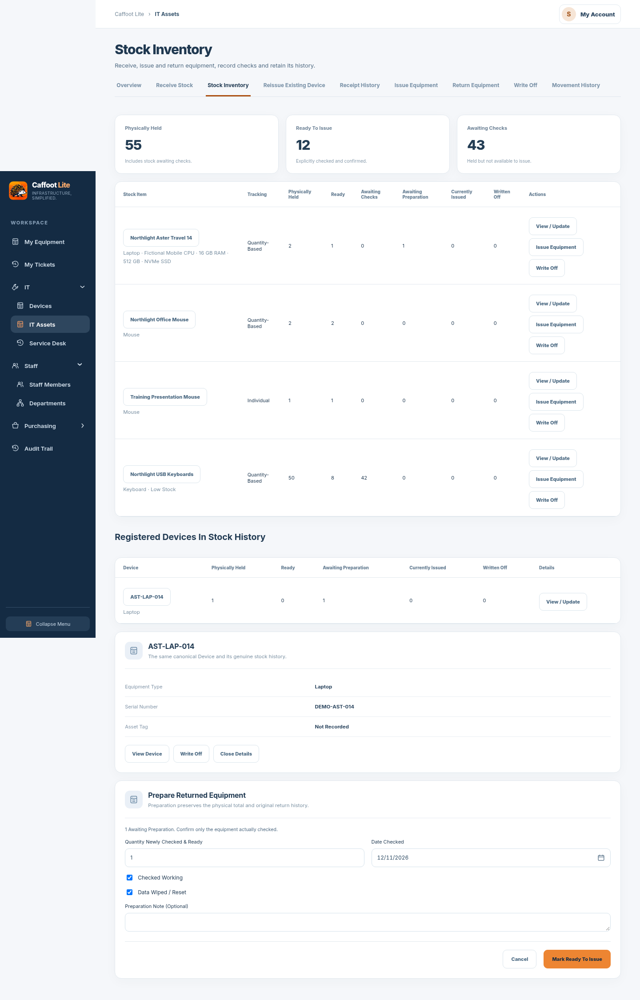

*Draft v2.2 — The original laptop is checked working and its data wiped/reset before becoming Ready. Preparation changes readiness without adding another held unit or new Device. Independent review and owner visual acceptance pending.*

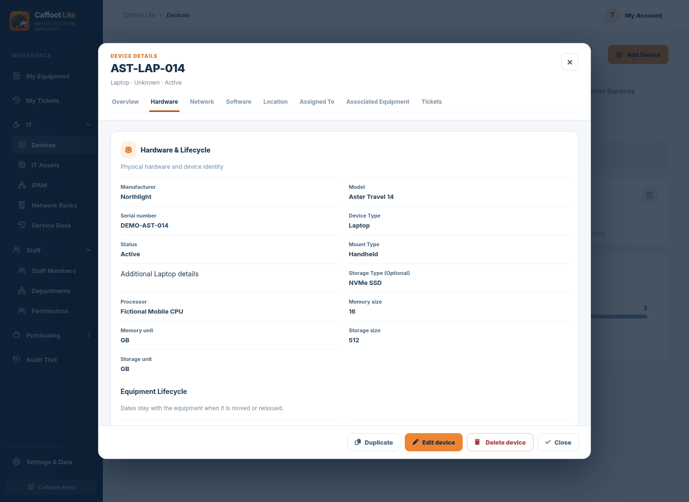

*Draft v2.2 — Saved AST-LAP-014 dates retain first service 05/11/2026 after reissue. Purchase 03/11 and warranty 15/12 are evidenced fictional dates; the Laptop lifespan calculates replacement in 2029 rather than restarting at Sarah’s issue. Independent review and owner visual acceptance pending.*

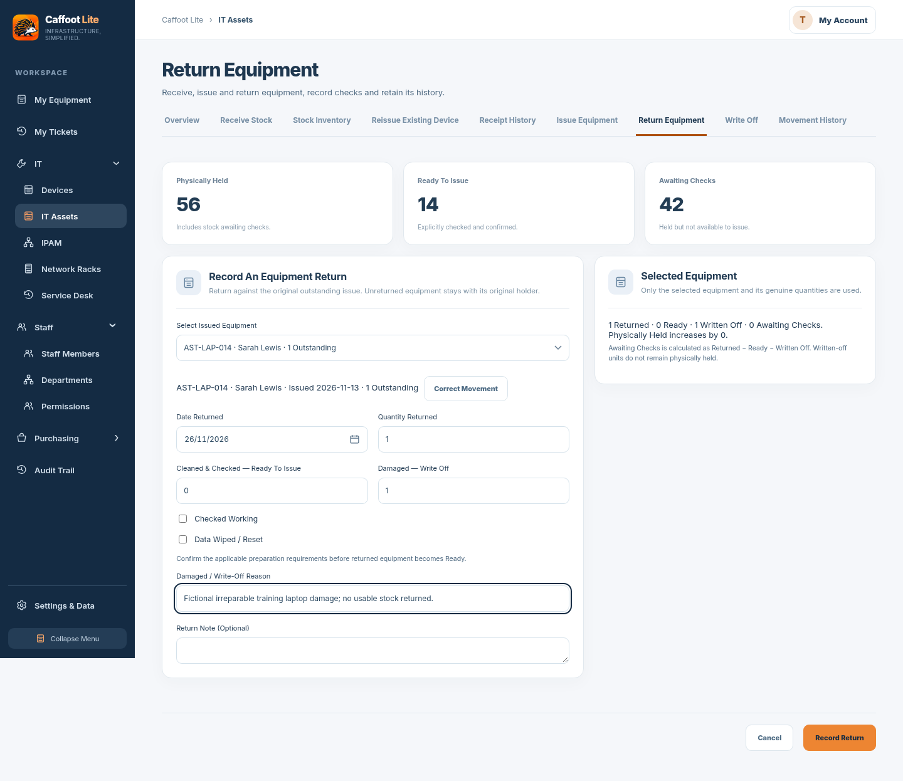

*Draft v2.2 — AST-LAP-014 physically returns damaged: returned one, Ready zero and damaged/write-off one. This actual return/disposition closes Sarah’s custody and adds no usable held laptop; a genuinely missing Device would use the separate Write Off route. Independent review and owner visual acceptance pending.*

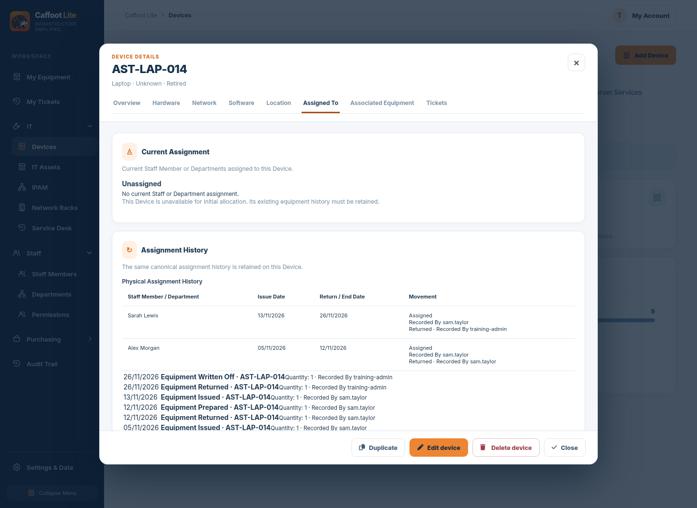

*Draft v2.2 — The final Retired Device keeps its identity and Alex/Sarah history. Physical return, damaged write-off and operational Retired are distinct recorded facts; nothing was deleted or generally reactivated. Independent review and owner visual acceptance pending.*

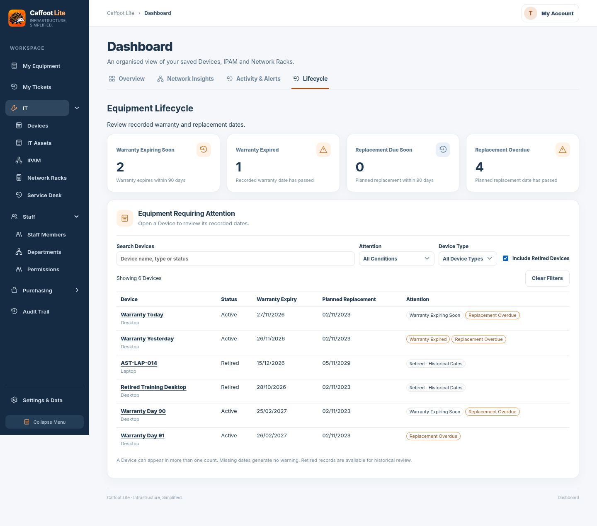

*Draft v2.2 — Named warranty examples distinguish yesterday, today, day 90 and day 91 under the 90-day rule. Include Retired with All Conditions retains AST-LAP-014 and its 15/12 warranty for historical review, while Retired Devices stay outside the four active counters. Independent review and owner visual acceptance pending.*

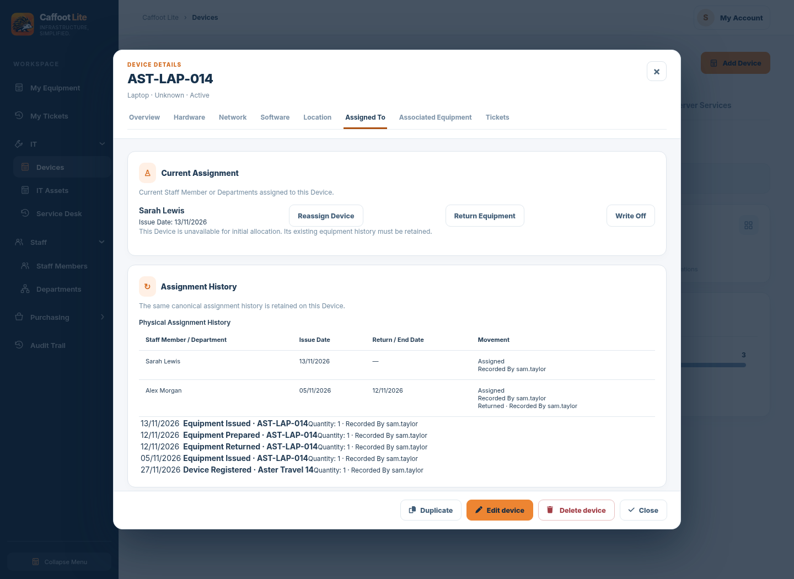

*Draft v2.2 — Sarah now holds the same AST-LAP-014. Alex’s ended custody and actual return remain in its history; preparation and reissue did not create a replacement identity or restart first service. Independent review and owner visual acceptance pending.*
