# Device Assignments And My Equipment

> **Current Batch 7D capture status — 27 November 2026:** [New desktop light illustrations](screenshots/batch-7d/README.md) use the approved merged schema-31 baseline. Independent ChatGPT review and separate owner visual/privacy/caption/alt acceptance remain pending. Earlier written/source and capture-status paragraphs retain their dated scope; the current pack status controls these new images. Published v2.1 and targeted correction-refresh requirements remain unchanged.

> **Draft v2.2 — Unreleased.** This guide includes the Stage 6.4 Shared Devices review changes. It is for development review, not production installation, upgrade or restore. Use the [published v2.1 guides](../README.md) for the released application. Batch 3.4 native/manual acceptance remains deferred; release acceptance is separate.

> **Written/source reconciliation:** Batch 3, application baseline `fdc677920bfc52f48f641b3d6d1344c902a6a9b0` (schema 31). Focused independent reviews are recorded and [owner written/source acceptance of Batches 1–6](https://github.com/Caffoot/Caffoot-Lite/issues/366#issuecomment-7200681167) is recorded. Current visual/privacy/caption/alt approval remains outstanding; [Batch 7 reconciliation and proposed capture packs](../../../development-guide/Milestone-01-Batch-7-Review.md) await independent review and owner acceptance. Capture scope and method need separate authorisation. Desktop capture remains deferred; existing images retain their original provenance and are not certified current by this pass. [Source review and exact screenshot requirements](../../../development-guide/Milestone-01-Batch-3-Review.md).

An assignment records one Staff Member or one or more Departments using an existing Device during a single physical custody period. Staff Details, Department Details and Device Details read the same saved relationship. My Equipment gives a linked person a limited view of their personal assignments and their Department's shared equipment.

The Device remains the authoritative inventory record throughout issue, return and reassignment. Do not create a second Device to change its holder or make it visible to a person.

## Choose The Correct Workflow

| Situation | Use this route |
| --- | --- |
| An eligible existing Device has never been assigned or recorded in equipment stock | **Assign Equipment** from Staff Details or **Assign Device** from Device Details → Assigned To. This records its initial holder. |
| Departments change while the existing Device stays in the same physical custody | **Manage Departments** from Device Details → Assigned To. |
| Brand-new computer stock needs its first Device identity | [Brand New / stock registration](Device-Stock-Registration-and-Reissue.md). Registration preserves physical stock; actual issue reduces held stock. |
| A registered Device is genuinely held and prepared for another holder | [Reissue Existing Device](Device-Stock-Registration-and-Reissue.md). |
| A currently assigned Device goes directly to a different holder | **Reassign Device**, after resolving associated equipment and completing preparation. See [Associated Equipment](Associated-Equipment.md#reassign-a-workstation-directly). |
| Equipment physically comes back or needs writing off | [Return Equipment / Write Off](IT-Assets-Issue-Return-and-Write-Off.md), reflecting its actual condition and custody. |

Initial allocation is not a stock receipt and does not mark a Device Ready. These records answer different questions:

- **Device Status**, such as Active or Retired, describes its operational record. Changing status does not receive equipment into stock.
- **Physical stock** records equipment genuinely held through stock workflows. Unassigned does not mean physically held by IT.
- **Readiness** records whether held equipment has passed its applicable checks and can be issued. A returned Device can be held while Awaiting Preparation.
- **Assignment** records current and previous holders, dates and responsible accounts. A Staff/Department status change does not automatically close an assignment.

Virtual machines do not have an **Assigned To** tab in Device Details because they cannot be physically allocated. Other applicable Device Details tabs remain available according to the existing permissions and feature settings. Physical Devices retain the Assigned To tab, including any saved assignment history.

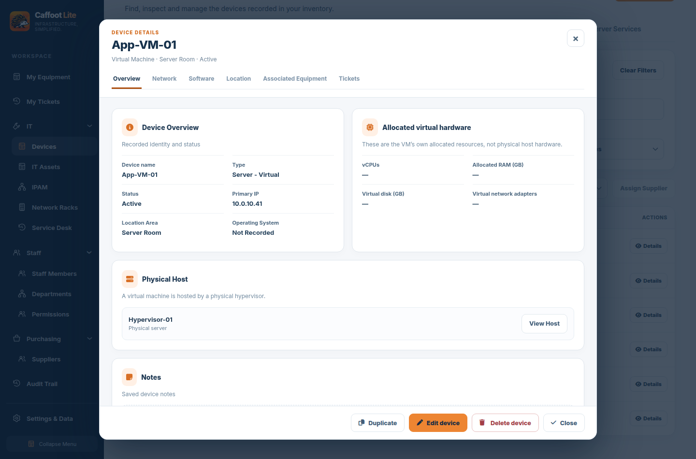

*Draft v2.2 — A virtual machine is not physically assigned.* [Dark mode](screenshots/milestone-01-sidebar-device-staff-corrections/virtual-device-dark.png)

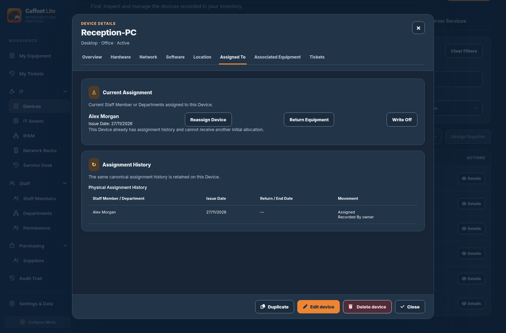

*Draft v2.2 — Physical Device custody and history remain available to authorised users.* [Capture provenance](screenshots/milestone-01-sidebar-device-staff-corrections/Provenance.txt) · [Owner-approved correction evidence](https://github.com/Caffoot/Caffoot-Lite/pull/485#issuecomment-7216358365)

## Before An Initial Assignment

You need **Devices Edit**, with Devices enabled. Starting from Staff Details also requires Staff Members Read. Device Details provides a restricted recipient picker without requiring broad Staff Members or Departments access.

Only **Desktop**, **Laptop** and **Printer** qualify for initial allocation. A Device must:

- be physical and have **Active** status;
- have no earlier Device assignment and no recorded equipment-stock history;
- still match the saved version selected in the form; and
- have no active editing reservation when saved.

Choose an **Active** Staff Member or one or more non-archived Departments. A person's login is optional and does not determine equipment eligibility. Other Device types, virtual machines and previously assigned or stock-recorded Devices cannot use this route to bypass stock, preparation or history safeguards.

See [Roles, Section Permissions And MFA](Roles-Section-Permissions-and-MFA.md) and [Optional Features](Optional-Features-and-Link-To-IPAM.md) for access controls.

## Assign From Staff Details

This route allocates one or several eligible existing Devices to one person together.

1. Open **Staff → Staff Members**, find the correct active person and choose **View Details**.
2. Under **Assigned Equipment**, choose **Assign Equipment**.
3. Use **Find Existing Devices** to search Device names. Tick intended Devices under **Devices** and review **Devices Selected**.
4. Check every selection belongs with this person. Selection is retained while searching another name; deselect anything added accidentally. Up to 100 Devices can be submitted together.
5. Choose **Confirm Assignment**.
6. Review **Assigned Equipment** and **Assignment History** in Staff Details. Open a Device's **Assigned To** tab to see the same holder and history.

The server validates all selected Devices before saving any assignment. If one changed, is being edited or became ineligible, the entire selection is rejected; no subset is allocated. Refresh the saved information and review all selections before retrying.

**Cancel** closes the form without allocation. Ticking a Device alone saves nothing. Successful initial allocation records the current date and responsible account; this form does not offer a backdated issue-date field.

### Example: Allocate Two Existing Devices

This example is fictional. **Alex Morgan** needs existing laptop **AC-LAP-07** and printer **AC-PRN-02**, neither having assignment or equipment-stock history. IT selects both and confirms. Both appear against Alex, and each original Device records Alex as its holder. No duplicate inventory or stock receipt is created.

If another technician starts editing AC-PRN-02 before confirmation, the whole allocation is rejected. AC-LAP-07 is not silently assigned alone. IT waits for the edit to finish, refreshes choices and reviews the selection again.

## Assign From Device Details

Use this route to assign one eligible Device to a person or to Departments that share it.

1. Open the existing Device Details view and select **Assigned To**.
2. Check **Current Assignment**. Choose **Assign Device** when initial allocation is available.
3. Set **Assign To** to **Staff Member** or **Department**.
4. For a Staff Member, search **Find A Recipient** and choose one person under **Recipient**. For Departments, use **Find A Department** and tick each applicable name. Your selections stay checked while you search for another name.
5. Choose **Confirm Assignment**.
6. Check the current holder, Issue Date and **Assignment History** on the same tab.

The recipient picker reveals only eligible recipient names and identifiers needed for the action. It does not grant access to directory contacts, login details or roles. If someone is missing, ask an authorised directory user to check status rather than selecting another person's record.

Departments share one custody period. Each selected Department has equal access to the Device under its existing membership and permissions. [Departments And Shared Equipment](Departments-and-Shared-Equipment.md)

## Change The Departments Sharing A Device

1. With **Devices Edit** and Devices enabled, open an assigned Desktop, Laptop or Printer and choose **Assigned To → Manage Departments**.
2. Confirm the current selections. Search **Find A Department** and tick each Department you need to add. Clear any Department you need to remove. An archived Department already assigned can stay selected or be removed.
3. Keep at least one Department selected. If the Device is physically returning or changing custodian, follow [Physical Return, Reissue And Direct Handover](#physical-return-reissue-and-direct-handover).
4. Review the list and choose **Save Changes**. For example, add Sales to the Main Office Printer currently used by Accounts while it stays in the same room and custody. Both groups can find the original printer, and existing Department tickets for its current custody period become available to eligible Sales members.
5. Check **Current Assignment** and **Assignment History**. The history shows who added or removed each Department and when. Stock quantities and physical issue history stay as recorded.

Choose **Cancel** to close the form and keep the saved selection. If a change is rejected because the Device or its assignment changed, reopen **Manage Departments** and check the current selections before saving again. New assignments to archived Departments are unavailable until reactivation. [Ticket confidentiality and access](Service-Desk-Tickets.md#shared-device-ticket-confidentiality)

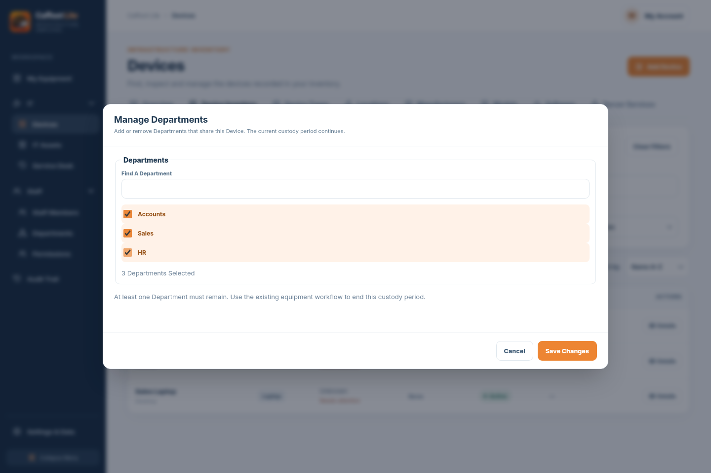

*Search and tick the Departments sharing the Device, then choose **Save Changes**.* [Capture provenance](../../../development-handovers/evidence/stage-6-4/README.md)

## Read Current Assignments And History

In Device Details → **Assigned To**, **Current Assignment** shows the present holder or **Unassigned**. Unassigned establishes no current holder; it does not establish physical possession or readiness.

**Assignment History** preserves the original Staff Member/Department label, Issue Date, Return / End Date and responsible account. Returns, write-offs and direct handovers close the relevant relationship without erasing it. Current labels follow recipient renames; historical labels retain names recorded at the time.

Staff Details shows a person's current equipment and corresponding history. Department Details → Equipment shows each Device shared with that Department, plus any outstanding IT Assets issued to it. Staff personal assignments remain in Staff Details. With independent IT Assets access, genuine stock movements appear alongside the original relationships. Hidden stock information must not be interpreted as an absence of stock history.

Devices with assignment history are protected against ordinary deletion and inventory replacements that would remove those relationships. The administrator’s separate Clean Start operation clears those records and their history along with the rest of the operational data. [Clean Start](Service-Desk-Administration.md#clear-operational-data-with-clean-start)

## Physical Return, Reissue And Direct Handover

### A Device Physically Comes Back

1. Check what was actually handed back. Do not record missing equipment as physically returned.
2. Open **Device Details → Assigned To → Return Equipment**, where offered, with **Devices Edit** and **IT Assets Edit**, both features enabled.
3. Follow [Return Equipment](IT-Assets-Issue-Return-and-Write-Off.md) for physical receipt, applicable checks, readiness and damaged/write-off disposition.
4. Check the closed original assignment and retained Device identity/history. A returned Device may await preparation; it is not automatically deployable.
5. Use [Reissue Existing Device](Device-Stock-Registration-and-Reissue.md) only when the registered Device is genuinely held, unassigned and Ready To Issue, with outstanding associated equipment resolved.

Return Equipment also supports eligible previously deployed physical Devices that currently have neither an assignment nor stock history, with explicit confirmation of actual receipt. Follow the stock guide; do not invent an initial holder or a separate Place In Stock action.

### The Device Goes Directly To Another Holder

1. Open **Associated Equipment** and resolve every outstanding explicitly linked accessory through actual return/disposition or an appropriate Write Off. Accessories do not transfer automatically.
2. Open **Assigned To → Reassign Device** when eligible.
3. Choose **Recipient Type**. For a single holder, use **Find A Recipient** to choose the new Staff Member or Department. The current holder is omitted from that list. For an eligible shared Device, search and tick the new Department selection under **Departments**. You can retain a Department as part of a changed shared selection, for example by selecting Finance and Facilities when Finance currently holds the Device.
4. Enter **Date Reassigned** and any **Reassignment Note (Optional)**. The date cannot precede the original issue or be in the future.
5. Complete the displayed **Preparation Checks** for that Device type. Computers require **Checked Working** and **Data Wiped / Reset**; other equipment uses its applicable working, condition and data-clearing checks.
6. Choose **Confirm Ready And Reassign** only after completing those checks.
7. Review the new current holder and closed previous assignment.

The old holder stays recorded until the complete save succeeds. Cancellation or rejection leaves that holder unchanged. Successful handover retains identity and saves checks, dates, actors and old/new relationships together. It creates no storeroom receipt, held-stock increase or fictional Ready stock.

If the Device or current holder changes while the form is open, reopen **Reassign Device** from the refreshed **Assigned To** tab. Check current custody before choosing the new recipient. The server rejects an unchanged selection.

On a narrow screen, scroll inside **Reassign Device** to reach the preparation checks and the **Cancel** and **Confirm Ready And Reassign** buttons. [Mobile view with a classic scrollbar](../../../development-handovers/evidence/stage-6-6-batch-3/screenshots/classic-reassign-dark-390x844.png)

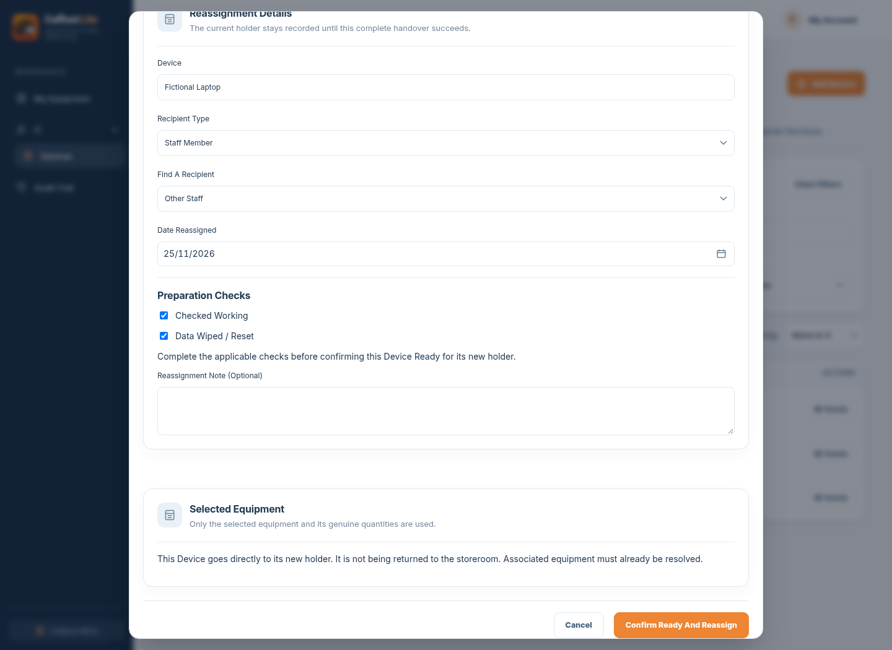

Devices-only handover needs Devices Edit. A Device with recorded stock history also requires IT Assets enabled and IT Assets Edit. Use [Associated Equipment And Direct Handover](Associated-Equipment.md#reassign-a-workstation-directly) for the full missing-accessory scenario and recovery guidance. [Correct Movement](IT-Assets-Correct-Movement.md) handles eligible stock-recording mistakes separately. A new holder can raise a separate ticket after a valid assignment. [Ticket privacy after handover](Service-Desk-Administration.md#what-happens-to-service-desk-tickets-when-equipment-changes-hands)

## My Equipment

My Equipment is for a person signing in with a login linked to an active Staff Member. It does not require or grant general inventory or directory rights.

1. Sign in using your own linked login.
2. Open **My Account → Overview**, then select **Open My Equipment** in the **My Equipment** card. The same destination is available from **Workspace → My Equipment** in the sidebar. If the card is missing, ask your administrator to check that your login is linked to an active Staff Member and that Devices or IT Assets is enabled.
3. Read **Assigned to Me** for Devices and outstanding IT Assets assigned directly to you.
4. Read **Shared with My Department** for equipment assigned to your current Department. Viewing it does not make you the personal holder.
5. Report an incorrect item or quantity to an authorised IT user, using its name and the relevant facts. This personal screen has no Issue, Return, Reassign or Write Off controls.
6. To ask IT for help with listed equipment, select **Report A Problem** on the item. Confirm the preselected **Device / Asset**. On a Department Device or its associated accessory, read the confidentiality warning before completing **Subject**, **Description** or adding a file. Complete **Ticket Category** and the required fields. Add a permitted file if helpful. Select **Create Ticket** to save, or **Cancel** to return to My Equipment. Follow the saved reference in **My Tickets** for personal equipment or **Department Tickets** for shared equipment. [Full ticket instructions](Service-Desk-Tickets.md#raise-a-support-request)

### Find Equipment And Open Details

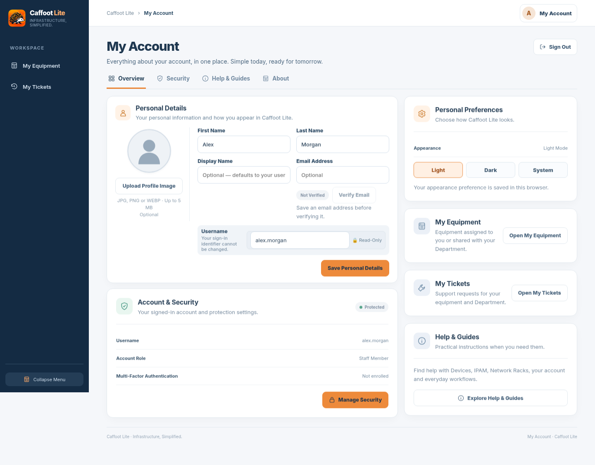

*Open My Equipment brings you to the personal and Department lists.* [Mobile view and capture provenance](../../../development-handovers/evidence/stage-6-6-batch-3/README.md#application-screenshots)

1. In **Search Equipment**, enter part of a name, type, manufacturer, model or operating system. Use **Equipment Type** or **Equipment Kind** to narrow both tables. **Clear Filters** restores the full list your account can see.
2. On a narrow screen, scroll each table horizontally to reach **Assigned date**, **Details** and **Report A Problem**.
3. Select **Details** for an item. Device details can include the serial number and operating system. For a Laptop or Desktop, **Recorded Installed Software** lists eligible application names recorded on that Device. The list describes the saved record and may differ from what is installed today. An IT Asset shows its outstanding quantity where applicable.
4. Choose **Close** or press Escape to return to the table. **Report A Problem** opens the existing ticket form with the equipment selected. If the assignment changed before you opened Details, the dialogue may say the equipment is no longer available. Reopen My Equipment to refresh the list.

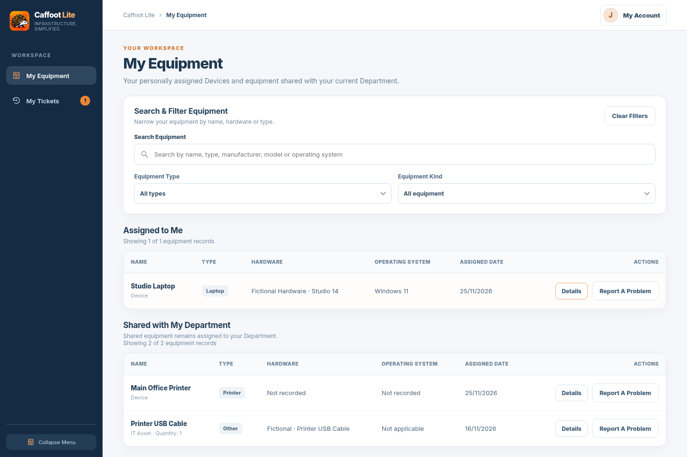

*The two sections show current custody. The cable quantity is the outstanding quantity.*

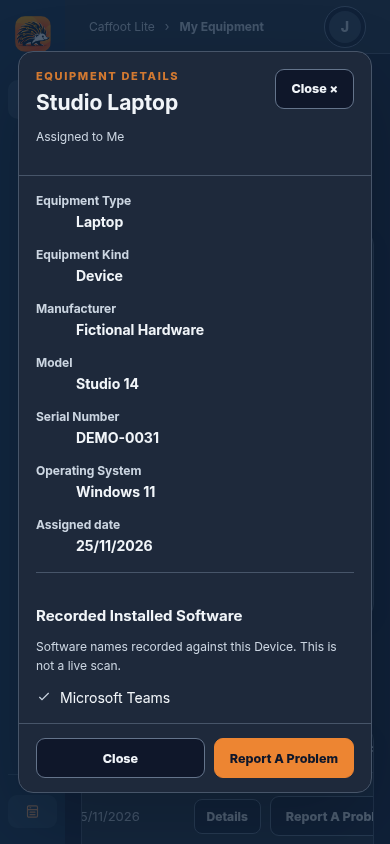

*The dialogue shows the fields this account can see. Network configuration, licence keys, credentials, private notes, stock totals and former holders are excluded.* [Desktop and mobile captures and provenance](../../../development-handovers/evidence/stage-6-6-batch-2/README.md#application-screenshots)

If the recorded software list is long, scroll inside **Details** to reach the actions. Escape closes the details and returns keyboard focus to the equipment row's **Details** button. [Long software list on mobile](../../../development-handovers/evidence/stage-6-6-batch-3/screenshots/classic-equipment-details-dark-390.png)

The server checks the active Staff link and current custody on every request. Without a current Department there is no Department-shared list. A Left Company or unlinked Staff record gives no self-service equipment visibility. Left Company also disables its linked login and revokes sessions/proofs; reactivation leaves login enabling as a separate administrator decision. Authorised IT staff can still resolve outstanding assignments. A current Department member can see equipment still shared with their archived Department until an authorised change ends that relationship.

Devices and IT Assets obey independent feature switches. Disabling one hides its equipment and blocks its protected actions while preserving saved relationships. Ordinary baseline Staff access therefore exposes personal/shared equipment without opening the organisation's inventory pages.

### Visibility, Empty Results And Permission Changes

**No matching equipment** means the filters excluded the records already available to you: select **Clear Filters**. **No equipment available** means no current records were returned for that personal or Department section. Missing manufacturer/model/serial fields show **Not recorded**; a Laptop/Desktop with no eligible recorded software shows **No installed software is recorded for this Device.** These are recorded inventory facts, not live detection results.

Details reloads authorised equipment before displaying it. A changed assignment or Department membership can produce **Equipment details could not be loaded or are no longer available.** Close it, reopen My Equipment and check with IT. Old rows in an already-open page do not preserve access; already displayed information cannot be recalled from the viewer's memory or screenshots.

Removing general Devices/IT Assets Read does not, by itself, remove an active linked person's personal My Equipment access. It removes the corresponding general inventory permission; self-service still follows current custody, membership, feature switches and valid sign-in. Role/permission changes can revoke sessions, requiring a fresh sign-in. Disabling the account ends its sessions and blocks all authenticated access. Disabling Devices hides Device records and Device-linked accessories; independently issued IT Assets remain subject to IT Assets being enabled. Disabling IT Assets hides its issues while enabled Devices can remain visible.

Only the permitted Device name/type, manufacturer/model, serial number, recorded operating system, assignment date and eligible Laptop/Desktop software names are returned for self-service. IT Asset rows expose their permitted description, issue date and outstanding quantity. IP/MAC addresses, network settings, licence keys, credentials, private notes, Supplier/purchase details, lifecycle records, stock totals and former-holder history are not supplied by this view. Software names come from recognised saved catalogue flags; orphan fields and **Other / Not Listed** are not presented as an installed-application inventory.

### Example: A Partial Return And Department Move

This example is fictional. **Priya Shah** in Accounts holds one laptop and two quantity-tracked adapters. Accounts holds a shared printer. Assigned to Me shows Priya's laptop and **Quantity: 2** adapters; Shared with My Department shows the printer.

IT records one adapter's actual return. Priya's next My Equipment request shows one outstanding adapter, rather than the original two. If Priya moves to Sales, the Accounts printer disappears from the shared list. The remaining adapter and laptop stay personally assigned to Priya, and the printer remains assigned to Accounts. Nothing is duplicated or physically returned by the membership change.

Marking Priya **Left Company** disables her linked login, revokes its sessions/proofs and removes self-service equipment visibility while retaining outstanding assignments for authorised IT staff. **Reactivate** alone does not enable the login. IT records actual return, write-off or handover separately. [Linked account security](Roles-Section-Permissions-and-MFA.md#employment-status-and-linked-login-security)

## Troubleshooting And Recovery

| Problem | What to check or do |
| --- | --- |
| Assign Device is absent | Check Devices Edit, the feature switch, physical type, Active status and history. Use the appropriate stock/reissue route for previously recorded equipment. |
| The Device is missing from Find Existing Devices | Search its name more specifically. Infrastructure, virtual, previously assigned and stock-recorded Devices are excluded from initial allocation. |
| Confirmation reports a changed/edited Device | No selected assignment was saved. Refresh choices after the other edit finishes and review the whole selection. |
| A recipient is missing | Check Active Staff/non-archived Department status. Equipment eligibility and login availability are separate. |
| Reassign Device or Reissue Existing Device is unavailable | Review required rights, actual custody/readiness and unresolved Associated Equipment, including earlier holders' history. |
| My Equipment is empty | Check that the login is linked to an active Staff Member, then check current assignments and feature switches. A Staff record alone creates no assignment. |
| Shared equipment changes after a transfer | It follows current Department membership. Verify membership rather than creating duplicate personal assignments to restore former visibility. |
| A request loses its response | Reopen current assignment and history to establish the saved state before repeating an action. |

The server checks current session, rights, recipient eligibility and saved equipment state when submitting each operation. Viewing an item or retaining an earlier open form does not guarantee a later mutation remains authorised.

## Related Guides And Acceptance Items

- [Staff Members](Staff-Members.md)
- [Departments And Shared Equipment](Departments-and-Shared-Equipment.md)
- [Device Stock Registration And Reissue](Device-Stock-Registration-and-Reissue.md)
- [Associated Equipment](Associated-Equipment.md)
- [Issue, Return And Write Off](IT-Assets-Issue-Return-and-Write-Off.md)
- [Correct Movement](IT-Assets-Correct-Movement.md)

The reused image belongs to the [owner-approved Batch 3.8 application captures](https://github.com/Caffoot/Caffoot-Lite/pull/389#issuecomment-6908629303). [Earlier assignment evidence](../../../development-handovers/evidence/stage-3-batch-34/Report.md) records deferred native/manual acceptance. Current explicitly approved illustrations of initial allocation and direct handover remain documentation acceptance items; functional HTML previews are not used as screenshots.

[← Draft v2.2 Guides](README.md) · [Published v2.1 Guides](../README.md)

[Connected equipment example — Supplier, stock, assignment and later use](Connected-Equipment-Journey.md).

## Batch 7D Desktop Illustrations

These images follow the fictional training journey. Read the caption to distinguish a draft, a cancelled preview and a saved outcome. [Complete original coverage and limits](screenshots/batch-7d/Coverage.md).

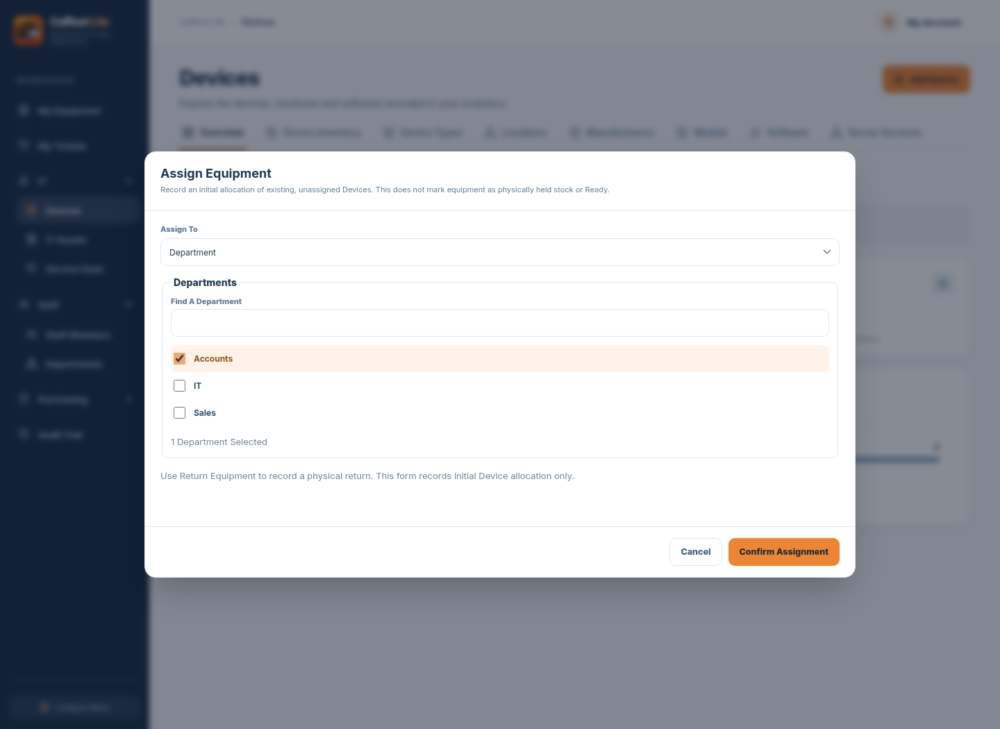

*Draft v2.2 — This unsaved assignment selects Accounts for one shared physical printer. Membership affects access, rather than creating another physical issue. Independent review and owner visual acceptance pending.*

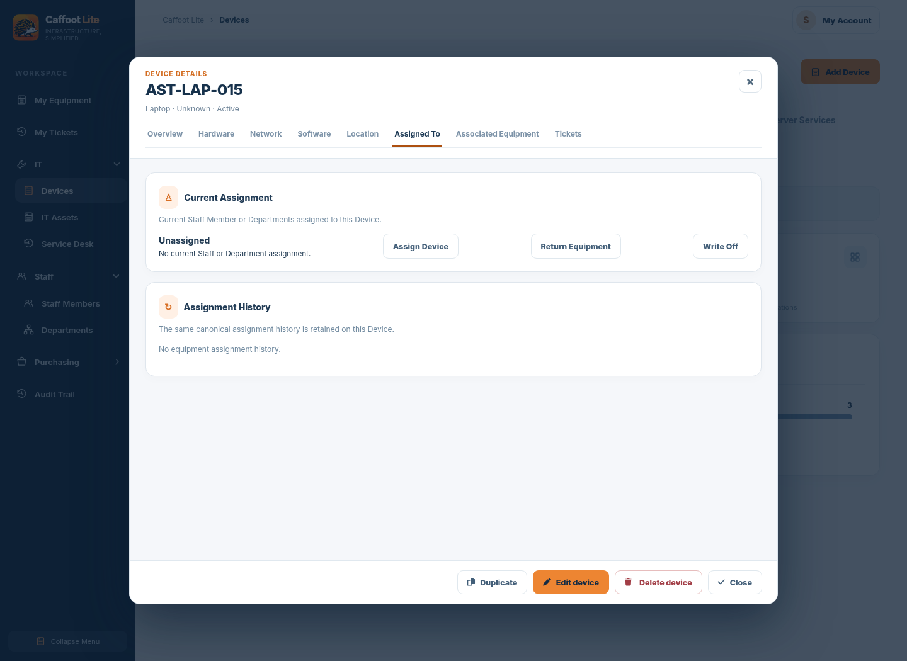

*Draft v2.2 — AST-LAP-015 is an independent Device with no current holder or physical stock receipt. Initial allocation is available only while it remains eligible. Independent review and owner visual acceptance pending.*

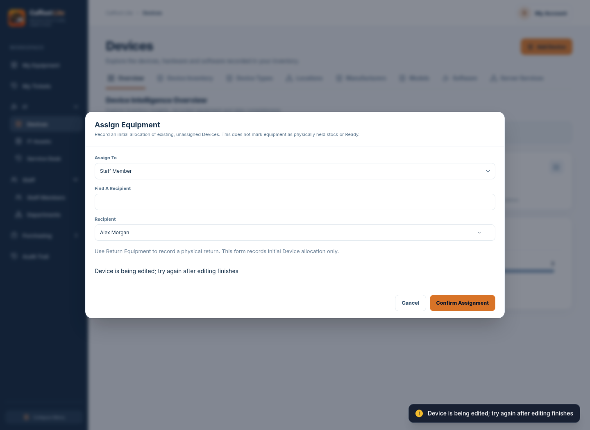

*Draft v2.2 — A real edit reservation invalidates this initial allocation. The complete selection is rejected; Alex does not receive a partially saved assignment. Independent review and owner visual acceptance pending.*

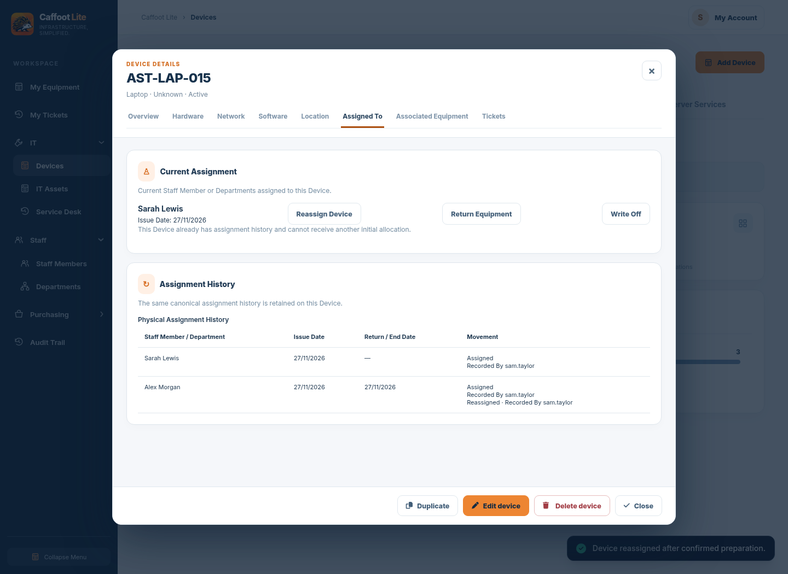

*Draft v2.2 — This separate AST-LAP-015 demonstration records a checked direct handover from Alex to Sarah on 27/11. It has no storeroom return and does not replace the AST-LAP-014 return/reissue journey. Independent review and owner visual acceptance pending.*

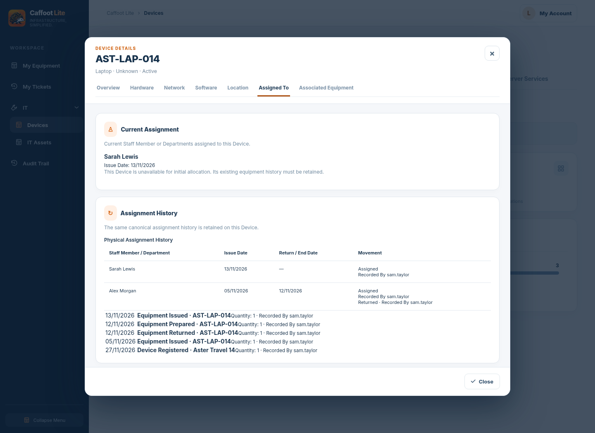

*Draft v2.2 — Devices/IT Assets Read can review AST-LAP-014’s current Sarah custody and earlier Alex history, without assignment, return, write-off or editing controls. Independent review and owner visual acceptance pending.*

*Draft v2.2 — The final Retired Device keeps its identity and Alex/Sarah history. Physical return, damaged write-off and operational Retired are distinct recorded facts; nothing was deleted or generally reactivated. Independent review and owner visual acceptance pending.*

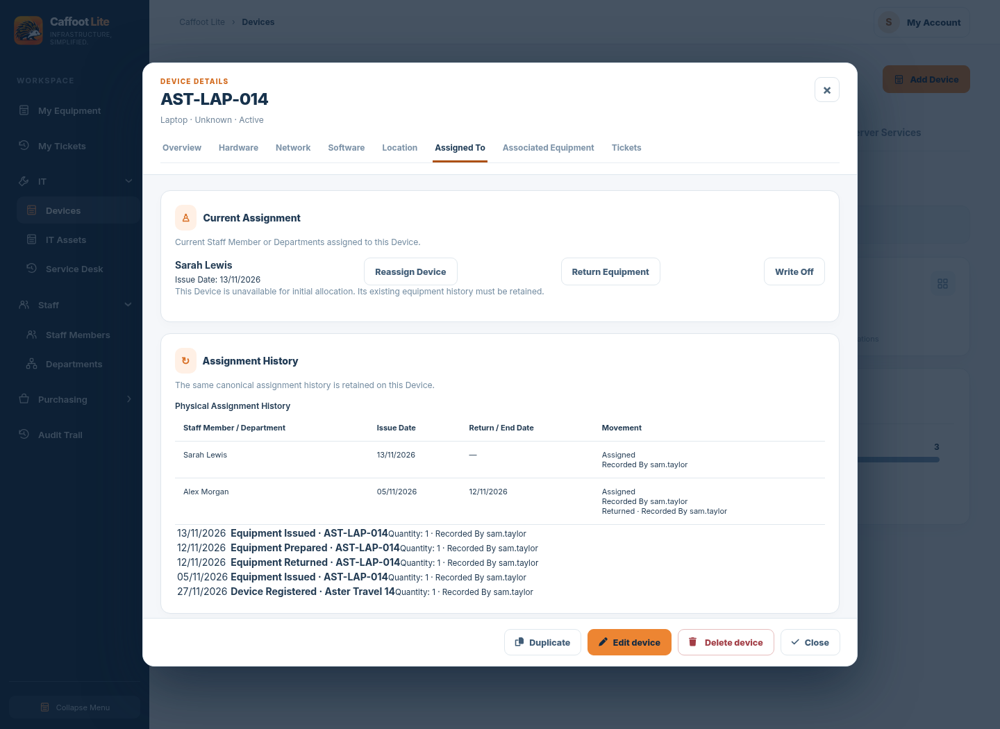

*Draft v2.2 — Sarah now holds the same AST-LAP-014. Alex’s ended custody and actual return remain in its history; preparation and reissue did not create a replacement identity or restart first service. Independent review and owner visual acceptance pending.*

*Draft v2.2 — Saved current custody belongs to Alex. The original Device and assignment history remain the authoritative identity; registration was a different event. Independent review and owner visual acceptance pending.*
