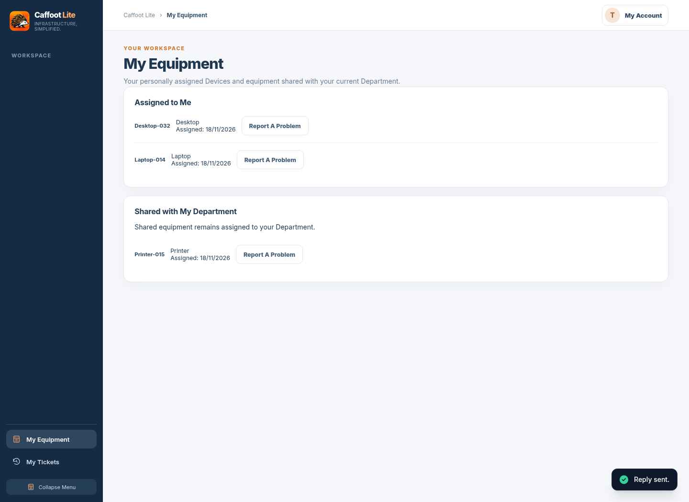
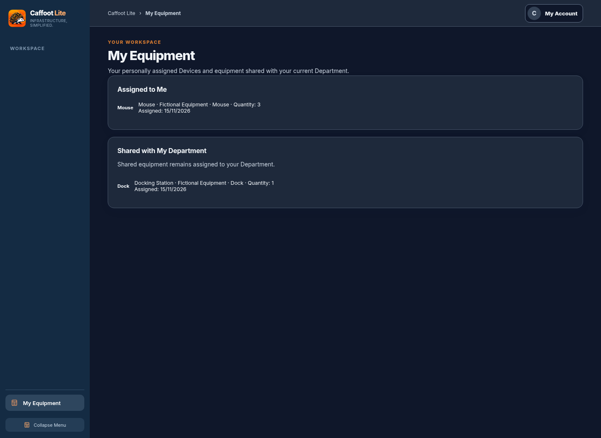

# Device Assignments And My Equipment

> **Draft v2.2 — Unreleased.** This guide describes the implementation on `milestone-1` at `753b3266893987addb11406ef8303adb03c3c112`. It is for development review, not production installation, upgrade or restore. Use the [published v2.1 guides](../README.md) for the released application. Batch 3.4 native/manual acceptance remains deferred; release acceptance is separate.

An assignment records the Staff Member or Department holding an existing Device. Staff Details, Department Details and Device Details read the same saved relationship. My Equipment gives a linked person a limited view of their personal assignments and their Department's shared equipment.

The Device remains the authoritative inventory record throughout issue, return and reassignment. Do not create a second Device to change its holder or make it visible to a person.

## Choose The Correct Workflow

| Situation | Use this route |
| --- | --- |
| An eligible existing Device has never been assigned or recorded in equipment stock | **Assign Equipment** from Staff Details or **Assign Device** from Device Details → Assigned To. This records its initial holder. |
| Brand-new computer stock needs its first Device identity | [Brand New / stock registration](Device-Stock-Registration-and-Reissue.md). Registration preserves physical stock; actual issue reduces held stock. |
| A registered Device is genuinely held and prepared for another holder | [Reissue Existing Device](Device-Stock-Registration-and-Reissue.md). |
| A currently assigned Device goes directly to a different holder | **Reassign Device**, after resolving associated equipment and completing preparation. See [Associated Equipment](Associated-Equipment.md#reassign-a-workstation-directly). |
| Equipment physically comes back or needs writing off | [Return Equipment / Write Off](IT-Assets-Issue-Return-and-Write-Off.md), reflecting its actual condition and custody. |

Initial allocation is not a stock receipt and does not mark a Device Ready. These records answer different questions:

- **Device Status**, such as Active or Retired, describes its operational record. Changing status does not receive equipment into stock.
- **Physical stock** records equipment genuinely held through stock workflows. Unassigned does not mean physically held by IT.
- **Readiness** records whether held equipment has passed its applicable checks and can be issued. A returned Device can be held while Awaiting Preparation.
- **Assignment** records current and previous holders, dates and responsible accounts. A Staff/Department status change does not automatically close an assignment.

## Before An Initial Assignment

You need **Devices Edit**, with Devices enabled. Starting from Staff Details also requires Staff Members Read. Device Details provides a restricted recipient picker without requiring broad Staff Members or Departments access.

Only **Desktop**, **Laptop** and **Printer** qualify for initial allocation. A Device must:

- be physical and have **Active** status;
- have no earlier Device assignment and no recorded equipment-stock history;
- still match the saved version selected in the form; and
- have no active editing reservation when saved.

The recipient must be an **Active** Staff Member or a non-archived Department. A person's login is optional and does not determine equipment eligibility. Other Device types, virtual machines and previously assigned or stock-recorded Devices cannot use this route to bypass stock, preparation or history safeguards.

See [Roles, Section Permissions And MFA](Roles-Section-Permissions-and-MFA.md) and [Optional Features](Optional-Features-and-Link-To-IPAM.md) for access controls.

## Assign From Staff Details

This route allocates one or several eligible existing Devices to one person together.

1. Open **Staff → Staff Members**, find the correct active person and choose **View Details**.
2. Under **Assigned Equipment**, choose **Assign Equipment**.
3. Use **Find Existing Devices** to search Device names. Tick intended Devices under **Devices** and review **Devices Selected**.
4. Check every selection belongs with this person. Selection is retained while searching another name; deselect anything added accidentally. Up to 100 Devices can be submitted together.
5. Choose **Confirm Assignment**.
6. Review **Assigned Equipment** and **Assignment History** in Staff Details. Open a Device's **Assigned To** tab to see the same holder and history.

The server validates all selected Devices before saving any assignment. If one changed, is being edited or became ineligible, the entire selection is rejected; no subset is allocated. Refresh the saved information and review all selections before retrying.

**Cancel** closes the form without allocation. Ticking a Device alone saves nothing. Successful initial allocation records the current date and responsible account; this form does not offer a backdated issue-date field.

### Example: Allocate Two Existing Devices

This example is fictional. **Alex Morgan** needs existing laptop **AC-LAP-07** and printer **AC-PRN-02**, neither having assignment or equipment-stock history. IT selects both and confirms. Both appear against Alex, and each original Device records Alex as its holder. No duplicate inventory or stock receipt is created.

If another technician starts editing AC-PRN-02 before confirmation, the whole allocation is rejected. AC-LAP-07 is not silently assigned alone. IT waits for the edit to finish, refreshes choices and reviews the selection again.

## Assign From Device Details

Use this route to choose a person or Department for one eligible Device.

1. Open the existing Device Details view and select **Assigned To**.
2. Check **Current Assignment**. Choose **Assign Device** when initial allocation is available.
3. Set **Assign To** to **Staff Member** or **Department**.
4. Enter part of the name in **Find A Recipient**, then choose the correct entry under **Recipient**.
5. Choose **Confirm Assignment**.
6. Check the current holder, Issue Date and **Assignment History** on the same tab.

The recipient picker reveals only eligible recipient names and identifiers needed for the action. It does not grant access to directory contacts, login details or roles. If someone is missing, ask an authorised directory user to check status rather than selecting another person's record.

A Department-assigned Device belongs to that shared assignment once. It is not allocated individually to every member. See [Departments And Shared Equipment](Departments-and-Shared-Equipment.md).

## Read Current Assignments And History

In Device Details → **Assigned To**, **Current Assignment** shows the present holder or **Unassigned**. Unassigned establishes no current holder; it does not establish physical possession or readiness.

**Assignment History** preserves the original Staff Member/Department label, Issue Date, Return / End Date and responsible account. Returns, write-offs and direct handovers close the relevant relationship without erasing it. Current labels follow recipient renames; historical labels retain names recorded at the time.

Staff Details shows a person's current equipment and corresponding history. Department Details → Equipment shows directly Department-owned equipment, excluding members' personal assignments. With independent IT Assets access, genuine stock movements appear alongside the original relationships. Hidden stock information must not be interpreted as an absence of stock history.

Devices with assignment history are protected against ordinary deletion and inventory replacements that would remove those relationships. The administrator’s separate Clean Start operation clears those records and their history along with the rest of the operational data. [Clean Start](Service-Desk-Administration.md#clear-operational-data-with-clean-start)

## Physical Return, Reissue And Direct Handover

### A Device Physically Comes Back

1. Check what was actually handed back. Do not record missing equipment as physically returned.
2. Open **Device Details → Assigned To → Return Equipment**, where offered, with **Devices Edit** and **IT Assets Edit**, both features enabled.
3. Follow [Return Equipment](IT-Assets-Issue-Return-and-Write-Off.md) for physical receipt, applicable checks, readiness and damaged/write-off disposition.
4. Check the closed original assignment and retained Device identity/history. A returned Device may await preparation; it is not automatically deployable.
5. Use [Reissue Existing Device](Device-Stock-Registration-and-Reissue.md) only when the registered Device is genuinely held, unassigned and Ready To Issue, with outstanding associated equipment resolved.

Return Equipment also supports eligible previously deployed physical Devices that currently have neither an assignment nor stock history, with explicit confirmation of actual receipt. Follow the stock guide; do not invent an initial holder or a separate Place In Stock action.

### The Device Goes Directly To Another Holder

1. Open **Associated Equipment** and resolve every outstanding explicitly linked accessory through actual return/disposition or an appropriate Write Off. Accessories do not transfer automatically.
2. Open **Assigned To → Reassign Device** when eligible.
3. Choose **Recipient Type** and a different eligible holder under **Find A Recipient**.
4. Enter **Date Reassigned** and any **Reassignment Note (Optional)**. The date cannot precede the original issue or be in the future.
5. Complete the displayed **Preparation Checks** for that Device type. Computers require **Checked Working** and **Data Wiped / Reset**; other equipment uses its applicable working, condition and data-clearing checks.
6. Choose **Confirm Ready And Reassign** only after completing those checks.
7. Review the new current holder and closed previous assignment.

The old holder stays recorded until the complete save succeeds. Cancellation or rejection leaves that holder unchanged. Successful handover retains identity and saves checks, dates, actors and old/new relationships together. It creates no storeroom receipt, held-stock increase or fictional Ready stock.

Devices-only handover needs Devices Edit. A Device with recorded stock history also requires IT Assets enabled and IT Assets Edit. Use [Associated Equipment And Direct Handover](Associated-Equipment.md#reassign-a-workstation-directly) for the full missing-accessory scenario and recovery guidance. [Correct Movement](IT-Assets-Correct-Movement.md) handles eligible stock-recording mistakes separately. A new holder can raise a separate ticket after a valid assignment. [Ticket privacy after handover](Service-Desk-Administration.md#what-happens-to-service-desk-tickets-when-equipment-changes-hands)

## My Equipment

My Equipment is for a person signing in with a login linked to their Staff record. It does not require or grant general inventory or directory rights.

1. Sign in using your own linked login.
2. Open **My Equipment** in the personal sidebar.
3. Read **Assigned to Me** for Devices and outstanding IT Assets assigned directly to you.
4. Read **Shared with My Department** for equipment assigned to your current Department. Viewing it does not make you the personal holder.
5. Report an incorrect item or quantity to an authorised IT user, using its name and the relevant facts. This personal screen has no Issue, Return, Reassign or Write Off controls.
6. To ask IT for help with listed equipment, select **Report A Problem** on the item. Confirm the preselected **Device / Asset**, then complete **Ticket Category**, **Subject** and **Description**. Add a permitted file if helpful. Select **Create Ticket** to save, or **Cancel** to return to My Equipment. Follow the saved reference in **My Tickets** for personal equipment or **Department Tickets** for shared equipment. [Full ticket instructions](Service-Desk-Tickets.md#raise-a-support-request)

*The action opens Create Ticket with the equipment already selected.* [Capture details](../../../development-handovers/evidence/employee-service-desk/README.md)

*Approved Batch 3.8 application capture with fictional data. The two sections keep personal and shared assignments distinct. Quantities show what is still outstanding, rather than the original issued quantity.*

The limited view shows equipment name, type, manufacturer, model and assignment date, plus outstanding quantity for IT Assets. General network configuration, credentials, private notes, former holders, other people's history, stock totals and administration controls are excluded.

On each request, the server derives the Staff link and current Department from the signed-in account. You cannot choose another person's identity or another Department. Without a Department there is no Department-shared list to populate; without a linked login a Staff record provides no self-service access.

Devices and IT Assets obey independent feature switches. Disabling one hides its equipment and blocks its protected actions while preserving saved relationships. Ordinary baseline Staff access therefore exposes personal/shared equipment without opening the organisation's inventory pages.

### Example: A Partial Return And Department Move

This example is fictional. **Priya Shah** in Accounts holds one laptop and two quantity-tracked adapters. Accounts holds a shared printer. Assigned to Me shows Priya's laptop and **Quantity: 2** adapters; Shared with My Department shows the printer.

IT records one adapter's actual return. Priya's next My Equipment request shows one outstanding adapter, rather than the original two. If Priya moves to Sales, the Accounts printer disappears from the shared list. The remaining adapter and laptop stay personally assigned to Priya, and the printer remains assigned to Accounts. Nothing is duplicated or physically returned by the membership change.

Marking Priya Inactive retains the outstanding assignments. It does not disable her login or return equipment. Administrators handle login access separately, and IT resolves equipment through actual return, write-off or handover workflows.

## Troubleshooting And Recovery

| Problem | What to check or do |
| --- | --- |
| Assign Device is absent | Check Devices Edit, the feature switch, physical type, Active status and history. Use the appropriate stock/reissue route for previously recorded equipment. |
| The Device is missing from Find Existing Devices | Search its name more specifically. Infrastructure, virtual, previously assigned and stock-recorded Devices are excluded from initial allocation. |
| Confirmation reports a changed/edited Device | No selected assignment was saved. Refresh choices after the other edit finishes and review the whole selection. |
| A recipient is missing | Check Active Staff/non-archived Department status. Equipment eligibility and login availability are separate. |
| Reassign Device or Reissue Existing Device is unavailable | Review required rights, actual custody/readiness and unresolved Associated Equipment, including earlier holders' history. |
| My Equipment is empty | Check the correct login/Staff link, actual assignments and feature switches. A Staff record alone creates no assignment. |
| Shared equipment changes after a transfer | It follows current Department membership. Verify membership rather than creating duplicate personal assignments to restore former visibility. |
| A request loses its response | Reopen current assignment and history to establish the saved state before repeating an action. |

The server checks current session, rights, recipient eligibility and saved equipment state when submitting each operation. Viewing an item or retaining an earlier open form does not guarantee a later mutation remains authorised.

## Related Guides And Acceptance Items

- [Staff Members](Staff-Members.md)
- [Departments And Shared Equipment](Departments-and-Shared-Equipment.md)
- [Device Stock Registration And Reissue](Device-Stock-Registration-and-Reissue.md)
- [Associated Equipment](Associated-Equipment.md)
- [Issue, Return And Write Off](IT-Assets-Issue-Return-and-Write-Off.md)
- [Correct Movement](IT-Assets-Correct-Movement.md)

The reused image belongs to the [owner-approved Batch 3.8 application captures](https://github.com/Caffoot/Caffoot-Lite/pull/389#issuecomment-6908629303). [Earlier assignment evidence](../../../development-handovers/evidence/stage-3-batch-34/Report.md) records deferred native/manual acceptance. Current explicitly approved illustrations of initial allocation and direct handover remain documentation acceptance items; functional HTML previews are not used as screenshots.

[← Draft v2.2 Guides](README.md) · [Published v2.1 Guides](../README.md)
