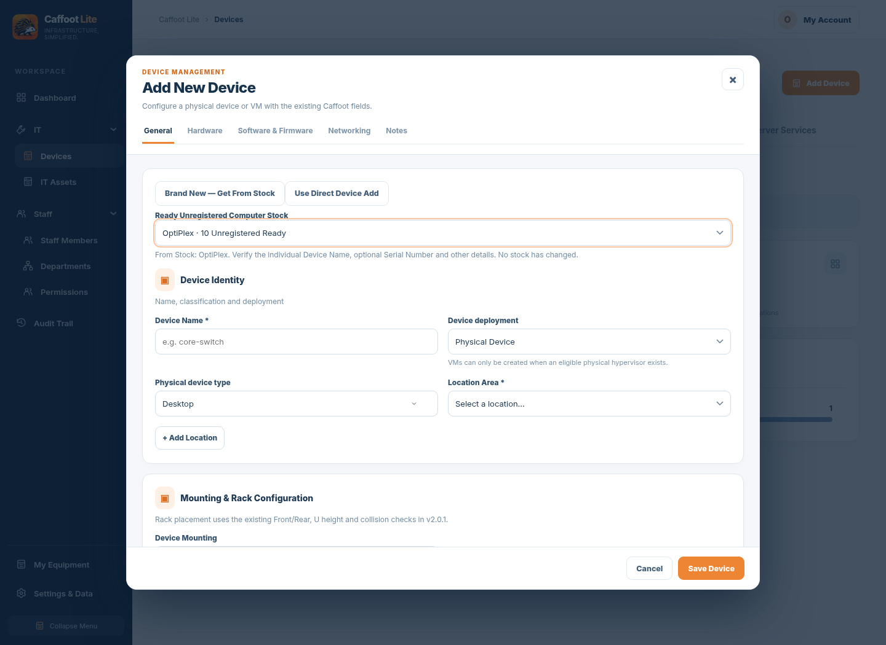
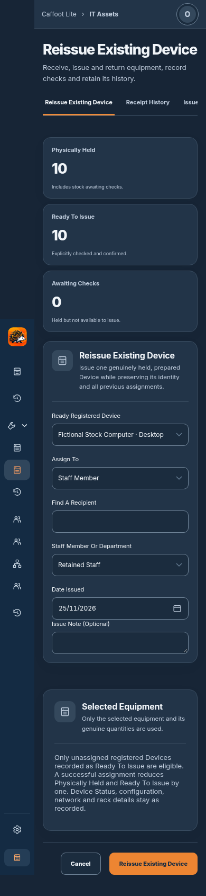
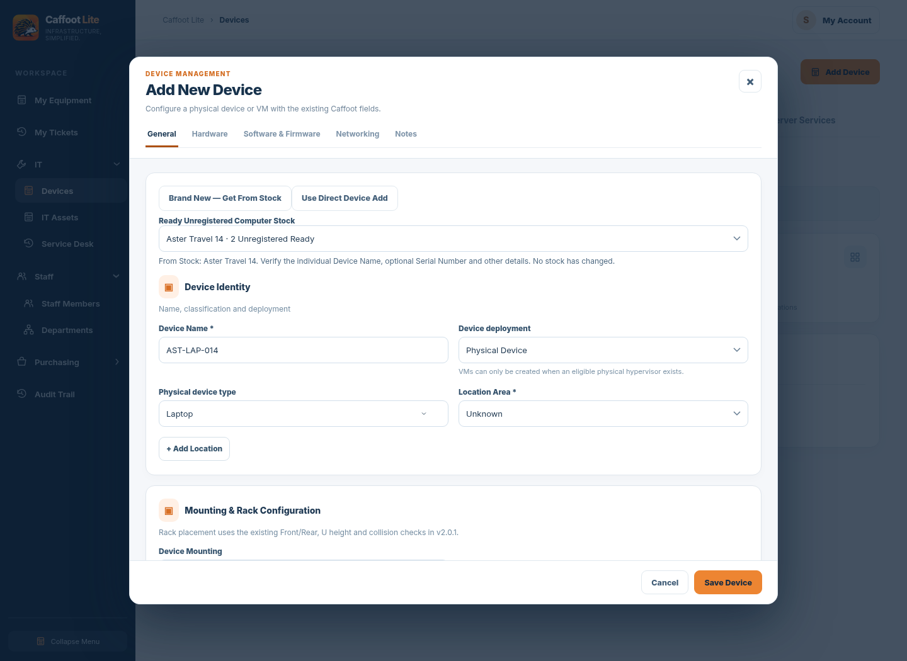
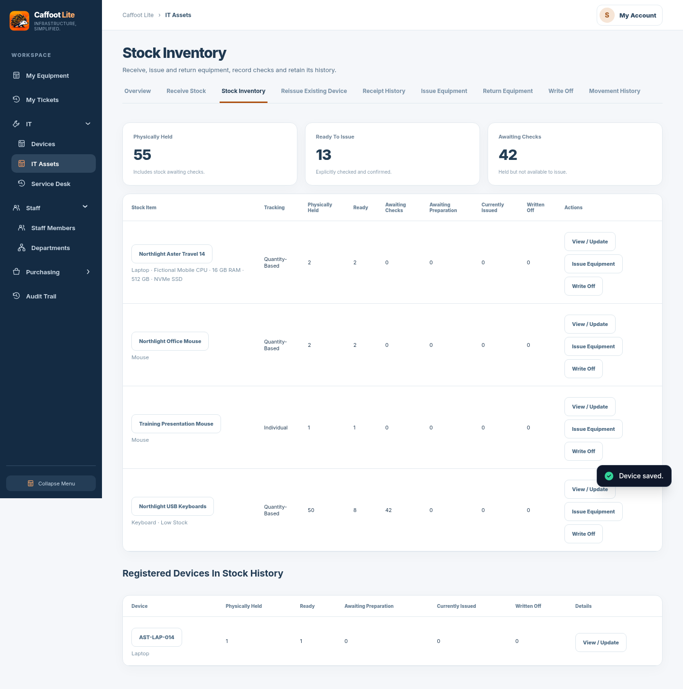
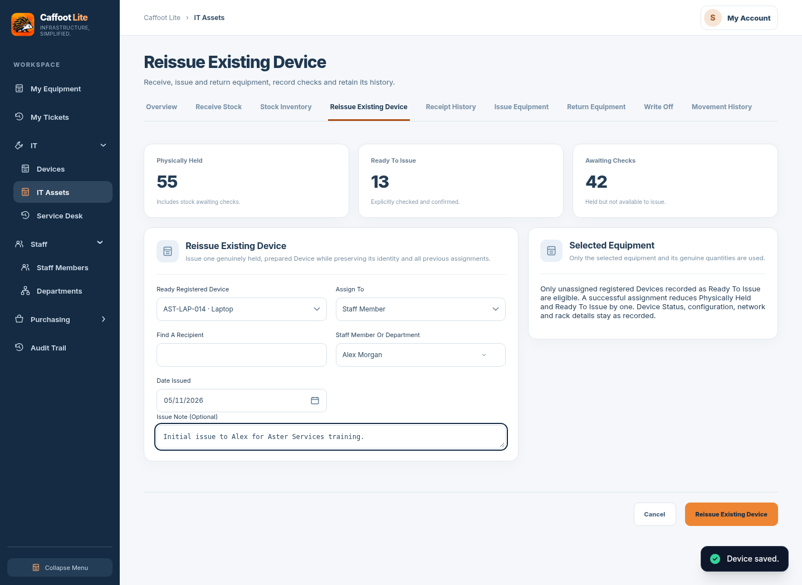
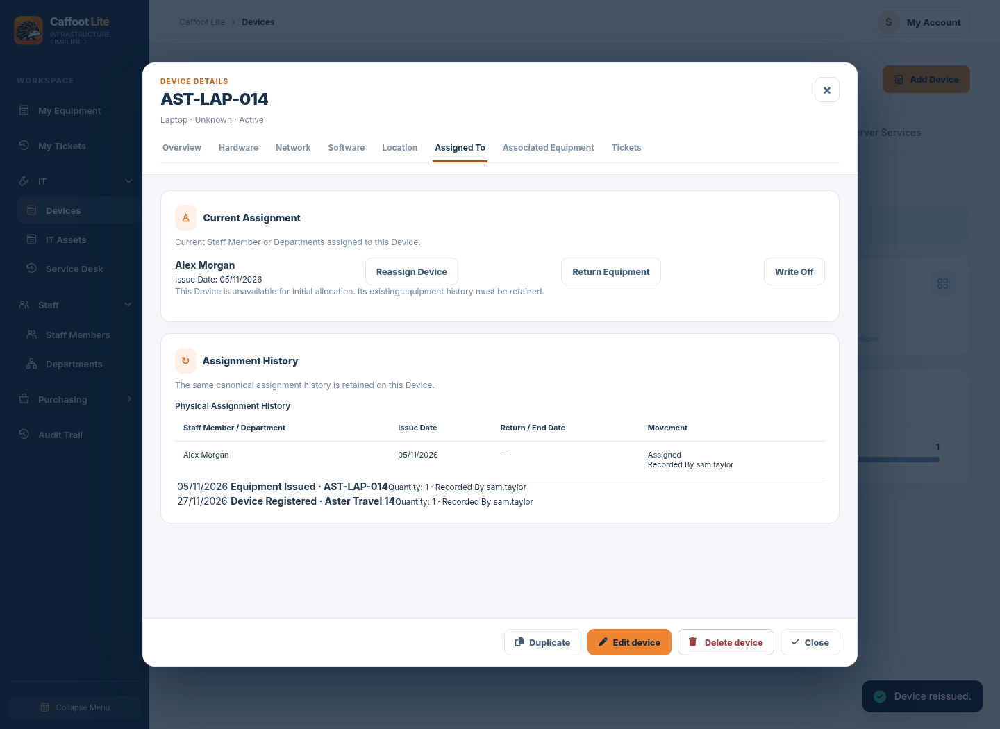
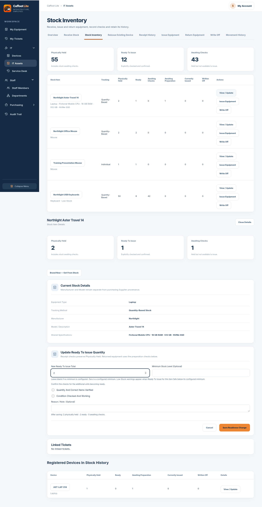
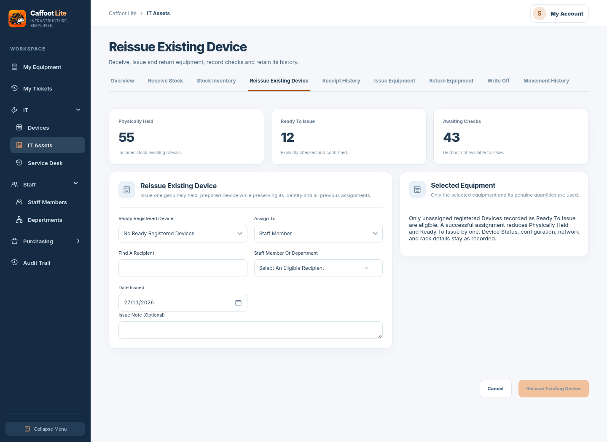
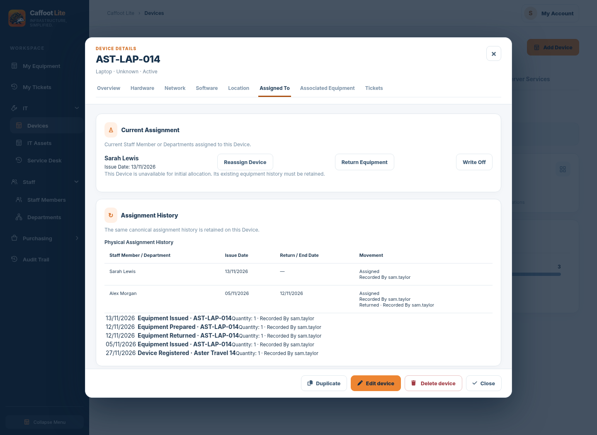

# Register Computers From Stock And Reissue Devices

> **Current status — 27 November 2026:** Batches 7C, 7D and 7E have separate owner draft-evidence acceptance (41/36/25 new paths; 102 combined; 7E has 23 distinct image contents). Original captures, provenance and requirement mappings remain unchanged; accepted instructions retain the approved merged corrections. Batch 8 editorial findings and publication approval remain outstanding. The exact approved application baseline is now `0251b43a3b5d41d626aa022c6d7f9b4d860433da`, schema 31. 7F/7G are authorised but blocked here by unavailable retained fixtures; no new pack has been delivered. [Current reconciliation and retained editorial limits](../../../development-guide/Milestone-01-7F-7G-Reconciliation.md). Earlier capture-time status notices are historical; publication remains unauthorised.

> **Current Batch 7C capture status — 27 November 2026:** [New desktop light illustrations](screenshots/batch-7c/README.md) use the approved merged schema-31 baseline. Independent ChatGPT review and separate owner visual/privacy/caption/alt acceptance remain pending. Earlier written/source and capture-status paragraphs retain their dated scope; the current pack status controls these new images. Published v2.1 and targeted correction-refresh requirements remain unchanged.

> **Draft v2.2 — Not Yet Published.** This guide describes the implementation on `milestone-1` at the application baseline identified below. Use the [published v2.1 guides](../README.md) for current production instructions. These draft procedures do not establish installation, upgrade, native/manual or release acceptance.

> **Written/source reconciliation:** Batch 4, application baseline `fdc677920bfc52f48f641b3d6d1344c902a6a9b0` (schema 31). Focused independent reviews are recorded and [owner written/source acceptance of Batches 1–6](https://github.com/Caffoot/Caffoot-Lite/issues/366#issuecomment-7200681167) is recorded. Current visual/privacy/caption/alt approval remains outstanding; [Batch 7 reconciliation and proposed capture packs](../../../development-guide/Milestone-01-Batch-7-Review.md) await independent review and owner acceptance. Capture scope and method need separate authorisation. Desktop capture remains deferred; existing images retain their original provenance and are not certified current by this pass. [Source review and exact screenshot requirements](../../../development-guide/Milestone-01-Batch-4-Review.md).

## What Registration And Reissue Do

Use **Brand New — Get From Stock** to turn one checked, unregistered computer-stock unit into one individually managed Device. A canonical Device is the permanent record for a particular machine. It keeps its identity even when returned, prepared and given to a different holder.

Use **Reissue Existing Device** when that permanent record already exists and the actual machine is held, checked and ready to leave stock. Registration identifies the machine; reissue records its physical issue and new assignment. Keeping these actions separate prevents duplicate Devices and incorrect stock balances.

## Choose The Right Route

| Route | What It Records |
| --- | --- |
| **Devices → Add Device** directly | A managed Device. It does not receive stock or declare physical possession. IT Assets is not required |
| **IT Assets → Receive Stock** | A delivery, its original date, optional purchasing Supplier and shared specifications. It does not create managed Devices |
| **Brand New — Get From Stock → Save Device** | One new canonical Device from one checked, unregistered computer-stock unit. It remains physically held, unassigned and Ready To Issue |
| **Reissue Existing Device** | An actual issue of an already registered, held Ready Device to eligible Staff or a Department. Its identity and earlier assignments remain |
| **Return Equipment**, then preparation | A genuine physical return and applicable checks before the same Device becomes ready again |
| **Reassign Device** | A direct handover between holders, following its own checks and associated-equipment safeguards; see [assignments](Device-Assignments-and-My-Equipment.md) |

An imported, retired, unassigned or directly created Device is not automatically physically held stock. Device operational **Status**, stock readiness and assignment describe different facts. These stock actions do not automatically change Status, IP addresses, rack placement, Location or technical configuration. Do not change an operational status merely to try to make a machine appear in stock.

## Before You Start

For stock registration or reissue, an administrator enables **Devices** and **IT Assets** independently in **Settings & Data → Optional Features**. The technician needs effective **Devices Edit** and **IT Assets Edit**, a current authorised session and any required MFA. Read Only is insufficient. Stock Edit does not grant Staff directory, account or permission-management access.

Normal direct Add Device uses its existing Devices permissions and works with IT Assets disabled. A Device can have no IP address. Add a managed address or rack placement only when needed and authorised, using the independent IPAM and Network Racks permissions. A stock source adds no IPAM or rack requirement. See [Optional Features](Optional-Features-and-Link-To-IPAM.md) and [roles and access](Roles-Section-Permissions-and-MFA.md).

Have the actual equipment available when checking identities and recording a physical issue or return. For registration, confirm that the stock item represents the correct common specification. For reissue, identify the intended active Staff Member or eligible Departments and resolve outstanding Associated Equipment first.

## Receive And Check New Computers

1. Open **IT → IT Assets → Receive Stock**. Choose **New Stock Entry**, or receive more into a matching existing item.
2. Select **Desktop**, **Laptop** or **Server**, and **Quantity-Based Stock**. The registration route uses quantity-based computer stock; individually tracked accessories follow their own issue workflow.
3. Record Manufacturer, Model / Description and any known common Processor, Memory Size/Unit, Storage Capacity/Unit and Storage Type. Use separate stock entries for different recorded configurations.
4. Enter Quantity Received, Date Received and optional purchasing Supplier. Manufacturer and Supplier are separate facts.
5. Confirm the receipt and condition checks for equipment actually checked. Enter **Checked & Ready To Issue**, review the Receipt Summary and choose **Record Receipt**.
6. If checks remain outstanding, the equipment stays held but unavailable to register. Complete the receipt-readiness procedure in **Stock Inventory** once those checks are done.

See the [full stock-intake guide](IT-Assets-Stock-Intake.md) for partial checks, subsequent deliveries and readiness reductions. Each receipt preserves its own date, Supplier, checks and responsible account.

## Register One Brand-New Device

*Genuine application capture from the [accepted Batch 3.9 gallery](https://github.com/Caffoot/Caffoot-Lite/issues/351#issuecomment-6912071679), using fictional stock. Selecting the source has not yet saved a Device or moved stock.*

1. Open **IT → Devices → Add Device**. In the existing **General** tab, choose **Brand New — Get From Stock**.
2. Under **Ready Unregistered Computer Stock**, select the correct batch. The list shows its actual unregistered Ready quantity. It excludes already registered Devices, awaiting equipment, issued stock and written-off stock.
3. Verify the prefilled physical Device Type, Manufacturer and Model. In **Hardware**, check compatible common details such as Processor, memory, storage capacity and Storage Type.
4. Enter an individual, unique **Device Name**. If you know the genuine **Serial Number**, enter it; otherwise leave it blank. Distinct Devices can have blank serials. Do not use a dummy serial or another machine's serial.
5. Select the real **Location Area** and complete applicable ordinary Device fields. Shared stock does not supply an individual hostname, serial, networking, location, rack placement or recipient. An IP address remains optional.
6. Review all relevant Device tabs and select **Save Device**.
7. After success, check the Device record and **IT Assets → Stock Inventory**. One unregistered Ready unit has become one registered Ready Device; overall Physically Held is unchanged. The Device is still unassigned.

The alternative entry point is **IT Assets → Stock Inventory → View / Update** for a compatible Ready computer item, then **Brand New — Get From Stock**. It opens the same Add Device form and rechecks availability.

The application rejects a duplicate Device Name or a supplied serial already used by another Device. If the batch's Device Type is unavailable in the existing editor catalogue, an inline message asks for a compatible source or restoration of that type; it does not create an alternative Device type automatically.

### Saving, Cancelling And Failed Registration

Selecting stock and editing the form do not change stock or create a Device. **Cancel** leaves the saved inventory and balances unchanged after any unsaved-change confirmation. **Use Direct Device Add** deliberately removes the selected stock source; saving through that route creates an ordinary Device without a stock registration. Review any prefilled fields you retain.

A successful registration saves the Device, stock linkage, registration movement and any authorised managed IPAM change together. A failed save leaves none of those partly applied. Stock availability and access are checked again at saving time. Another technician may use the available unit after you opened the form.

If the source is stale or no longer available, read the inline message beside the stock control, reload **Get From Stock**, select an available batch and review the individual fields again. If access was removed, restore the relevant feature/permission through an administrator and reopen the workflow. A selected registration never silently becomes direct Device creation.

If a connection interruption leaves the outcome uncertain, look for the Device and its movement before opening a new registration. Do not create another permanent Device to bypass a stale selection or unknown save result.

## Worked Example: Receive, Register, Issue, Return And Reissue

All names and equipment in this example are fictional. Aster Services receives ten identical desktops, checks all ten and records them Ready To Issue. Technician Sam registers **AST-PC-014** from that stock, then issues it to Staff Member Priya Shah using Reissue Existing Device.

| Classification | After Receipt | After Registering AST-PC-014 | After Issuing It | After Its Return | After Preparation | After Reissuing It |
| --- | ---: | ---: | ---: | ---: | ---: | ---: |
| Unregistered Ready | 10 | 9 | 9 | 9 | 9 | 9 |
| Registered Ready And Held | 0 | 1 | 0 | 0 | 1 | 0 |
| Registered Awaiting Preparation | 0 | 0 | 0 | 1 | 0 | 0 |
| Total Physically Held | 10 | 10 | 9 | 10 | 10 | 9 |
| Currently Issued | 0 | 0 | 1 | 0 | 0 | 1 |

Registration changes identification and classification, so ten held stays ten. Physical issue reduces held stock. A later actual return restores the same machine as Awaiting Preparation, rather than adding it back to anonymous new stock. Preparation changes readiness without changing held quantity. Reissuing **AST-PC-014** to another eligible holder preserves its original Device ID, serial, configuration, receipt source and previous assignment history.

The stock-item total includes its registered unit. Do not count both the item total and its individual Device row as separate equipment. Receiving another genuinely new delivery is a separate receipt; neither registration nor return is a new purchase.

## Reissue An Existing Ready Device

1. Confirm that the actual Device is physically held, unassigned and recorded as **Ready To Issue** after the applicable checks. An unassigned record alone is insufficient.
2. Open **IT → IT Assets → Reissue Existing Device**. You can also start from an eligible registered Device's Stock Inventory details or **Device Details → Assigned To → Reissue Existing Device**.
3. Select **Ready Registered Device**. Choices exclude awaiting equipment, assigned/issued equipment, written-off or virtual Devices, and Devices with outstanding Associated Equipment.
4. In **Assign To**, choose **Staff Member** or **Department**.
5. Use **Find A Recipient** and select the intended Staff Member, or use **Find A Department** and tick the applicable Departments for an eligible shared Device. Left Company Staff and archived Departments cannot receive a new assignment. The restricted search provides eligible names and identities without granting the full directory.
6. Verify **Date Issued** and enter **Issue Note (Optional)** where useful, for example “Prepared desktop issued for reception cover”.
7. Check the selected machine and recipient, then choose **Reissue Existing Device** when the equipment is actually issued.
8. Check the current holder in the Device, Staff or Department equipment view. A linked employee can see permitted personal or Department-shared equipment through [My Equipment](Device-Assignments-and-My-Equipment.md).

A successful operation records a new permanent dated assignment and its matching stock issue. Ready To Issue and Physically Held each reduce by one. The original Device and all earlier assignments remain. **Cancel** abandons the unsaved form and makes no assignment or physical movement. Changed eligibility, revoked access, a stale record or an edit reservation can reject the save without applying either half.

For an eligible Desktop, Laptop or Printer, select **Department** to search and tick the new Department list. If several Departments receive the Device, the stock issue records its custody as the recipient. Outstanding accessories must be resolved through the existing physical workflow before the new issue. Resolve them using [Associated Equipment](Associated-Equipment.md) before reissue. A missing accessory must follow its approved return/write-off handling; recording it as physically returned when it is missing would make stock inaccurate.

In the current integrated application, a qualifying first issue of a Device registered from stock also records its **Original In Service Date** when the qualifying history is available. This happens even if Equipment Lifecycle is switched off. See [Record First Service From Stock](Equipment-Lifecycle.md#record-first-service-from-stock) for the date rules and what happens on later reissues.

## Return And Prepare The Same Device

Record an actual return using **Return Equipment**, keeping the original Device identity. If an eligible previously deployed physical Device has no outstanding recorded assignment, use its authorised **Device Details → Assigned To → Return Equipment** action and explicit physical-return confirmation. That route does not invent an earlier issue or holder and enters Awaiting Preparation.

To prepare a returned registered Device:

1. Open **IT Assets → Stock Inventory**.
2. Under **Registered Devices In Stock History**, locate the correct Device and choose **View / Update**.
3. In **Prepare Returned Equipment**, verify the actual machine, **Quantity Newly Checked & Ready** and **Date Checked**. A registered Device represents one physical unit.
4. Complete the displayed working and applicable data-preparation confirmations only after performing the checks.
5. Add **Preparation Note (Optional)** if useful, then choose **Mark Ready To Issue**.
6. Verify Ready To Issue before starting reissue. This save prepares the Device; it does not give it to a recipient.

| Equipment | Required Preparation Confirmation |
| --- | --- |
| Desktop, Laptop, physical Server | Checked Working and Data Wiped / Reset |
| Printer | Cleaned And Checked Working; stored documents, credentials and user data cleared where applicable. A factory reset is not mandatory for every printer |
| Monitor, Keyboard, Mouse, Docking Station | Cleaned And Checked Working |
| Other physical equipment | Working/condition checks and applicable preparation, including data clearing where needed |

Preparation preserves Physically Held and the original return. If checks are outstanding, leave the machine Awaiting Preparation. If damaged beyond reuse, use the appropriate **Write Off** procedure rather than marking it ready. **Cancel** leaves the saved preparation state unchanged. Full return, partial-return and damaged-equipment procedures are in [Issue, Return And Write Off](IT-Assets-Issue-Return-and-Write-Off.md).

## Supplier And Lifecycle Data Are Separate

A stock registration takes common technical specifications from its source, not an employee, IP address, saved lifecycle dates or a new purchasing decision. The source receipt retains its original Supplier information. A canonical Supplier association on the Device is separately recorded through the [Device Supplier field](Equipment-Supplier-Integration.md#record-a-supplier-on-one-device); do not assume registration copied that association. **Add Device** has no Lifecycle date fields: save the physical Device, then use Edit Device → Hardware for known Purchase Date and warranty information. Only a qualifying first stock issue automatically records first service.

Reissue is not a way to reactivate genuinely written-off equipment. A written-off Device retains its identity/history and is excluded. An operationally Retired Device and a written-off unit are distinct facts; review the physical and operational records with IT before any further use.

## Optional Hardware Details

**Desktop, Laptop and physical Server:** Storage Type is optional and separate
from Storage Size/Unit. Suggested media are HDD, SATA SSD, NVMe SSD and Other.
Blank means unrecorded; recorded custom/legacy values remain selectable.

**Physical Server → Hardware:** select **Record Boot Storage** to document ordinary
boot drives without requiring ZFS. Under **Boot Storage Source**, choose
**Independent Boot Drives (ZFS Not Required)**, then record
Boot Drive Type, Number Of Boot Drives, Capacity Per Drive/Unit and Boot Configuration
(Single, Mirror or Other). Boot Pool Name is optional. A mirror needs at least two drives.

Use **Add Pool** for named ZFS Pools, and **Add VDEV** for each constituent VDEV.
Record a unique Pool Name, layout, drive count, capacity per drive/unit and Drive Type.
The accepted layout minimums are Single: one, Mirror: two, RAIDZ1: three, RAIDZ2:
four and RAIDZ3: five drives. Every Pool needs at least one recorded VDEV.

If the boot drives are already represented by a recorded Pool, choose **Use An
Existing ZFS Pool** and select that Pool under **Existing ZFS Boot Pool**. This stores
one reference and does not add another set of boot drives. Verify the choice after
changing or removing a Pool.

Existing **RAID Type**, **Number Of Hard Drives**, **Storage Size** and **Storage Unit**
remain independently recorded. Detailed Boot/ZFS information does not calculate,
overwrite or define those older values. Device Details displays the recorded
descriptions. These controls document inventory only; they do not manage disks,
operating systems or real ZFS resources. Desktop/Laptop do not acquire Server-only controls.

UPS/PDU Manufacturer suggestions include Ubiquiti and the other approved manufacturers.
They are suggestions, with no added model lists. Existing user-managed entries,
hidden suggestions, custom values and historical Device records remain intact.

## Troubleshooting And Recovery

| Problem | What To Do |
| --- | --- |
| No suitable stock appears | Check the exact batch, quantity tracking, supported computer type and unregistered Ready balance. Physically Held includes equipment unavailable to register |
| No Device appears for reissue | Confirm actual recorded possession, readiness, no active assignment/write-off and resolved Associated Equipment. Device Status alone is insufficient |
| Duplicate name or serial is rejected | Check the existing permanent record first. Correct the individual value; do not create a second record for the same machine |
| Another technician changed stock or the Device | Reload and review the latest state. Respect an active edit reservation and do not bypass it by registering a duplicate |
| The recipient is absent | Check for active Staff or a non-archived Department. Ask an authorised directory editor to correct the underlying record if necessary |
| Stock access disappears while editing | Ask an administrator to check both feature switches and both effective Edit rights, then reopen the intended workflow |
| Returned equipment cannot be made ready in the quantity form | Use its registered Device preparation controls and complete the required checks |
| Optional storage details are invalid | Check positive counts/capacities, layout minimums, unique Pool Names and an existing selected Boot Pool |
| An earlier saved movement is wrong | Investigate [Movement History and Correct Movement](IT-Assets-Correct-Movement.md); do not invent an offsetting delivery or duplicate Device |

Use factual equipment notes and avoid passwords, recovery information or unrelated personal details. Stock rights do not expose unrestricted Staff records; linked employees see only their permitted equipment relationships. The server rechecks permissions, recipient eligibility and balances when saving, including after an account's access changes.

## Related Guidance And Screenshots

Continue with [stock intake](IT-Assets-Stock-Intake.md), [Issue, Return And Write Off](IT-Assets-Issue-Return-and-Write-Off.md), [assignments and My Equipment](Device-Assignments-and-My-Equipment.md), [Associated Equipment and handovers](Associated-Equipment.md), [corrections](IT-Assets-Correct-Movement.md) and [IT Assets reporting](IT-Assets-Dashboard.md).

The [registration and storage evidence gallery](../../../development-handovers/evidence/device-stock-registration/Report.md) preserves genuine fictional desktop/mobile light/dark captures and their source manifest. The owner accepted the revised gallery with [Batch 3.9](https://github.com/Caffoot/Caffoot-Lite/issues/351#issuecomment-6912071679); its earlier checkpoint descriptions remain dated development history. The unchanged Get From Stock controls are illustrated above. Reissue captures predate the current Overview tab and Cancel wording; a refreshed complete navigation/cancellation capture remains an acceptance item. Functional HTML previews are not user-guide screenshots.

The [technical source mapping](../../../development-guide/Device-Stock-Registration-and-Reissue.md) explains implementation boundaries for maintainers. Native Pi/Safari, private-export, complete upgrade/restore and release acceptance must be established separately; this guide does not declare them complete.

[Connected example: a laptop from Supplier and stock to its final write-off](Connected-Equipment-Journey.md).

## Batch 7C Desktop Illustrations

These images follow the fictional training journey. Read the caption to distinguish a draft, a cancelled preview and a saved outcome. [Complete original coverage and limits](screenshots/batch-7c/Coverage.md).

*Draft v2.2 — The Device draft selects one Ready laptop from the two-unit receipt. Registration will retain one permanent AST-LAP-014 identity and will not assign it. Independent review and owner visual acceptance pending.*

*Draft v2.2 — The laptop item still represents two held units: one unregistered Ready unit plus AST-LAP-014 as a registered Ready Device. Never add the Device row to the item total again. Independent review and owner visual acceptance pending.*

*Draft v2.2 — This is the unsaved first issue of the already registered Ready Device to Alex. The explicit issue will reduce held/Ready by one and preserve Device identity. Independent review and owner visual acceptance pending.*

*Draft v2.2 — Saved current custody belongs to Alex. The original Device and assignment history remain the authoritative identity; registration was a different event. Independent review and owner visual acceptance pending.*

*Draft v2.2 — The returned registered Device cannot be made Ready by increasing the stock item’s receipt-readiness total. Its own Prepare Returned Equipment checks are required; this out-of-range draft is discarded. Independent review and owner visual acceptance pending.*

*Draft v2.2 — AST-LAP-014 is Awaiting Preparation, so it is absent from the Ready registered Device chooser. The returned identity and history remain saved. Independent review and owner visual acceptance pending.*

*Draft v2.2 — Sarah now holds the same AST-LAP-014. Alex’s ended custody and actual return remain in its history; preparation and reissue did not create a replacement identity or restart first service. Independent review and owner visual acceptance pending.*
