# Devices — Creating, Editing and Managing Equipment

> **Draft v2.2 — Unreleased.** v2.1 remains the published release. These instructions describe v2.2.

[← All feature guides](README.md)

## What a device record represents

A device can describe a physical server, switch, workstation, printer or another supported type, with its network address, status, location, optional rack position and type-specific hardware/software information. Supported virtual machines have their own host-related details. A Device is the canonical record for a managed piece of equipment. Keep the same record through assignment, return, preparation and reissue. A Device is not a stock balance, a login account, a subnet or a support ticket. **Not every Device type presents the same additional fields.**

## Find equipment and understand your inventory

1. Open **IT → Devices**. If the IT group is collapsed, expand it. Devices must be enabled and your account must have Devices Read.
2. Choose **Device Inventory** to see the list. **Search Devices** helps find an existing record. Combine filters for **Network Assignment**, **Device Type**, **Device Status**, **Location** and **Mounting**. Use **Clear Filters** to return to the full permitted list.
3. Use **Sort by** to order the results. Read the **Name**, **Type**, **Location Area**, **Primary IP**, **Status** and **Hardware** columns to identify the record before selecting **Details**.
4. Open **Overview** for Device Intelligence, including saved hardware, operating systems, software and data completeness. A **Missing Primary IP** count means an address was not recorded; v2.2 permits an intentionally address-free Device. Do not assign a made-up IP merely to reduce that count.

For example, filter by location and device type to find the switch in a fictional Training Room. If it does not appear, clear filters and check access before creating another record. The inventory is based on recorded information, not a live network discovery scan.

The Devices section also provides **Device Types**, **Locations**, **Manufacturers**, **Models**, **Software** and **Server Services** tabs. These support the catalogue of choices used when recording equipment; see the catalogue instructions below.

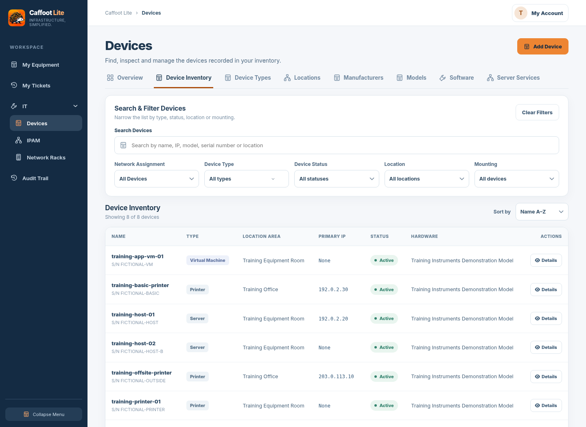

*Recorded fictional Device Inventory; these are saved records, not discovery results.*

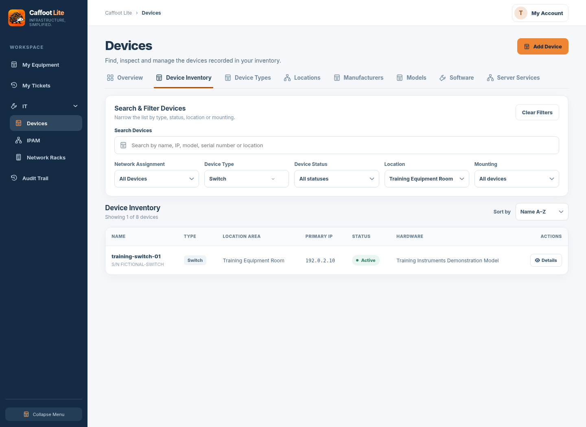

*Device Type and Location filters narrow the inventory to training-switch-01.*

## Prepare before you add a device

- Enable Devices in [Optional Features](Optional-Features-and-Link-To-IPAM.md). You need **Devices Edit** to add or edit a Device, and the account must meet its MFA requirements. Devices Read allows inspection, not changes.
- Decide whether to leave the address blank, record basic IPv4 (new basic entry with IPAM off), or assign a managed IP (IPAM enabled and IPAM Edit, with an existing managed subnet).
- Make sure the required Device type and location are available. Create the rack beforehand if it is to be rack-mounted; that requires enabled Network Racks and Racks Edit.
- Check whether this physical item already has a Device record, or is held in IT Assets. Use [Device Stock Registration And Reissue](Device-Stock-Registration-and-Reissue.md) for stock registration or reissue instead of inventing a duplicate Device.
- See [Roles, Section Permissions And MFA](Roles-Section-Permissions-and-MFA.md). Section access and organisation-wide feature switches are separate.

## Worked example — add a switch

Imagine recording *lab-switch-01*, a fictional switch on documentation subnet 192.0.2.0/24. For this worked managed-IP example, an authorised IPAM editor has already configured the subnet and checked that 192.0.2.10 is available. Use approved real records, not the example addresses, for your equipment.

1. Open **IT → Devices → Device Inventory** and select **Add Device**. The dialog heading is **Add New Device**.
2. Enter a unique **Device Name**, such as *lab-switch-01*. On **General**, select the physical deployment and supported device type under **Device Identity**. The new record starts **Active**; an existing record offers **Device Status** (Active, Maintenance or Retired).
3. On **Hardware**, under **Hardware & Lifecycle**, supply manufacturer, model and serial number if known. **Manage Hardware Catalogue** maintains reusable manufacturer/model suggestions.
4. Complete any relevant **Additional details for this device type**, such as hardware properties, installed software or supported service flags. These vary by device type.
5. On **General**, choose **Location Area** under **Device Identity**, then **Device Mounting** under **Mounting & Rack Configuration**. For rack-mounted equipment, select the rack, **Face**, **Start U** and **U Height**. Use a free position for the entire height.
6. Under **Networking → Network Identity**, optionally filter by **IP Address Block**, select the managed subnet and choose an available IP or enter it in **Primary IP Address (Optional)**. For this example use 192.0.2.10. Both choices update the same address. The VLAN is derived from the selected subnet; manage it in IPAM. If the network is missing, have an authorised editor create it in IPAM before assigning the address. Do not select an unrelated subnet.
7. Optionally enter **Notes**, then select **Save Device**. To abandon a new record, select **Cancel**; if prompted choose **Discard Changes**, or **Keep Editing** to return to your draft.
8. Reopen the saved record and check the name, hardware, network details and location. In IPAM and Racks, verify the related records where applicable.

The application refuses invalid addresses, incompatible rack positions and other relationship errors; follow the message rather than attempting to force the save. A rejected save is not a successful partial creation. Check the saved record before retrying after an unclear connection failure.

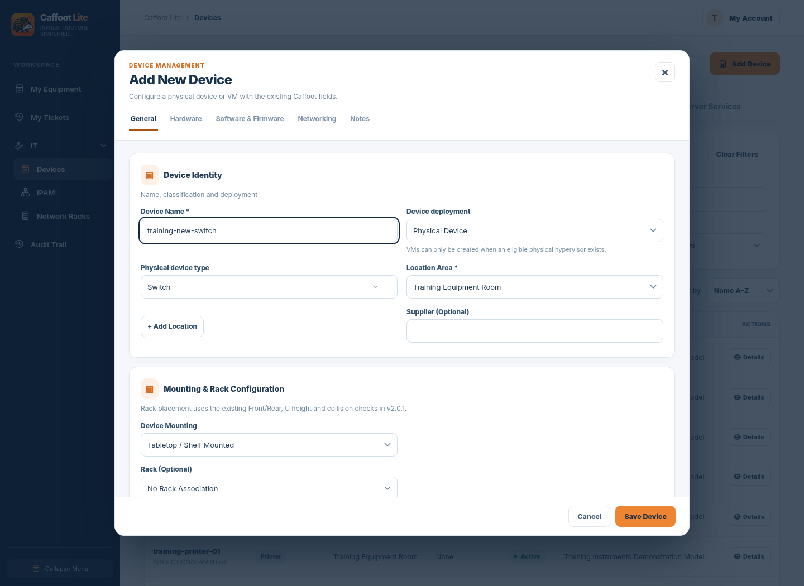

*Add New Device: a fictional unsaved switch draft. Duplicate uses this editor with a new identity.*

### Choose the right address workflow

| Situation | What to do |
| --- | --- |
| Offline equipment or no address yet | Leave **Primary IP Address (Optional)** blank. No subnet or allocation is required; Devices Edit is sufficient for ordinary non-Rack creation. |
| New basic IPv4 | With IPAM disabled, enter a valid unused IPv4 address. No subnet/allocation is created. |
| Existing basic IPv4 after enabling IPAM | Edit it as basic or clear it; ordinary Save never links it automatically. |
| Managed IP | With IPAM enabled and IPAM Edit, select a matching managed subnet and an available address. Use **Reserve this IP address for this device** to keep this same managed primary address linked but show it as Reserved. See [managed primary-IP reservation](IPAM.md#reserve-the-same-managed-primary-ip). |
| Existing managed IP with IPAM off or without IPAM Edit | The saved address is protected from editing. Turning IPAM off does not clear the relationship. |

For the basic-IP example, record a fictional offline printer without an address, or with 192.0.2.20 while IPAM is off. When IPAM is enabled later and the correct subnet exists, use **Device Details → Network → Link to IPAM** with both Edit permissions. Read the full [Optional Features and Link to IPAM procedure](Optional-Features-and-Link-To-IPAM.md#deliberately-link-a-saved-basic-address) for the dialog, conflicts and cancellation. A hidden allocation can still prevent use of an address.

## View an existing device

The **Details** action opens the read-only Device view. Opening and viewing a Device **does not reserve it for editing**.

| Tab | Information |
| --- | --- |
| Overview | Name, type, status, primary IP, recorded location and platform; Supplier information when available. |
| Hardware | Physical equipment hardware, including manufacturer/model/serial and relevant lifecycle details. Not shown for a virtual server. |
| Network | Recorded IP and permitted network relationships, including explicit basic-IP linking when eligible. |
| Software | Recorded platform, software and applicable server services. |
| Location | Recorded mounting/location and permitted Rack or shelf information. |
| Assigned To | Physical Devices only: current custody and relevant assignment information, subject to access. Virtual machines do not show this tab. |
| Associated Equipment | Explicitly associated accessories where authorised. |
| Virtual Machines | Recorded hosted guests for relevant physical servers. |
| History | Retained historical type details where present; not the full organisation Audit Trail. |
| Tickets | Linked support tickets where Service Desk and Devices access allow the view. |

Available tabs and fields depend on type, recorded information, enabled features and effective access. Virtual machines do not have an **Assigned To** tab in Device Details because they cannot be physically allocated. Other applicable Device Details tabs remain available according to the existing permissions and feature settings. Physical Devices retain the Assigned To tab, including any saved assignment history. See the [corrected virtual and physical Device screenshots](Device-Assignments-and-My-Equipment.md#choose-the-correct-workflow) and [desktop navigation guidance](README.md#move-around-the-application). Missing related data is not proof that no relationship exists. **My Equipment** is a separate restricted employee view, not an alternative route into the IT Device Inventory.

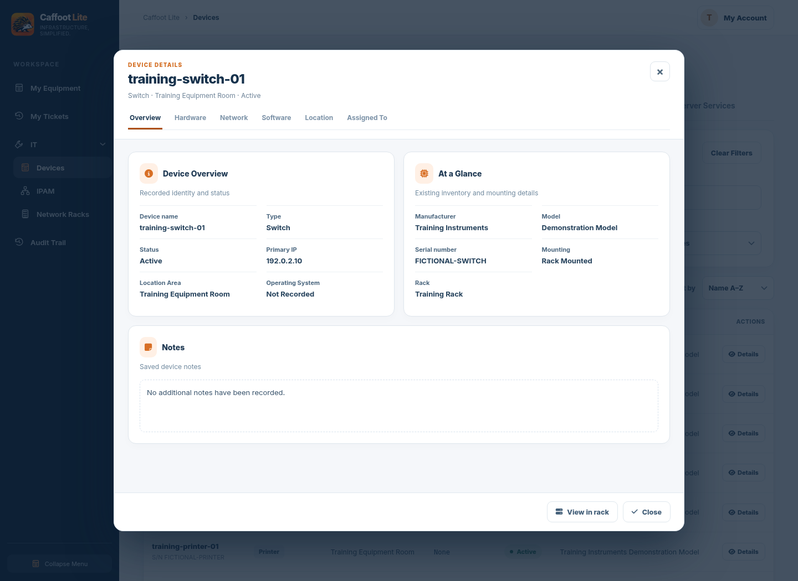

*The saved training-switch-01 Overview, viewed with Devices Read.*

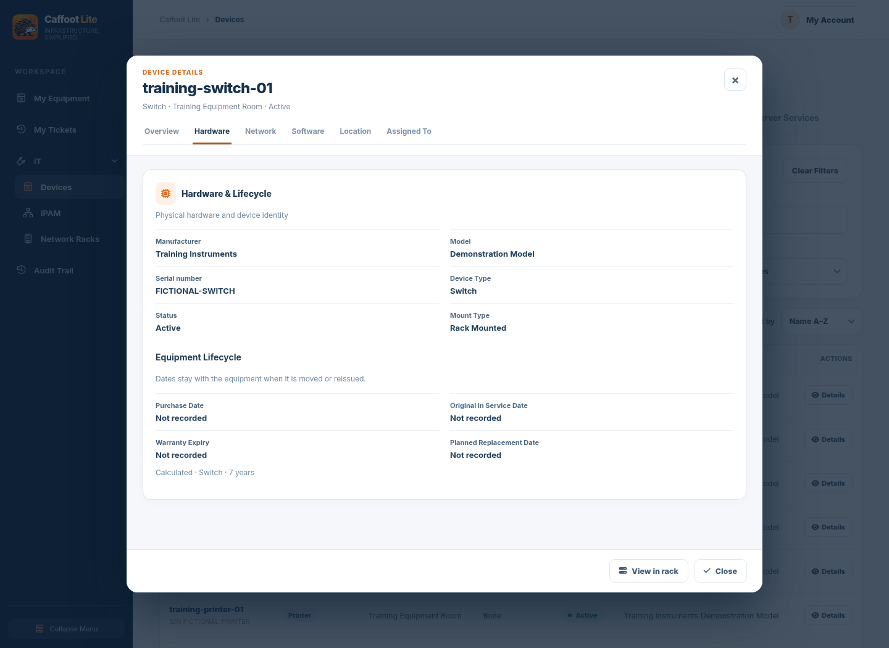

*Hardware records describe the fictional switch; they do not discover its specification.*

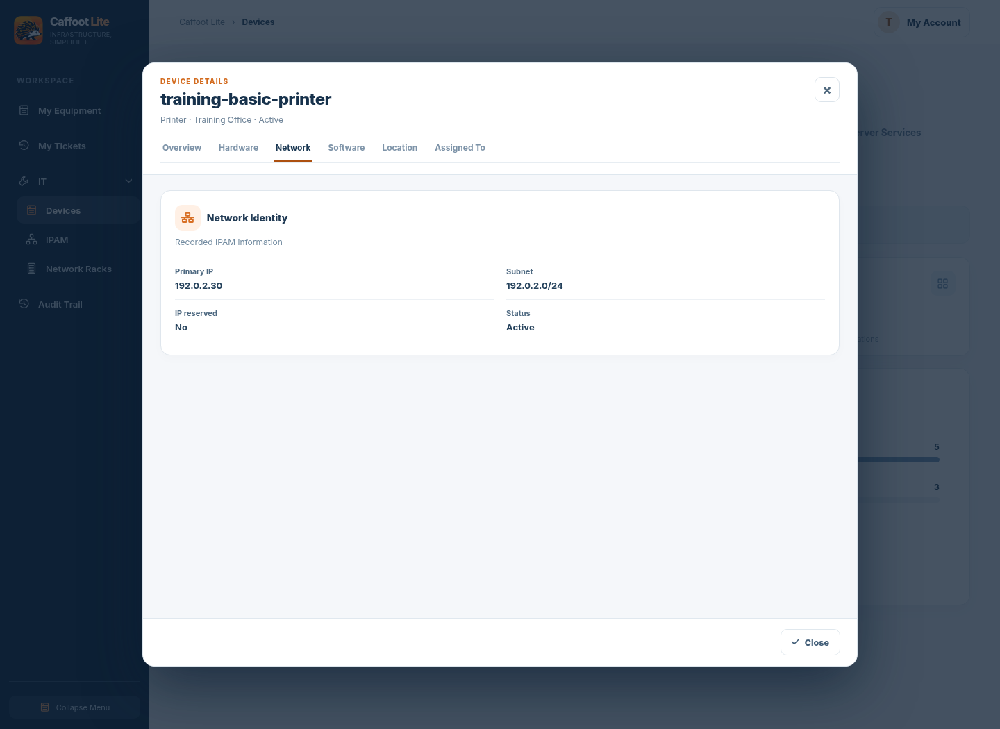

*After deliberate linking, training-basic-printer retains 192.0.2.30 and now shows its managed subnet. Compare the earlier chooser for the same saved address.*

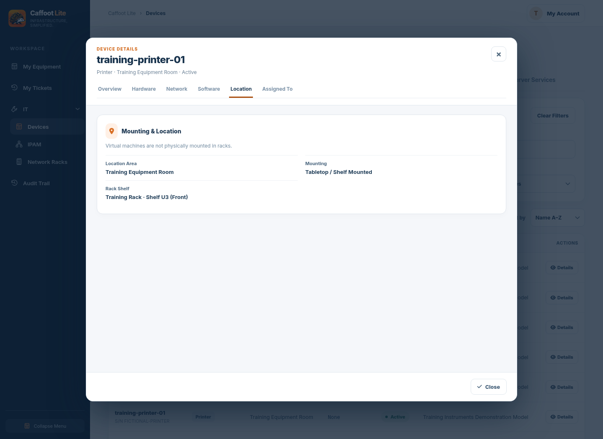

*The saved printer derives its Front U3 location from Training Printer Shelf; it occupies no separate U footprint.*

## Edit, save and cancel

1. Open the device details and choose **Edit device**, if you have permission.
2. Caffoot first requests a temporary exclusive edit reservation on that device. The editing form opens only if the reservation is granted.
3. Change only the permitted fields and select **Save Device**. The server checks permissions, current revision, references and validations before storing the change.
4. Choose **Back to Details** to leave the editor. If prompted, choose **Discard Changes** to abandon unsaved edits and release the reservation, or **Keep Editing** to continue.

If another user already has the reservation, the read-only screen remains available and may show **Currently being edited by [username]**. Another user can edit a *different* device at the same time. Reservations expire if abandoned (normally after five minutes). Navigating or reopening details fetches current saved data.

**Cross-section permissions:** Devices Edit permits ordinary Device fields and eligible basic addresses, but managed-IP changes require IPAM Edit, and Rack movements require Racks Edit. Disabled features cannot be bypassed. If Network Racks is disabled, an existing mounted or shelf-associated Device retains its protected placement and Location Area; unrelated permitted edits remain possible. See [Rack preservation](Optional-Features-and-Link-To-IPAM.md#preserve-devices-when-network-racks-is-off).

A recorded assignment or stock unit protects the Device's type and physical/virtual identity even when related features are hidden. If the server refuses a change to that identity, keep the original identity and edit only permitted fields. Do not create another Device to conceal its history.

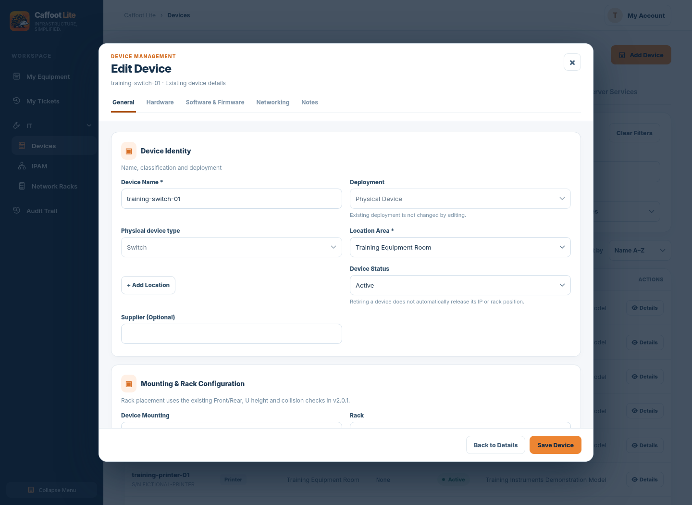

*Edit Device: review the existing switch identity and protected related fields before saving.*

## Duplicate a device

Use the established **Duplicate** action on an existing record to start a *new* record using its details as a starting point. Supply a unique Device Name and, if recording an address, a unique unused primary IP. The copied name, serial number and IP are cleared; review the new record's placement, host and other copied details. The copy is a new Device, not a way to reissue or transfer the original. Choose **Save Device** to create it or **Back to Details** and discard changes to leave the source unchanged. The source Device is not overwritten.

## Remove or retire a device

Use **Device Status** to record a supported operational state such as Active, Maintenance or Retired. Retirement does not automatically release its primary IP or rack position. It does not by itself return equipment to stock, end custody or erase support history.

1. Open **Details** and use **Edit device** to review the status and related records. Record the actual status and save; check the result.
2. Use the appropriate assignment, physical return or write-off procedure if equipment custody or stock has actually changed. Review associated equipment and linked tickets separately.
3. For permanent removal of an eligible record, open **Details → Delete device**. Review the confirmation, including linked IPAM records, reservations, Rack and any hosted guests. Cancel if it is not the intended record or the impact is unclear.
4. Confirm only when permanent deletion is appropriate and all dependencies are resolved. A Device with assignment history or protected Service Desk history cannot be deleted. Hidden Rack/IPAM relationships also prevent destructive removal; do not disable features to bypass safeguards.

If a deletion is rejected, retain the record, read the reason and investigate using the authorised workflow. Do not remove a record merely to free its IP.

## Virtual machines

When an eligible physical hypervisor host exists and is configured accordingly, the deployment selector offers **Virtual Machine (VM)**. Select a suitable virtual purpose and the physical host, then record resource information such as vCPU, RAM, disk and network adapters where requested. Existing historical VM relationships are preserved.

## Device forms and host/guest relationships

The editor uses **General**, **Hardware**, **Networking**, **Software** and **Notes** where relevant; physical-only controls are unavailable for virtual machines.

For an eligible physical server, **General** shows **This physical server hosts virtual machines** immediately beneath its type. Tick it to use the dedicated **Hypervisor software** and **Hypervisor version (optional)** controls. The ordinary OS card is hidden while hosting is enabled; unticking restores its values. Known host products are offered through this dedicated path. Previously recorded OS/software assignments are retained with an explanation rather than silently removed. When changing recorded hypervisor software, review the affected guest records. When disabling hosting, choose the permitted outcome for each guest (reassign to an eligible host, unassign while preserving history, or retire). **Keep Editing** cancels that review; confirm only after checking each choice. These are inventory changes, not physical VM migration or a change to the guest OS.

For a VM, choose its purpose, physical host and virtual allocations on **General**. Physical mounting and Hardware controls are hidden. Type-specific choices and saved host relationships remain protected.

**Notes** fills the available form space automatically and keeps all existing formatting/Preview actions. Short windows scroll within the editor while the footer stays accessible. Validation messages appear above the footer and reveal the relevant tab or field. Duplicate uses its subtitle to explain the new record; it requires a unique name and a unique address if one is supplied, and preserves the original. Some inherited dialog text still mentions a unique IP; the actual v2.2 address field is optional.

## Shelves and recorded software

The following workflows depend on the relevant enabled sections and Edit access. Rack operations need Network Racks and Racks Edit; related Device changes need Devices Edit.

For physical **Tabletop / Shelf Mounted** equipment, open **General → Mounting & Rack Configuration**. Leaving **Rack (Optional)** empty records no rack association. Selecting a rack requires an actual **Rack Shelf** in that rack. **+ Add Rack Shelf** opens the existing Horizontal Accessory editor and returns to your Device draft. A successfully saved shelf remains in inventory even if you cancel the Device draft. The device uses the shelf's current location without occupying another U. Details shows the rack, current shelf U and face. Duplicate can retain the shelf association while requiring a new identity and a unique address if supplied; check the actual location before saving.

Removing a shelf that holds devices requires an explicit choice for each device: another shelf, a newly created replacement, or **Retired**. Retirement keeps the record and clears its active rack/shelf association; history retains the former location. All reviewed changes save together or none do. Another editor's active five-minute reservation prevents the operation. Devices and Racks edit access are required.

OS/version lists are offline suggestions, with **Custom / Other** for saved or unlisted values. Ubuntu Server offers LTS releases; desktop Ubuntu also offers interim releases. pfSense and OPNsense editions have separate release lists. Installed Software suggestions depend on this device's type and OS, including a VM's own guest OS. Check actual package availability for its edition, release and model; a suggestion does not mean it is installed or supported everywhere.

Old, archived, hidden or out-of-context assignments remain checked under **Previously recorded — review**. They remain saved until you deliberately untick them. Changing the OS refreshes suggestions without clearing those selections. Custom catalogue entries, saved versions and historical hardware details remain available. Cancel keeps the original device unchanged.

## Device choices and location defaults

Changing device type or virtual purpose refreshes the related OS, version, software and hardware choices straight away. Incompatible new standard OS/version choices are cleared; saved historical values and Custom entries remain available. Previously recorded values are marked for review and remain until you deliberately replace or remove them. Changing an OS edition or hosting product starts its version choice afresh. Cancel leaves the saved device unchanged.

When adding a physical device, selecting a rack defaults **Location Area** to that rack's matching recorded area. A room already recorded on the rack is offered even if it is not yet in the Device location list; this does not create a managed location or save the draft automatically. You can override it freely; later rack changes will then leave your choice alone. Existing devices retain their saved location, and Duplicate initially keeps its copied location. If a rack has no matching area, choose the location normally.

Use the labelled × control or **Close** to leave read-only details. Escape also closes the view and returns keyboard focus to the control that opened it.

## Maintain equipment catalogue choices

The catalogue describes choices offered during Device recording. It does not install software, discover hardware or change equipment merely because a suggestion is selected in the catalogue.

- **Device Types** and **Locations**: manage the available categories. Review the number of affected Devices before confirming changes to in-use categories. Protected Unknown entries and identity/relationship safeguards still apply.
- **Manufacturers** and **Models**: use search and filters to locate built-in, custom or inventory-derived suggestions. Use **Add Manufacturer** or **Add Model** for genuine missing suggestions and review the applicable Device types. Do not alter recorded hardware merely to tidy a suggestion list.
- **Software**: use **Add Custom Software** for an appropriate missing option. A hidden suggestion is not an uninstalled application. To record actual removal of archived software, use its **Mark as Uninstalled** action and review the confirmation. This changes the inventory record only, not the real computer.
- **Server Services**: manage available service suggestions. The current **Archive Service** action refuses a service still assigned to a Device. Existing archived records remain readable; restoring makes a service available for new selections.

Check the saved Device after a permitted catalogue change. Cancel a change you do not intend; if rejected, investigate the affected records rather than forcing a deletion. The following procedures explain the catalogue and storage controls in more detail.

## Record Storage, ZFS Pools And Boot Drives

Storage fields document the equipment you have. Saving them does not partition a disk, create a pool, install an operating system or calculate usable storage. **Storage Type (Optional)** is available for physical Desktop, Laptop and Server equipment, with HDD, SATA SSD, NVMe SSD and Other choices. Record the actual medium, leaving it blank if unknown.

A **ZFS pool** groups storage; a **VDEV** is one recorded group of drives within that pool. These optional detailed controls are for physical Servers. Existing **RAID type**, **Number of hard drives**, **Storage size** and **Storage unit** remain independent fields. Adding a pool does not recalculate or overwrite them.

1. Add a physical Server, or open its **Details → Edit device**. Open **Hardware** and find **ZFS Pools (Optional)**.
2. Select **Add Pool**. Enter a **Pool Name**, for example fictional *Training Data*. Pool names must be unique within this Device, ignoring case and surrounding spaces.
3. For its first VDEV, choose **VDEV Layout**, **Number Of Drives**, **Capacity Per Drive**, **Capacity Unit** (GB or TB) and **Drive Type**. For example, record Mirror, 2 drives, 960 GB each and SATA SSD.
4. Use **Add VDEV** for further groups or **Add Pool** for another named pool. Every pool needs at least one complete VDEV. **Remove VDEV** and **Remove Pool** change the draft; review before saving.
5. To record boot drives, tick **Record Boot Storage** under **Boot Storage (Optional)**. Choose **Boot Storage Source**:
   - **Independent Boot Drives (ZFS Not Required)**: record **Boot Drive Type**, **Number Of Boot Drives**, **Capacity Per Drive**, **Capacity Unit**, **Boot Configuration** (Single, Mirror or Other) and optional **Boot Pool Name**.
   - **Use An Existing ZFS Pool**: choose **Existing ZFS Boot Pool** from this Device's recorded pools. Do not duplicate that pool's drives as independent boot drives.
6. Select **Save Device**, then reopen **Details → Hardware** to verify the pool, VDEVs and boot information. **Cancel** on Add, or **Back to Details** and **Discard Changes** on Edit, leaves the saved Device unchanged.

Drive counts must be positive whole numbers; capacities must be positive finite numbers. VDEV minimum drive counts are Single 1, Mirror 2, RAIDZ1 3, RAIDZ2 4 and RAIDZ3 5. Independent mirrored boot storage needs at least two drives. A linked boot pool must still exist when saving; choose another boot source before removing it. A Device supports up to 100 pools and 100 VDEVs per pool. These are record-validation limits, not a storage design recommendation. Correct an incomplete or conflicting field after rejection; no new pool is configured on the actual server.

For example, *training-host-01* can record two 240 GB SATA SSD independent boot drives in Mirror and a separate *Training Data* pool with two 960 GB SATA SSD drives in one Mirror VDEV. Verify its actual capacity separately; the application does not infer a total from this example.

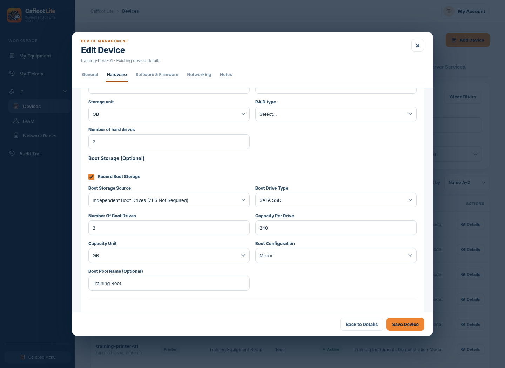

*Independent boot drives are recorded separately from ZFS pools; this does not configure disks.*

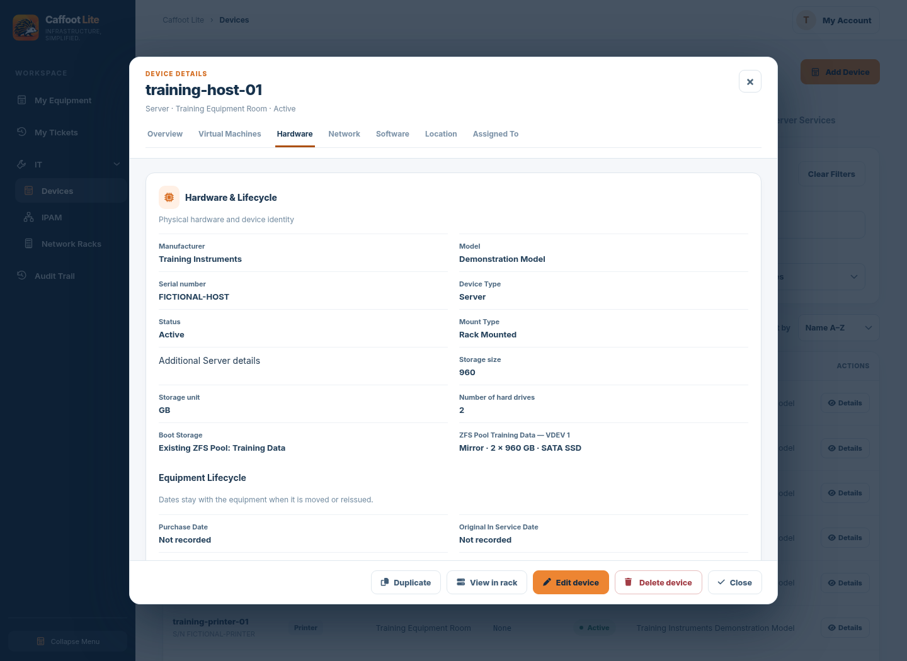

*The saved Hardware details show linked boot and the recorded Mirror VDEV together; these records do not configure disks.*

## Complete A Host And Guest Inventory

A physical hypervisor host runs virtual machines. A guest is its separately recorded VM. Recording a relationship does not provision or move either machine.

1. Create or edit a physical Server. On **General**, tick **This physical server hosts virtual machines**, select **Hypervisor software** and optionally enter **Hypervisor version (optional)**. Save and check the host's **Virtual Machines** tab.
2. Select **Add Device**. With an eligible non-retired physical host recorded, choose **Virtual Machine (VM)** as deployment. Choose the virtual purpose (Server, Desktop, Firewall, Router, NAS or Wireless LAN Controller, subject to available types).
3. Choose **Physical Hypervisor Host**; the virtualisation platform is inherited from that host. Record **vCPUs**, **Allocated RAM (GB)**, **Virtual disk (GB)** and **Virtual network adapters** as appropriate. Complete its own guest software and optional networking information. Physical hardware and mounting controls do not apply to the guest.
4. Save the VM and reopen both records. The guest's recorded location follows its selected host. Its own OS drives its software suggestions, rather than the host's hypervisor.
5. Before retiring the host or disabling hosting, save any other work and review every affected guest. Choose an eligible replacement host, unassign while preserving history, or retire each guest. **Keep Editing** cancels the review. Confirm only when every choice reflects the real inventory.
6. A change to a host's hypervisor platform presents a guest-platform review. Review the listed old/new platforms before confirming; cancelling preserves the current saved records.

Historical missing/retired hosts may be retained on existing records; this does not make them eligible for new assignments. Stale records, another editor's reservation and protected Device identities can reject the combined change. Resolve that reason and reopen the review; do not delete guests to bypass it.

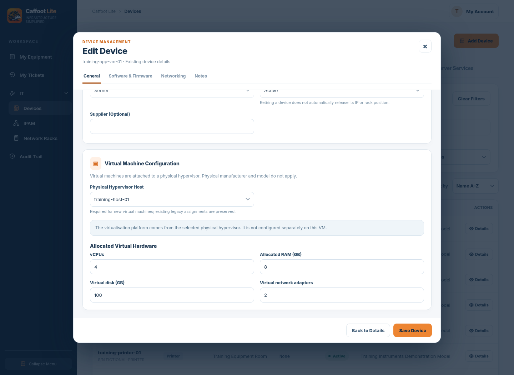

*The VM inherits its host platform and has its own recorded virtual resource allocations.*

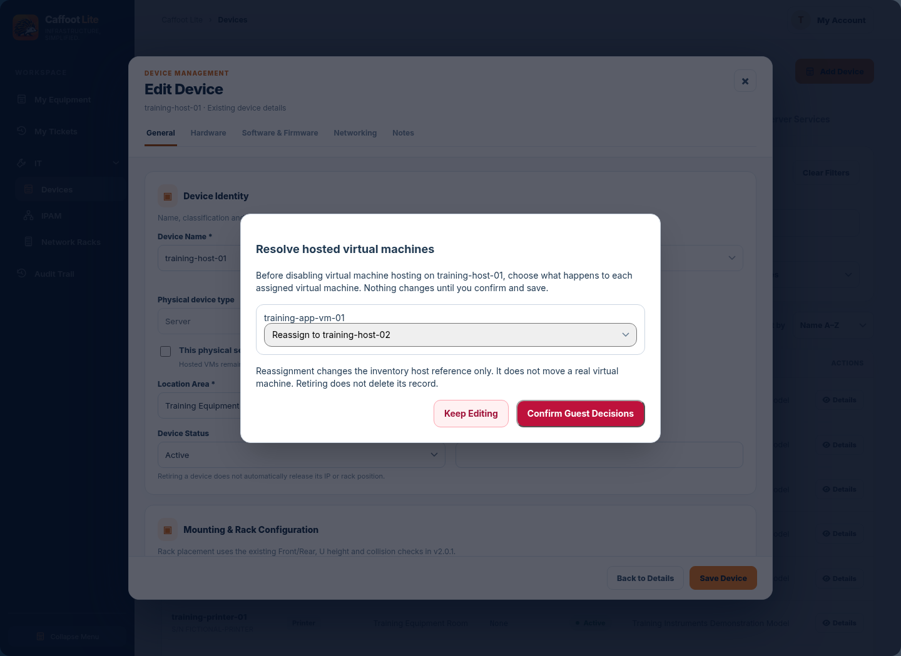

*Review the explicit replacement host for the guest before confirming. This draft has not migrated or reassigned a real VM.*

## Manage Device Types And Locations

These lists provide reusable classifications and location names. A Location is descriptive text, whereas a Rack/shelf placement is a separate protected relationship. Devices must be enabled and you need Devices Edit for these changes.

1. Open **IT → Devices → Device Types** or **Locations**, then **Manage Device Types** or **Manage Locations** respectively. Search for an existing value before adding one.
2. Enter **Add Device Type** or **Add Location**, for example *Training Room*, and choose **Add Type** or **Add Location**. The individual operation saves immediately. **Done** closes the manager; its **Cancel** button does not undo an already completed operation.
3. To correct a name, use its rename action, edit the name and select **Save Changes**. This updates affected Device records together. Cancelling an unsaved rename returns to the list, with the discard prompt if needed.
4. To stop offering a Device Type for new selections, choose **Archive**. Existing Devices keep the type, and it remains selectable on their edits. **Unarchive** restores it for new selections. Virtual Machine deployment cannot be archived this way.
5. To delete a list entry, read **Delete Device Type?** or **Delete Location?**. It shows the affected Device count and warns that their value will become **Unknown**. Choose **Cancel** to retain everything, or **Delete** only if that reclassification is intended.
6. Reopen affected Devices after a successful rename/deletion and check the result. The server rejects a stale affected-device list, active affected Device edit or invalid resulting relationship instead of applying only some changes.

Names must be non-empty, at most 100 characters and unique without case differences. **Unknown** is protected; **Racked** is not a valid new managed Location. A catalogue rename is a shared inventory change, so use it for a real correction rather than to move one Device. Ordinary Device identity protection remains in force for individual edits; do not assume a catalogue action is an authorised way to convert assigned equipment into a different kind of item.

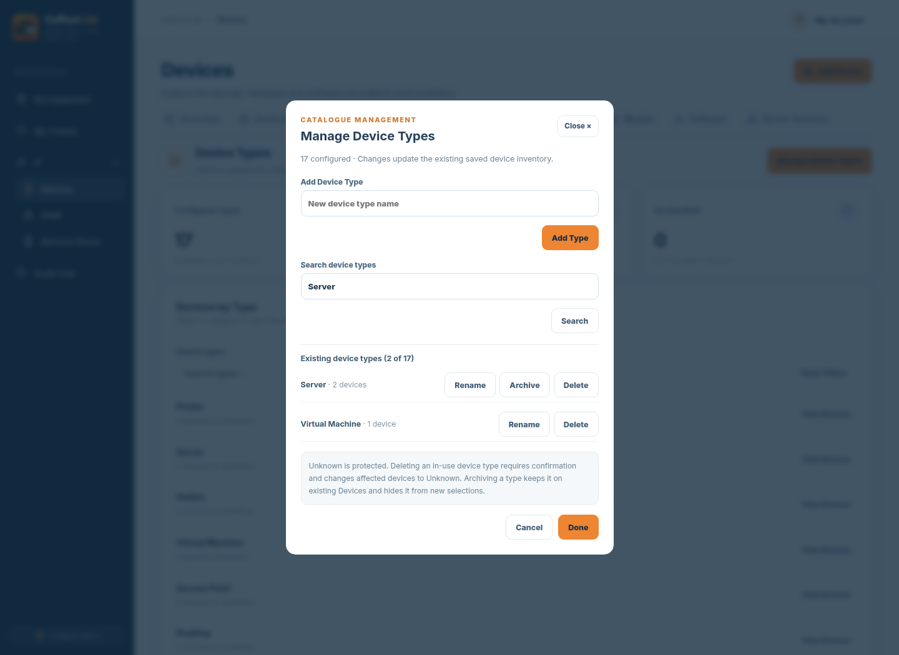

*Manage Device Types filtered to Server shows affected counts and shared catalogue actions. Unknown remains protected.*

## Maintain Hardware, Software And Service Catalogues

1. Open **IT → Devices → Manufacturers** or **Models**. Search and filter by the available type/source/usage controls. **View Devices** opens matching inventory. **Built-in**, **Custom** and **Recorded** describe where a suggestion came from, not its support or warranty status.
2. Use **Add Manufacturer** for a missing maker and associate the applicable physical Device types. Add a model under its manufacturer and type using **Add Model**. Save the dialog, then check that the choice appears for that type. Duplicate names/associations are rejected; choose an existing suggestion where appropriate.
3. Use **Edit** for custom entries or **Manage Suggestion** for a built-in suggestion's label/availability. Removing a custom suggestion, or hiding a built-in one, preserves existing Device hardware text. Use the hidden built-in list's **Manage / Restore** to restore availability. Cancel an unsaved dialog to keep its prior value.
4. Within a Device editor, the manufacturer/model quick-add offers **Add & Select**. Select a physical type first; a model also needs a manufacturer associated with that type. Successful quick-add saves the catalogue item immediately, even if you later discard the Device draft. It does not save the Device itself.
5. Open **Software → Add Custom Software** for a missing title. Enter its name and at least one applicable Device type, then **Save Software**. Use **Manage** or **Edit** for availability and associations. Software availability is independent of whether it is installed.
6. Use **Remove** to review removal from available software choices. If any Device still records it, the operation is blocked: correct the actual installation records first. Unused entries are archived for recovery. **Restore** makes an archived entry available again, subject to name conflicts.
7. For an actual historical archived installation, use **Overview → Software** and its **Mark as Uninstalled** action, reviewing the named Device/title before confirming. This removes the recorded installation flag, not software on the computer. Cancel preserves it.
8. Open **Server Services** to add or edit a service and use **Save Service**. A service describes an enabled role such as DNS or File Server, separate from a software product. **Archive Service** is blocked while the service is assigned; an archived service's restore action makes it available again.

Record actual software and services by editing the Device and saving the relevant selections. Changing suggestions or type/OS filters never proves installation or removal. **Previously recorded — review** selections remain saved until deliberately unticked. A failed catalogue save restores the prior catalogue state; check feedback and reopen before retrying. Use fictional *Training Tools* as a planning example, but record only real verified titles on your equipment.

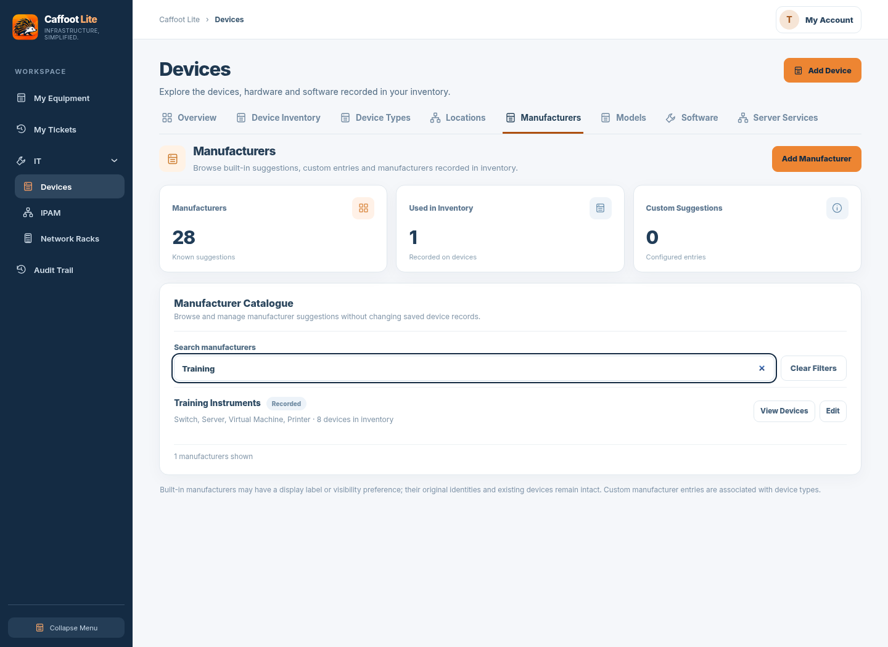

*The manufacturer catalogue is a representative example; software and service catalogues have their own written procedures.*

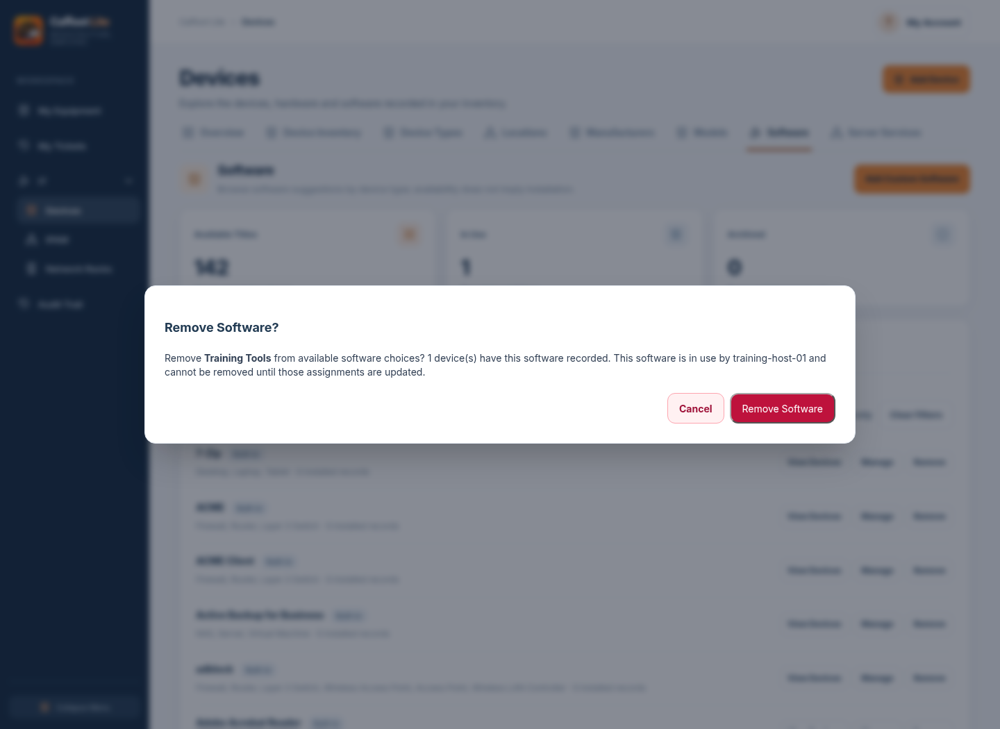

*Training Tools cannot be removed while training-host-01 records it as installed.*

## Choose the next task after recording equipment

| Task | Guide |
| --- | --- |
| Allocate an existing Device to a person, manage shared custody, or read assignment history | [Device Assignments And My Equipment](Device-Assignments-and-My-Equipment.md) |
| Register a new stock unit or reissue the same registered Device | [Device Stock Registration And Reissue](Device-Stock-Registration-and-Reissue.md) |
| Record physical returns, associated equipment or a direct handover | [Issue, Return And Write Off](IT-Assets-Issue-Return-and-Write-Off.md) and [Associated Equipment](Associated-Equipment.md) |
| Record supplier and purchasing relationships | [Equipment Supplier Integration](Equipment-Supplier-Integration.md) |
| Record lifecycle dates or review warranty and replacement warnings | [Equipment Lifecycle](Equipment-Lifecycle.md) |
| View authorised support tickets for a Device | [Service Desk Tickets](Service-Desk-Tickets.md) |
| Inspect authorised event history | [Audit Trail](Audit-Trail.md) |

For example, a returned laptop retains the original Device identity and its previous custody history. Use the appropriate physical return, preparation and reissue workflows rather than **Duplicate**. An operational status or an empty assignment does not prove a stock unit is physically held or ready for issue.

## Troubleshooting

| Problem | Check |
| --- | --- |
| Cannot add device | Check Devices is enabled, Devices Edit, required name/type/location, applicable mounting and MFA. A managed address needs IPAM Edit; the address itself is optional. |
| Cannot mount | Existing rack, Racks Edit, valid mounting type, free face/U span and appropriate height |
| Can't edit IP or rack fields | Check whether the address is managed and whether the related feature is enabled and grants Edit. Protected hidden relationships remain saved. |
| Edit refused | Another user's active device reservation, missing edit permission or MFA |
| Save refused | Review the field/revision error, duplicate address, incompatible placement, protected identity or dependency. Keep the original record and retry only after resolving the stated problem. |
| Colleague sees old details | Reopen the device or navigate to the section; no continuous background polling |

Related: [Optional Features and Link to IPAM](Optional-Features-and-Link-To-IPAM.md), [Roles, Section Permissions And MFA](Roles-Section-Permissions-and-MFA.md), [Draft v2.2 guide index](README.md). See also [IPAM](IPAM.md) and [Network Racks](Racks.md) for complete network and placement procedures.
