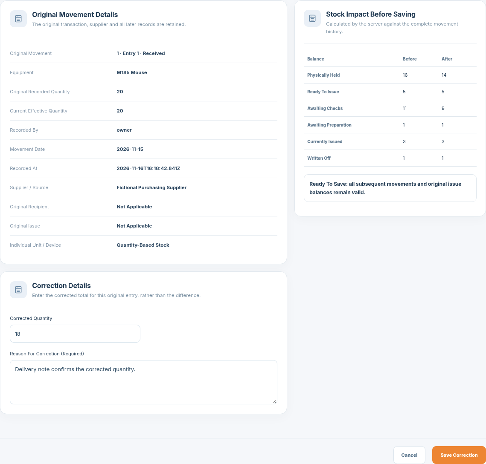
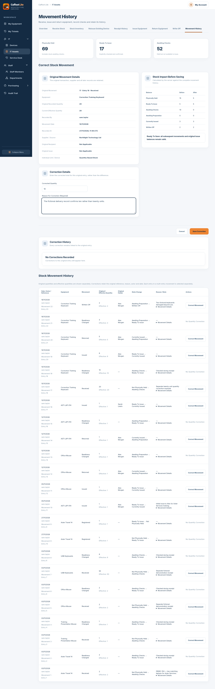
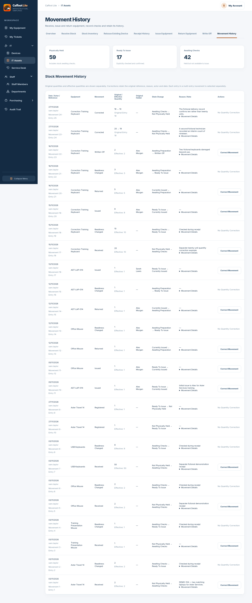
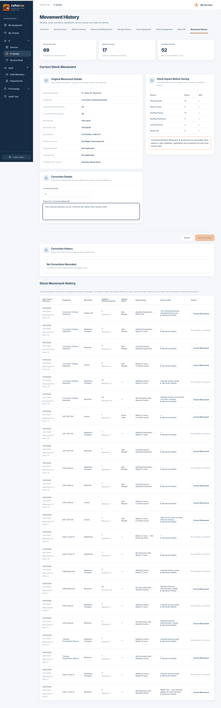
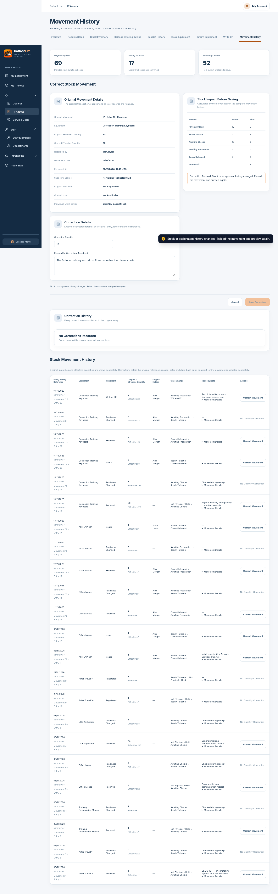

# Correct Stock Movement

> **Draft v2.2 — Unreleased.** v2.1 remains the published release. These instructions describe v2.2.

Use **Correct Movement** when a receipt, issue, return or write-off quantity was recorded incorrectly. For example, a technician might have entered 20 keyboards received when the delivery actually contained ten. The correction keeps the original transaction and adds a dated record containing the correct total, your name and an explanation.

This changes a recorded quantity, not what physically happened. Use [Return Equipment](IT-Assets-Issue-Return-and-Write-Off.md#return-equipment) for an actual return and **Write Off** for genuinely missing or unusable equipment. Correct Movement does not provide a physical stocktake, edit Device identity or silently adjust later transactions to make a desired total fit.

*A fictional receipt correction from 20 to 18. The original record and preview remain visible together.*

## Before You Start

- **IT Assets** must be enabled and you need effective **IT Assets Edit**. The feature switch does not grant editing permission.
- A correction involving registered Devices or their explicitly associated equipment also needs enabled **Devices** and **Devices Edit**. Existing Device edit reservations still apply.
- Identify the original movement and individual entry. A movement can contain several equipment entries; each entry is considered separately.
- Establish the correct quantity from reliable evidence, such as the original delivery paperwork or an issue record. Review later activity before changing an earlier figure.
- Prepare a clear factual reason. Do not put passwords or unnecessary personal information in permanent history.

Read-only users can view permitted original records and correction history but cannot preview or save a correction. A disabled feature or **No Access** prevents access to its records. See [Roles And Permissions](Roles-Section-Permissions-and-MFA.md) if the action is unavailable.

## Find The Right Original Entry

1. Open **IT → IT Assets → Movement History**.
2. Locate the original **Received**, **Issued**, **Returned** or **Written Off** entry. Check the equipment, **Original Holder**, date, actor and movement/entry references. Do not rely on a model name alone when several items share it.
3. Read **Original / Effective Quantity**. The original quantity is the immutable first record; the effective quantity is the total currently used after any earlier correction.
4. Expand **Movement Details** if you need the recorded time, original issue reference, Supplier or preparation evidence.
5. Choose **Correct Movement** for the intended original entry. On narrow screens, scroll horizontally to reach **Actions**.

**Readiness Changed**, **Registered**, **Reassigned** and **Corrected** entries do not provide this quantity-correction operation. Follow the relevant workflow instead. An original individual-unit movement may be visible in the workflow, but validation prevents a quantity change from creating, removing or replacing that permanent identity.

## Preview And Save A Correction

1. Review **Original Movement Details**. Confirm **Original Recorded Quantity**, **Current Effective Quantity**, equipment, dates, **Recorded By**, **Supplier / Source** and original recipient where recorded.
2. Read **Correction History** to understand any earlier correction. A further correction is another attributed record, not removal of the earlier one.
3. Enter **Corrected Quantity** as the correct total for this entry, not the amount to add or subtract. To change 20 to ten, enter `10`; do not enter `-10`.
4. Enter **Reason For Correction (Required)**. Explain both the mistake and its evidence, for example “Delivery note HV-104 confirms ten keyboards; twenty was entered in error”.
5. Wait for **Stock Impact Before Saving** to calculate. Compare every relevant **Before** and **After** balance: **Physically Held**, **Ready To Issue**, **Awaiting Checks**, **Awaiting Preparation**, **Currently Issued**, **Written Off** and, where shown, **Original Issue Outstanding**.
6. Read the validation result. **Ready To Save** means the requested total and reason pass the current checks. **Correction Blocked** explains why the operation cannot be saved. The preview itself records no correction and changes no stock.
7. When the preview is correct and the action is enabled, choose the orange **Save Correction** button at the bottom of the form.
8. Check the saved result: before/after quantities, reason, actor, recorded time and correction reference. Review the updated effective quantity and relevant stock/outstanding balance.

A successful save appends the correction and updates calculated balances together. The original transaction, its Supplier provenance, original holder and later chronological records remain. The correction does not change a movement's equipment, event date, recipient, specifications or preparation checks.

*The original receipt remains twenty. This preview proposes effective quantity ten with a reason and before/after balances; Save Correction is still required.*

## Worked Example: Correct A Receipt Before It Is Used

All data is fictional. Harbour View Library received ten keyboards, but the technician recorded 20 with zero Ready. No later movements exist.

1. Morgan opens the original **Received** entry, checks the delivery note and chooses **Correct Movement**.
2. Morgan enters **Corrected Quantity** `10` and a factual reason referencing the delivery note.
3. The preview shows:

| Balance | Before | After |
| --- | ---: | ---: |
| Physically Held | 20 | 10 |
| Ready To Issue | 0 | 0 |
| Awaiting Checks | 20 | 10 |
| Currently Issued | 0 | 0 |
| Written Off | 0 | 0 |

4. Morgan saves the correction, then checks the original quantity still reads 20 and the effective quantity is ten. The ten real keyboards still need their normal receipt checks before issue.

If 12 keyboards had already been checked or issued from that receipt, reducing it to ten could make the intervening history impossible. A current apparent surplus from a later delivery does not repair that earlier inconsistency. The correction is blocked rather than rewriting the later checks, issues or assignments.

*The original twenty-unit receipt and both attributed corrections remain. Its effective quantity is ten; prior issue/return facts and physical Device identities are preserved.*

## Correct An Issue While Returning Equipment

Use this entry point if an issue-recording mistake becomes apparent when equipment comes back. It opens the same correction form, with the same safeguards.

1. In **Return Equipment**, select the original issue and check its recorded and outstanding quantities.
2. Choose **Correct Movement** beside the original issue information. The action appears only for an original stock issue you are allowed to correct.
3. Complete the review, reason and preview steps above. Your entered return date, quantities, checks, damage reason and note are retained while the correction form is open.
4. Choose **Save Correction** only if the corrected issue total is supported by the evidence and the preview permits it.
5. Back in **Return Equipment**, review the refreshed authoritative quantities and retained return fields. The form reloads current quantities and versions rather than saving a return against the old balance.
6. Amend retained return quantities if necessary, then choose **Record Return** as a separate action for the equipment physically received.

For example, four keyboards were physically issued to fictional Alex, but five were recorded. With no conflicting dependent history, correct the issue total to four, then record the actual return of four. Saving the correction does not record the return: Alex's outstanding balance remains four until **Record Return** succeeds.

If the corrected issue is no longer eligible, the form explains the change and requires an eligible selection; it does not quietly choose a different issue. If refresh fails, use **Reload Stock** before attempting the return. A retained entered quantity above the refreshed outstanding balance must be corrected.

**Cancel** and **Escape** return to your entered return details, with confirmation before discarding changed correction fields. Leaving both forms also protects unsaved return details. A blocked or failed correction retains the entered details for review. A saved correction remains saved even if you later cancel the return.

## Why A Correction May Be Blocked

The corrected total must be a changed positive whole number up to 9,007,199,254,740,991, with all resulting balances also within the supported range. Reason For Correction is required and allows up to 2,000 characters. Zero, negative amounts, decimals and the existing effective total cannot be saved as a quantity correction.

The application replays the subsequent saved movement sequence in publication order, not just today's total or a sort of user-entered business dates. A later receipt cannot supply an earlier saved issue retroactively. In particular:

- A receipt cannot be reduced below quantities already checked, registered or used by dependent movements.
- An issue cannot be reduced below its later returns or direct write-offs.
- A return cannot be reduced below preparation or write-offs which depend on it.
- A correction cannot reopen unresolved associated equipment after the Device assignment has ended.
- An individually tracked unit or canonical Device retains its one permanent identity; this action cannot change its quantity to create, remove or replace it.

A blocked preview is not an instruction to invent compensating movements. Check whether you selected the wrong original entry or entered the difference instead of the correct total. If the supported correction is still irreconcilable with recorded history, stop and give the administrator the movement and entry references, factual evidence and exact explanation. Do not delete records, alter the database or use fictitious receipts/returns to bypass the safeguard.

*Five would contradict later issue/return history, so the correction is blocked. Do not invent a compensating receipt or delete the original movement.*

## Cancel, Stale Data And Recovery

**Cancel** or **Escape** leaves the correction safely. If fields changed, choose **Keep Editing** to retain them or confirm discarding unsaved changes. Changing theme retains your draft. Leaving the page also protects unsaved correction fields. None of these actions reverses a correction already saved.

If another technician changes stock, Device details, assignments or equipment links while the form is open, the save is rejected and requires a fresh preview. Cancel, reload **Movement History**, reopen the original entry and review current information before retrying. The failed operation does not partly change quantities or later records.

If a Device edit reservation blocks a cross-feature correction, let the existing edit finish or be cancelled, then reload. If your session ends or permissions change, sign in and check your effective access before reopening the workflow. A connection failure should be followed by a check of **Correction History** and movement references before starting a separate correction.

*A separately saved interim correction invalidates the earlier preview. The stale Save Correction is rejected and the user must review the refreshed history.*

## What This Form Cannot Correct

The supported kinds are an original Received, Issued, Returned or Written Off quantity entry. Individual-unit and canonical-Device quantity changes are blocked, even if an entry can be opened for inspection. This form does not edit a date, original recipient, reason, serial, specification, Supplier association, registration, readiness-change record or direct handover. Use the dedicated Supplier-association controls for that relationship. For an unsupported factual correction, retain the original references and seek an administrator decision; do not fabricate physical movement.

## Related Guides

[Issue, Return And Write Off](IT-Assets-Issue-Return-and-Write-Off.md) · [Receive Stock And Stock Inventory](IT-Assets-Stock-Intake.md) · [Associated Equipment](Associated-Equipment.md) · [IT Assets Overview](IT-Assets-Dashboard.md).

[← Draft v2.2 Guides](README.md) · [Published v2.1 Guides](../README.md)

[Connected example: a laptop from Supplier and stock to its final write-off](Connected-Equipment-Journey.md).
