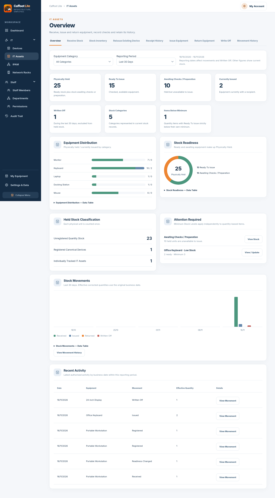
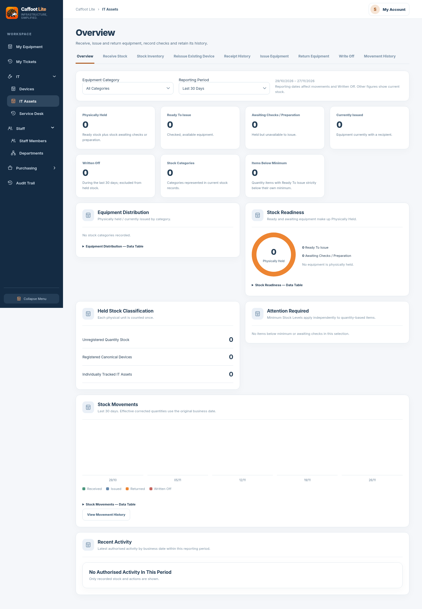
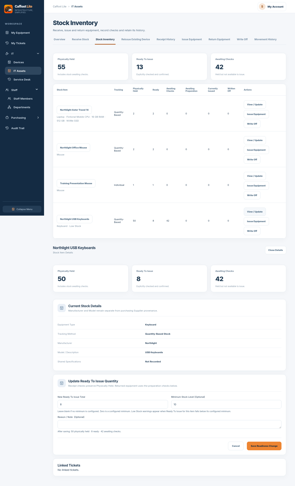
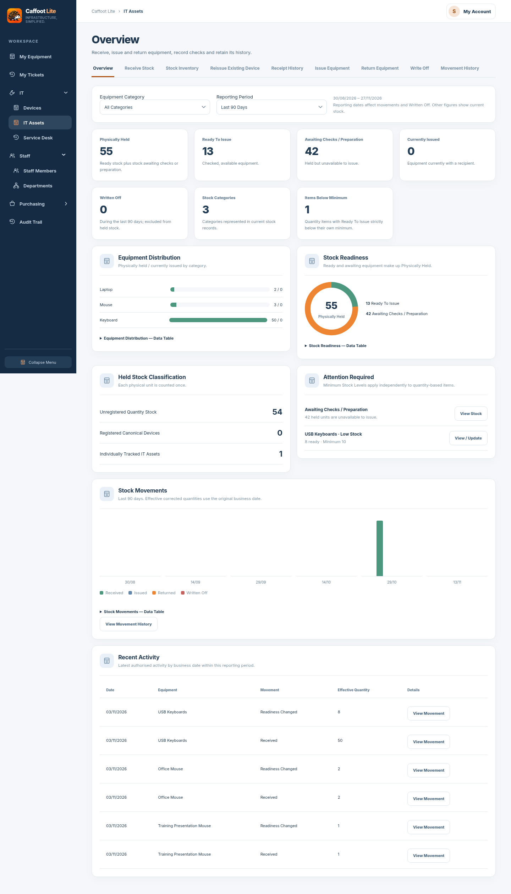
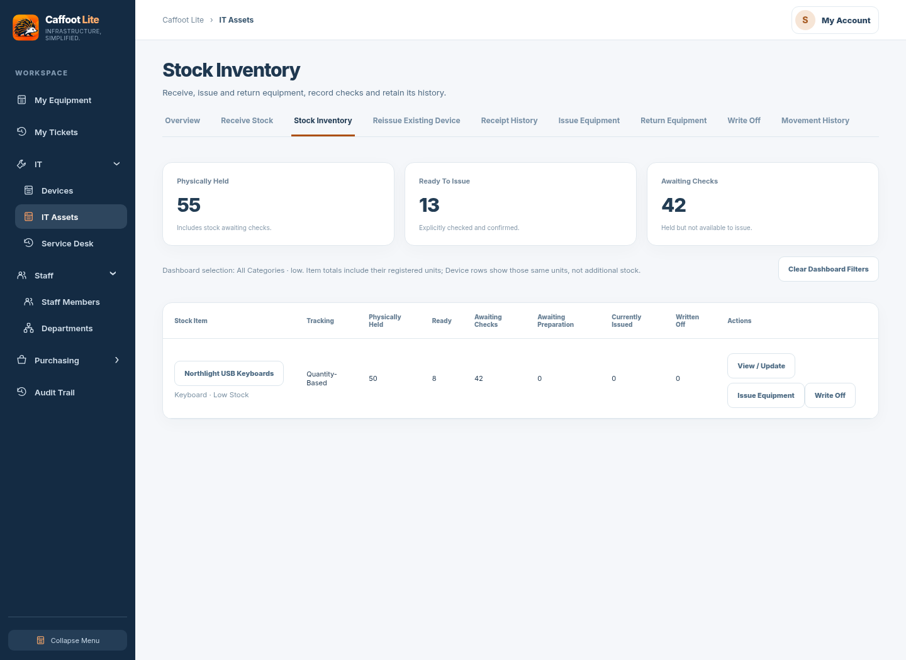
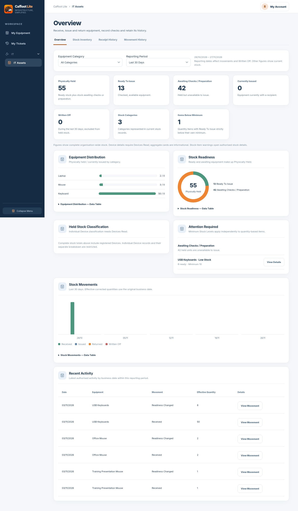
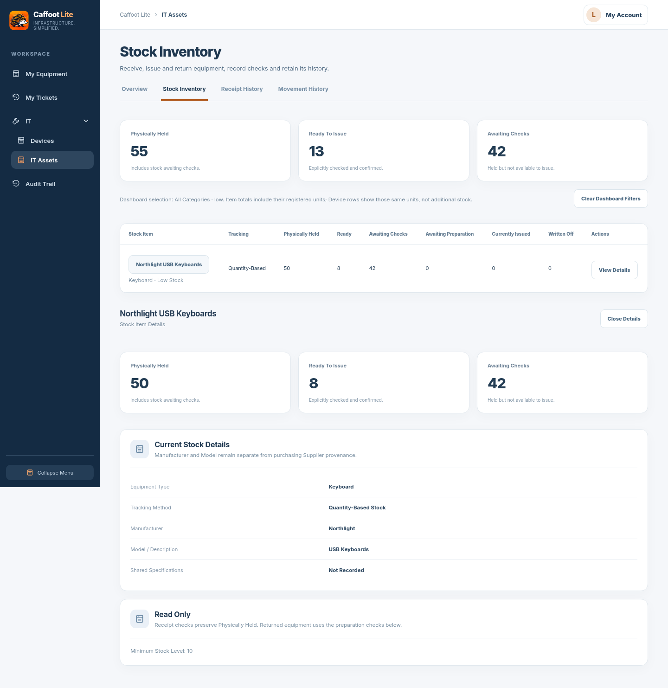

# IT Assets Overview And Low Stock Warnings

> **Current Batch 7C capture status — 27 November 2026:** [New desktop light illustrations](screenshots/batch-7c/README.md) use the approved merged schema-31 baseline. Independent ChatGPT review and separate owner visual/privacy/caption/alt acceptance remain pending. Earlier written/source and capture-status paragraphs retain their dated scope; the current pack status controls these new images. Published v2.1 and targeted correction-refresh requirements remain unchanged.

> **Draft v2.2 — Unreleased.** These instructions describe the implementation on `milestone-1` at the application baseline identified below. v2.1 remains the published release.

> **Written/source reconciliation:** Batch 4, application baseline `fdc677920bfc52f48f641b3d6d1344c902a6a9b0` (schema 31). Focused independent reviews are recorded and [owner written/source acceptance of Batches 1–6](https://github.com/Caffoot/Caffoot-Lite/issues/366#issuecomment-7200681167) is recorded. Current visual/privacy/caption/alt approval remains outstanding; [Batch 7 reconciliation and proposed capture packs](../../../development-guide/Milestone-01-Batch-7-Review.md) await independent review and owner acceptance. Capture scope and method need separate authorisation. Desktop capture remains deferred; existing images retain their original provenance and are not certified current by this pass. [Source review and exact screenshot requirements](../../../development-guide/Milestone-01-Batch-4-Review.md).

The IT Assets **Overview** brings together the organisation's current equipment balances, preparation backlog, stock movements and optional Low Stock warnings. It helps a technician answer practical questions: what is held, what can be issued now, which items need checks and which quantity-based items are below their configured minimum?

The dashboard reports the existing stock records; opening it does not receive, issue, prepare or write off equipment. Use its links to reach the established stock workflows when you need to act.

*Approved application capture with fictional data. The first/default tab is **Overview**. This image shows a viewer with both IT Assets and Devices access; the classification and available actions depend on permissions. The owner approved the genuine dashboard captures in [PR #398](https://github.com/Caffoot/Caffoot-Lite/pull/398#issuecomment-6929275962). Figures illustrate that capture, not your organisation's current stock.*

## Before You Start

- An administrator must enable **IT Assets** under **Settings & Data → Optional Features → Additional Features**.
- Effective **IT Assets Read** is required to view the Overview. **IT Assets Edit** is required for the stock-changing actions reached from it.
- **Devices Read** and the independently enabled **Devices** feature are needed for identifiable Device details and the separate held-stock classification. Stock-changing Device work additionally requires the relevant Edit permissions.
- Receipts, returns and preparation must have been recorded through their appropriate workflows. A Device being unassigned, imported or Retired does not by itself make it held or Ready stock.

The switch and permissions are separate. The built-in **IT Staff** role defaults to IT Assets Edit as well as Devices/IPAM/Racks Edit, but an individual's effective access can differ because of role configuration, explicit overrides or feature switches. Existing access is preserved on upgrade; ordinary new accounts do not automatically gain IT Staff membership or inventory administration. See [Roles And Permissions](Roles-Section-Permissions-and-MFA.md).

## Open And Read The Overview

1. Choose **IT → IT Assets**. **Overview** is the first/default tab. From another stock tab, choose **Overview** to return.
2. Start with **Physically Held**, **Ready To Issue**, **Awaiting Checks / Preparation** and **Currently Issued**. These are current-state figures for the selected equipment category.
3. Check **Items Below Minimum** for quantity-based items whose Ready balance is below their own optional threshold.
4. Review **Equipment Distribution**, **Stock Readiness** and, if permitted, **Held Stock Classification** to understand the same stock figures in context.
5. Read **Attention Required**, **Stock Movements** and **Recent Activity** for outstanding checks, Low Stock details and dated activity.

| Figure | How To Interpret It |
| --- | --- |
| **Physically Held** | Ready equipment plus equipment Awaiting Checks or Awaiting Preparation. Issued and written-off quantities are excluded. |
| **Ready To Issue** | Held equipment which has passed its applicable checks and is available for issue. It is part of Physically Held, not an extra quantity. |
| **Awaiting Checks / Preparation** | Held equipment unavailable for issue until the relevant receipt or return-preparation checks are completed. |
| **Currently Issued** | Equipment still outstanding with its current Staff Member or Department recipient. |
| **Written Off** | Effective write-off quantities within the selected reporting period, not all historical write-offs or current physical stock. |
| **Stock Categories** | Categories represented in the current stock records for the selection. It counts categories, not units. |
| **Items Below Minimum** | The number of qualifying quantity-based stock items, not the number of missing units or a procurement quantity. |

If the cards show 25 Physically Held, 15 Ready and ten Awaiting Checks / Preparation, there are 25 held units altogether. Adding the Ready and awaiting figures explains the held figure; adding all three would count the same equipment twice.

## Choose A Category And Reporting Period

1. Set **Equipment Category** to the category you want to inspect, or keep **All Categories**.
2. Set **Reporting Period** to **Last 30 Days** or **Last 90 Days**. The date range appears alongside the controls.
3. Review the refreshed selection. The category applies to the stock and activity selection. The period applies to **Stock Movements**, **Recent Activity** and the **Written Off** card.
4. Keep the distinction between current balances and activity over time: changing the period does not turn Physically Held, Ready or Currently Issued into historical snapshots.

The reporting window includes today and the preceding 29 or 89 UTC calendar dates. It uses recorded business dates, rather than the time you opened the page. Movement reporting uses effective corrected quantities against the original business date. A correction entered today for a receipt from two months ago affects the reporting interval containing that receipt's date. Direct Device reassignment is shown in its custody history; it does not invent a new physical stock receipt or appear as a fresh stock issue in the movement totals.

For example, fictional Harbour View Library currently holds 18 keyboards. A write-off 45 days ago appears in **Last 90 Days** but not **Last 30 Days**. Switching between those periods does not change the current 18 held keyboards. A filter with no qualifying activity can show an empty movement table while current stock remains positive.

## Use Charts And Open The Underlying Records

**Equipment Distribution** compares Physically Held and Currently Issued by category. **Stock Readiness** shows how Ready and awaiting equipment make up Physically Held. Each chart has a corresponding expandable **Data Table** containing exact values; use these tables if the chart colours or shapes are difficult to read. Keyboard users can focus the table summary and open it with Enter or Space.

With the required Devices access:

1. Choose a current-state card or category row to open the corresponding filtered stock or current-assignment view.
2. Choose **View Stock** under an awaiting-checks attention item to inspect the equipment needing work.
3. Choose **View Movement History** under **Stock Movements**, or the **Written Off** card, to inspect permitted history for the selected period.
4. In **Recent Activity**, choose **View Movement** for the exact entry.
5. Read the selection explanation above the destination table. Choose **Clear Dashboard Filters** to return that table to its full existing view. The Overview's own category/period selectors remain separate controls.

**Held Stock Classification**, when permitted, distinguishes **Unregistered Quantity Stock**, **Registered Canonical Devices** and **Individually Tracked IT Assets**. These describe how the same held equipment is represented. Registering one of ten held desktops changes it from unregistered to registered-held; Physically Held stays ten. Physically issuing that registered Device reduces held by one. Stock item totals can already include their registered units: the separate Device rows are not additional stock.

### Empty Selections And Saving

**No stock categories recorded.**, **No equipment is physically held.** and **No Data For This Selection** describe different parts of the report. **No items below minimum or awaiting checks in this selection.** means no attention rows for that selection; it does not certify that every physical item has been inspected. Use All Categories and both permitted reporting periods when investigating missing activity. The category/period selectors refresh reporting; there is no reporting Save or Cancel and they make no stock changes. A failed load is not a zero-stock result.

## Configure An Optional Minimum Stock Level

The warning compares each quantity-based stock item's own **Ready To Issue** total with its own optional **Minimum Stock Level**. It does not compare the organisation total or Physically Held against one global threshold.

1. With **IT Assets Edit**, open **IT Assets → Stock Inventory**.
2. Find the quantity-based item and choose **View / Update**.
3. In **Update Ready To Issue Quantity**, locate **Minimum Stock Level (Optional)**.
4. Enter a non-negative whole number, or leave the field blank to have no minimum. Keep the readiness quantity unchanged if you are only setting the minimum; a threshold does not make equipment Ready.
5. Choose **Save Readiness Change**.
6. Return to **Overview** and check **Items Below Minimum** and **Attention Required** for the relevant category. Stock Inventory also marks a qualifying item **Low Stock**.

A blank minimum means no warning. Zero is a configured minimum; a valid non-negative Ready balance cannot fall below zero. Individually tracked stock items do not have this quantity-threshold warning.

| Item Setting And Balance | Result |
| --- | --- |
| Minimum 10; Ready 8 | **Low Stock**; this item contributes one to **Items Below Minimum**. |
| Minimum 10; Ready 10 | No warning: equality is sufficient. |
| No minimum; Ready 0 | No Low Stock warning. |
| Minimum 10; Physically Held 16; Ready 8 | **Low Stock**: unchecked or unprepared held equipment cannot satisfy the Ready threshold. |

A warning offers **View / Update** for an editor or **View Details** for a read-only viewer. Use the existing receipt or preparation workflow for the actual stock situation. The warning does not place an order, reserve stock, send equipment to a recipient or automatically confirm checks.

## Permissions, Complete Totals And Privacy

IT Assets-only viewers receive complete organisation-wide stock totals and correct Low Stock calculations, including registered equipment. Removing Devices Read must not make a genuinely low item appear sufficient or make held stock disappear from an aggregate.

That aggregate permission does not disclose Device identities, Device-specific histories, a Device-only count or the three-way **Held Stock Classification** breakdown. For IT Assets-only viewers, aggregate cards/category displays are informational, while authorised stock-item warnings can still open their stock details. The separate individual Device list is permission-filtered and need not account for every unit included in the complete aggregate.

Read-only access offers no stock-changing controls. Changing a feature switch or permission does not erase records; subsequent requests apply the current access rules. **My Equipment** remains a separate safe personal/shared view, not access to organisation-wide stock reporting.

## Troubleshooting

| What Seems Wrong | What To Check |
| --- | --- |
| Held stock is higher than Ready | The difference is equipment Awaiting Checks / Preparation. Inspect the backlog and complete only work actually done. |
| A large held balance still shows **Low Stock** | The warning uses this item's Ready total, not all held equipment or another item's availability. |
| No warning appears at the exact minimum | Equality is not Low Stock. Warnings require Ready to be strictly below the configured minimum. |
| **Items Below Minimum** is a small number despite a larger shortage | The indicator counts qualifying items, not units needed. Read each warning's Ready and Minimum figures. |
| Written Off changes when the period changes | It is an activity measure within that period. Current held/Ready/issued cards are snapshots. |
| Recent Activity does not list every movement | It shows up to six recent authorised entries within the selected period and category. Use **Movement History** for the fuller permitted record. |
| Device rows or classification are absent | Check enabled Devices and Devices Read. Complete aggregate stock totals remain available through IT Assets Read. |
| A filtered table omits expected records | Read its dashboard-selection explanation and choose **Clear Dashboard Filters**; also check the Overview category selection. |
| Stock fails to load | Use **Reload Stock**, check your session and effective permissions, and review the displayed error before retrying. Opening or reloading reporting changes no stock. |

## Related Guides And Acceptance Boundary

[Receive Stock And Stock Inventory](IT-Assets-Stock-Intake.md) · [Issue, Return And Write Off](IT-Assets-Issue-Return-and-Write-Off.md) · [Device Registration And Reissue](Device-Stock-Registration-and-Reissue.md) · [Correct Stock Movement](IT-Assets-Correct-Movement.md).

The [genuine dashboard evidence](../../../development-handovers/evidence/stock-dashboard/Report.md) records the existing checks and capture provenance. Owner approval of those images does not establish native Safari, private-installation, full upgrade/restore or release acceptance. Remaining documentation and manual acceptance items are recorded in the [documentation review items](../../../development-guide/Stage-1-3-Documentation-Review.md).

[← Draft v2.2 Guides](README.md) · [Published v2.1 Guides](../README.md)

[Connected example: a laptop from Supplier and stock to its final write-off](Connected-Equipment-Journey.md).

## Batch 7C Desktop Illustrations

These images follow the fictional training journey. Read the caption to distinguish a draft, a cancelled preview and a saved outcome. [Complete original coverage and limits](screenshots/batch-7c/Coverage.md).

*Draft v2.2 — Before the first receipt, the isolated journey has no stock. Empty totals do not authorise receiving a delivery twice. Independent review and owner visual acceptance pending.*

*Draft v2.2 — Fifty keyboards are physically held; only eight are Ready against minimum ten. The minimum compares Ready units, rather than the full held quantity. Independent review and owner visual acceptance pending.*

*Draft v2.2 — Mixed quantity and individually tracked stock use complete held totals. The 90-day reporting control affects movement reporting, not current stock arithmetic. Independent review and owner visual acceptance pending.*

*Draft v2.2 — The Low Stock drill-down identifies the eight-Ready keyboard item below minimum ten. Clear Dashboard Filters returns to the full stock list. Independent review and owner visual acceptance pending.*

*Draft v2.2 — IT Assets Read without Devices Read receives complete aggregate totals, while Device identities, classifications and Device drill-down stay protected. Independent review and owner visual acceptance pending.*

*Draft v2.2 — IT Assets Read can inspect stock details and recorded checks, but cannot change readiness or receive or issue stock. Independent review and owner visual acceptance pending.*
