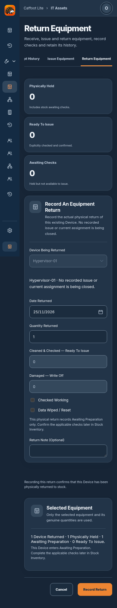

# IT Assets: Issue, Return And Write Off

> **Draft v2.2 — Unreleased.** These instructions describe the implementation on `milestone-1` at `753b3266893987addb11406ef8303adb03c3c112`. v2.1 remains the published release. Use these feature instructions on an authorised development or acceptance instance; they are not installation, upgrade or restore instructions.

Use IT Assets to record who has equipment, what has physically returned and which items can safely be issued again. An issue reduces available stock; a genuine return records what came back; preparation confirms which returned items are ready; a write-off records equipment that must leave usable inventory. Each action keeps the original equipment identity and a permanent movement record.

This guide follows equipment after [receipt and checking](IT-Assets-Stock-Intake.md). For managed computers, also read [Device Registration And Reissue](Device-Stock-Registration-and-Reissue.md): a computer's Device record, physical possession, assignment and readiness describe different things.

## Date Format For Stock Movements

Use UK **DD/MM/YYYY** for Date Issued, Date Returned, Date Checked, Date Reassigned and Date Written Off (for example, **18/11/2026**), or choose from the calendar button. Caffoot Lite preserves the event as an ISO `YYYY-MM-DD` value internally and retains the original stock movement, validation, future-date and handover safeguards. An invalid typed date cannot be saved. For accessibility and calendar-keyboard help, see [UK Date Entry And Calendar Controls](README.md#uk-date-entry-and-calendar-controls).

## Before You Start

An administrator enables **IT Assets** under **Settings & Data → Optional Features → Additional Features**. It is independently optional and starts off. **IT Assets Read** permits stock and movement viewing; **IT Assets Edit** permits the actions below, subject to existing role, individual override, MFA and session rules. The switch grants no permission.

Returning, preparing or writing off a managed Device also requires enabled **Devices** and effective **Devices Edit**. Staff Members and Departments keep their independent directory permissions. The restricted recipient picker offers eligible names without granting directory, contact or account access.

Open **IT → IT Assets**. **Overview** opens first. Choose **Stock Inventory** to inspect balances, or the **Issue Equipment**, **Return Equipment**, **Write Off** and **Movement History** tabs for the procedures below. **Receive Stock**, **Receipt History** and, with the relevant permissions, **Reissue Existing Device** support the related workflows. On a narrow screen, scroll the tab row or wide tables sideways. The tab row also supports the arrow keys, Home and End when a tab has keyboard focus. Read-only users can inspect permitted inventory and history; editing forms are unavailable.

Before saving, identify the actual equipment, its original issue where applicable, the person or Department and the real event date. Keep notes factual; do not put passwords, personal medical information or other unnecessary sensitive details in stock history.

## Understand The Stock Figures

| Figure Or State | What It Means |
| --- | --- |
| **Physically Held** | Equipment recorded as held by the organisation for stock purposes: Ready plus Awaiting Checks and Awaiting Preparation. It excludes equipment currently issued or written off. |
| **Ready To Issue** | Held equipment explicitly checked and available for a new issue. This is a subset of Physically Held, not an additional quantity. |
| **Awaiting Checks** | Received equipment still needing its receipt checks. Return summaries also use this label for their calculated unchecked balance. |
| **Awaiting Preparation** | Returned equipment held but awaiting the appropriate cleaning, working or data checks. |
| **Currently Issued** | The quantity still outstanding against its original holder. A partial return reduces this quantity without closing the remainder. |
| **Written Off** | Equipment removed from usable stock by an explicit historical action. It cannot simultaneously remain held or Ready. |

For example, 12 Physically Held with four Ready and eight Awaiting Checks means 12 units altogether. It does not mean 24. Registered Devices shown separately can already contribute to a stock item's totals; do not add those rows a second time.

An **Active**, **Maintenance** or **Retired** Device status describes its operational status. Changing that status, creating a Device, importing it or leaving it unassigned does not record a physical stock receipt or return.

## Issue Equipment

1. Open **Issue Equipment**. In **Ready Equipment**, select the stock item. Read **Ready To Issue For This Item**: it is the selected item's actual available quantity for this workflow.
2. For quantity stock, enter a positive whole **Quantity To Issue** within that balance. For individual stock, select each actual unit; the quantity follows the selection. Serial numbers and asset tags may be absent without losing individual identity.
3. Set **Assign To** to **Staff Member** or **Department**. Use **Find A Recipient**, then select the actual name in **Staff Member Or Department**. Only active Staff Members and unarchived Departments can receive new equipment. Check similarly named recipients carefully.
4. Enter **Date Issued** and an optional **Issue Note**, then choose **Issue Equipment**. This opens **Confirm Issue Equipment**; it does not record stock yet.
5. Check the equipment, quantity and actual Staff Member or Department name. For individually tracked equipment, check the selected units, including serial numbers and asset tags where recorded.
6. Choose **Back To Edit** to correct anything. Your selected equipment, quantity, recipient, date and note are retained. Choose **Issue Equipment** again to review the revised details.
7. Choose **Confirm Issue** to save. Wait for the result; the buttons are unavailable while saving. On success, the application shows the updated stock view and an equipment-issued message. Check the changed balances and the original recipient in **Movement History**. A rejected save keeps your entries and explains the problem. If stock has changed, reload and review live availability before trying again. If the connection fails, retrying the same confirmation protects against recording it twice.

Awaiting Checks, Awaiting Preparation, issued and written-off equipment are unavailable for issue. Concurrent requests cannot consume the same available units. A saved issue retains its date, technician, original recipient and permanent reference.

Staff Details and Department Details also offer **Issue Equipment** when independently authorised. These links preselect the person or Department. Department equipment is shared once with the Department; it is not issued separately to every member.

This stock form does not register a new managed Device or reissue a returned managed Device. Use the separate [Device registration and reissue workflows](Device-Stock-Registration-and-Reissue.md). **Add Equipment** associations and **Reassign Device** keep their existing actions; this confirmation applies to ordinary **Issue Equipment**.

### Example: Issue Shared Mice To A Department

The fictional Harbour View Library has 20 identical mice: 12 checked and Ready, eight Awaiting Checks. Technician Morgan issues eight Ready mice to the Learning Department.

| Point In The Workflow | Physically Held | Ready | Awaiting Checks | Currently Issued | Written Off |
| --- | ---: | ---: | ---: | ---: | ---: |
| Before the issue | 20 | 12 | 8 | 0 | 0 |
| After **Confirm Issue** for eight | 12 | 4 | 8 | 8 | 0 |

The Department holds one shared allocation of eight. Its ten Staff Members do not each receive an eight-unit allocation. Opening the form or its confirmation leaves the first row unchanged; only the successful save creates the issue.

**Cancel** leaves an unsaved form without issuing equipment. Where a discard prompt appears, choose **Keep Editing** to retain your entries or confirm discarding them. In the final confirmation, **Back To Edit** restores the same form values; it is the route to check dates, notes or selections before saving.

## Return Equipment

1. Open **Return Equipment**. In **Select Issued Equipment**, select the original outstanding issue. Check its original issue date, recipient and outstanding quantity. An authorised **Return Equipment** link on Staff/Department equipment preselects that issue.
2. Enter **Date Returned** and **Quantity Returned**. Return only what has physically come back. The remainder stays assigned to the original recipient.
3. Enter the returned quantity which is **Cleaned & Checked — Ready To Issue** and the quantity **Damaged — Write Off**. The summary calculates **Awaiting Checks = Returned − Ready − Written Off**; you cannot edit that calculated balance.
4. Complete the applicable preparation confirmations below before making any returned quantity Ready. Enter a **Damaged / Write-Off Reason** whenever damaged stock is written off. Add a **Return Note** if helpful.
5. Review **Selected Equipment**, including the calculated outstanding and returned balances, then choose **Record Return**. The return and its Ready/write-off dispositions save together. A failed or outdated request saves none of them. On success, check **Stock Inventory** and **Movement History** for the return and any associated write-off.

For example, return five mice from an eight-unit issue. Confirm three cleaned and working, write off two with a reason, and leave zero Awaiting Checks. Three become held and Ready, two become Written Off, and three remain outstanding with the original person. Neither the issued quantity nor the physical stock is duplicated.

Continuing the fictional Department example, the balances are now:

| Physically Held | Ready | Awaiting Checks | Still Issued To Learning | Written Off |
| ---: | ---: | ---: | ---: | ---: |
| 15 | 7 | 8 | 3 | 2 |

The three remaining issued mice are still with Learning. The two physically returned, damaged mice have a return and a write-off record, but add nothing to current held stock. If only two of the five returned mice had been checked, Morgan would leave the other reusable unit awaiting preparation rather than claiming it Ready.

Do not enter eight as returned simply to close the original issue. An item which has not come back must remain outstanding or, if genuinely missing and authorised for write-off, follow [Write Off Missing Issued Equipment](#write-off-missing-issued-equipment).

Individual units keep their permanent identities. Equipment can return from an inactive Staff Member or archived Department; their status does not erase the original issue.

If the recorded original issue quantity is wrong, choose **Correct Movement**
beside the selected issue information. The [existing correction workflow](IT-Assets-Correct-Movement.md#correct-an-issue-while-returning-equipment)
retains your return entries and reloads current quantities and versions after
saving. Review them before recording the return. If that issue is no longer
eligible, select eligible equipment; the form will explain the change.

### Return A Managed Device

In the original **Device Details → Assigned To** tab, choose **Return Equipment** with both required Edit permissions. Confirm the actual returned Device. Normally leave Ready and Written Off at zero so it enters **Awaiting Preparation** until checked.

The same canonical Device remains in Devices. Its original assignment closes permanently, with a dated return and responsible technician. Return does not change its IP address, Rack, Location, operational status or specifications. Merely becoming unassigned, imported or retired does not place a Device in stock. There is no separate Place In Stock workflow.

### Return A Currently Unassigned Device

[Changed-screen evidence and review status](../../../development-handovers/evidence/unassigned-device-return/Report.md#changed-screen-gallery--awaiting-owner-visual-acceptance).

1. Open the existing **Device Details → Assigned To** tab for the actual physical Device.
2. Choose **Return Equipment**. Both Devices Edit and IT Assets Edit are required, with their features enabled. The Device must be physical, currently unassigned and have no previous stock movements. Existing issued/assigned equipment keeps its original return route; held, prepared or written-off equipment cannot be returned again.
3. Check the fixed Device identity, enter the actual **Date Returned** and an optional **Return Note**.
4. Read the physical-return confirmation above **Record Return**, then choose **Record Return** only when the Device has actually been received.
5. Check that **Registered Devices In Stock History** lists the same Device **Awaiting Preparation**. Complete its checks in Stock Inventory before reissue.

The existing form shows **Device Being Returned**, preselected and fixed to this
Device, with **Quantity Returned** fixed at one. It does not invent an original
issue date or holder. Enter the actual **Date Returned** and any optional note.
The Ready, write-off and preparation-check controls are unavailable for this first
return: it records **Awaiting Preparation** only. Complete checks later in Stock Inventory.

Immediately above **Record Return**, the form states: “Recording this return confirms
that this Device has been physically returned to stock.” Choose **Record Return**
only after actually receiving that Device. Submitting that action is your affirmative
physical-return confirmation; merely opening the form records nothing. The permanent
return/audit records retain the original Device identity, return date and signed-in
technician, without creating a fictitious assignment or receipt.

An imported, directly created, unassigned or Retired Device does not become stock
by itself. The same explicit action is required for an actual physical return.
Operational Status, IP, Rack, Location and existing history remain unchanged.
Disabling IT Assets retains the existing Devices-only controls and denies stock
returns without changing saved stock or Device records.

## Prepare Returned Equipment

In **Stock Inventory**, choose the item's **View / Update**, then **Prepare Returned Equipment**. For a returned managed Device, use **View / Update** under **Registered Devices In Stock History**.

1. Find the actual returned equipment and open **View / Update**.
2. In **Prepare Returned Equipment**, enter **Quantity Newly Checked & Ready**, or select the actual individual units. A registered Device has a fixed quantity of one.
3. Enter **Date Checked** and complete only the preparation confirmations for work actually done, using the table below.
4. Add an optional **Preparation Note**, then choose **Mark Ready To Issue**.
5. Check that Ready increases and Awaiting Preparation reduces by the same amount. Physically Held stays the same. Unprepared equipment remains held and unavailable. This records a preparation event, not another receipt.

| Equipment | Required Preparation Confirmation |
| --- | --- |
| Desktop, Laptop, Physical Server | **Checked Working** and **Data Wiped / Reset** |
| Printer | **Cleaned And Checked Working**, plus confirmation that stored documents, credentials and user data were cleared where applicable. A factory reset is not required for every printer. |
| Monitor, Keyboard, Mouse, Docking Station | **Cleaned And Checked Working**, without a compulsory data wipe |
| Other types | Appropriate working/condition checks and explicit confirmation of applicable data/preparation requirements. Potentially data-bearing equipment must not become Ready without that confirmation. |

If the applicable preparation has not been completed and confirmed, leave the equipment Awaiting Preparation.

The original receipt-readiness controls cannot bypass returned-equipment checks. Receipt guidance remains in [Receive Stock And Stock Inventory](IT-Assets-Stock-Intake.md).

## Write Off Equipment

1. Open **Write Off**, or choose **Write Off** beside the relevant stock item or registered Device. Confirm that this is unusable or missing equipment rather than a typing error in an earlier movement.
2. Select **Equipment To Write Off** and the actual **Current State**. For quantity stock, enter the whole quantity from that state. For held individual stock, select each actual unit.
3. Enter **Quantity To Write Off**, **Date Written Off**, a mandatory **Write-Off Reason** and any optional **Write-Off Note**. The quantity must fit the selected state; an individually identified unit or Device remains one unit.
4. Review **Selected Equipment**, then choose **Record Write Off**. Check the resulting stock and movement history. **Cancel** or a rejected save does not write off equipment.

Held equipment leaves its actual held state and cannot remain Ready. An issued individual Asset or assigned Device is written off directly: its outstanding issue/assignment closes without inventing a physical return. Damaged quantities physically received from a quantity issue use the mixed Return Equipment form.

The Device record, specifications, original holder and prior history remain. Operational status and other Device associations are retained; writing off a Device does not automatically write off its accessories. An explicitly selected Device which was never recorded as stock gets a write-off fact without a receipt or opening stock balance.

Write-off history is permanent. A genuine write-off has no general reactivation or disposal workflow. Use [Correct Movement](IT-Assets-Correct-Movement.md) for eligible quantity-recording mistakes; a quantity correction cannot remove or recreate an individual Device. Do not record a fictitious return or receipt to reverse a write-off.

### Write Off Missing Issued Equipment

1. Open the outstanding accessory's **Write Off** action in **Associated Equipment**, or choose its original issued line under **Equipment To Write Off**.
2. Check the **Issued To** recipient and outstanding quantity. Use the original issue, not a stock item with a similar name.
3. Keep **Current State** as **Currently Issued** and enter only the genuinely missing **Quantity To Write Off**.
4. Enter the real **Date Written Off** and a clear **Write-Off Reason**, such as “One issued mouse missing at equipment collection; not physically returned”.
5. Choose **Record Write Off**, then check that the original issue's outstanding quantity reduces and the write-off is recorded.

For one missing mouse from an outstanding quantity of three, the result is two still outstanding and one written off. Physically Held and Ready do not increase: the missing mouse never came back. A physically returned broken mouse follows the return-and-damage procedure instead. See [Associated Equipment](Associated-Equipment.md) for a complete leaving-day handover example.

## Read Stock And Equipment History

**Stock Inventory** distinguishes Physically Held, Ready, Awaiting Checks, Awaiting Preparation, Currently Issued and Written Off. Physically Held includes awaiting equipment; it excludes issued and written-off quantities. Registered Devices retain their own identities in a separate table.

1. Open **Movement History** and locate the equipment and event. On smaller screens, scroll horizontally to read all columns.
2. Check **Date / Actor / Reference**, **Equipment**, **Movement** and **Original Holder**. The movement reference and entry reference distinguish transactions involving similarly named items.
3. Compare **Original / Effective Quantity**. Original records remain visible after a correction; Effective is the quantity currently used in calculations.
4. Expand **Movement Details** to inspect the recorded time, original issue reference, preparation checks, physical-return confirmation or Supplier where applicable.
5. For an eligible typing mistake, use **Correct Movement** rather than inventing a compensating receipt or return. Read [Correct Stock Movement](IT-Assets-Correct-Movement.md) before changing a quantity.

**Movement History** includes genuine receipts, issues, returns, readiness changes, registration, reassignment, write-offs and corrections. **Receipt History** retains original Supplier, specifications, quantities and checks. Later events do not rewrite earlier facts. Supplier means the purchasing source, separately from Manufacturer. The event date describes when the action happened; the recorded time identifies when it was entered.

With independent access, Staff/Department equipment shows actual outstanding Asset quantities and original Device relationships. **My Equipment** shows only the signed-in person's safe personal equipment and **Shared with My Department**, including remaining quantities. It grants no stock, directory or Device administration rights. Membership changes and independent feature switches apply on the next request; disabling a feature retains its data and history.

## Troubleshooting And Recovery

| What You See | What To Check Or Do |
| --- | --- |
| The issue quantity exceeds availability | Check **Ready To Issue For This Item**, not the organisation total or Physically Held. Complete real checks first, or reduce the issue. Registered Devices require their separate reissue workflow. |
| A recipient is missing | Check **Assign To**, the search text and whether the Staff Member is active or the Department unarchived. The restricted picker does not grant directory access. |
| The return exceeds outstanding equipment | Check that you selected the correct original issue. Return only what came back. Investigate a recording mistake through **Correct Movement**. |
| Ready plus damaged exceeds returned | Reduce the disposition quantities. The remaining returned quantity is calculated automatically and stays unavailable pending checks. |
| A returned computer cannot become Ready | Complete its working and data preparation confirmations. A receipt-readiness adjustment cannot bypass preparation for returned equipment. |
| Stock, holder or Device changed while the form was open | Reload the stock or original issue and review fresh figures before saving. A rejected action does not partly apply its requested changes. |
| A Device is being edited | Finish or cancel the existing Device edit, or wait for its technician, then reload. Do not create another Device to bypass the reservation. |
| A Device is unassigned but absent from stock | Unassigned does not establish physical possession. Use the eligible Device's actual **Return Equipment** route after receiving it. |
| An action disappears | Check independent feature switches, effective Edit permissions and session/MFA status. Read-only access permits viewing, not stock changes. |
| The connection failed after a save | Review the success message, balances and movement references before starting a new operation. Reuse the same pending confirmation when retrying; do not deliberately create duplicate forms. |

Cancelling affects the current unsaved form. It does not reverse a return, write-off or other action already saved separately. Notes and history remain subject to their access permissions; ordinary **My Equipment** viewers receive only their safe personal/shared equipment view, not this stock administration interface.

## Related Guides And Review Items

[Receive Stock And Stock Inventory](IT-Assets-Stock-Intake.md) · [Device Registration And Reissue](Device-Stock-Registration-and-Reissue.md) · [Associated Equipment And Direct Handover](Associated-Equipment.md) · [Correct Stock Movement](IT-Assets-Correct-Movement.md) · [IT Assets Overview And Low Stock](IT-Assets-Dashboard.md).

Genuine development screenshots are retained in the linked evidence reports. Approval of a functional preview alone does not make it an approved application screenshot. The [documentation review items](../../../development-guide/Stage-1-3-Documentation-Review.md) record image and remaining manual acceptance requirements. No production upgrade, backup or restore acceptance is claimed here.

More current examples show [writing off an issued device in mobile dark](../../../development-handovers/evidence/stage-6-6-batch-3/screenshots/stock-issued-writeoff-dark-390.png) and [reviewing Movement History in desktop light](../../../development-handovers/evidence/stage-6-6-batch-3/screenshots/stock-movement-history-light-1440.png).

[Implementation And Screenshots](../../../development-handovers/evidence/stock-circulation/Report.md) · [Roles And MFA](Roles-Section-Permissions-and-MFA.md) · [← Draft v2.2 Guides](README.md) · [Published v2.1 Guides](../README.md)
