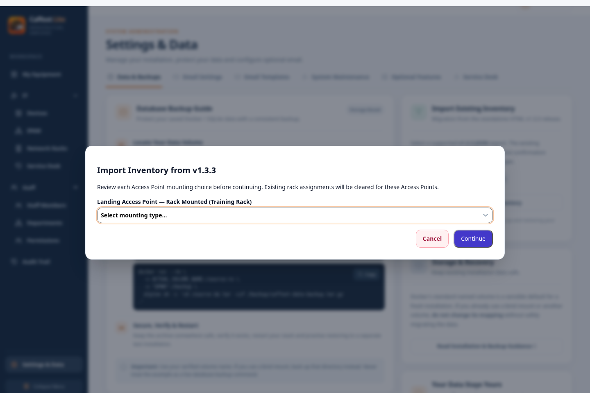
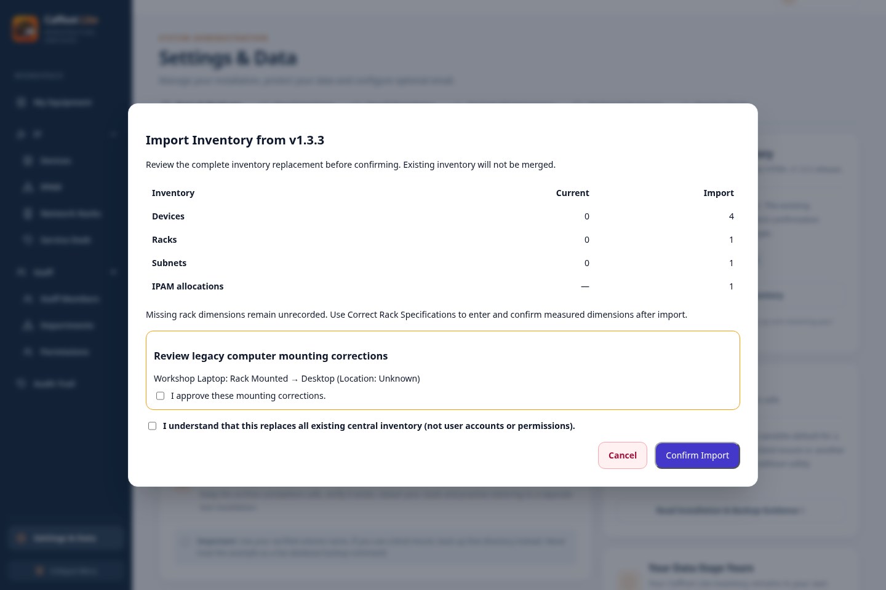
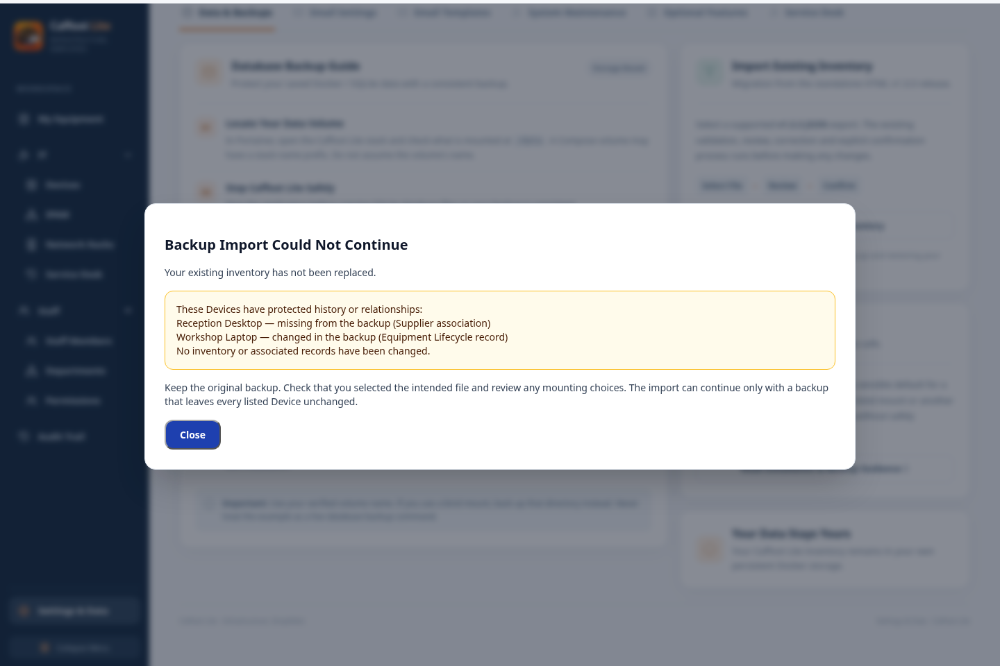

# Import Legacy Inventory Or Upgrade Docker

> **Draft v2.2 — Unreleased.** These instructions are for authorised isolated v2.2 review installations. For a live v2.1 installation, use the [published v2.1 guidance](https://github.com/Caffoot/Caffoot-Lite/blob/v2.1/docs/how-tos/features-and-instructions/Migration-Backup-and-Restore.md).

Choose the procedure for the installation you already have.

| Starting point | Procedure |
| --- | --- |
| The standalone v1.3.3 HTML application | Export its inventory with **Download Backup**, then use [Import legacy inventory](#import-legacy-inventory). This is a one-way transfer of inventory into Docker. |
| An existing Caffoot Lite v2.1 Docker installation | Follow [Upgrade a v2.1 Docker installation](#upgrade-a-v21-docker-installation). The application upgrades the existing SQLite database on startup. |
| A Docker installation that needs recovery | Use your external backup tooling and [restore the complete installation with its matching image](#restore-a-complete-installation). A standalone inventory JSON file cannot recover a Docker installation. |

## Import Legacy Inventory

### Before You Start

- In the standalone application, check that you are using the [published v1.3.3 HTML version](https://github.com/Caffoot/Caffoot-Lite/releases/tag/v1.3.3). If you use an older HTML version, follow that application's upgrade guidance, open your inventory in v1.3.3 and check it before exporting.
- Set up the destination Docker installation with persistent `/data`, HTTPS and an active Administrator account with MFA enrolled. Import requires Edit access to **Devices**, **IPAM** and **Racks** together. All three features must be enabled under **Settings & Data → Optional Features**. See [Roles, Section Permissions And MFA](Roles-Section-Permissions-and-MFA.md).
- Keep your original HTML and JSON file somewhere private. The export can include equipment and network details. If the destination already contains inventory, use the [complete backup procedure](#make-a-complete-pre-upgrade-backup) before replacing it.

### Export, Review And Confirm

1. In published v1.3.3, open **Settings & Data**. Under **Back Up & Restore**, select **Download Backup**. Keep the downloaded JSON file.
2. Sign into the Docker application as Administrator. Open **Settings & Data → Data & Backups**. In **Import Existing Inventory**, select **Import v1.3.3 Inventory** and choose the JSON file from v1.3.3.
3. If the review lists Access Points, choose the correct mounting type for each one and select **Continue**. The import clears existing rack assignments for the Access Points in this review. For example, choose **Wall Mounted** for a Landing Access Point fitted to a corridor wall.
4. In the replacement review, compare the **Current** and **Import** counts for Devices, Racks, Subnets and IPAM allocations. If **Review legacy computer mounting corrections** appears, check each proposed change. For example, a Workshop Laptop with an obsolete **Rack Mounted** value may be proposed as **Desktop** with location **Unknown**. Select **I approve these mounting corrections** only if those changes are right.
5. To leave the destination unchanged, choose **Cancel**. To proceed, check **I understand that this replaces all existing central inventory (not user accounts or permissions)** and select **Confirm Import**. The application validates the replacement again and shows **Inventory imported.** after it succeeds.
6. Open **Devices**, **IPAM** and **Network Racks** and verify the results. Check representative device names, notes and custom fields, linked IP allocations and rack positions. For example, the Reception Desktop should still show asset tag `TRAIN-204` and its saved IP allocation. Existing Docker users, permissions, MFA, audit records and private settings stay with the destination.

*Choose the mounting for every listed Access Point before continuing to the counts.*

*Review the counts and the proposed change to the Workshop Laptop before approving replacement.*

*After the confirmation appears, check the Device, IPAM and rack records themselves.*

### If A Device Is Protected

An existing Device can have Staff or Department assignment history, a handover, a stock link or movement history, associated equipment, a Supplier association, Lifecycle information or Service Desk ticket history. Those relationships still count when an optional feature is switched off. The import keeps an identical reviewed Device record, its stored revision and its linked records.

If the reviewed backup changes or omits any protected Device, Caffoot Lite rejects the entire replacement. **Backup Import Could Not Continue** lists each affected Device, **changed in the backup** or **missing from the backup**, and its protected relationship types. For example, the Reception Desktop could be missing from a backup while a renamed Workshop Laptop could conflict with its Lifecycle record. The dialog confirms that no inventory or associated records have changed. Replacement can also be rejected at confirmation if someone records a new relationship after your preview.

*Both conflicts appear in the same rejection. Keep the original backup and review the file and mounting choices before starting again.*

See the [desktop and mobile rejection captures in light and dark modes](../../../development-handovers/evidence/stage-6-2/README.md#protected-import-rejection-captures).

| What you see | What to check |
| --- | --- |
| **Import v1.3.3 Inventory** is unavailable | Confirm the session belongs to an active MFA-enrolled Administrator and that Devices, IPAM and Racks are enabled. |
| A validation error appears | Check that you selected a fresh JSON export from published v1.3.3 and that the file is no larger than 10 MiB. If the legacy inventory has an invalid relationship, correct it in the source application and download a fresh export. |
| A protected Device is changed or missing | Use the list in the rejection dialog to check that you chose the intended backup and, where applicable, the correct mounting choices. Proceed only if the reviewed backup leaves every listed Device identical. If the only copy conflicts, stop and keep the current installation and the original export. |
| The review expires, you sign out or the application restarts | Choose the file again and repeat the review. Reviews are temporary and specific to your session. |

The screenshots use fictional inventory captured in the working application. See the [Stage 6.2 evidence record](../../../development-handovers/evidence/stage-6-2/README.md) for source revisions and checked scenarios.

## Upgrade A v2.1 Docker Installation

The Stage 6.2 rehearsal used published v2.1 schema 10 and reached v2.2 schema 28 on a disposable copy. The review procedure below applies to an authorised isolated installation. Keep the v2.1 production instance on its published version until a release and deployment have been approved.

### Make A Complete Pre-Upgrade Backup

Follow [Back up a complete installation](#back-up-a-complete-installation) while the source is still on v2.1. Test restoring that backup with the matching v2.1 image before proceeding. Keep the verified snapshot and its image for rollback.

### Start The Review Image And Check The Result

1. Use a separate disposable installation and a consistent copy of the stopped v2.1 `/data`. Confirm that the test stack cannot see your production mount. Use the authorised v2.2 review image for the intended revision and architecture.
2. Keep the test stack's existing `/data` mapping and working HTTPS/network settings when you replace the image. For Portainer, edit the existing test stack and replace its image reference. For Compose, change the image in the existing test definition and recreate the service in the same project. Confirm the volume mapping before starting. The application applies the pending migrations on startup.
3. Check that the instance becomes healthy and that it still presents the trusted certificate. Existing sessions end and affected outstanding email proofs are revoked. Sign in again. Legacy Readers and other active accounts moved to **IT Staff** may need to enrol an authenticator, even if their inventory access remains **No Access**. Existing authenticator details are retained. See [Roles, Section Permissions And MFA](Roles-Section-Permissions-and-MFA.md#what-an-existing-account-may-show-after-upgrade).
4. Verify representative Devices, linked IPAM and Racks records, preferences and Audit Trail entries. Check a saved profile, existing Read and Edit access and Administrator sign-in. Check that the private email settings remain readable. The upgrade maintains configured legacy access while applying the new MFA requirements.
5. Recreate the isolated container again against the same mount and repeat the health, sign-in and sample record checks. The rehearsal also checked SQLite integrity, foreign keys and unchanged rows on repeat startup. If startup fails, preserve the stopped copy and review the container log before trying again.

### Roll Back Using The Complete Pre-Upgrade Backup

1. Stop the upgraded container. If you need its data for investigation or later recovery, back up its complete stopped mount separately and label that copy with its v2.2 image and schema.
2. [Restore the complete pre-upgrade snapshot](#restore-a-complete-installation) into a clean target using the matching v2.1 image and saved stack settings. The migrated schema-28 mount must never be attached to v2.1.
3. Check trusted HTTPS, MFA sign-in, representative inventory, profiles, permissions and private settings. Rollback returns the installation to the time of the schema-10 backup. Changes made afterwards are absent from that recovery.

## Back Up A Complete Installation

1. Record the exact running image digest or revision and architecture, your Compose project or Portainer stack, and the actual mount at `/data`. In Compose, inspect the running service container's mounts. In Portainer, check the container's mount details and **Volumes**. For Docker-managed storage, use the actual named volume, including any project prefix. For a bind mount, use the exact host directory shown as the mount source.
2. Save the stack definition and its private environment and secrets separately from `/data`. Include the web origin, server address, published port and any configured `TZ`. Retain access to the exact matching image. If TLS terminates at a separate reverse proxy, preserve its configuration and credentials separately.
3. Stop the source service and confirm all writers to its mount have stopped. For Compose, run `docker compose stop caffoot-lite` in the source project. In Portainer, stop the corresponding container and confirm it is stopped. Keep the service stopped until the external backup finishes.
4. Use your external Docker volume-backup utility for the named volume or your external host backup tool for the bind directory. Archive the entire mount relative to its root, including hidden entries. Include `caffoot.sqlite3` and any SQLite sidecars that remain, `tls/`, `smtp-settings.json`, `account-email-secret.key` and all other files present. Preserve numeric owners and groups, directory and file modes, and the directory layout. For example, `caffoot.sqlite3` should restore directly into `/data`.
5. Check that the backup is readable and contains the expected files before restarting the source. Keep an access-controlled copy outside the Docker host. The archive includes authentication data and can include SMTP credentials, private TLS keys and private tickets and attachments. Protect it and the saved stack settings accordingly. Confirm the backup through an isolated restore.

## Restore A Complete Installation

1. Create a new, isolated target. Confirm its container is stopped and its `/data` mapping is a new empty volume or a new empty bind directory. Check the mapping before extracting. Keep the source and earlier recovery copies available.
2. Extract with the external tool, restoring all paths, numeric ownership and modes. Make sure the application user `10001:10001` inside the container can read and write its data and traverse the mount. For a standard rootful bind mount, an administrator can prepare a new directory with `sudo install -d -m 0750 -o 10001 -g 10001 /path/to/new-data` before restoring. For rootless Docker or user namespace remapping, check the ownership as seen inside a container using that mapping. The host IDs can differ. Preserve restrictive modes on private files.
3. Verify the expected files are directly under the restored mount. Use the archived image revision and saved stack configuration. Bind the test service to an isolated endpoint and retain the saved HTTPS identity. Confirm the SHA-256 certificate fingerprint against your trusted record and verify the hostname or IP used by the client before signing in.
4. Start the target and check HTTPS health, sign-in and MFA, the expected account permissions and representative data. For example, check a saved rack position, a Department assignment, a Service Desk closure and an authorised attachment download. Check that an unrelated account cannot read that ticket. Verify settings and the expected optional-feature choices. Keep any test mail on an isolated receiver.
5. Restart or recreate the target with the same mount and repeat the checks. If the application opens first-run setup, stop and verify the mount and archive layout. If it reports a permissions error, compare the mount ownership and modes inside the container with those saved. If the schema is newer than the image understands, stop and select the image recorded for that backup.

See the [Stage 6.2 upgrade evidence](../../../development-handovers/evidence/stage-6-2/README.md) and the [historical matching-image rollback rehearsal](../../../development-guide/Upgrade-And-Restore-Rehearsal.md). A disposable local restore does not exercise your off-host backup tooling or verify recovery of your own installation.
