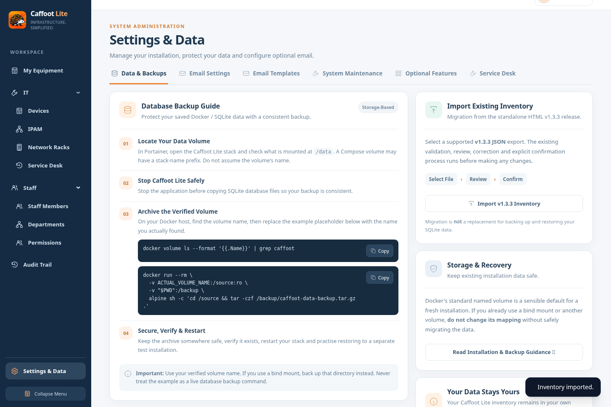

# Import Legacy Inventory Or Upgrade Docker

> **Draft v2.2 — Unreleased.** v2.1 remains the published release. These instructions describe v2.2.

Choose the procedure for the installation you already have.

| Starting point | Procedure |
| --- | --- |
| The standalone v1.3.3 HTML application | Export its inventory with **Download Backup**, then use [Import legacy inventory](#import-legacy-inventory). This is a one-way transfer of inventory into Docker. |
| An existing Caffoot Lite v2.1 Docker installation | Follow [Upgrade a v2.1 Docker installation](#upgrade-a-v21-docker-installation). The application upgrades the existing SQLite database on startup. |
| A Docker installation that needs recovery | Use your external backup tooling and [restore the complete installation with its matching image](#restore-a-complete-installation). A standalone inventory JSON file cannot recover a Docker installation. |

## Version And Recovery Limits

v2.2 is unreleased. Use the upgrade and recovery procedures below only on a separately authorised isolated copy. A supported production v2.1 → v2.2 upgrade and complete-volume recovery for the current v2.2 candidate have not been established. Keep production on the published release and retain its matching image and complete backup. An untested backup has not been proved recoverable.

## Import Legacy Inventory

### Before You Start

- In the standalone application, check that you are using the [published v1.3.3 HTML version](https://github.com/Caffoot/Caffoot-Lite/releases/tag/v1.3.3). If you use an older HTML version, follow that application's upgrade guidance, open your inventory in v1.3.3 and check it before exporting.
- Set up the destination Docker installation with persistent `/data`, HTTPS and an active Administrator account with MFA enrolled. Import requires Edit access to **Devices**, **IPAM** and **Racks** together. All three features must be enabled under **Settings & Data → Optional Features**. See [Roles, Section Permissions And MFA](Roles-Section-Permissions-and-MFA.md).
- Keep your original HTML and JSON file somewhere private. The export can include equipment and network details. If the destination already contains inventory, use the [complete backup procedure](#make-a-complete-pre-upgrade-backup) before replacing it.

### Export, Review And Confirm

1. In published v1.3.3, open **Settings & Data**. Under **Back Up & Restore**, select **Download Backup**. Keep the downloaded original JSON file unchanged in protected storage, with its source version and export date. Review a copy; do not overwrite the only original while correcting migration problems.
2. Sign into the Docker application as Administrator. Open **Settings & Data → Data & Backups**. In **Import Existing Inventory**, select **Import v1.3.3 Inventory** and choose the JSON file from v1.3.3.
3. If the review lists Access Points, choose the correct mounting type for each one and select **Continue**. The import clears existing rack assignments for the Access Points in this review. For example, choose **Wall Mounted** for a Landing Access Point fitted to a corridor wall.
4. In the replacement review, compare the **Current** and **Import** counts for Devices, Racks, Subnets and IPAM allocations. If **Review legacy computer mounting corrections** appears, check each proposed change. For example, a Workshop Laptop with an obsolete **Rack Mounted** value may be proposed as **Desktop** with location **Unknown**. Select **I approve these mounting corrections** only if those changes are right.
5. To leave the destination unchanged, choose **Cancel**. To proceed, check **I understand that this replaces all existing central inventory (not user accounts or permissions)** and select **Confirm Import**. The application validates the replacement again and shows **Inventory imported.** after it succeeds.
6. Open **Devices**, **IPAM** and **Network Racks** and verify the results. Check representative device names, notes and custom fields, linked IP allocations and rack positions. For example, the Reception Desktop should still show asset tag `TRAIN-204` and its saved IP allocation. Existing Docker users, permissions, MFA, audit records and private settings stay with the destination.

*Choose the mounting for every listed Access Point before continuing to the counts.*

*Review the counts and the proposed change to the Workshop Laptop before approving replacement.*

*After the confirmation appears, check the Device, IPAM and rack records themselves.*

### If A Device Is Protected

An existing Device can have Staff or Department assignment history, a handover, a stock link or movement history, associated equipment, a Supplier association, Lifecycle information or Service Desk ticket history. Those relationships still count when an optional feature is switched off. The import keeps an identical reviewed Device record, its stored revision and its linked records.

If the reviewed backup changes or omits any protected Device, Caffoot Lite rejects the entire replacement. **Backup Import Could Not Continue** lists each affected Device, **changed in the backup** or **missing from the backup**, and its protected relationship types. For example, the Reception Desktop could be missing from a backup while a renamed Workshop Laptop could conflict with its Lifecycle record. The dialog confirms that no inventory or associated records have changed. Replacement can also be rejected at confirmation if someone records a new relationship after your preview. Permissions and protected relationships are rechecked under the write lock; the preview is not a reservation or a guaranteed successful confirmation. A rejected import saves none of its proposed replacement, and invalidated/expired reviews must be started again from the original file.

*Both conflicts appear in the same rejection. Keep the original backup and review the file and mounting choices before starting again.*

| What you see | What to check |
| --- | --- |
| **Import v1.3.3 Inventory** is unavailable | Confirm the session belongs to an active MFA-enrolled Administrator and that Devices, IPAM and Racks are enabled. |
| A validation error appears | Check that you selected a fresh JSON export from published v1.3.3 and that the file is no larger than 10 MiB. If the legacy inventory has an invalid relationship, correct it in the source application and download a fresh export. |
| A protected Device is changed or missing | Use the list in the rejection dialog to check that you chose the intended backup and, where applicable, the correct mounting choices. Proceed only if the reviewed backup leaves every listed Device identical. If the only copy conflicts, stop and keep the current installation and the original export. |
| The review expires, you sign out or the application restarts | Choose the file again and repeat the review. Reviews are temporary and specific to your session. |

## Upgrade A v2.1 Docker Installation

The v2.2 candidate uses **schema 31**; published v2.1 uses **schema 10**. The application applies pending numbered migrations on startup and rejects a database newer than the image understands.

Schema 30 adds temporary-password change state; schema 31 adds account-specific ticket read receipts. Existing ticket messages are not automatically marked read. Startup also reconciles Left Company linked logins without another schema number. A protected inventory import still requires matching saved Device records for equipment with retained relationships.

For any separately authorised isolated upgrade, first identify the original image, architecture, schema, actual project/mount and complete private configuration. Confirm the intended source-to-target path, make a complete stopped pre-upgrade backup and retain its matching image. Keep that archive separate from the upgrade copy. Historical schema-28/29 recovery copies require their own matching images; current schema-31 copies require the corresponding current image. See [Back Up A Complete Installation](#back-up-a-complete-installation). Keep production on its separately approved published version; no production v2.2 upgrade procedure or release is approved here.

### Historical Associated Equipment Tickets

Authorised IT can still open historical associated accessory tickets in **IT → Service Desk** with the existing Service Desk and IT Assets permissions. When the original employee audience cannot be verified, those tickets and their files are available only to authorised IT. This covers earlier tickets raised against issues that have since been explicitly associated with a Device. Existing ticket numbers, replies, attachments and audit records are retained.

During upgrade checks, sign in as a representative Staff Member and confirm that a saved link to a restricted historical ticket is unavailable. Confirm the same ticket still opens for an authorised technician. If the equipment still needs support, an eligible employee can open **My Equipment → Report A Problem** and submit a new ticket after reading the shared-equipment warning. Standalone IT Asset and canonical Device tickets retain their existing access rules. [Ticket privacy and custody](Service-Desk-Administration.md#what-happens-to-service-desk-tickets-when-equipment-changes-hands)

### Make A Complete Pre-Upgrade Backup

Follow [Back up a complete installation](#back-up-a-complete-installation) while the source is on its original image, published v2.1 with schema 10 or an earlier authorised v2.2 review build. Test restoring the backup with that matching image before proceeding. Keep the verified snapshot and image for rollback, including when both review builds use the same schema number: schema 31 alone does not identify the full application behaviour or deployment.

### Start The Review Image And Check The Result

1. Use a separate disposable installation and a consistent copy of the stopped source `/data`. Confirm that the test stack cannot see your production mount. Use the authorised v2.2 review image for the intended revision and architecture.
2. Before starting, preserve its original snapshot/image and ensure copied SMTP cannot send unintended real alerts. Choose the organisation's correct IANA `TZ` and retain the saved earlier settings. Keep the test stack's existing `/data` mapping and working HTTPS/network settings when you replace the image. For Portainer, edit the existing test stack and replace its image reference. For Compose, change the image in the existing test definition and recreate the service in the same project. Confirm the volume mapping before starting. The application applies pending migrations on startup. Configuration/TLS failures can occur after database initialisation; failed health or startup does not establish that the database stayed on its old schema.
3. Check that the instance becomes healthy and that it still presents the trusted certificate. Sign in using an authorised test account. On the v2.1 upgrade, earlier migrations end existing sessions and revoke affected outstanding email proofs. Legacy Readers and other active accounts moved to **IT Staff** may need to enrol an authenticator, even if their inventory access remains **No Access**. Existing authenticator details are retained. See [Roles, Section Permissions And MFA](Roles-Section-Permissions-and-MFA.md#what-an-existing-account-may-show-after-upgrade).
4. Verify representative Devices, linked IPAM and Racks records, preferences and Audit Trail entries. Check a saved profile, existing Read and Edit access, Administrator sign-in and private email settings. For a populated v2.2 review source, compare Department assignments, original stock recipients and quantities, associated equipment, ticket visibility and attachments. The upgrade preserves established effective access under its migration rules while applying the new MFA requirements and historical accessory restriction above. Verify actual roles and individual overrides rather than relying on job titles. Check protected Left Company status and retained-disabled login behaviour, pending temporary-password changes, current-custody/Department boundaries, internal notes, attachment bytes and independent unread receipts with representative authorised and unauthorised accounts.
5. Recreate the isolated container again against the same mount and repeat the health, sign-in and sample record checks. Check the expected schema 31, SQLite integrity and foreign keys, and compare records and files with the pre-upgrade copy. If startup fails or records/permissions differ unexpectedly, stop and preserve the upgraded copy and logs privately for investigation. Do not repeatedly restart under different images, edit schema/security flags, bypass a last-administrator conflict or treat an empty database as a successful upgrade. Revert only with the complete matching pre-upgrade snapshot/image procedure below.

### Left Company Linked Login Reconciliation

The v2.2 application retains schema 31. On startup it checks for existing inactive/Left Company Staff with enabled linked logins. Within the upgrade transaction, it disables those logins and revokes their sessions, email verification/recovery proofs and temporary-password change proofs. Staff identities, assignments, equipment custody, tickets, MFA enrolment and historical records are retained. A new Audit Trail event identifies **Application upgrade** as the actor; original events remain unchanged. Repeated startup does not add duplicate reconciliation events.

If the affected accounts include every active administrator, startup stops with an explicit last-active-administrator conflict and rolls back the transaction. Keep the complete pre-upgrade backup and matching image. Report the conflict to the product owner for an approved resolution; do not edit database flags or bypass the safeguard.

Reactivation later leaves the login disabled. An administrator must first reactivate Staff and then explicitly use **Enable Login** after reviewing access. See [Staff lifecycle](Staff-Members.md#mark-as-left-company-or-reactivate).

### Roll Back Using The Complete Pre-Upgrade Backup

1. Stop the upgraded container. If you need its data for investigation or later recovery, back up its complete stopped mount separately and label that copy with its v2.2 image and schema.
2. [Restore the complete pre-upgrade snapshot](#restore-a-complete-installation) into a clean target using the matching source image and saved stack settings. Use the stopped backup with that image, because the upgraded database may already be schema 31 or otherwise changed by that image. **Never simply start an older image against the newer migrated database as a rollback.**
3. Check trusted HTTPS, MFA sign-in, representative inventory, profiles, permissions and private settings. For a v2.2 review source, also check Staff assignments, stock and restricted Service Desk access. Rollback restores the state captured in the backup. Any later changes are absent from that recovery.

## Back Up A Complete Installation

Use trusted external host/volume backup tooling selected for your installation. Caffoot Lite provides no full-installation recovery export through the browser. This draft stopped-volume procedure does not establish successful recovery for your installation. An unreadable, incomplete or untested archive has not been proved recoverable.

1. Record the exact running image digest or revision and architecture, your Compose project or Portainer stack, and the actual mount at `/data`. In Compose, inspect the running service container's mounts. In Portainer, check the container's mount details and **Volumes**. For Docker-managed storage, use the actual named volume, including any project prefix. For a bind mount, use the exact host directory shown as the mount source.
2. Save the stack definition and its private environment and secrets separately from `/data`. Include the web origin, server address, published port and any configured `TZ`. Retain access to the exact matching image. If TLS terminates at a separate reverse proxy, preserve its configuration and credentials separately.
3. Stop the source service and confirm all writers to its mount have stopped. For Compose, run `docker compose stop caffoot-lite` in the source project. In Portainer, stop the corresponding container and confirm it is stopped. Keep the service stopped until the external backup finishes.
4. Use your external Docker volume-backup utility for the named volume or your external host backup tool for the bind directory. Archive the entire mount relative to its root, including hidden entries. Include `caffoot.sqlite3` and any SQLite sidecars that remain (such as `-wal`/`-shm`), `tls/server.crt`, `tls/server.key`, optional `smtp-settings.json`, optional `account-email-secret.key` and all other files present. Account profiles/photos, MFA/permissions, directory/custody, stock/Suppliers/lifecycle, ticket messages/events/attachment BLOBs/read receipts, reporting/calendar history, email drafts/published templates and branding/logo BLOBs are in SQLite; they are not separate browser export files. If custom database/TLS paths lie outside `/data`, include those persistent locations too. Preserve numeric owners and groups, directory and file modes, and the directory layout. For example, `caffoot.sqlite3` should restore directly into `/data`.
5. Check that the backup is readable and contains the expected files before restarting the source. Keep an access-controlled copy outside the Docker host. The archive includes authentication data and can include SMTP credentials, private TLS keys and private tickets and attachments. Protect it and the saved stack settings accordingly. Record the backup date, original image ID/digest/revision, schema, architecture, actual mount, tool and layout, file manifest/checksums and ownership/modes in a restricted record. A readable archive/checksum alone is not recovery acceptance: confirm it through a separately authorised isolated matching-image restore before relying on it. Do not perform a recovery exercise on your only working installation.

## Restore A Complete Installation

This is draft administrator guidance for a separately authorised recovery. Current schema-31 complete-volume recovery has not been established. Protect the original backup and source. Recovering a snapshot returns to its capture time; later changes are absent unless separately preserved and supported recovery is established. Do not improvise a merge between old and upgraded databases.

1. Create a new, isolated target. Confirm its container is stopped and its `/data` mapping is a new empty volume or a new empty bind directory. Check the mapping before extracting. Keep the source and earlier recovery copies available.
2. Extract with the external tool, restoring all paths, numeric ownership and modes. Make sure the application user `10001:10001` inside the container can read and write its data and traverse the mount. For a standard rootful bind mount, an administrator can prepare a new directory with `sudo install -d -m 0750 -o 10001 -g 10001 /path/to/new-data` before restoring. For rootless Docker or user namespace remapping, check the ownership as seen inside a container using that mapping. The host IDs can differ. Preserve restrictive modes on private files.
3. Verify the expected files are directly under the restored mount. Use the archived image revision and saved stack configuration. Bind the test service to an isolated endpoint, prevent unintended outgoing mail and retain the saved HTTPS identity. Restore the files directly into the mount root, not `/data/data/caffoot.sqlite3` or another extra archive directory. Preserve the original environment and separately stored paths/secrets in the recovery record, including `TZ`, addresses and ports. For an isolated rehearsal, retain `TZ` and use an isolated network/host or deliberately non-conflicting review endpoint. If the review endpoint differs, keep its canonical HTTPS origin, published port and verified certificate identity consistent; do not reuse a live endpoint, blindly trust a mismatched certificate or overwrite the original configuration. Stop if safe isolation and trusted HTTPS cannot both be established. Confirm the SHA-256 certificate fingerprint against your trusted record and verify the hostname or IP used by the client before signing in.
4. Start the target and check HTTPS health, sign-in and MFA, the expected account permissions and representative data. For example, check a saved rack position, a Department assignment, a Service Desk closure and an authorised attachment download. Check that an unrelated account cannot read that ticket. Verify settings and the expected optional-feature choices. Keep any test mail on an isolated receiver.
5. Restart or recreate the target with the same mount and repeat the checks. If the application opens first-run setup, stop and verify the mount and archive layout. If it reports a permissions error, compare the mount ownership and modes inside the container with those saved. If the schema is newer than the image understands, stop and select the image recorded for that backup.

Verify your own off-host backup tooling and isolated matching-image recovery before relying on a backup.

### Recovery Problems To Investigate

| Symptom | Response |
| --- | --- |
| Setup appears instead of the expected accounts | Stop. Check actual target volume/project and whether extraction nested the files one directory too deep. Do not initialise an empty replacement or overwrite the original archive. |
| Schema newer than image / startup migration conflict | Stop and match the archive to its original image. For approved rollback restore the entire pre-upgrade snapshot, not selected tables or a new database mixed with old private keys. |
| TLS fingerprint differs | Check the expected restored TLS pair and actual endpoint. Do not approve a changed identity until independently verified. |
| Private SMTP/key file cannot be read | Check ownership and restrictive regular-file modes; do not make credentials world-readable or omit the file to suppress an error. |
| Ticket attachment or branding/photo missing | Verify the complete database and correct snapshot, account permissions/feature switches and original file bytes. An inventory JSON cannot reconstruct those records. |
| Integrity, permissions or record checks fail | Keep the recovered target stopped and preserve the original backup/source. Obtain a source-supported resolution; no generic repair, row editing or downgrade workaround is established by this guide. |

[New isolated review installation](Installation.md) · [Installation time zone](Service-Desk-Time-Zone.md) · [Service Desk administration](Service-Desk-Administration.md) · [Draft guides](README.md)
