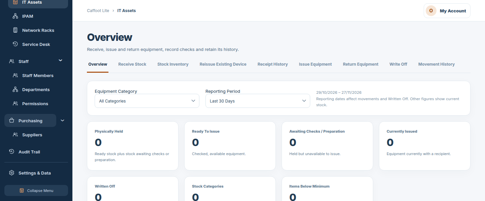
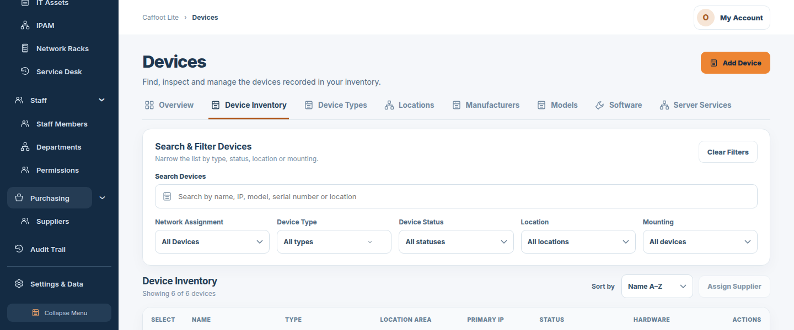

# Draft v2.2 User And Administrator Guides

> **Draft v2.2 — Unreleased.** v2.1 remains the published release. These instructions describe v2.2.

Caffoot Lite v2.2 — Everyday IT Management connects Devices, IPAM and Network Racks with accounts, Staff Members, Departments and optional IT Assets. Record who holds equipment, what is physically in stock and what is ready to issue; keep Supplier and lifecycle information alongside it; and handle support through employee tickets and the IT Service Desk. These guides explain the connected workflows, permissions, reporting, email and administration for employees, IT technicians and administrators. Examples use fictional people, organisations and equipment.

Start with the task you need to complete. Each feature guide explains its permissions, controls, numbered procedures, examples and recovery steps. A missing section may mean the feature is switched off or your account lacks permission; ask an administrator to check before creating duplicate records.

## Move Around The Application

On desktop, the left-hand navigation scrolls independently of the main page when the expanded menu is taller than the window. Scroll over the sidebar, or use the keyboard to reach the permitted links. **Settings & Data** (administrators only) and **Collapse Menu** remain reachable at the bottom. For example, if IT, Staff and Purchasing are expanded, scroll down to Settings & Data from either IT Assets Overview or Device Inventory. Collapsing a group or the menu does not change your permissions.

*Scroll within the desktop sidebar rather than moving the main page. The lower links remain reachable at a short 1440 × 600 viewport.*

*The same navigation works from Device Inventory.*

## Import, Upgrade And Recovery

Use [Installation — isolated private review](Installation.md) for the separate draft v2.2 Docker/Portainer/Compose setup, storage, HTTPS and first-administrator steps. There is no public v2.2 image or production deployment procedure established here.

Use [Import Legacy Inventory Or Upgrade Docker](Legacy-Import-and-Docker-Upgrade.md) to review a standalone v1.3.3 export, understand protected Device conflicts, rehearse a v2.1 Docker upgrade on an isolated copy, or recover a complete Docker installation with its matching image.

## UK Date Entry And Calendar Controls

In v2.2, Caffoot Lite's date-entry controls show and accept **DD/MM/YYYY** regardless of the browser's own regional date display. For example, **15/03/2023** means 15 March 2023, and **05/06/2024** means 5 June 2024, not 6 May. Use a four-digit year. The visible format is for people: the application continues to save and exchange dates in its existing ISO `YYYY-MM-DD` format.

Type a date with slashes, or enter eight consecutive digits (for example, `15032023`), which are formatted as `15/03/2023`. Use the calendar button on the same field if you prefer not to type. The calendar begins each week on Monday and includes the month, year and labelled days. With keyboard focus inside the calendar, use the arrow keys to move by day or week, Home/End for the beginning/end of the week, Page Up/Down to move months, Shift+Page Up/Down to move years, Enter to select and Escape to close it.

Only real calendar dates are accepted: **29/02/2024** is valid, but **29/02/2023** is not. Fields with existing restrictions, such as no future Purchase Date or qualifying first-service Date Issued, keep those restrictions. An invalid date is shown with a validation message and is not submitted as a replacement for the previous recorded value. Clearing an optional date remains possible. The calendar preserves existing permissions, readonly fields, Cancel and unsaved-change/discard behaviour.

This is a change to how dates are **entered and shown**, not to the dates already saved, the actual event times, the configured timezone, lifecycle calculations, or stock movement history. Existing published v2.1 instructions and records are unchanged.

## Infrastructure

| Task | Guide |
| --- | --- |
| Find, record, edit and manage physical Devices or virtual machines | [Devices — Creating, Editing and Managing Equipment](Devices.md) |
| Manage subnets, address blocks, VLANs, reservations and address allocations | [IPAM — Subnets, VLANs and Individual Addresses](IPAM.md) |
| Record racks, inspect elevations, place equipment and manage shelves/accessories | [Network Racks](Racks.md) |
| Enable optional features, record basic IPv4 or explicitly link to IPAM | [Optional Features, Basic IPv4 And Link To IPAM](Optional-Features-and-Link-To-IPAM.md) |

### A Sensible Infrastructure Setup Order

1. Agree which infrastructure areas the organisation uses. An administrator enables the required Optional Features and grants access separately.
2. If using managed IPAM, record the real addressable subnets first, with their purpose and gateway/VLAN where applicable. An Address Block is optional and cannot substitute for a subnet.
3. If recording rack-mounted or shelf equipment, add the measured rack and any actual shelf accessories. Check the intended face and free span.
4. Search Devices before adding equipment. Save it with no address, an eligible basic IPv4 address, or a managed allocation using the corresponding guide.
5. Reopen the Device and related IPAM/Rack records to verify the saved result. Use the specialised assignment/stock guides for custody or physical issue; Add Device alone does not complete those tasks.
6. Review authorised Audit Trail records where navigation is available. An audit entry explains a change; it is not a backup or proof of a physical action.

## Accounts And Access

| Task | Guide |
| --- | --- |
| Understand Staff Member, IT Staff, shared roles and individual overrides | [Roles, Section Permissions And MFA](Roles-Section-Permissions-and-MFA.md) |
| Add a login, resolve linked profile differences or open Manage Permissions | [Staff Members](Staff-Members.md) |
| Enrol MFA, recover a password or understand a session ending | [Roles, Section Permissions And MFA](Roles-Section-Permissions-and-MFA.md) |
| Reset an ordinary user’s password or sign in with a temporary password | [Reset a Staff Member’s password](Roles-Section-Permissions-and-MFA.md#reset-a-staff-members-password) · [Change a temporary password](Roles-Section-Permissions-and-MFA.md#after-an-administrator-gives-you-a-temporary-password) |
| Check eligibility and promote an existing user to Administrator | [Make an existing user an Administrator](Roles-Section-Permissions-and-MFA.md#make-an-existing-user-an-administrator) |
| Edit, preview, test and publish email wording or set shared branding | [Email Templates And Company Branding](Email-Templates-and-Company-Branding.md) |
| Enable sections, preserve Rack information or record/link basic IPv4 addresses | [Optional Features, Basic IPv4 And Link To IPAM](Optional-Features-and-Link-To-IPAM.md) |

An application account is the identity used to sign in. A Staff Member is a person in your organisation; that person may have a linked account or no login at all. Roles determine section access, while an organisation's Optional Features switches determine whether optional functions are available. A role does not switch a feature on.

## People And Equipment

| Task | Guide |
| --- | --- |
| Add or update Staff, link a login or manage Staff status safely | [Staff Members](Staff-Members.md) |
| Maintain Departments, archive them or manage shared equipment | [Departments And Shared Equipment](Departments-and-Shared-Equipment.md) |
| Assign an existing Device or view personal/Department equipment | [Device Assignments And My Equipment](Device-Assignments-and-My-Equipment.md) |

Staff Members and Departments are core functions, with independent section permissions. You do not need to populate them to use Caffoot Lite's infrastructure inventory. **My Equipment** gives linked Staff an appropriately restricted view of their equipment; it does not grant access to IT inventory or another person's private details.

## Connected Equipment Example

[Follow Aster Services and laptop AST-LAP-014](Connected-Equipment-Journey.md) from Supplier information and physical receipt to Device registration, personal/Department visibility, return/reissue or direct handover, lifecycle review and eventual write-off. The example links the detailed instructions; it is not a compulsory application sequence.

## Stock And Technician Workflows

| Task | Guide |
| --- | --- |
| Configure IT Assets, receive deliveries and inspect Stock Inventory/readiness | [Receive Stock And Stock Inventory](IT-Assets-Stock-Intake.md) |
| Issue equipment, record partial/damaged returns, prepare it or write it off | [Issue, Return And Write Off](IT-Assets-Issue-Return-and-Write-Off.md) |
| Register a computer from stock or reissue an existing registered Device | [Device Stock Registration And Reissue](Device-Stock-Registration-and-Reissue.md) |
| Explicitly associate accessories, resolve missing items or hand a Device to a new holder | [Associated Equipment And Direct Handovers](Associated-Equipment.md) |
| Correct an incorrectly recorded quantity without erasing its history | [Correct Movement](IT-Assets-Correct-Movement.md) |
| Read stock balances, movement reporting and Minimum Stock Level warnings | [IT Assets Overview And Reporting](IT-Assets-Dashboard.md) |

IT Assets is independently optional and is **off by default** on fresh installations. Its availability and your permission to read or edit it are separate checks. Device operations retain their own Devices permissions.

Before changing stock, keep these distinctions in mind:

- A **Device** is the canonical record for a managed piece of equipment. Keep that identity through return, reissue and handover rather than creating a replacement record.
- **Physically Held** describes equipment actually in your stockholding. Registering one stock unit as a Device changes its classification without reducing that total. Physically issuing it reduces held stock.
- **Readiness** records preparation/checking for issue. Being unassigned, operationally active or physically present does not by itself mean equipment is Ready.
- **Assignment History** records successive holders. **Movement History** records stock events. Correcting a movement retains the original event and an attributed correction.

For a new delivery, follow Receive Stock → check/readiness → Issue Equipment, using Device registration first where needed. For equipment already with a holder, inspect the current assignment and associated accessories before choosing Return Equipment or the checked direct-handover route. Use Correct Movement for a recording mistake; do not invent a receipt or return to conceal it.

## Suppliers

| Task | Guide |
| --- | --- |
| Enable Suppliers, set access, and manage companies, categories, locations, contacts and notes | [Supplier Management](Supplier-Management.md) |
| Use Purchasing, file or correct Issues, hand them over between contacts and manage Issue Categories | [Supplier Issues And Purchasing](Supplier-Issues-and-Purchasing.md) |
| Record, correct or review Supplier associations on Devices and stock receipts | [Equipment Supplier Integration](Equipment-Supplier-Integration.md) |

Suppliers starts switched off and uses its own section permissions. Use Supplier Equipment to review linked Devices and stock receipts without duplicating their inventory records.

## Equipment Lifecycle

| Task | Guide |
| --- | --- |
| Record dates, review Dashboard warnings, configure warning periods and lifespans, archive or restore types | [Equipment Lifecycle](Equipment-Lifecycle.md) |

Equipment Lifecycle is independently optional and starts switched off. Enabling it makes its date controls, settings and warnings available without replacing equipment or changing physical stock.

## Service Desk

| Task | Guide |
| --- | --- |
| Follow Alex and Sam through one connected support request | [Connected Service Desk Journey](Connected-Service-Desk-Journey.md) |
| Raise, find, reply to and reopen tickets for personal and Department equipment | [Employee ticket instructions](Service-Desk-Tickets.md#raise-a-support-request) |
| Use the IT queue, record tickets, handle technician actions and attachments, and understand equipment privacy | [Service Desk Tickets](Service-Desk-Tickets.md) |
| Grant technician access, configure Working Hours, Excluded Dates and Ticket Categories, and protect ticket-linked records | [Administer The Service Desk](Service-Desk-Administration.md) |
| Set or correct the Service Desk time zone in Portainer or Docker Compose | [Set The Service Desk Time Zone](Service-Desk-Time-Zone.md) |
| Read workload, change reporting periods and understand technician attribution | [Read Service Desk Activity](Service-Desk-Tickets.md#read-service-desk-activity) |
| Configure the IT support mailbox, check notification recipients and troubleshoot missing mail | [Service Desk email settings](Service-Desk-Administration.md#configure-the-it-support-mailbox) |
| Edit and publish templates, set company branding and send a sample | [Email Templates And Company Branding](Email-Templates-and-Company-Branding.md) |

Employees use My Tickets and Department Tickets for eligible equipment. Technicians use the separately permissioned IT Service Desk. Administrators manage its calendar, categories and email settings.

## Audit Trail

Use [Read The Audit Trail](Audit-Trail.md) to search authorised event-time names and original references, understand recorded labels and export the history available to your account.
