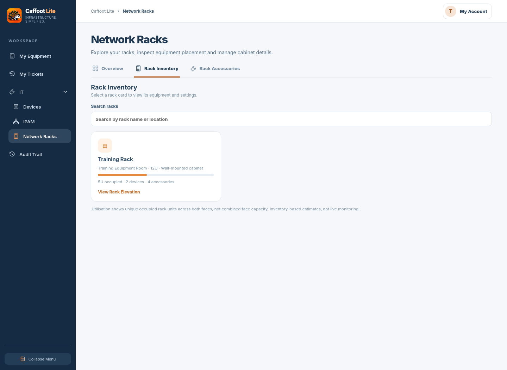
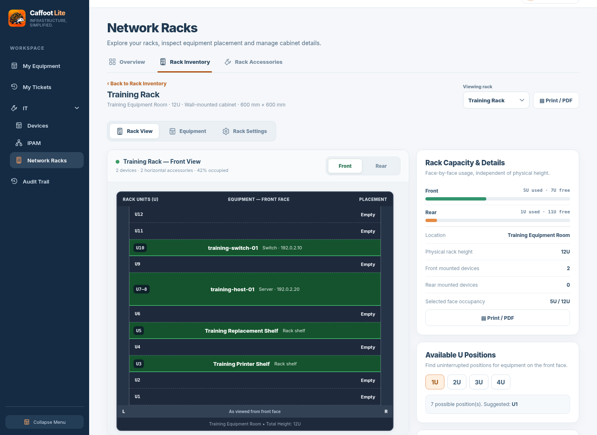
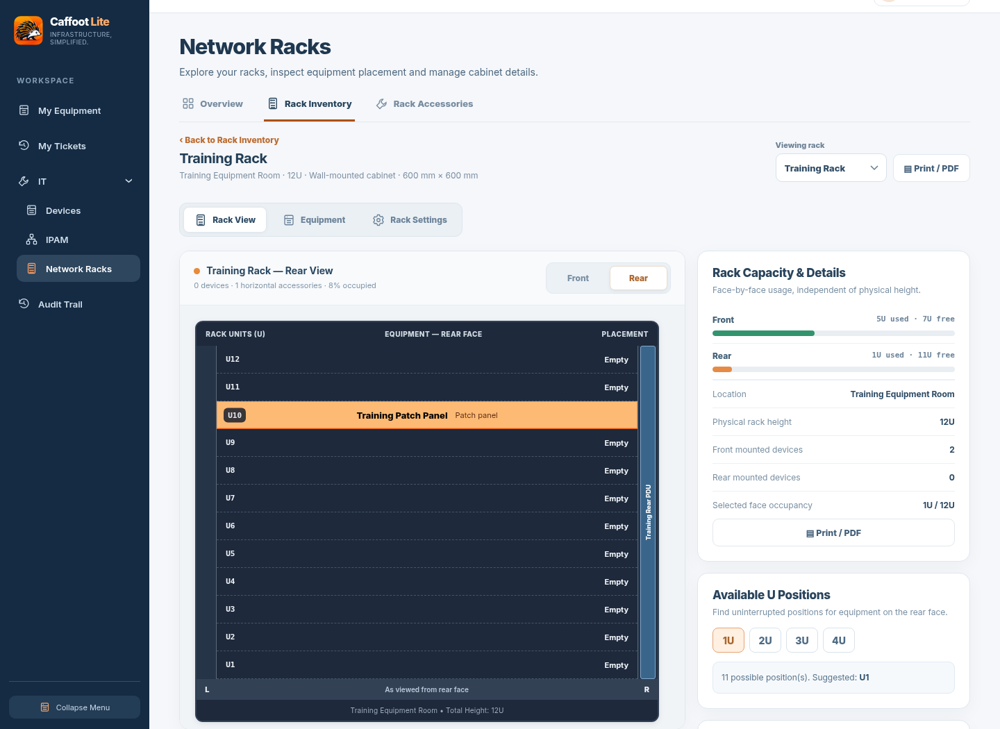
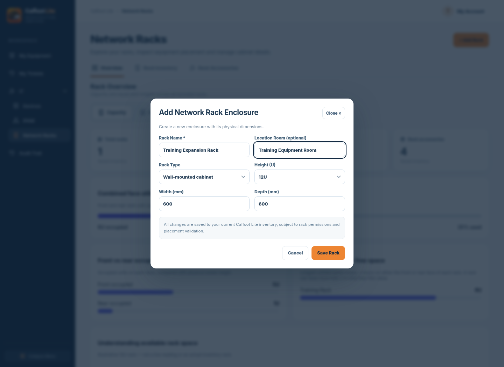
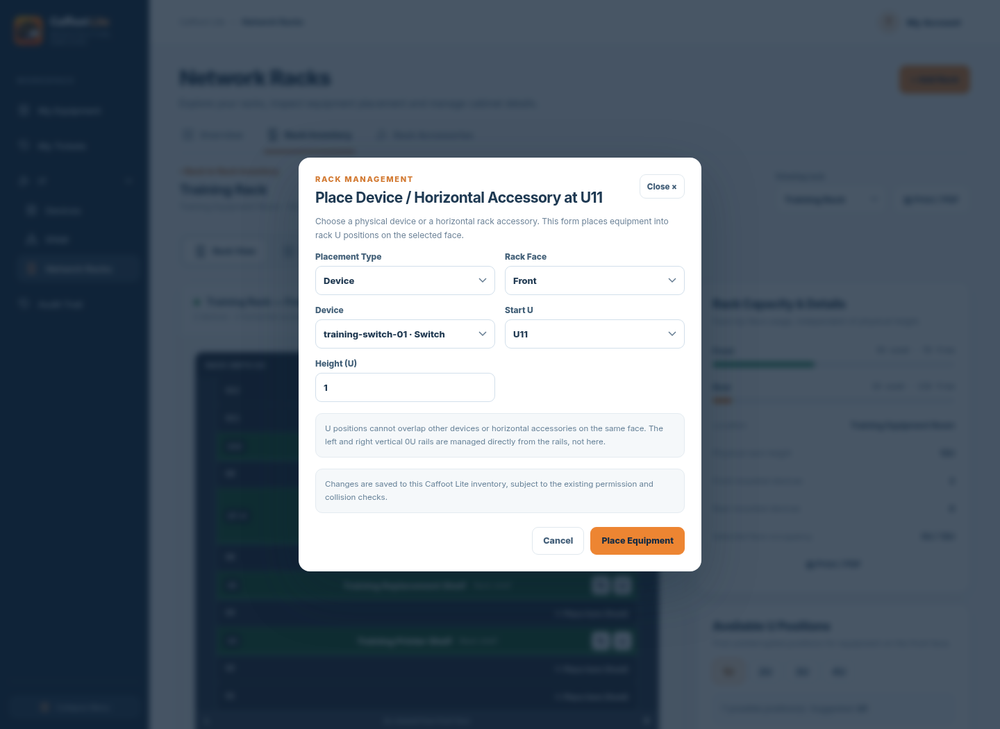
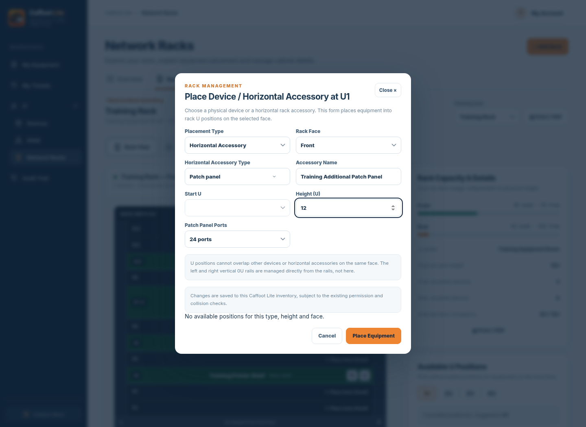
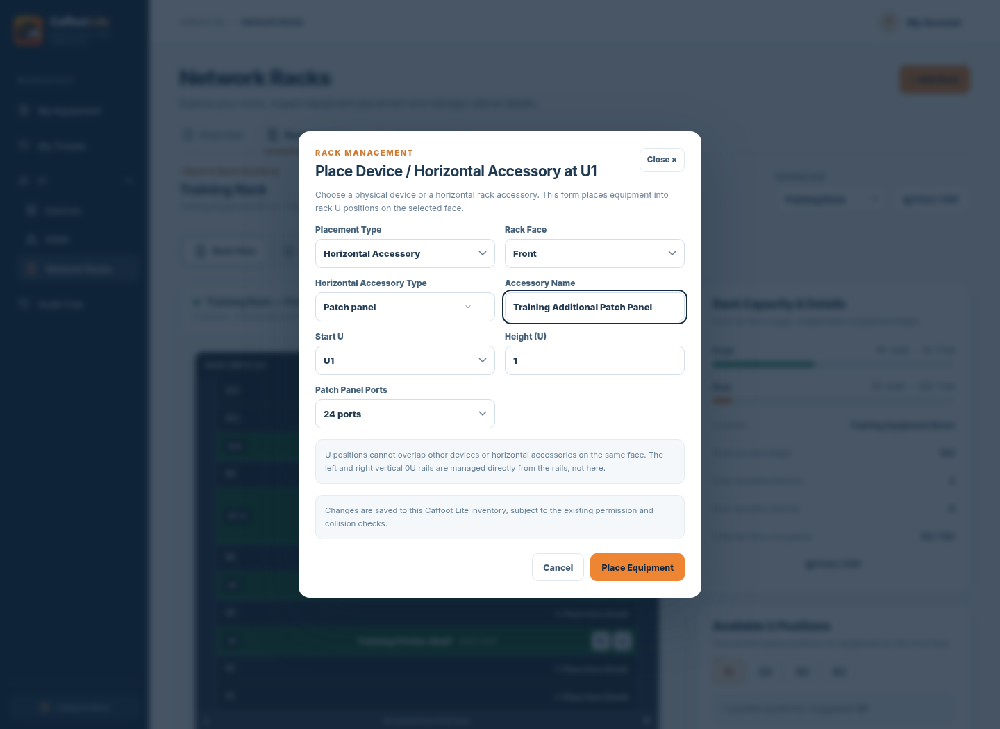
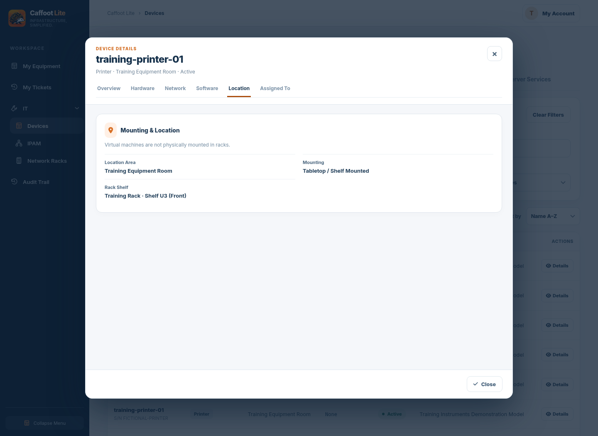
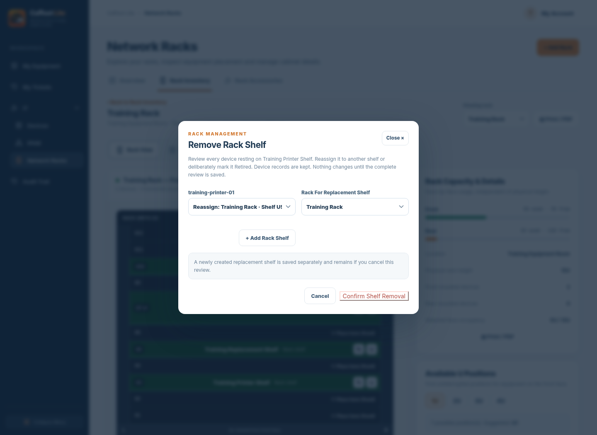
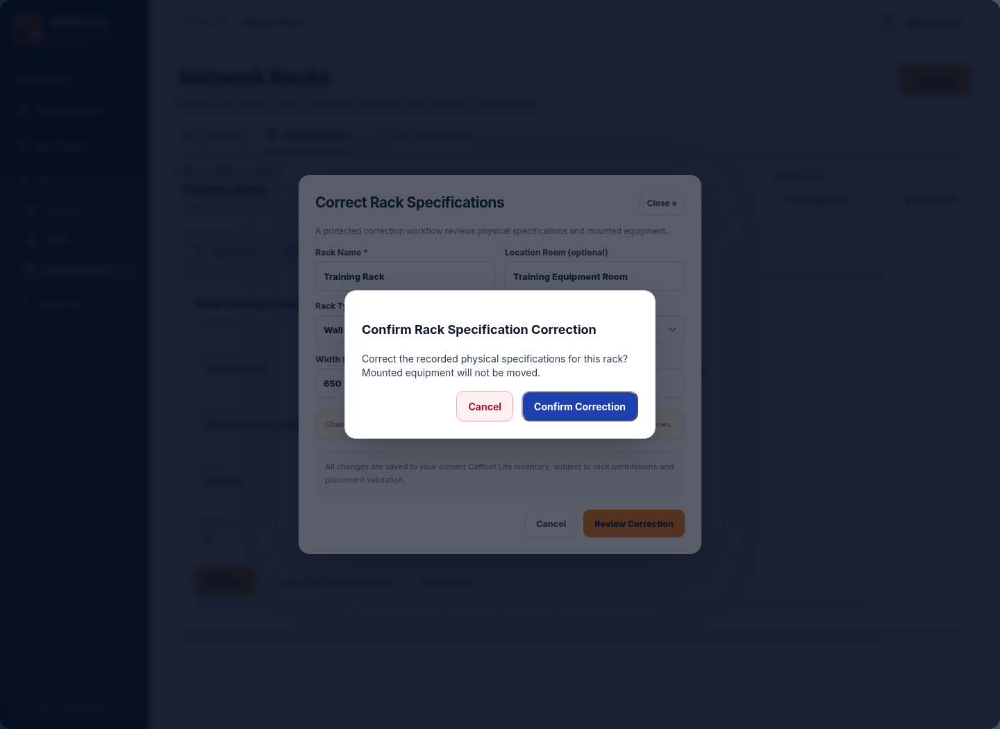

# Network Racks — Enclosures, Elevations And Equipment Placement

[← Draft v2.2 Guides](README.md)

> **Draft v2.2 — Unreleased.** Reconciled against `fdc677920bfc52f48f641b3d6d1344c902a6a9b0` (schema 31), 26 November 2026. These instructions build on the preserved [published v2.1 guide](https://github.com/Caffoot/Caffoot-Lite/blob/c3237114108cad9f7d4e57657b6aed5e0091a5ef/docs/how-tos/features-and-instructions/Racks.md). Batch 7A proposed desktop illustrations are included below; visual and final acceptance remain outstanding; see the [Batch 2 review record](../../../development-guide/Milestone-01-Batch-2-Review.md). Examples are fictional.

> **Documentation status — 27 November 2026:** Batches 1–6 written/source work and [Batch 7.1/bounded 7.2](https://github.com/Caffoot/Caffoot-Lite/issues/366#issuecomment-7210689297) are owner accepted. [Batch 7A](screenshots/batch-7a/README.md) is authorised for at most 40 desktop light-theme images. The proposed illustrations below await independent ChatGPT review and product-owner visual/privacy/caption/alt acceptance; no publication approval is implied.

## What Network Racks Records

Use Network Racks to document enclosures, their physical specifications, accessories and recorded equipment positions. A **rack elevation** is a diagram of the equipment at each height. One **U** is one standard rack unit of vertical space. **Start U** is the lowest numbered unit occupied by an item; a 2U item starting at U5 occupies U5–U6. U1 is at the bottom of the diagram.

The application records front and rear faces independently. Horizontal accessories occupy central U positions. **Vertical 0U** accessories run on a left/right side rail and do not consume central U slots, although their vertical span is recorded. A Device resting on a **Rack shelf** references that actual accessory instead of acquiring its own U footprint.

This is saved inventory, not live monitoring, automatic discovery, electrical load calculation, a cable connectivity map or a guarantee of physical fit. Measure depth, width, airflow and mounting requirements yourself. Diagram capacity does not prove safe weight, electrical capacity or clearance.

## Before You Start: Features And Permissions

An administrator enables **Network Racks** through [Optional Features](Optional-Features-and-Link-To-IPAM.md). Your account must meet its MFA requirements and have the appropriate section access.

| Task | Required Access |
| --- | --- |
| Read racks, elevations and accessory records | Network Racks enabled and Racks Read |
| Create/edit racks and independent accessories; correct recorded specifications | Racks Edit |
| Place, move or unmount an existing eligible Device through Rack controls | Racks Edit, with Devices enabled and readable to select/inspect that Device; this does not grant general Devices Edit |
| Create/edit a Device and its Rack/shelf association through its Device form | Devices Edit and Racks Edit, both features enabled |
| Remove a shelf holding Devices using reassignment/retirement review | Both Devices Edit and Racks Edit, both features enabled |

Read-only users can inspect elevations without movement controls. Occupied items and empty units retain their display, while drag, placement and edit affordances are removed. If Devices access is unavailable, Device-derived occupants, counts and names may be absent from the Rack view; an apparently empty position is not proof that it is free. Server validation still checks retained records. Do not create replacement Devices or accessories to explain hidden information.

Network Racks can be used without IPAM, or independently for enclosure/accessory records without Devices. A Rack permission cannot override a disabled feature. See [Roles, Section Permissions And MFA](Roles-Section-Permissions-and-MFA.md).

## Find A Rack And Read Capacity

1. Open **IT → Network Racks**. **Overview** describes the recorded estate. Its **Capacity**, **Equipment** and **Locations & Types** views offer different summaries.
2. Open **Rack Inventory** and use **Search racks** to find a name or recorded room. Select the matching rack card to open it. Clear the search if no racks match before adding another enclosure.
3. Check the name, room, type, height and dimensions. Use **Viewing rack** to select another enclosure or **Back to Rack Inventory** to return.
4. Select **Rack View**, **Equipment** or **Rack Settings**. In Rack View choose **Front** or **Rear** and scroll the elevation. Use the equipment list to identify the item before moving it.
5. Read **Available U Positions** for uninterrupted ranges on the selected face, and **Other Side** for opposite-face equipment. Total free units can be spread into several gaps; a 4U item needs four consecutive units on one face.
6. Use **Rack Accessories** from the section's main tabs to browse accessories in their owning rack, including vertical 0U items.

**Rack Inventory** utilisation counts each numbered U once across both faces. **Overview → Capacity** combined face utilisation counts front and rear separately. A 12U rack has 12 physical U and 24 face-U; 3U occupied at the same height on each face is 3 occupied numbered U in the inventory card and 6 occupied face-U in the combined figure. Vertical rails do not consume central U. These are inventory estimates using the records available to the view.

*Draft v2.2 — Rack Inventory records enclosure dimensions and occupied numbered U across both faces. Visual acceptance pending.*

*Draft v2.2 — Front elevation under Racks Read: inspect saved equipment and capacity without placement or drag controls. Visual acceptance pending.*

*Draft v2.2 — Rear elevation shows the patch panel and Right 0U PDU; left and right are viewed from the selected face. Visual acceptance pending.*

## Worked Example: Create A Training Rack

Imagine a fictional 12U *Training Rack*, 600 mm wide and 600 mm deep, in *Training Equipment Room*. Replace these values with actual measurements.

1. In **Network Racks**, select **Add Rack**. The heading is **Add Network Rack Enclosure**.
2. Enter **Rack Name** and optionally **Location Room**. Search existing racks first to avoid recording the same enclosure twice.
3. Choose **Rack Type**: Floor-standing cabinet, Wall-mounted cabinet, Open-frame 2-post, Open-frame 4-post or Wall-mounted network enclosure.
4. Choose **Height (U)**. Presets are 6, 9, 12, 18, 24, 42 and 48U; select **Custom…** for another whole height from 1 to 100U.
5. Enter **Width (mm)** and **Depth (mm)** as positive whole millimetres from 1 to 10,000. Do not enter decimal dimensions or a description in these fields.
6. Select **Save Rack**, reopen the rack and check the empty elevation and specifications. **Cancel** abandons the unsaved form; a rejected save retains the previous inventory and reports the validation problem.

Creating a Rack from within a Device draft saves that enclosure independently. Returning to or cancelling the Device form does not undo the saved Rack. A Rack's Location Room is separate from the managed Device Locations list; choosing a Rack can suggest a location on a new Device, but moving an existing Device between racks does not overwrite its saved Location Area automatically.

*Draft v2.2 — The enclosure form records measured physical dimensions. This new Training Expansion Rack draft is unsaved. Visual acceptance pending.*

## Place An Existing Rack-Mounted Device

1. Use [Devices](Devices.md) to record the real physical Device first. It must support and be configured as **Rack Mounted**. Its recorded U height must reflect the actual item. Virtual machines are located through their host and cannot be mounted independently.
2. Open the intended rack's **Rack View**, choose **Front** or **Rear**, then select an empty U position. The heading is **Place Device / Horizontal Accessory at U[number]**.
3. Set **Placement Type → Device** and choose the existing **Device**. New placement lists eligible unmounted Devices or Devices already in this rack; a Device mounted in another rack is not offered as a second copy.
4. Check **Rack Face**, **Start U** and **Height (U)**. For a Device, height is taken from the saved record and is read-only in this placement form. Change an incorrect recorded height using its authorised Device workflow first.
5. Choose a free start span. Options are recalculated for the Device height and face. If none fits, the form reports **No available positions for this type, height and face**. Do not reduce height merely to force a fit.
6. Select **Place Equipment**. Reopen Rack View and Device Details → Location to check the recorded face/U span. The Rack operation preserves the Device's existing Location Area.

For example, a 1U *training-switch-01* at Front U10 occupies U10 alone. A 2U *training-host-01* at Front U7 occupies U7–U8. A horizontal patch panel cannot overlap those units on Front; Rear positions are recorded independently. **Cancel** leaves the saved Device and rack unchanged.

A Rack placement obtains the existing Device edit reservation and checks its revision. Another user's active edit, a changed record, hidden occupant or new collision rejects the move and restores the original placement. A successful save followed by an unsuccessful refresh is reported separately: refresh and inspect the saved record before retrying.

*Draft v2.2 — Place an existing Device at a free Front position. Its recorded 1U height is read-only in this form; the proposed move is unsaved. Visual acceptance pending.*

*Draft v2.2 — A 12U horizontal accessory cannot fit on the occupied Front face. The form offers no valid Start U and warns before saving. Visual acceptance pending.*

## Move Or Remove A Device From A Rack

1. In Rack View, use the mounted item's **Edit placement** action to choose another offered face/start position and save with **Mount Device**. Check the result before making another change. Cancel leaves the prior position.
2. Alternatively drag a mounted Device to a new valid U position. Review the footprint/target preview before dropping. A drop is a save action; there is no later page-wide Save. Invalid or colliding targets are rejected with the original position retained.
3. For another rack, use **Device Details → Edit device → General → Mounting & Rack Configuration** with Devices Edit and Racks Edit to select the destination rack, face, start U and height, then **Save Device**. Check the actual location separately. Do not use **Remove from rack** as a shortcut to the destination's placement chooser: unmounting sets the mounting value to Desktop, which is ineligible for that chooser. If already unmounted, restore an eligible **Rack Mounted** configuration and select the destination rack and position together in the Device editor.
4. **Remove from rack** removes the current placement immediately when permitted; it has no separate confirmation dialog in this implementation. Check the named item before using it. It clears the active rack/U position and uses the existing Desktop mounting value while preserving Location Area. It does not delete the Device, release its IP, end custody or physically move equipment.

If removal is rejected by type/mounting validation or a protected relationship, keep the record and use the Device editor to choose a valid type-appropriate non-Rack mounting method with the required permissions. A Retired status alone does not unmount a Device. Do not delete or duplicate equipment to bypass placement validation.

## Add And Maintain Horizontal Accessories

1. Select a free U position on the intended face. In **Place Device / Horizontal Accessory at U…**, set **Placement Type → Horizontal Accessory**.
2. Choose **Horizontal Accessory Type**: Blanking plate, Patch panel, Brush panel, Cable manager, Rack shelf, Horizontal rack PDU, Ventilation panel, Fan tray or Environmental sensor (rack-mounted).
3. Enter an **Accessory Name** where useful, for example *Training Patch Panel*. Check **Rack Face**, **Start U** and **Height (U)**. Horizontal accessories support 1–12U, constrained by the actual rack height/free space.
4. For a Patch panel choose **Patch Panel Ports**: 12, 24 or 48. This is a recorded port count; it does not create cable connections or live port monitoring.
5. Select **Place Equipment**, then reopen the elevation and equipment list. Cancel saves nothing. Collisions, invalid height/ports or a failed save leave the previous inventory unchanged.
6. Open an existing accessory to use **Edit Horizontal Accessory Placement**. Review its type, Name, Face, Start U, Height and any port count, then **Save changes**. Use **Cancel** to retain its saved placement.
7. Dragging a supported horizontal accessory to a valid new position saves immediately on drop, subject to the same collision checks. Devices resting on a shelf derive its current position; they do not acquire separate U slots when the shelf moves.

*Draft v2.2 — A horizontal patch panel uses central U space on the selected face; this placement is an unsaved draft. Visual acceptance pending.*

## Add And Maintain Vertical 0U Accessories

1. In **Rack View**, choose the intended face. Use its left or right rail's **Add vertical 0U accessory** control; these accessories are not added through the central horizontal placement dialog.
2. In **Add Vertical 0U Accessory**, choose **Vertical Accessory Type → Vertical PDU** or **Vertical Cable Manager**. Enter a useful **Name**.
3. Choose **Face**, **0U Rail Side** (Left or Right), **Start U** and **Vertical Span (U)**. Left/right is as viewed from that face, not from the opposite face.
4. Select **Place accessory** and check the correct rail. A vertical item can span up to the rack height and must fit within it. Another vertical item cannot overlap it on the same face and rail. It does not consume central U positions.
5. Open an existing rail item to edit and **Save changes**, or drag it to an available position on the intended rail using the preview. Invalid span/collision rejects the change. **Cancel** in the editor preserves its saved values.

For example, a fictional Rear Right PDU spanning U1–U12 uses that 0U rail, leaving central rear U available in the diagram. Check actual depth and power suitability separately.

## Record Equipment Resting On A Shelf

Use a shelf for supported physical **Tabletop / Shelf Mounted** equipment. An actual **Rack shelf** accessory must exist in the selected rack.

1. Open the Device's editor with Devices Edit and Racks Edit. On **General → Mounting & Rack Configuration**, choose **Tabletop / Shelf Mounted**.
2. Leave **Rack (Optional)** empty for equipment outside a rack. If choosing a rack, choose its existing shelf. A rack with no shelf cannot substitute for one.
3. Use **+ Add Rack Shelf** if you need to record a real missing shelf. Complete its existing Horizontal Accessory editor and **Place accessory**. This saves the shelf immediately and returns you to the Device draft, preserving its editor/reservation.
4. Select **Save Device**, then check **Details → Location**. It derives the current rack/shelf face and U from the shelf. The Device has no independent U/face footprint.

A separately saved shelf remains if you cancel the Device draft. **Duplicate** can copy an eligible shelf association, but creates a separate Device identity; check actual equipment before saving. Read [Devices](Devices.md#shelves-and-recorded-software) for the complete Device-side context.

*Draft v2.2 — The saved printer derives its Front U3 location from Training Printer Shelf; it occupies no separate U footprint. Visual acceptance pending.*

### Remove A Shelf That Holds Devices

1. Open the shelf's accessory editor and choose **Remove**. With linked Devices, this opens **Remove Rack Shelf**, not the ordinary accessory deletion confirmation.
2. With both Edit grants, review every linked Device. Choose an existing replacement shelf (including one in another rack), or **Retired — Clear Active Rack And Shelf** for each.
3. If a real replacement is missing, choose **Rack For Replacement Shelf**, then **+ Add Rack Shelf**. Its separate successful save remains even if you cancel the removal review.
4. Select **Confirm Shelf Removal** only after every Device has an explicit choice. Shelf deletion and the reviewed Device reassignment/retirement save together, or none do. Retirement retains the Device/history while clearing its active placement; it is not a physical stock return or write-off.
5. Reopen the destination racks and Device Details to verify the outcome. **Cancel** retains the old shelf and all linked Device associations, apart from any independently saved replacement shelf.

The server rechecks the exact shelf preview, full linked-Device set, revisions, permissions, destinations and active edit reservations. A changed record or another editor blocks removal without applying a subset. Resolve the reported reason and reopen a fresh review. Do not delete the parent rack to bypass it.

*Draft v2.2 — Review the replacement shelf for training-printer-01 before removing its current shelf; no removal has been confirmed. Visual acceptance pending.*

## Edit A Rack Or Correct Its Specifications

1. Open **Rack Settings → Edit Rack** to change the recorded name or Location Room. Physical fields are locked in this ordinary editor. Select **Save Rack**, or Cancel to retain prior values.
2. If the physical specifications were recorded incorrectly, choose **Rack Settings → Correct Rack Specifications**. Check the actual enclosure before changing its type, Height, Width or Depth.
3. Select **Review Correction**. Read **Confirm Rack Specification Correction**: mounted equipment will not be moved. **Cancel** leaves the saved specifications unchanged; **Confirm Correction** saves an eligible correction.
4. Reopen Rack Settings and both faces to verify the result. The rack cannot be shortened below any Device or accessory span, including vertical accessories. Validation failure preserves the prior record.

Correcting a measurement is different from recording a physically replaced enclosure or moving equipment. It does not transfer Devices automatically and does not override collision, type or relationship safeguards.

*Draft v2.2 — Review a proposed width correction from 600 to 650 mm. Mounted equipment will not move; this correction has not been confirmed. Visual acceptance pending.*

## Remove An Accessory Or Empty Rack

1. For an ordinary unlinked accessory, use its editor's **Remove** action. Review **Remove rack accessory?**. **Keep accessory** cancels; **Remove accessory** deletes the named accessory only. Linked shelves use the dedicated review above.
2. To delete a rack, first move/unmount every linked Device, including shelf-associated equipment, and remove/relocate its accessories and rails. A rack with any remaining relationship is protected, including occupants hidden from your account.
3. In **Rack Settings**, choose **Delete Rack**. Read **Delete empty rack [name]? This cannot be undone.** Cancel retains it; confirm removes only an eligible empty rack.
4. Check the inventory afterwards. A rejected or failed save restores the previous record. Do not treat a network interruption as evidence of successful deletion; refresh before retrying.

## Print Or Save A PDF

1. Open the intended rack and choose **Print / PDF**.
2. Allow the application's print window if the browser blocks it. The normal flow opens a separate printable view for front and rear elevations, capacity and side-rail equipment, then the browser print dialog.
3. Choose the printer or the browser's PDF destination, check pagination and paper size, and print/save. Cancel the print dialog to leave inventory unchanged.

Printed records reflect saved data visible to your account at that time. They may include equipment names, rooms and positions, so store/share them with appropriate care. Historical print PDFs and same-tab development trials remain evidence; they are not a promise that another browser has been accepted.

## Protected Relationships And Troubleshooting

| Problem | What To Check |
| --- | --- |
| Rack navigation missing | Network Racks switch, Racks Read, session and MFA |
| Device is not offered | Devices enabled/readable, physical supported Rack Mounted type, recorded U height and whether it is already mounted elsewhere |
| Many free U but no valid start | Need consecutive space on the chosen face, for the entire height; check hidden occupants and horizontal accessories |
| Cannot drag or place | Racks Read allows inspection; Racks Edit permits placement. Device actions also require the enabled Devices feature |
| Device editor cannot move equipment | Devices Edit alone is insufficient; Racks Edit and enabled Network Racks are also required |
| Move rejected while a colleague edits | Finish/cancel or wait for expiry of the Device reservation, then refresh and reopen; do not force a stale move |
| Shelf missing or removal blocked | Real shelf in the selected rack, both Edit grants, explicit choice for every Device, current preview/revisions and no conflicting edit |
| Rack cannot shrink or delete | Check Devices, shelves and accessories on both faces and 0U rails, including hidden relationships |
| Device Location Area differs from rack room | Existing moves preserve descriptive Device location. Correct it separately with authorised Device editing |
| Feature switched off | Saved racks, accessories, Device placement and Location Area are retained. Re-enable deliberately; do not recreate hidden inventory |
| Save succeeded but view did not refresh | Reload and inspect the saved record before repeating the action |

With Network Racks off, existing mounted/shelf-linked Devices protect their mount type, Rack, U span, face, shelf reference and Location Area during unrelated edits. Ordinary eligible Device edits remain possible. See [Rack preservation](Optional-Features-and-Link-To-IPAM.md#preserve-devices-when-network-racks-is-off). An unavailable Rack is not a deleted Rack.

Related: [Devices](Devices.md), [IPAM](IPAM.md), [Optional Features](Optional-Features-and-Link-To-IPAM.md), [Roles, Section Permissions And MFA](Roles-Section-Permissions-and-MFA.md).
