# Roles, Section Permissions And MFA

> **Draft v2.2 — Unreleased.** This guide covers the Staff account workflow in [PR #453](https://github.com/Caffoot/Caffoot-Lite/pull/453). Use the [published v2.1 guides](../README.md) for released installations.

> **Documentation status — 27 November 2026:** Accepted written/source procedures are preserved. [Batch 7B](screenshots/batch-7b/README.md) adds desktop light-theme instructional illustrations under the [owner’s scope and method approval](https://github.com/Caffoot/Caffoot-Lite/issues/366#issuecomment-7211852349). Independent ChatGPT review and separate product-owner visual acceptance recorded in the [27 November decision](https://github.com/Caffoot/Caffoot-Lite/issues/366#issuecomment-7212506766); original provenance and targeted pre-publication refresh limitations remain. The three Morgan Reed reuse images retain their original narrow approval and provenance. [All 16 groups / 79 specifications](screenshots/batch-7b/Coverage.md) remain traceable; no publication approval is implied.

[← Draft v2.2 Guides](README.md)

Caffoot Lite links a person’s sign-in account to their Staff directory record. The account controls sign-in and access. The Staff record holds their Department, Staff status and equipment relationships. A receptionist may need only their own equipment list; a technician may edit Devices; an administrator manages accounts and organisation settings. Roles let an administrator reuse a set of permissions, while individual overrides provide deliberate exceptions for one person.

MFA means **multi-factor authentication**: signing in with a password and a changing six-digit code from an authenticator app. In v2.2, wider Read access as well as Edit access requires MFA. An enabled additional role also requires MFA even when it grants no section access. Do not apply the published v2.1 read-only MFA rule to this development version.

## Before You Start

To manage an individual account, sign in as an active **Administrator** with MFA enrolled and open **Staff → Staff Members**. Use **Staff → Permissions → Manage Roles** for reusable roles. Staff Members Edit and Departments Edit alone do not grant account administration.

For your own settings, open **My Account**. You do not need general inventory permission to update your own profile, change your password, manage eligible MFA settings or use [My Equipment](Device-Assignments-and-My-Equipment.md). Keep your username, password and authenticator available before changing security settings.

There is no public registration. An administrator creates a login, either here or through the authorised [Staff Members](Staff-Members.md) workflow. A Staff record can exist without a login. **Mark As Left Company** disables the linked login and revokes sessions and outstanding verification, recovery and temporary-password change proofs in the same save. **Reactivate** restores Staff eligibility but leaves that login disabled until an administrator separately selects **Enable Login**. Disabling a login alone does not return equipment or change employment status. See [employment changes](#employment-status-and-linked-login-security).

## Understand The Three Access Decisions

A section is available only when the account is active, its MFA requirements are satisfied, the account has the relevant permission and any organisation feature switch is enabled.

| Decision | What it controls | Where to review it |
| --- | --- | --- |
| Account status | Whether a person can sign in | **Staff → Staff Members → Staff Details → Manage Permissions** |
| Roles and individual permissions | Which sections the account may read or edit | **Manage Roles** and the account's **Assigned Roles** and section permission controls |
| Optional Features | Whether the organisation uses an optional section | Administrator **Settings & Data → Optional Features** |

Enabling a feature does not grant permissions. Granting a permission does not enable a feature. An Administrator has account and system administration authority and configured access to all sections, but cannot use a disabled optional section simply by being an administrator.

### Sections And Permission Levels

| Section permission | Meaning |
| --- | --- |
| **No Access** | No general access to that section |
| **Read** | View permitted records and information; no authority to change that section |
| **Edit** | View and change permitted records, subject to the workflow's other permissions and safeguards |

The eight section controls are **Devices**, **IPAM**, **Racks**, **Staff Members**, **Departments**, **IT Assets**, **Suppliers** and **Service Desk**. Racks governs **Network Racks** in navigation. Staff Members, Departments and Service Desk are core functions protected by their own section permissions. Devices, IPAM, Network Racks, IT Assets and Suppliers have independent organisation switches. **Equipment Lifecycle** is the sixth optional feature and uses the applicable equipment permissions rather than a separate section grant. Service Desk permissions govern the IT workspace; employee ticket eligibility is separate. See [Optional Features](Optional-Features-and-Link-To-IPAM.md) and [Service Desk administration](Service-Desk-Administration.md).

Forms can involve several sections. Devices Edit does not authorise changing protected IPAM links or rack placement; those actions need the applicable IPAM or Racks authority. IT Assets Edit permits stock operations, while registering or changing a canonical Device also needs Devices Edit and the Devices feature. See [Optional Features And Link To IPAM](Optional-Features-and-Link-To-IPAM.md) and [Device Stock Registration And Reissue](Device-Stock-Registration-and-Reissue.md) for the exact workflows.

A limited recipient search in an authorised equipment action lets the operator select eligible Staff Members or Departments. It does not grant access to the general directory, private contact details, other accounts or permission settings. Department membership gives no general section permission. IT Assets Read can show accurate organisation-wide stock totals without Devices Read, while Device identities and Device-only breakdowns remain protected; see [IT Assets Dashboard](IT-Assets-Dashboard.md).

## Roles, Inheritance And Individual Overrides

Every account receives the protected **Staff Member** baseline. This role grants no general section access and cannot be renamed, disabled, deleted or removed from an account. Its name is separate from the **Staff Members** directory section.

**IT Staff** is an additional built-in role. Its identity and name are protected, but an administrator can change its section grants, disable or re-enable it, and assign or remove its memberships. It does not make someone an Administrator. At this source checkpoint, its default grants are **Devices Edit**, **IPAM Edit**, **Racks Edit** and **IT Assets Edit**. Staff Members and Departments access must be granted separately where needed. Always inspect the current definition: an administrator may already have changed its defaults.

Administrators can also create custom roles. A person can hold several roles at once. For each section, the highest grant from their enabled roles becomes the **Inherited** level: Edit takes precedence over Read. A role's No Access setting supplies no grant; it does not cancel a grant from another enabled role.

An individual override then determines the account's **Effective** level:

| Individual choice | Result for an ordinary account |
| --- | --- |
| **Inherit** | Use the highest grant from enabled roles; with no grant, the result is No Access |
| **No Access** | Deny that section despite inherited Read or Edit |
| **Read** | Set that section to Read, even when a role grants Edit |
| **Edit** | Set that section to Edit, even when roles provide less access |

Overrides continue to apply when a role changes. Choose **Inherit** deliberately to remove an exception. Disabling a role retains its definition and memberships but stops its grants contributing; other enabled roles and overrides may still provide access. Administrator status is independent, and its section controls are not individually configured in the account editor.

### Worked Example: Two Technicians With Different Responsibilities

The fictional accounts `tim.example` and `dave.example` both belong to IT Staff. Tim has no individual overrides and inherits the role's current grants. Dave has **Devices Read** and **Racks Read** overrides, with IPAM set to **Inherit**. With the default infrastructure grants, Dave can read Devices and Racks and edit IPAM. His explicit Read choices remain even if IT Staff is later changed.

If Dave becomes responsible for rack maintenance, select **Inherit** for Racks, review the change and confirm it. He then follows the role's current Racks grant. Choosing **Edit** would instead create a fixed individual exception. Review IT Assets separately; neither Dave's name nor his Department establishes permission to issue stock.

### What An Existing Account May Show After Upgrade

The accepted schema-12 change assigned IT Staff to enabled pre-existing accounts, including enabled administrators and accounts that previously had no infrastructure access. Individual overrides preserved their exact earlier Devices, IPAM and Racks levels. Disabled accounts did not receive that membership. The added enabled role made MFA mandatory, even where all effective infrastructure rights stayed No Access.

The later schema-20 change adds the IT Assets Edit role default while preserving existing accounts' earlier effective IT Assets access. An account can therefore show IT Staff membership and still have an IT Assets **No Access** or **Read** override. This is deliberate access preservation. Do not clear it as an assumed fault.

Fresh installations create IT Staff enabled but unassigned. Newly created ordinary accounts receive Staff Member only. These are implemented compatibility rules, not a verified production upgrade procedure; [version and acceptance status](../../../development-guide/Development-Status.md) remains separate.

## Create A Sign-In Account

1. Open **Staff → Staff Members → + Add Staff Member** and enter the person’s name and any known contact details. To give an existing Staff Member a login, open their **Staff Details** and choose **Create Login**.
2. Enable **Create Caffoot Login** if the switch is off. Enter a unique **Username**, such as the fictional `alex.example`.
3. Enter **Initial Password** and repeat it in **Confirm Initial Password**. Use a long, unique password.
4. Select **Save Staff Member**. Staff Details opens after the Staff record and login are saved together. The account starts with **Staff Member** and no general section grants.
5. Select **Manage Permissions** to review the new account. Give the person their username and initial password through a secure channel. Ask them to change the password in My Account and complete any required authenticator enrolment.

**Cancel** discards unsaved entries. If the username is in use or the passwords do not match, correct the issue in the Staff form. Check whether the person already has a login before creating one. See the full [Staff and login creation procedure](Staff-Members.md#create-and-link-an-optional-caffoot-login).

## Review An Account

1. Open **Staff → Staff Members** and enter the username in **Find A Staff Member**.
2. Select **View Details** and check **Caffoot Login** for the username, account status, authenticator state and assigned roles.
3. Select **Manage Permissions** below **Assigned Roles**. The dialogue is wider on desktop and adapts to smaller screens. Its heading, account badges, **Close**, tabs and footer stay visible; only the selected tab content scrolls.
4. Choose a tab using the mouse or keyboard. Arrow keys, Home and End move between tabs; Tab reaches the selected tab's controls. On narrow screens, the tab row can scroll sideways.
5. Use **Done**, **Close** or Escape to return to Staff Details. **Done** closes the dialogue. Save or confirm each change using its existing control before closing.

| Tab | What to review or change |
| --- | --- |
| Personal Details | Read-only Sign-in Username, First Name, Last Name, Display Name and E-Mail Address, with verification shown below the email input. **Save Personal Details** saves this form. |
| Roles | Assigned Roles and the existing individual role-change previews and confirmations. |
| Permissions | Inherited, Override and Effective section levels. Individual changes still require the existing review and confirmation. |
| Account Controls | Employment Status, Enable Login/Disable Login, administrator eligibility, Reset Password and Delete User, with their existing restrictions. |

Switching tabs retains personal details you have typed. Immediate account changes and role confirmations also retain an unsaved personal-details draft. If another writer changes those saved personal details, the original revision is retained so a stale save is rejected; reopen the dialogue and review the newer values. Closing discards unsaved typing, while already saved or confirmed changes remain effective. There is no global Save button.

Check **Feature Disabled** beside a section: configured rights remain subject to its organisation switch. **MFA Required · Setup Pending** means the person must enrol before normal sign-in. Your own administrator account retains its protected controls; use **My Account** for your own personal and security settings.

### Save Personal Details

1. In **Manage Permissions → Personal Details**, check the read-only username. Update **First Name**, **Last Name**, **Display Name** or **E-Mail Address** as needed.
2. Select **Save Personal Details**. First name, surname and email are shared with the linked Staff Member. Display name applies to the account only.
3. If told to reconcile a saved difference, close the dialogue and use [Edit Staff Member](Staff-Members.md#resolve-a-difference-between-staff-and-account-details). If told the profile changed elsewhere, reopen **Manage Permissions**, review the latest values and try again.
4. Ask the owner to verify a changed email in My Account before using password recovery. A changed account address clears prior verification and outstanding proofs. Saving the existing address retains them.

Closing the dialogue discards unsaved profile typing. Changes you already saved or confirmed still apply.

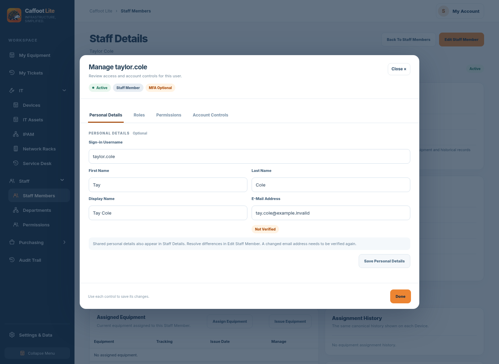

*Draft v2.2 — Saved Personal Details for taylor.cole: the account uses Tay Cole and an unverified email. Resolve any saved Staff/account differences separately. Independent review and owner visual acceptance recorded; original revision and targeted refresh limitations retained.*

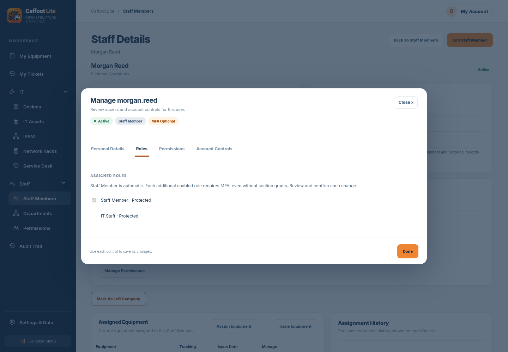

*Draft v2.2 — Morgan’s saved membership: protected Staff Member selected, IT Staff unchecked. This is not a subsequent membership change. Approved narrow reuse; original provenance retained.*

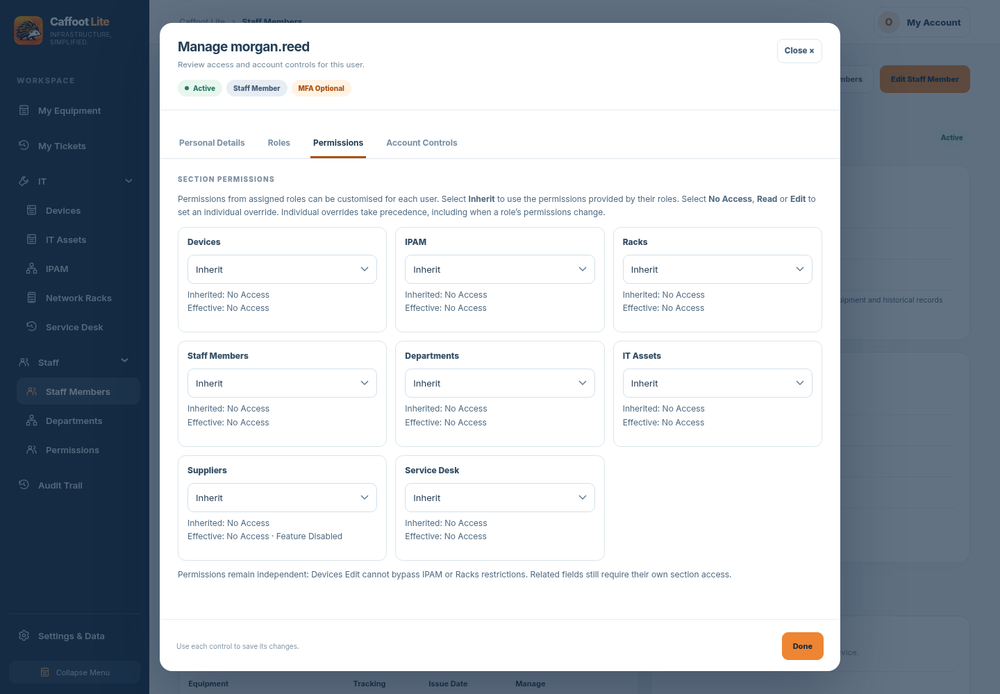

*Draft v2.2 — Morgan’s inherited and effective No Access example, including Suppliers Feature Disabled. This is not a later access-change result. Approved narrow reuse; original provenance retained.*

## Assign Or Remove An Additional Role

1. Open the correct account through **Staff Details → Manage Permissions**.
2. In the **Roles** tab, under **Assigned Roles**, select the role's checkbox to propose adding it, or clear it to propose removing it. Each checkbox change is reviewed separately.
3. In **Review Access Change**, inspect the before/after roles, section inheritance, overrides, effective levels and MFA status.
4. Check **Affected Accounts** and **Sessions To End**. Assigning or removing a membership ends that account's sessions, even when its effective rights would stay the same.
5. Select **Confirm Change** to save, or **Cancel** to leave the saved membership unchanged.
6. After success, review the refreshed account. If MFA enrolment is pending, the current tabbed dialogue shows its warning in **Roles**. Review effective levels in the separate **Permissions** tab. Tell the person to sign in again and complete enrolment.

Staff Member cannot be removed. An additional role may be assigned before MFA enrolment, but cannot be used to bypass enrolment. Removing a role does not automatically remove an enrolled authenticator or erase individual overrides.
## Set An Individual Section Override

1. Open **Staff Details → Manage Permissions → Permissions** for the ordinary account.
2. Find the section and read its **Inherited** and **Effective** summaries.
3. Choose **Inherit**, **No Access**, **Read** or **Edit** from that section's selector.
4. Review the consequences in **Review Access Change**, including MFA and session effects. Changing the selector proposes a change; it is not the final save.
5. Select **Confirm Change** to apply it, or **Cancel** to keep the original choice.
6. Recheck the refreshed effective level and organisation feature switch if access remains unavailable.

An Edit override may increase access above the roles, so it needs the same care as granting a role. A Read override can intentionally limit inherited Edit. Other sections keep their own permissions; changing Devices does not grant Staff Members, IPAM or IT Assets rights.

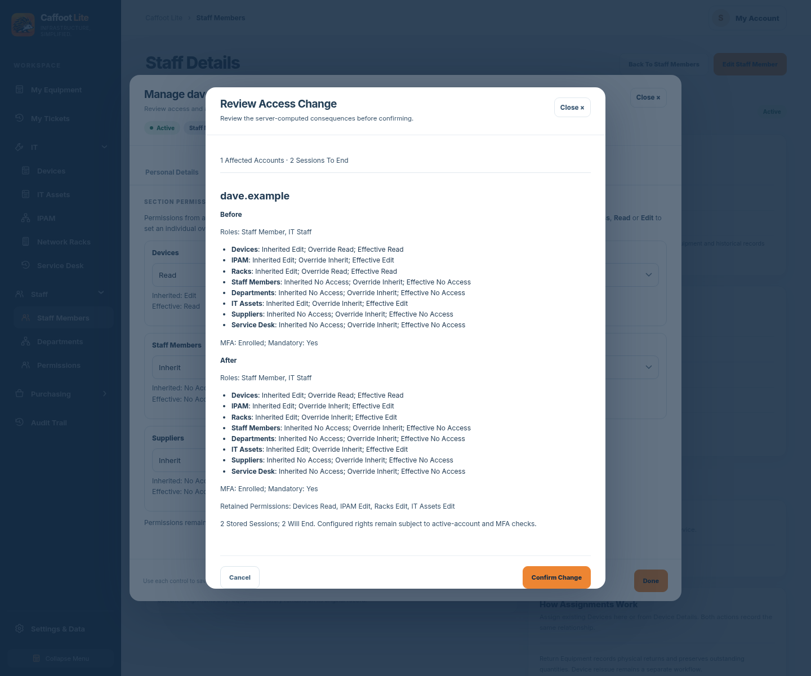

*Draft v2.2 — Dave’s proposed Racks change replaces the Read override with Inherit, giving effective Edit. One account and two stored sessions would be affected. This preview was cancelled. Independent review and owner visual acceptance recorded; original revision and targeted refresh limitations retained.*

## Create And Maintain Roles

### Create A Custom Role

1. Open **Staff → Permissions → Manage Roles** and select **+ Create Role**.
2. Enter a unique **Role Name** of 1–80 printable characters, for example the fictional **Equipment Auditors**. Empty, overlong or conflicting names are rejected.
3. Choose the required section grants. For an audit-only example, select **Read** for IT Assets and leave unrelated sections at **No Access**.
4. Select **Review Changes**, then inspect the role definition and consequences in **Review Access Change**.
5. Select **Confirm Change** to create it, or **Cancel** to save nothing.
6. Assign it to the intended accounts separately. A new role starts enabled and unassigned; creating it alone grants no account access. Every assigned enabled additional role requires MFA.

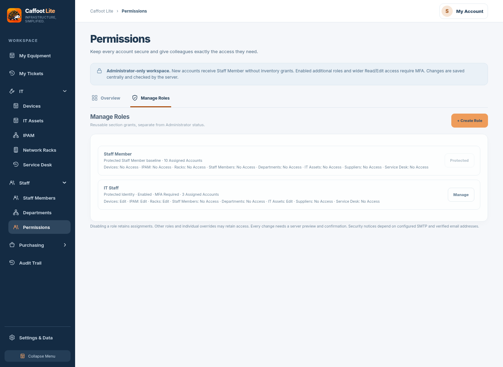

*Draft v2.2 — Manage Roles shows the protected Staff Member baseline and the enabled IT Staff definition. Independent review and owner visual acceptance recorded; original revision and targeted refresh limitations retained.*

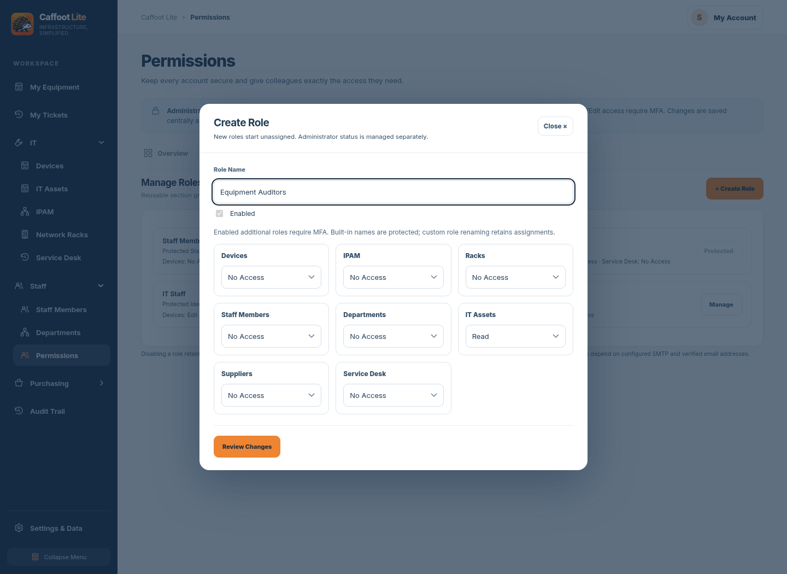

*Draft v2.2 — Equipment Auditors is an unsaved role draft with IT Assets Read. Review Changes is still required; this role has not been created. Independent review and owner visual acceptance recorded; original revision and targeted refresh limitations retained.*

### Change, Disable Or Delete A Role

1. In **Manage Roles**, select **Manage** beside the correct role.
2. Edit its grants or, for a custom role, its name. Clear **Enabled** to disable it, or select it to re-enable it.
3. Select **Review Changes** and examine every affected account, including retained overrides. A shared role change may affect many people.
4. Select **Confirm Change** to save or **Cancel** to keep the current role. Reopen it to check the resulting definition.
5. To delete a custom role, select **Delete Role** in its editor and review the impact before **Confirm Change**. Its membership and grants stop contributing; other roles and overrides may preserve access. Its historical definition remains recorded.

IT Staff cannot be renamed or deleted, and Staff Member is fully protected. Disabling a role is reversible and retains memberships and grants; re-enabling makes those grants contribute again. Renaming a custom role preserves its identity and memberships.

### When A Preview Changes Or Expires

The server checks the proposal again at confirmation. Another administrator's changes or an expired preview can make it outdated. The application then reports that **nothing was saved** and displays refreshed consequences. Read them before confirming again. If the target is no longer available, close the preview and refresh the list.

Successful permission changes are saved with their attributed history and required session changes. Membership changes always end the target's sessions; other role or override changes end sessions when effective rights or MFA requirements change. A rename or a grant masked by an override does not necessarily end sessions. The preview describes the actual consequences.

Notification feedback is separate from saving access. **Notices Queued** means accepted for outgoing processing, not delivered. **Coalesced** notices have been combined; **Not Queued** indicates unsuccessful queue admission. Missing SMTP configuration or an unverified email does not reverse a saved permission change. Investigate through administrator email settings and private delivery records; do not repeat an access change merely to request another notification.

## Enable, Disable Or Delete A Login

Account controls are separate from role previews. Check the account identity before selecting them: **Disable Login**, **Enable Login**, **Make admin** and **Remove admin** apply their own operation directly when selected. **Done** closes the editor; it is not a final save for these earlier actions.

1. Open **Staff → Staff Members → Staff Details → Manage Permissions → Account Controls** for the person.
2. An active account has a green status panel. In **Account Controls**, select **Disable Login** to end its sessions and prevent sign-in while retaining the account.
3. A disabled account has a red status panel. Select **Enable Login** to restore login eligibility after the Staff Member is Active, then review the current roles, permissions and MFA requirements.
4. To appoint an Administrator, review the eligibility checks and select **Make admin** once the account qualifies. See [Make An Existing User An Administrator](#make-an-existing-user-an-administrator).
5. To remove independent Administrator status, select **Remove admin**. Remaining ordinary access comes from the account's roles and overrides. The account must sign in again after Administrator status changes.
6. To remove the account permanently, select **Delete User** and read its confirmation. Confirm only if deletion is intended; cancelling keeps the account. Prefer disabling when the requirement is simply to prevent sign-in while retaining the login.

You cannot disable, demote or delete your own signed-in administrator account, and the last active administrator is protected. Deleting a login does not delete its Staff directory identity or return its equipment; review those separately in the [Staff lifecycle](Staff-Members.md). These controls do not provide an administrator bypass for a forgotten password or authenticator.

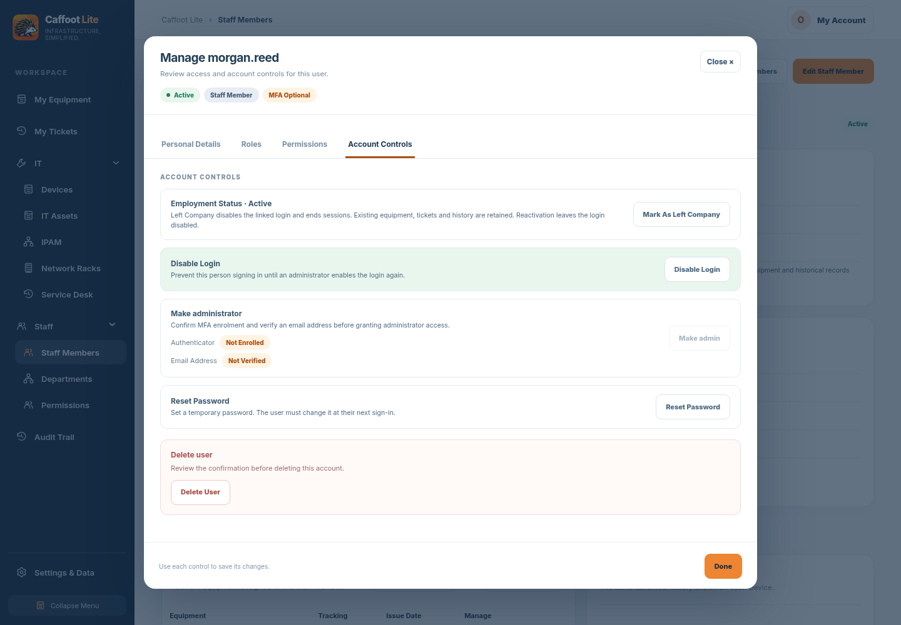

*Draft v2.2 — Morgan’s initial Active employment/login controls; promotion unavailable. This is not Alex’s later eligibility or offboarding result. Approved narrow reuse; original provenance retained.*

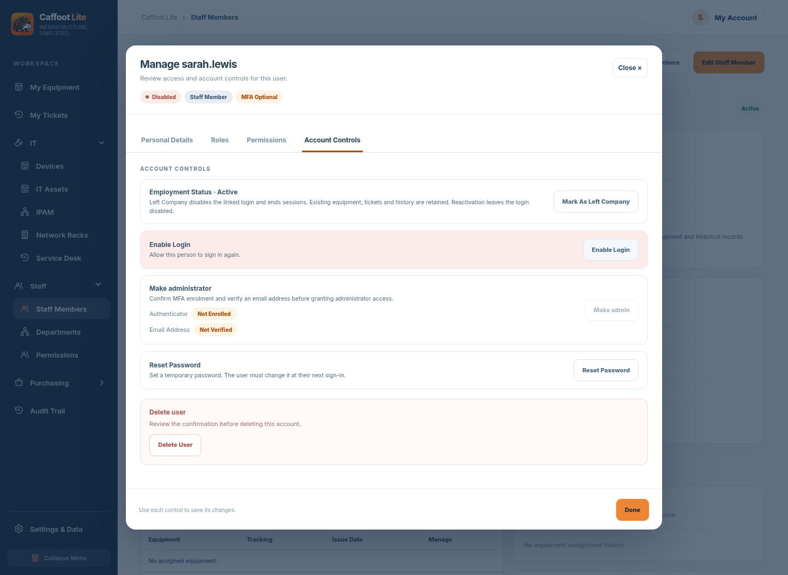

*Draft v2.2 — Sarah’s saved login is Disabled while employment remains Active. Enable Login is available; this is not an offboarding result. Independent review and owner visual acceptance recorded; original revision and targeted refresh limitations retained.*

For the depicted Sarah example, **Delete User** opens the browser-native confirmation **“Delete sarah.lewis?”**. Choose Cancel to keep the login. The illustration above shows her disabled login before that confirmation; it does not show deletion.

## Employment Status And Linked Login Security

Employment has two current choices: **Active** and **Left Company**. Older evidence may call the latter inactive; this is not a separate temporary-absence status.

1. Check the person in **Staff → Staff Members → View Details**. Review outstanding equipment using the necessary equipment permissions.
2. With **Staff Members Edit** and administrator authority for a linked person, select **Mark As Left Company**, or use **Manage Permissions → Account Controls → Employment Status**. Read and confirm the warning; **Cancel** saves nothing. The Add/Edit Staff form applies the same policy.
3. Verify **Left Company** and linked account **Disabled**. The save ends existing sessions and revokes email verification/recovery and temporary-password change proofs. Account credentials, enrolled MFA, roles and retained records are not erased. Existing equipment remains outstanding; no return, stock movement or ticket deletion is created.
4. If the employee returns, select **Reactivate** and confirm. Then review account access and separately choose **Enable Login** in Account Controls if authorised. Enabling or linking a login while Staff remain Left Company is rejected with **Reactivate the Staff Member before enabling their login** for the enable operation.

For example, Alex Morgan leaves with laptop **AC-LAP-07** still recorded against them. Offboarding blocks Alex's login while IT resolves the actual equipment. On Alex's return, Reactivate permits new assignments but does not restore login access. An administrator deliberately enables it after reviewing Alex's current roles. Self-offboarding and disabling the remaining active administrator are rejected, with both Staff and account changes rolled back. [Full Staff procedure](Staff-Members.md#mark-as-left-company-or-reactivate)

The [matching saved Staff illustration](Staff-Members.md#mark-as-left-company-or-reactivate) shows Alex’s Left Company status, Disabled login and retained AC-LAP-07 assignment. Morgan’s reused initial controls are not that result.

## Make An Existing User An Administrator

Use an existing administrator session protected by MFA. The proposed administrator must have confirmed their authenticator, verified the email address saved in **My Account** and completed any required temporary password change. Saving an email address alone does not verify it.

1. Open **Staff → Staff Members → Staff Details → Manage Permissions** for the intended account. Confirm the **Sign-in Username**, for example `alex.morgan`.
2. Under **Account controls → Make administrator**, review **Authenticator** and **Email Address**. If Alex sees **Not Enrolled** or **Not Verified**, ask them to [complete MFA enrolment](#required-enrolment-at-sign-in) or [verify their email](#prepare-verified-email-recovery). If Alex still uses a temporary password, ask them to [change it](#after-an-administrator-gives-you-a-temporary-password).
3. Reopen **Manage Permissions** after the person completes the checks. With **Enrolled** and **Verified** displayed and the password change complete, select **Make admin**. The choice takes effect immediately and ends that person’s existing sessions. They must sign in again with their authenticator.
4. Confirm that the account now shows **Administrator · All Sections**. Enabled features determine which sections they can use. **Done** closes the dialogue.

If **Make admin** stays disabled, check the guidance beside it. If an email address was just changed, the user must verify the new address. The server checks eligibility again when it receives the promotion request.

On a fresh installation, the first administrator can finish setup before outgoing email is configured. They must still enrol their authenticator. After configuring outgoing email, they can verify their address in **My Account → Overview → Personal Details**. Existing administrators keep their access if an address is missing or loses verification. The warning below their email settings explains how to restore eligibility for password recovery. Outgoing email remains optional for everyday operation, and the protected [host-only first-administrator recovery procedure](../../../development-guide/Account-Recovery.md) remains available to the system operator when its conditions are met.

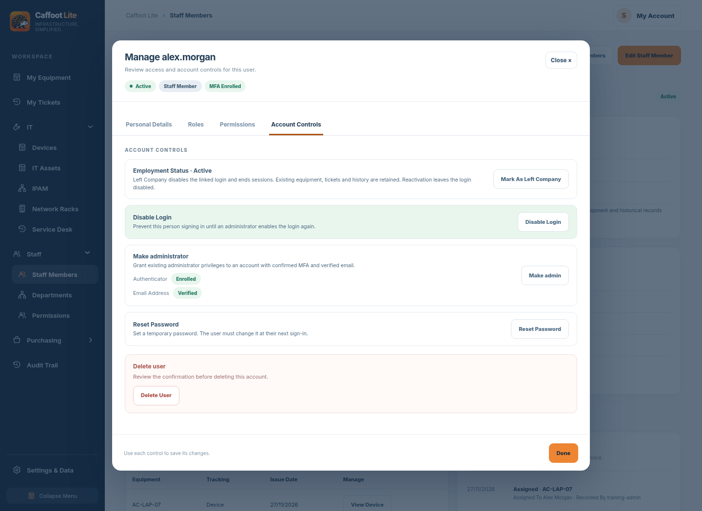

*Draft v2.2 — Alex’s authenticator is enrolled and email verified, so Make admin is available. No promotion has been applied. Independent review and owner visual acceptance recorded; original revision and targeted refresh limitations retained.*

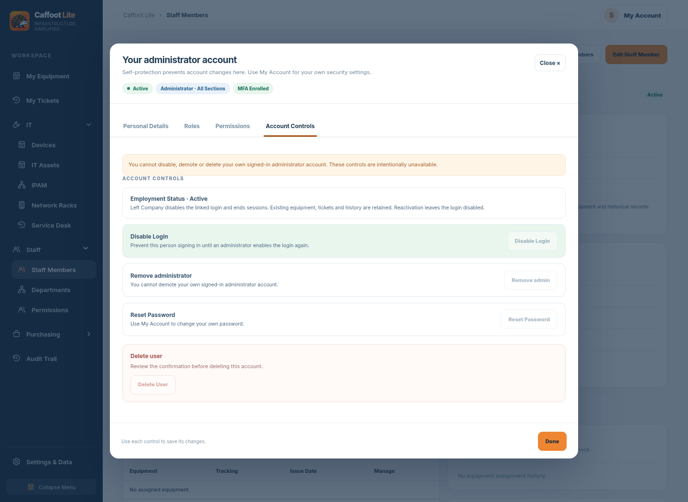

*Draft v2.2 — The signed-in account is also the only active administrator in this fixture. Its own disable, demotion, reset and deletion controls are protected. Independent review and owner visual acceptance recorded; original revision and targeted refresh limitations retained.*

## Reset A Staff Member’s Password

Use an assisted reset when a non-administrator needs a temporary password. You need a signed-in administrator account with confirmed MFA. Staff directory editing access alone cannot reset passwords. You can reset Staff Members, IT Staff and users with custom roles, including a disabled user. An administrator changes their own password in **My Account** or uses [account recovery](#recover-your-password-from-sign-in).

1. Open **Staff → Staff Members**. Find the person by name or sign-in username, for example **Jamie Taylor** (`jamie.taylor`). Choose **View Details → Manage Permissions** and check the **Sign-in Username**.
2. Under **Account controls**, select **Reset Password**. Enter a long, unique **Temporary Password** and repeat it exactly in **Confirm Temporary Password**. Use a password manager or another approved secure method to generate it.
3. Review the warning, then select **Reset Password** in the dialogue to confirm. **Cancel**, **Close** and Escape discard the temporary entries. If the passwords differ, correct the confirmation before submitting. If the reset reports a failure, refresh the account and verify its current state before trying again.
4. Wait for the confirmation beneath the reset control. The target’s existing sessions and recovery codes have ended. Their roles, Staff link, authenticator and verified email stay in place. A disabled account stays disabled and must be enabled separately before the person can sign in.
5. Give Jamie the temporary password using a secure channel outside Caffoot Lite. The person must still complete their own authenticator checks and choose a new password. Confirm that they can complete a fresh sign-in without asking them to disclose their new password.

Caffoot Lite records the administrator, affected account and change in the audit trail. Passwords and authenticator values stay out of the audit record.

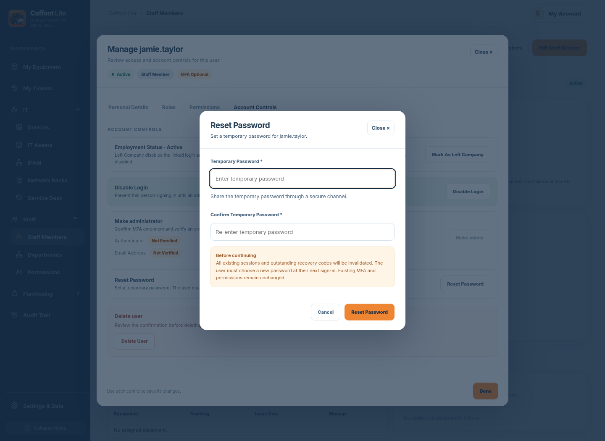

*Draft v2.2 — Reset Password for Jamie Taylor, before entry or confirmation. Both temporary password fields are empty. Independent review and owner visual acceptance recorded; original revision and targeted refresh limitations retained.*

## Set Up And Use MFA

### Required Enrolment At Sign-In

1. On the existing sign-in page, enter **Username** and **Password**, then select **Sign In**.
2. If your roles or access require enrolment, the page displays **Secure Your Account**. Scan the QR code with a trusted authenticator app, or enter the displayed setup key manually.
3. Keep the key and QR code private: either can let someone reproduce your codes. Do not include them in screenshots, support email or public issues.
4. Enter the app's current six-digit code and select **Confirm MFA Setup**.
5. After confirmation, sign in again using your password and a current authenticator code. Enrolment itself does not create a normal application session.

### Sign In After Enrolment

1. Enter your **Username** and **Password**, then select **Sign In**. The authenticator field appears after Caffoot Lite verifies the password for an active account that requires a code. A Staff Member such as Jamie Taylor, with no authenticator or MFA requirement, can enter the workspace with their password.
2. On **Verify Your Identity**, enter the current six-digit **Authenticator Code** from your app. Select **Verify & Sign In** if entering the sixth digit did not submit the form. Select **Back to Sign In** to start again with your username and password.
3. After successful sign-in, wait for the menu to load. The available destinations depend on your effective permissions. If permissions fail to load, reload the page or sign in again. Contact your administrator if the problem continues.

If you see **Unable to sign in. Please check your credentials or contact your administrator.**, check your username and password. The same message covers incorrect credentials and unavailable accounts. At **Verify Your Identity**, check the time on your authenticator device and try the next code if the previous one expired. After repeated failures, wait for the temporary sign-in limit to expire. For lost credentials, see [Account Recovery](../../../development-guide/Account-Recovery.md) or contact your administrator.

**Draft screenshot refresh pending:** the sign-in, authenticator challenge and mandatory password-change illustrations below retain their original provenance and predate the approved branding punctuation correction (#476). Refresh these three affected views from the corrected application before publication; the separately approved recovery captures are updated below.

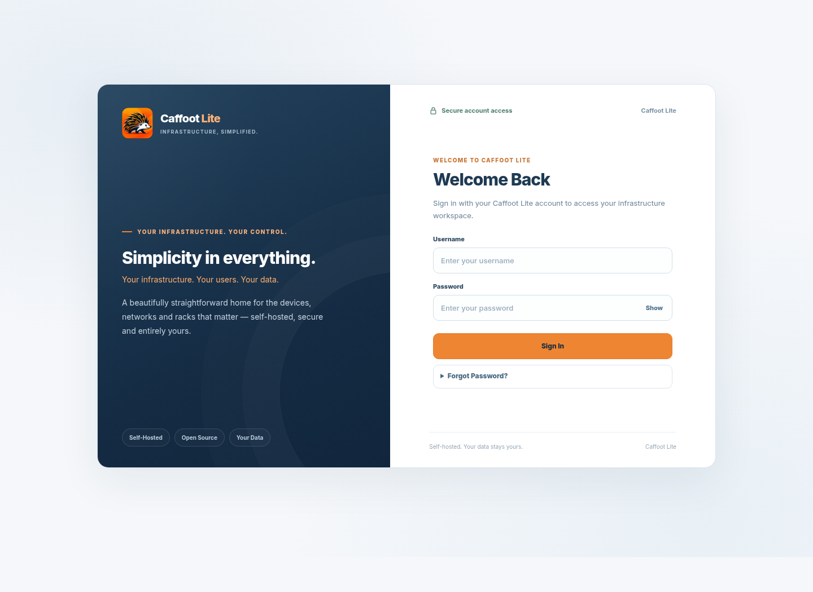

*Draft v2.2 — The sign-in form starts with empty Username and Password fields. Independent review and owner visual acceptance recorded; original revision and targeted refresh limitations retained.*

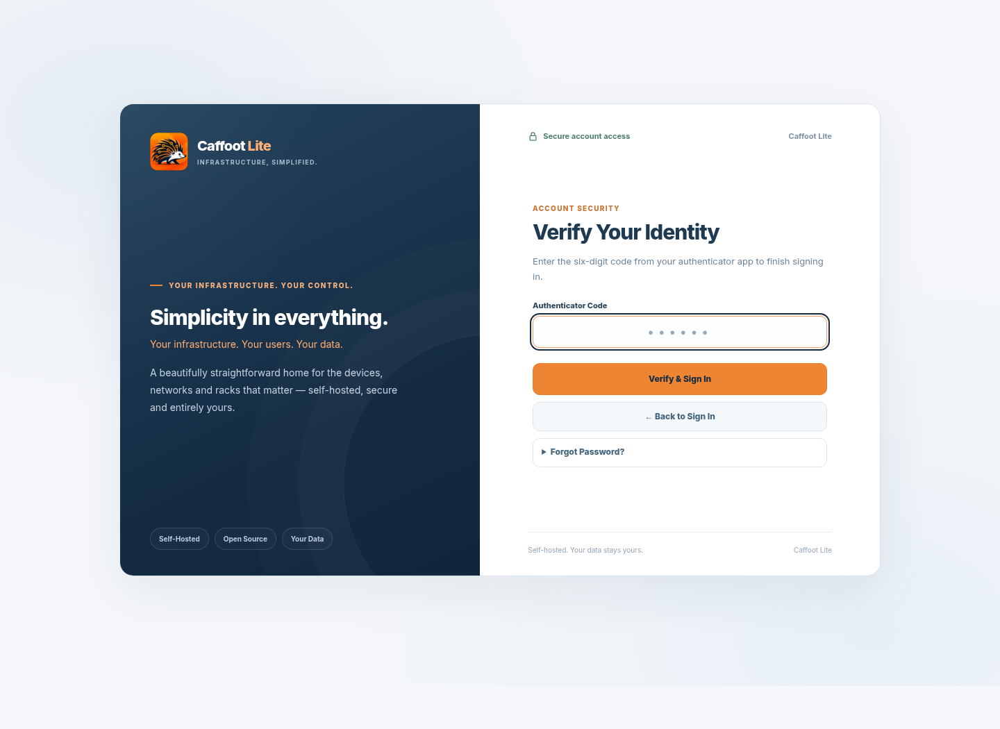

*Draft v2.2 — Tim’s IT Staff account requires the authenticator challenge after password entry. The password has cleared and the code field is empty; the dots are the application’s placeholder. Independent review and owner visual acceptance recorded; original revision and targeted refresh limitations retained.*

### Voluntary Enrolment And Eligible Removal

A Staff-only account with no wider grants or enabled additional role can enrol voluntarily through **My Account → Security → Multi-Factor Authentication**. Enter your password, select **Start MFA enrolment**, scan the QR code or enter its key, then enter the six-digit code and select **Confirm MFA**. Return to sign-in and use the authenticator afterwards.

Once enrolled, MFA remains required at sign-in even if a role is disabled or removed. Only an eligible account owner can remove it:

1. Open **My Account → Security** and expand **Remove MFA** when offered.
2. Enter **Current Password** and **Current Authenticator Code**.
3. Select **Confirm MFA Removal**.
4. After success, all your sessions end. Sign in again with your password. Roles and grants have not changed.

Removal is unavailable for Administrators, accounts with any enabled additional role, or accounts with wider effective Read/Edit access. The server rechecks eligibility and credentials before saving. Losing an authenticator does not make required MFA optional; contact the administrator and use maintained recovery guidance where applicable.

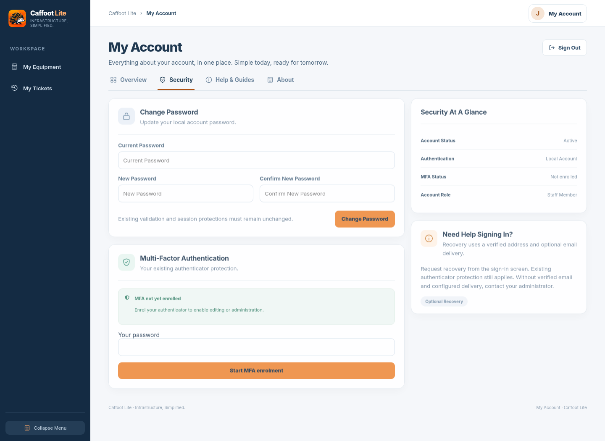

*Draft v2.2 — Jamie has the baseline Staff Member role and no wider grants. Security shows the empty password-change form and safe voluntary MFA starting screen; enrolment has not begun. Independent review and owner visual acceptance recorded; original revision and targeted refresh limitations retained.*

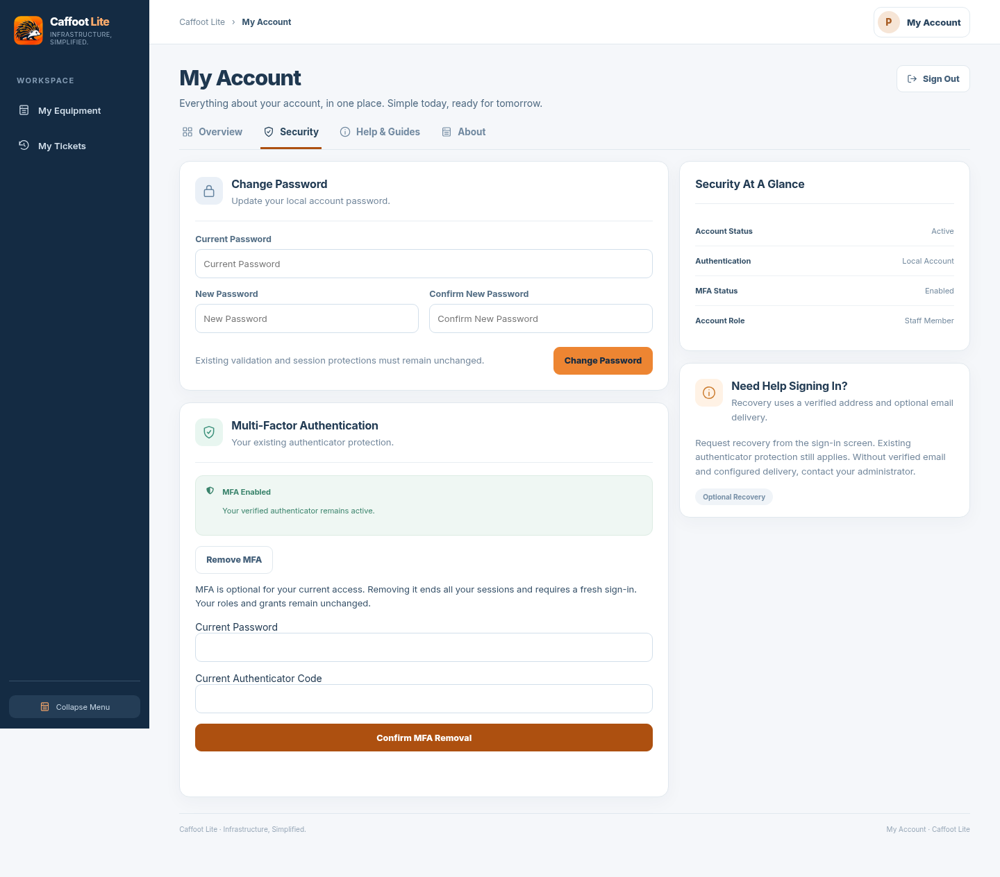

*Draft v2.2 — Priya’s enrolled MFA is optional for her baseline-only access. The expanded removal form has empty password and authenticator fields; no removal has been submitted. Independent review and owner visual acceptance recorded; original revision and targeted refresh limitations retained.*

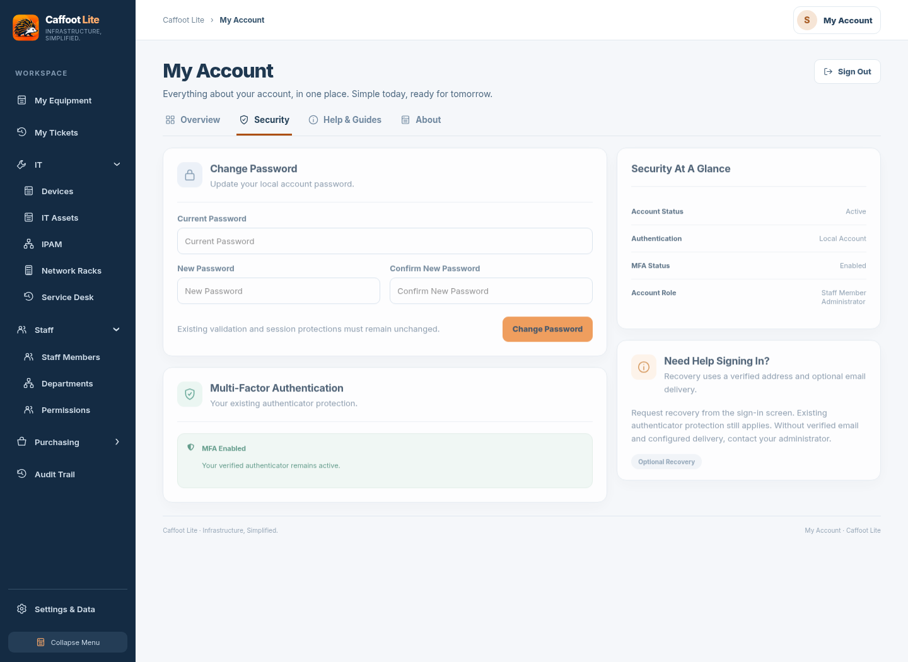

*Draft v2.2 — This administrator’s MFA is mandatory. Security shows MFA Enabled and provides no Remove MFA action. Independent review and owner visual acceptance recorded; original revision and targeted refresh limitations retained.*

## Change Your Password Safely

### After An Administrator Gives You A Temporary Password

1. At **Sign In**, enter your username and the temporary password. For example, Jamie Taylor enters `jamie.taylor` and the password their administrator supplied privately.
2. If prompted, enter the six-digit authenticator code. If **Secure Your Account** appears first, [complete enrolment](#required-enrolment-at-sign-in) and sign in again with the temporary password and your authenticator.
3. On **Change Your Password**, enter a personal **New Password** and repeat it in **Confirm New Password**. Select **Change Password**. Use a password different from the temporary password. Correct any mismatch and submit again.
4. When you see **Password changed successfully. Sign in again with your new password.**, enter the new password on the sign-in screen and provide your authenticator code if prompted. Only that fresh sign-in opens the workspace.

**Back to Sign In** clears the form. The restricted password-change screen expires after five minutes and cannot open normal application pages. The password change remains required the next time you sign in with the temporary password. If the change screen expires, begin again at sign-in. If the administrator resets the account again, use the latest temporary password. If the account is disabled, ask your administrator to check its status. A verified-email recovery can also complete the required password change when recovery is available and you choose a different password.

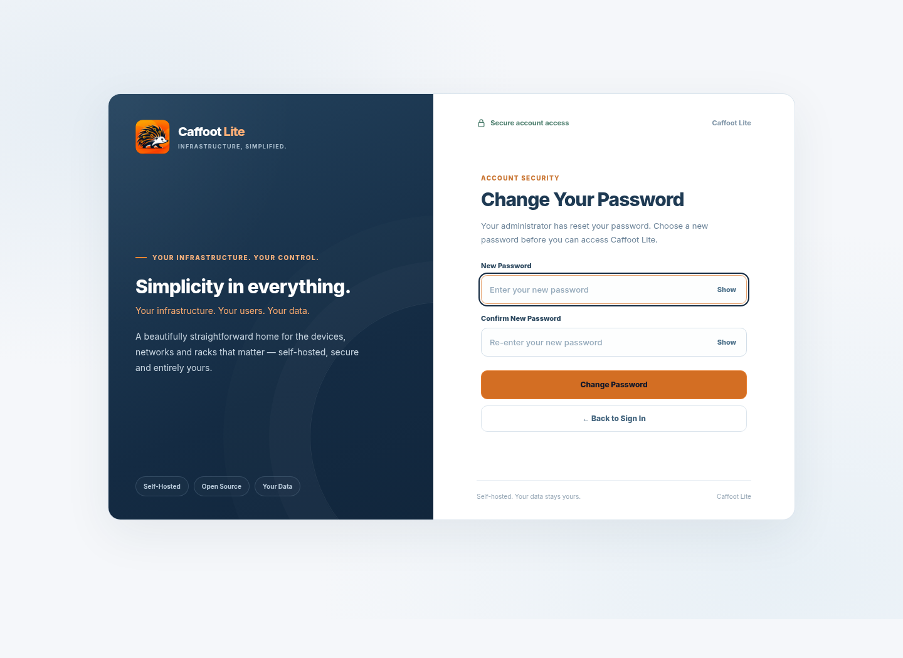

*Draft v2.2 — After an assisted reset, Jamie must choose a personal password before entering the workspace. Both new password fields are empty. Independent review and owner visual acceptance recorded; original revision and targeted refresh limitations retained.*

### Change Your Password From My Account

1. Open **My Account → Security → Change Password**.
2. Enter **Current Password**.
3. Enter a long, unique **New Password**, then repeat it in **Confirm New Password**. A password manager can help you retain it securely.
4. Select **Change Password**. Mismatched new values or an invalid current password are rejected without replacing the saved password.
5. After success, sign in again with the new password and your authenticator where required. All of this account's existing sessions have ended.

Typing values without submitting does not change the password. Follow the result shown and check a fresh sign-in rather than assuming an old tab saved it. Password changes do not remove MFA or grant access. Do not share your old password with an administrator or put credentials in an equipment note.

The [Security illustration above](#voluntary-enrolment-and-eligible-removal) also shows this empty Change Password form. Reusing it here does not imply a password change was submitted.

### Prepare Verified Email Recovery

1. Open **My Account → Overview → Personal Details** and save your optional email address with **Save Personal Details**.
2. Select **Verify Email**, enter **Current Password** and choose **Send Confirmation Code**.
3. Enter **Email Confirmation Code (8 Digits)**, retaining any leading zeroes, then select **Verify Email Address**.
4. Check that the address shows **Verified**. Changing the saved address removes verification. **Cancel** clears verification password/code fields without verifying the address.

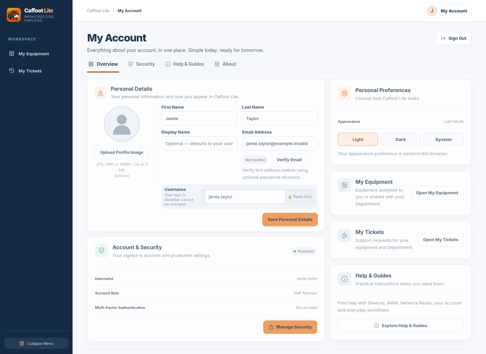

*Draft v2.2 — Jamie’s saved fictional address is Not Verified. Save Personal Details alone does not verify an address. Independent review and owner visual acceptance recorded; original revision and targeted refresh limitations retained.*

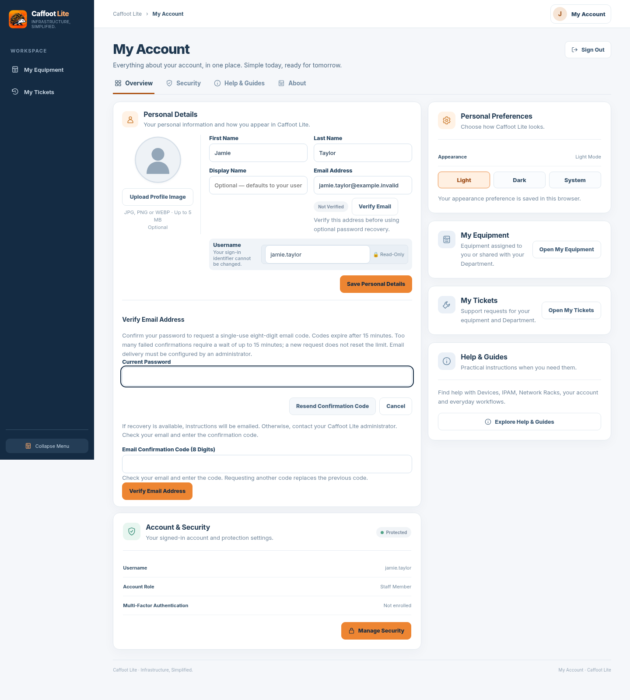

*Draft v2.2 — The existing isolated mail-sink fixture supplied the confirmation-request state. Current Password and Email Confirmation Code are empty. This illustration does not establish external mail delivery. Independent review and owner visual acceptance recorded; original revision and targeted refresh limitations retained.*

### Recover Your Password From Sign-In

You need an active Caffoot Lite account, a verified email address saved to that account and outgoing email configured by your administrator. If you have enrolled an authenticator, keep it to hand. Recovery cannot remove or bypass MFA. If roles require MFA but you have not yet enrolled, complete the required enrolment through sign-in using known credentials; ask an administrator for an assisted password reset if you cannot do that. You can start recovery from the sign-in page without an active session.

1. Select **Forgot Password?** on the sign-in page. **Request a Recovery Code** replaces the sign-in form. Enter your recovery **Username**, for example `recovery-owner`, and select **Request Recovery Code**. The response is **If recovery is available, instructions will be emailed. Otherwise, contact your Caffoot Lite administrator.** It protects account privacy and does not confirm that mail was sent.
2. When **Reset Your Password** opens, check your verified mailbox and enter the emailed **Recovery Code (8 Digits)**, including any leading zeroes. Use the most recent code. Codes work once and expire after 15 minutes.
3. Enter a long, unique **New Password** and repeat it exactly in **Confirm New Password**, including capital letters and any spaces. If you use a password manager, check that it filled both fields with the same generated password.
4. If you have enrolled MFA, enter the current six-digit **Authenticator Code (If Enrolled)**. This is the code from your authenticator app.
5. Select **Reset Password**. If the passwords differ, the form shows **The new passwords do not match.** and returns focus to **Confirm New Password**. Correct the entries and try again. A mismatch or empty field leaves your password and recovery challenge unchanged. The confirmation entry stays in the browser and is cleared with the new password when the form is reset.
6. When **Password Updated** appears, both password fields clear and your existing sessions end. Use **Back To Sign In** and sign in with the new password and your authenticator if required.

If an administrator has set a temporary password, successful recovery also clears the required password change. Enter a different password at step 3 and still complete all recovery and authenticator checks.

Select **Back To Sign In** from either step to clear recovery and restore the preceding sign-in step. If recovery was opened from **Verify Your Identity**, it returns to that authenticator challenge with focus on its code field; otherwise it returns to Username. Closing clears the local recovery fields and does not change your saved password. **Request Another Code** clears the reset fields and takes you back to **Request a Recovery Code** with your username filled in. Making that request replaces the previous code and keeps the existing failed-attempt limits. Five failed confirmations can exhaust a challenge, and the rolling account limit can require a wait of up to 15 minutes.

If no email arrives, check the junk folder and ask your administrator to check your verification and outgoing mail privately. The request message confirms neither eligibility nor delivery. If confirmation is rejected, the highlighted error panel distinguishes the message from neutral instructions. Check that the recovery code is current and that you used the correct authenticator. For delivery and administrator troubleshooting, see [Account Recovery](../../../development-guide/Account-Recovery.md).

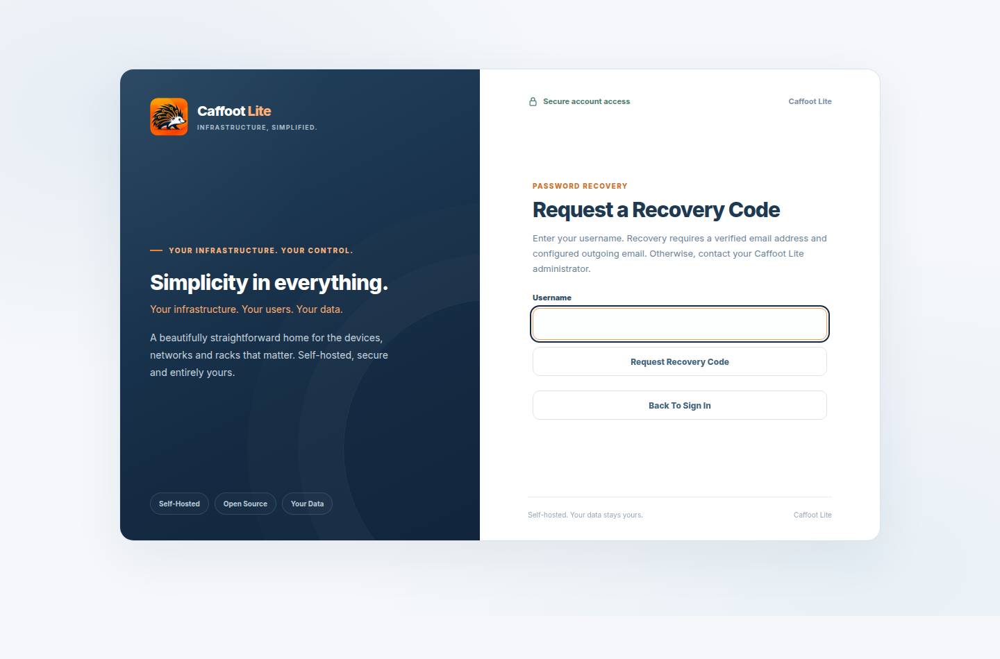

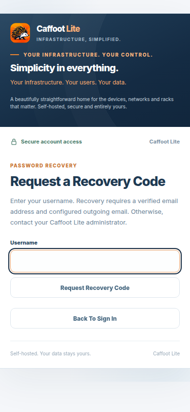

*Request step, with recovery prerequisites and administrator fallback.*

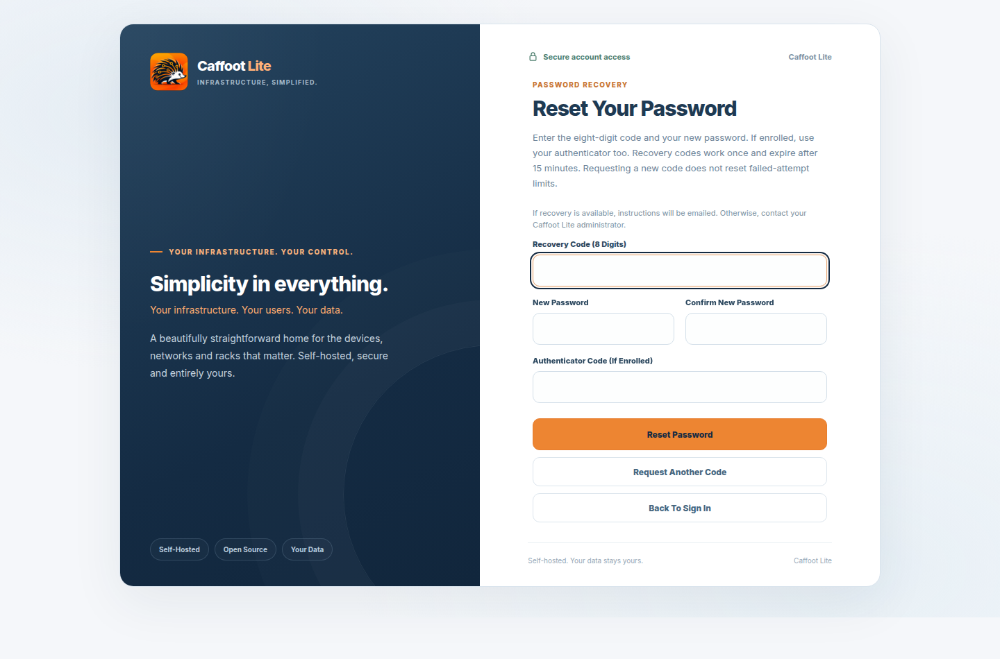

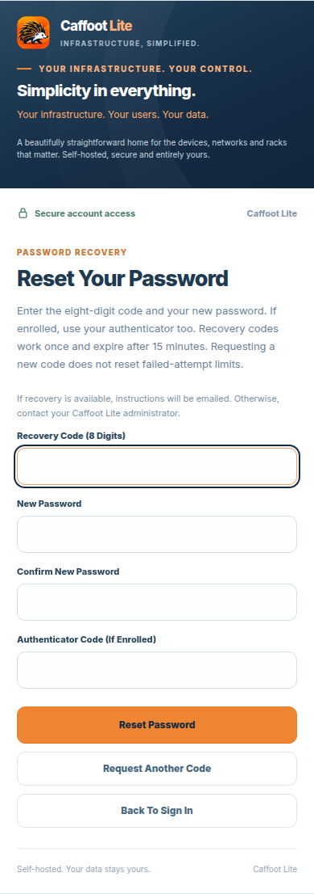

*Reset step, showing the neutral request response and the approved Reset Password label.*

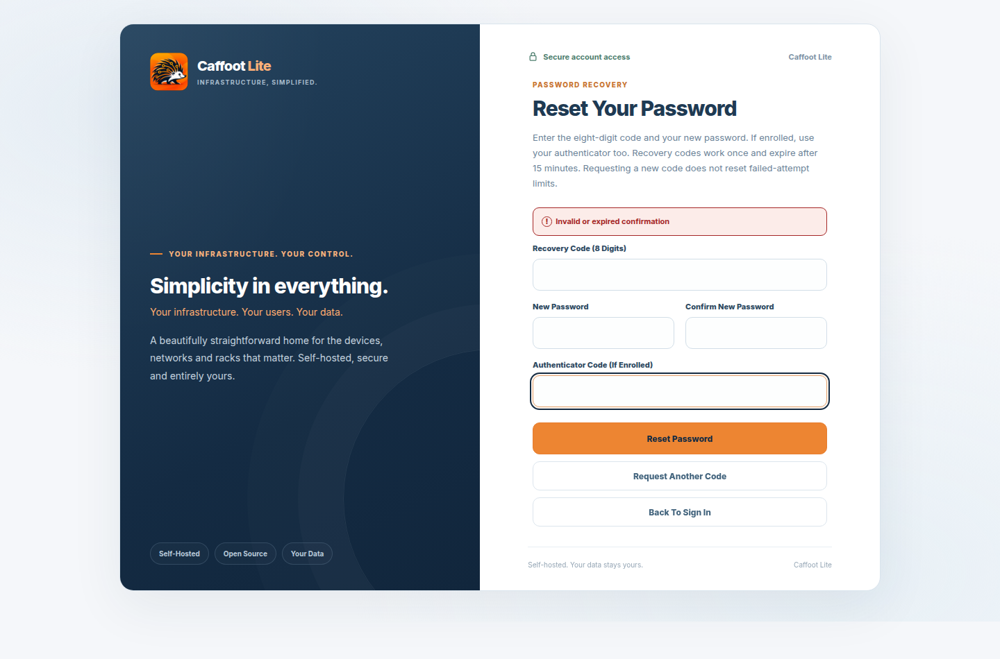

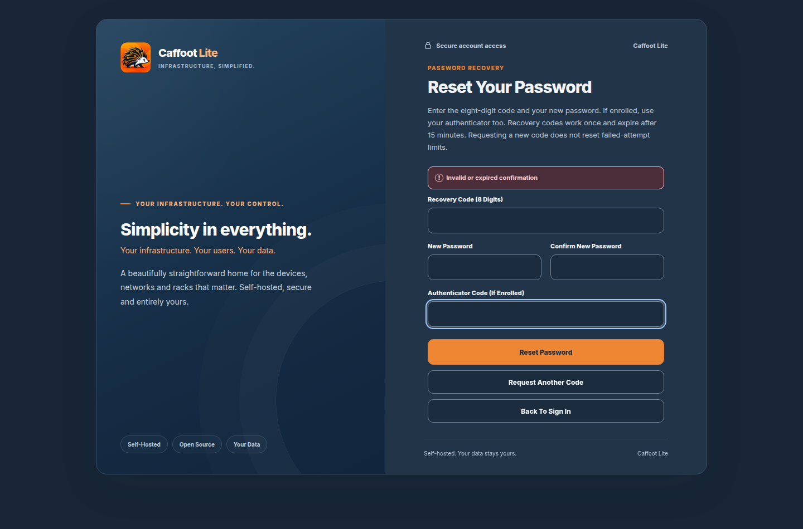

[Mobile light rejection](screenshots/milestone-01-authentication-corrections/recovery-rejected-mobile-light.png) · [Mobile dark rejection](screenshots/milestone-01-authentication-corrections/recovery-rejected-mobile-dark.png)

*The generic rejection is highlighted; recovery inputs were cleared for these captures. These eight Chromium captures were independently reviewed and owner-approved on 27 November 2026 at revision `abd311a2e49e3f1ec666b0f0b99bf4973230ce58`. [Capture provenance and SHA-256 hashes](screenshots/milestone-01-authentication-corrections/Provenance.txt). Native reacceptance remains separate.*

### Password Values And Lost Authenticators

Use long, unique passwords and communicate initial or temporary values privately. The current implementation rejects an empty password; it does not display or enforce a documented minimum length, complexity score or mandatory expiry period. Password and confirmation must match exactly. A mandatory replacement must differ from the temporary password. Initial account creation does not itself set the assisted-reset mandatory-change flag; ask the new user to change their initial password in My Account.

An emailed eight-digit recovery code is a password-recovery proof, not a backup authenticator code. There is no user-facing set of downloadable MFA recovery codes or administrator MFA-reset button in these account controls. A lost required authenticator prevents email recovery as well as normal sign-in. Contact the system operator privately; the [host-only recovery reference](../../../development-guide/Account-Recovery.md) has limited eligibility and is not a general account bypass. Do not delete an account, create duplicate Staff or remove permissions as an improvised recovery procedure.

## Sessions, Sign-Out And Unsaved Work

A session keeps a browser signed in after authentication. At this checkpoint it expires 12 hours after creation; the application does not promise an unlimited or activity-renewed session. Relevant account, role and security changes can end it sooner. **My Account → Sign Out** ends the current session; it does not sign out every other browser.

A browser page with an expired or invalid session returns to the existing sign-in page with **Your Session Has Ended** and a request to sign in again. A page opened with no session asks you to sign in. In an already-open workspace this occurs when a failed application request establishes that the session has ended; there is no immediate countdown or background-expiry alert. An ordinary permission denial while the session remains valid is a separate error.

After signing in, reopen the record and check its saved state before trying the action again. Unsaved entries are not guaranteed to return. If a save's outcome was unclear because the connection failed, inspect the record or authorised history before resubmitting: the session message alone does not establish whether an earlier request saved. Do not keep working from an old screen after access has been revoked.

## Common Problems And Recovery

| What you see | What to check |
| --- | --- |
| An account is missing from Permissions | Open Staff Members, search for the sign-in username, and use View Details → Manage Permissions. Permissions contains the overview and reusable roles. |
| No inventory after account creation | New accounts have Staff Member only. Ask an administrator to review section grants and switches. Your own My Account and eligible My Equipment are separate. |
| IT Staff shown, but one section remains Read or No Access | Review the override and current role definition. An access-preserving upgrade or deliberate exception may explain it. Remove an override only through an intentional reviewed change. |
| Read configured, but sign-in requires an authenticator | Wider Read requires MFA in v2.2; any enabled additional role also makes it mandatory. Complete enrolment. |
| Disabled role, but a section remains readable | Another enabled role or individual override may supply access. Review the effective level. |
| Feature Disabled beside a configured permission | An administrator must review Optional Features. Editing a role does not turn it on. |
| IPAM, rack or Device action unavailable in a form | Check that section's permission, feature state and record-specific restrictions. Do not broaden unrelated rights to bypass the error. |
| Preview changed or expired | Nothing was saved by that rejected confirmation. Review the refreshed impact, or reload if unavailable. |
| Saved change, but no email | Review notification feedback, verified address and outgoing email privately. Queue admission is not delivery; the access change remains saved. |
| Remove MFA unavailable | Required access or an enabled additional role may prevent removal. Enrolment does not disappear automatically after role changes. |
| Repeated invalid authenticator code | Check the correct account and device time, then use a current code. Repeated attempts can be throttled. |
| Recovery email absent | Review eligibility and delivery with the administrator privately. A neutral response reveals neither. Resending does not reset failure limits. |
| Session ends while working | Sign in again and inspect saved state before repeating the action. Review recent account changes if unexpected. |

Essential **Account**, **Role** and **Security** audit events remain available to authorised MFA-confirmed administrators, including when optional inventory features are disabled. Ordinary section Read does not grant this history. Inventory details within history remain permission-filtered. Share only necessary evidence when requesting help; exclude passwords, authenticator keys, session cookies, recovery codes and private email details from public reports.

## Related Workflows

[Optional Features And Link To IPAM](Optional-Features-and-Link-To-IPAM.md) · [Staff Members](Staff-Members.md) · [Departments And Shared Equipment](Departments-and-Shared-Equipment.md) · [Device Assignments And My Equipment](Device-Assignments-and-My-Equipment.md) · [IT Assets Stock Intake](IT-Assets-Stock-Intake.md)

Administrators and maintainers can consult the [role and account contract](../../../development-guide/Role-Permissions.md), [authentication and permission reference](../../../development-guide/04-Authentication-and-Permissions.md), [accepted IT Staff decisions](https://github.com/Caffoot/Caffoot-Lite/issues/365) and [later IT Assets default decision](https://github.com/Caffoot/Caffoot-Lite/issues/396). Current acceptance and release boundaries belong in [Development Status](../../../development-guide/Development-Status.md).

[Connected equipment example — Supplier, stock, assignment and later use](Connected-Equipment-Journey.md).
