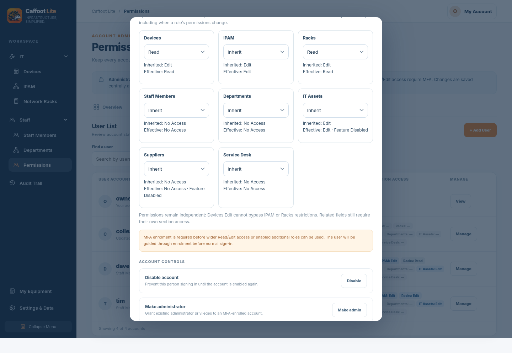
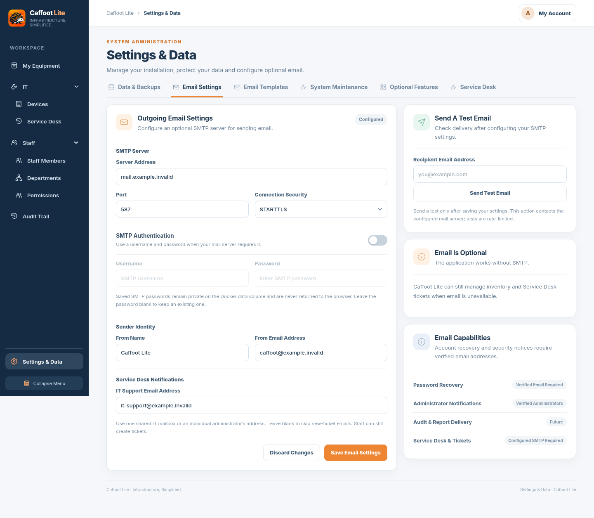
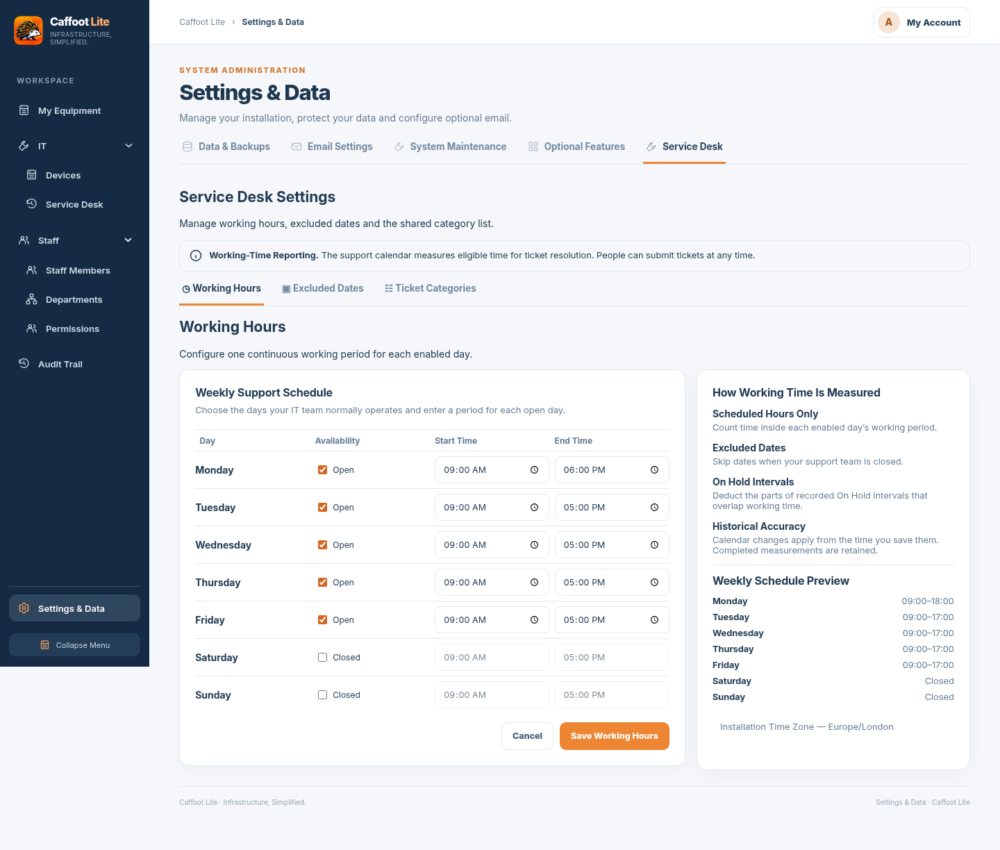
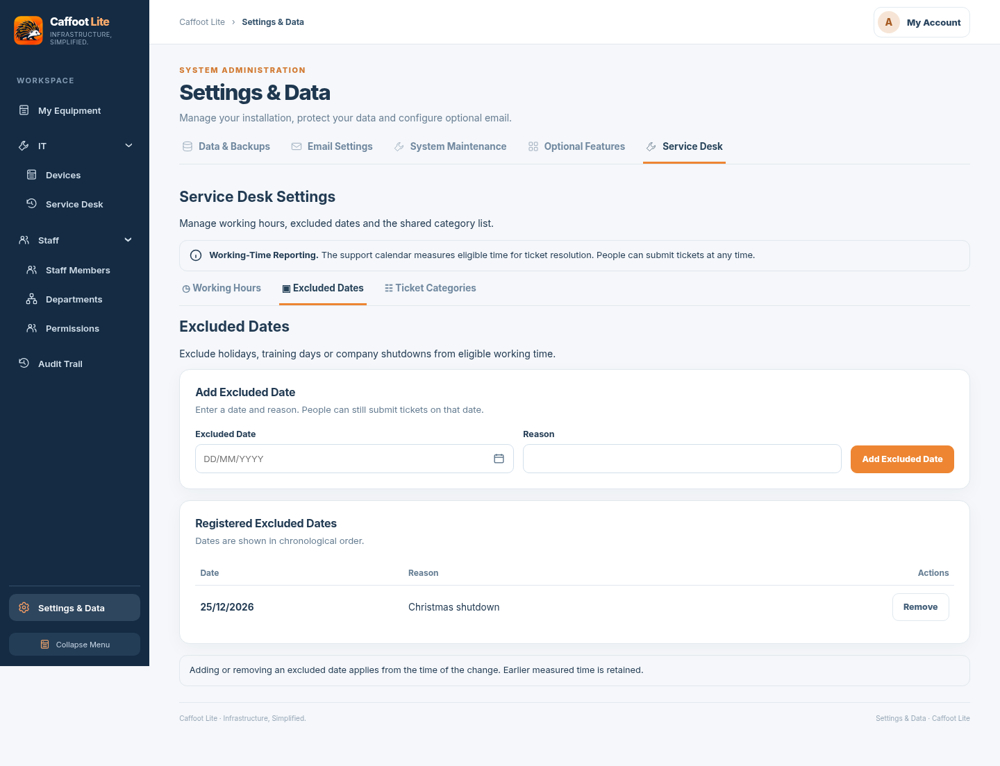
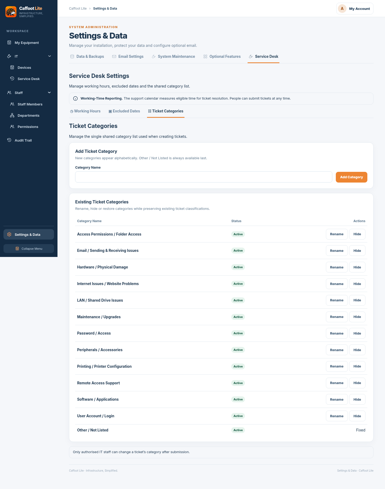
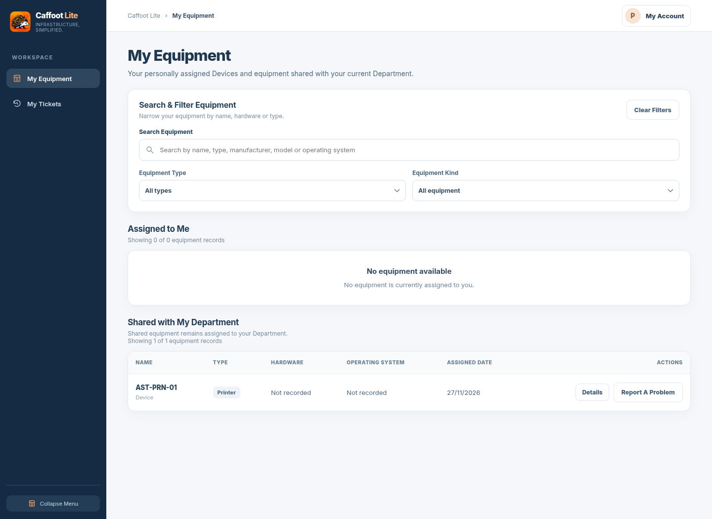
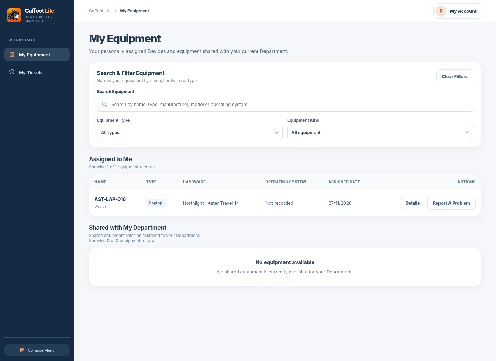
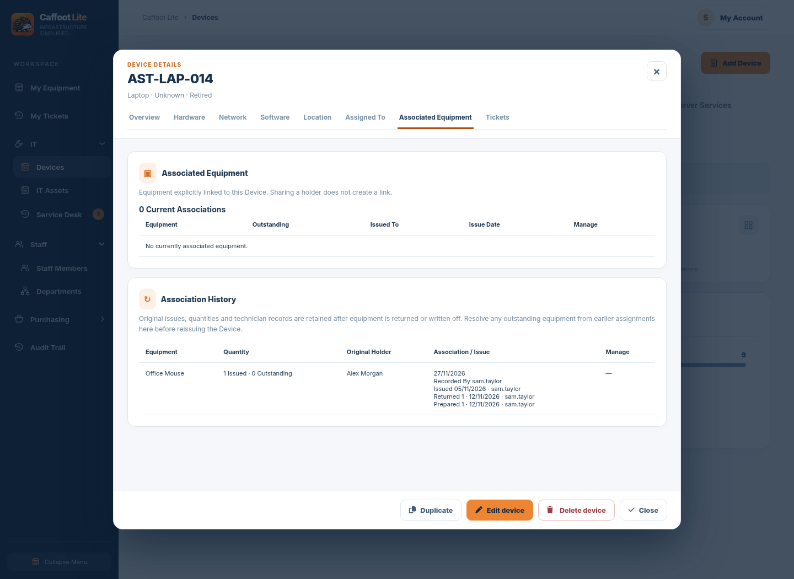
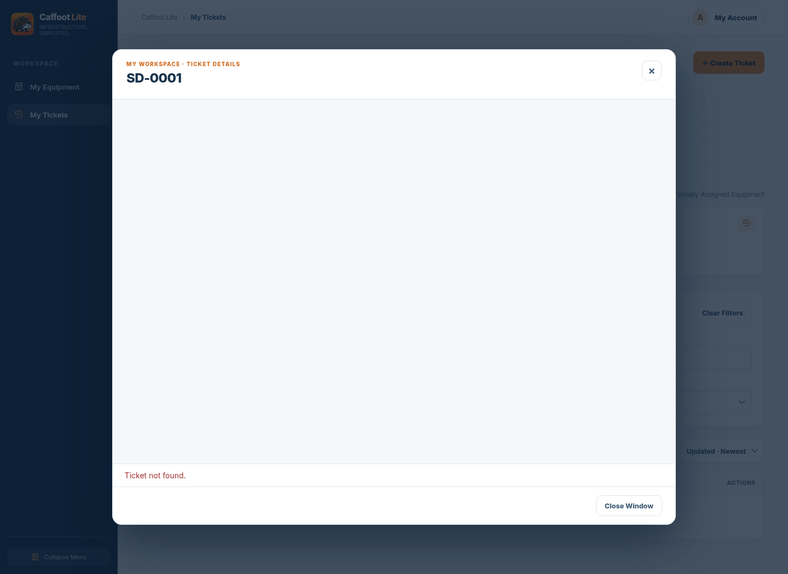

# Administer The Service Desk

> **Current Batch 7E capture status — 27 November 2026:** [New desktop light illustrations](screenshots/batch-7e/README.md) use the approved merged schema-31 baseline. Independent ChatGPT review and separate owner visual/privacy/caption/alt acceptance remain pending. Earlier written/source and capture-status paragraphs retain their dated scope; the current pack status controls these new images. Published v2.1 and targeted correction-refresh requirements remain unchanged.

> **Draft v2.2 — Unreleased.** This guide covers employee and technician access, ticket email, the support calendar, categories, reporting and the effect of equipment changes on stored tickets and files.

> **Written/source reconciliation:** Documentation Batch 5, application baseline `fdc677920bfc52f48f641b3d6d1344c902a6a9b0` (schema 31). Focused independent reviews are recorded and [owner written/source acceptance of Batches 1–6](https://github.com/Caffoot/Caffoot-Lite/issues/366#issuecomment-7200681167) is recorded. Current visual/privacy/caption/alt approval remains outstanding; [Batch 7 reconciliation and proposed capture packs](../../../development-guide/Milestone-01-Batch-7-Review.md) await independent review and owner acceptance. Capture scope and method need separate authorisation. Desktop capture remains deferred; existing historical/mobile images retain their original provenance. [Source review and exact screenshot requirements](../../../development-guide/Milestone-01-Batch-5-Review.md).

## Verify Employee Access

1. In **Staff → Staff Members**, open the employee’s record and check that it is active and linked to the correct enabled sign-in account. Review **Department** if the employee needs shared equipment. Keep the account’s existing sign-in and MFA requirements. [Staff Members](Staff-Members.md)
2. Verify the real equipment’s current assignment. Assign a personal Device to the employee, or shared equipment to the Department, through the existing equipment workflow where appropriate. Check that **Devices** or **IT Assets** is enabled for that equipment. [Device Assignments](Device-Assignments-and-My-Equipment.md) · [Optional Features](Optional-Features-and-Link-To-IPAM.md)
3. Ask the employee to sign in as themselves and open **My Equipment**. Confirm the item appears under **Assigned to Me** or **Shared with My Department**. Choose **Report A Problem** and check that **Create Ticket** opens with the equipment selected. Choose **Cancel** to leave the records as they were.
4. In **My Tickets**, check the appropriate tab and use **Clear Filters** to include Closed tickets. If you are testing a Department assignment, have a current member check an eligible ticket raised by a colleague or by IT. Compare the result with your authorised technician view. The employee can read shared updates and permitted files for that assignment. Internal notes and their files are visible in the authorised IT view.
5. For a returning problem on an eligible Closed ticket, the current assigned employee or any current member of the assigned Department can use **Reopen Ticket**. Confirm that it returns to **Open** and keeps its number, technician and closure history. **Reply To IT** and uploads become available after the reopen. Assigning, closing, changing priority and correcting categories require technician access.

An employee needs no general inventory, directory or Service Desk grant for these personal views. An active linked Staff record lets the employee open **My Tickets** while an equipment feature is enabled. Current assignment determines which tickets and options appear. If the equipment picker is empty, correct a genuine assignment through the existing workflow where appropriate. [Employee instructions](Service-Desk-Tickets.md#raise-a-support-request)

*Verify the view using an employee’s signed-in account. The Department name identifies the active shared audience.* [Capture details](../../../development-handovers/evidence/employee-service-desk/README.md)

## Give A Technician Access

Sign in as an administrator using your authenticator. Check that the prospective technician has an enabled account and the required access to the equipment they support. Devices and IT Assets have independent feature switches and permissions.

1. Open **Staff → Permissions → Manage Roles**. Select **Manage** beside the role you want to change. To grant access to just one authorised person, open **Staff Details → Manage Permissions → Permissions** and review their **Inherited**, **Override** and **Effective** section levels instead.
2. Find **Service Desk**. Choose **Read** for someone who may review the technician queue or **Edit** for someone who may record technician actions. Review their effective **Devices** and **IT Assets** access as well. Each ticket is subject to its equipment section's enabled state and effective Read permission.
3. Review the proposed changes and the accounts affected. The IT Staff role was assigned automatically during an earlier upgrade, so check the actual list before granting access to the whole role. Use an individual grant if the role has members who should have employee access only.
4. Confirm the change when the preview is correct or cancel it to keep the current permissions. Review any individual **No Access** override if an expected inherited permission is missing. The application applies its existing account, MFA and session rules to the change.

Ordinary Staff use equipment-scoped access through their Staff account link. They need no Service Desk, general inventory or Staff Directory grant for that access. The separate Service Desk permission governs the wider technician queue. [Roles, Section Permissions And MFA](Roles-Section-Permissions-and-MFA.md) · [Optional Features](Optional-Features-and-Link-To-IPAM.md)

*The Service Desk permission uses the existing per-account controls. Captured from the draft v2.2 application with fictional data.* [Capture details](../../../development-handovers/evidence/service-desk-foundation/README.md)

## Verify A Technician’s Access

1. Ask the technician to sign in with their own account and open **IT → Service Desk**. With at least one authorised equipment section they should see **Current Workload** and **Ticket Queue**. The queue begins with Open tickets.
2. With **Read**, check that the technician can open **Overview**, **Updates** and **History** and download an authorised attachment. **Create Ticket** and the edit and technician action controls require **Edit**.
3. With **Edit**, open a ticket for the equipment section they support. Confirm they appear as an eligible technician in **Assign Ticket** for that section, unless they are already the assignee. A technician who can support Device tickets may have different permissions for IT Asset tickets.
4. To remove the grant, review their role and individual override, preview and confirm the change. To revoke account access, use the established account controls. Refresh any open screen and confirm that a saved ticket URL or download link now follows the new permissions.

When troubleshooting, check the effective role and individual override, account status, MFA, the equipment feature switch and the equipment section’s Read access. The Service Desk uses the existing permission model and the Devices and IT Assets switches.

## Verify Unread Reply Indicators

Unread indicators in draft v2.2 are personal to the signed-in account. They count distinct tickets in the navigation and workspace tabs and qualifying unread replies against individual tickets and Updates. They are not a new permission, a workload target or a shared Department read flag.

1. Verify the employee or technician's access using the preceding instructions. For a technician, check **Service Desk** read access and the corresponding enabled equipment section. For an employee, check the active Staff account link and current equipment custody or Department membership. A read-only technician can acknowledge their own permitted conversation without editing it.
2. Use fictional acceptance records and two separately authenticated accounts with legitimate access to the same Department ticket. Send an employee-visible IT update from a third authorised account. Confirm that the recipient accounts each see an unread reply and that the sending account does not count its own reply.
3. From one recipient account, open the ticket at Overview, then select Updates. Confirm only that account's eligible unread replies clear. Sign out and sign in again, or use another browser for the same account, to confirm its read state persists. The other account must still have its own unread reply.
4. Add an internal IT note. Verify it contributes only to authorised IT counts, not to the employee's counts. A status or assignment change, an edit to an existing reply, and the original ticket attachment placeholder are not new replies.
5. When checking a failed conversation load, confirm its unread indication is retained. A later reply must remain unread if it arrived after the loaded snapshot. An account that loses access through a Department membership, custody, role or feature change must not receive counts for the restricted records or be able to acknowledge them using an earlier conversation.
6. Use the existing sign-in and access troubleshooting if badges do not appear. Zero indicators are hidden. Check filters, both employee tabs and other pages before assuming a ticket is missing. Do not grant additional permissions just to make a badge appear. See [Recognise And Read New Replies](Service-Desk-Tickets.md#recognise-and-read-new-replies).

The read state is stored in the application database as separate account/message receipts (development schema 31). Published v2.1 does not contain Service Desk ticket history. The schema 31 development migration is additive; it does not initialise existing private-development messages as read or change existing ticket history. Focused checks verified schema 30→31 and a fictional database from published v2.1, receipt persistence across an application restart, and Clean Start clearing receipts with their tickets. Native and full deployment acceptance remain pending.

Focused permission, database and browser evidence is available in the [Batch 2 verification record](../../../development-handovers/evidence/stage-6-6-batch-2/README.md).

## Configure The IT Support Mailbox

The **Ticket Created** email alerts IT when someone raises a request for their own or their Department’s assigned Device or IT Asset. It contains the ticket reference, its initial **Open** status and a link to the authorised IT ticket view. The description, attachments and request subject stay inside Caffoot Lite.

1. Sign in as an administrator with your authenticator. Open **Settings & Data → Email Settings**.
2. Under **Outgoing Email Settings**, enter the **Server Address**, **Port**, **Connection Security**, SMTP authentication details and **Sender Identity** supplied by your mail administrator. Keep credentials private. If you are editing an existing installation and the SMTP username stays the same, leave **Password** blank to keep the saved password. Select the TLS option your provider requires. [Complete v2.2 SMTP fields and security](Email-Templates-and-Company-Branding.md#configure-outgoing-email-smtp)
3. Under **Service Desk Notifications**, enter one mailbox in **IT Support Email Address**. For example, use `it-support@example.invalid` for a shared mailbox, or enter the address of the administrator who checks new requests. Give the people who monitor a shared mailbox their own authorised Caffoot Lite accounts. Enter the address alone, without a display name or a list of mailboxes.
4. Select **Save Email Settings**. If the address is rejected, correct it and save again. **Discard Changes** reloads the last saved settings. To stop **Ticket Created** mail, clear the address and save. The other approved events use their own eligible recipients.
5. Under **Send A Test Email**, enter your IT mailbox in **Recipient Email Address** and select **Send Test Email**. Check the mailbox and its junk folder. A successful connection test means your mail server accepted the test for sending. It can still take time to reach the mailbox. Wait at least 30 seconds between tests.
6. Use the [Ticket Created template instructions](Email-Templates-and-Company-Branding.md#edit-and-publish-ticket-created) to review or publish the wording. In a test installation with a mailbox you control, have a Staff Member create one ticket for a personal item and one for a shared Department item. Check the references in the IT mailbox and open each link with an authorised technician account. Creating a ticket from **IT → Service Desk** creates a queue entry without that alert.

*The mailbox field uses the existing outgoing email configuration and Save Email Settings button.* [Capture details](../../../development-handovers/evidence/service-desk-notifications/README.md)

## Check Which Service Desk Emails Are Sent

| Event | Recipient and content |
| --- | --- |
| Staff Member creates a personal or Department ticket | The configured IT support mailbox receives the reference, initial Open status and the secure IT link. |
| A technician assigns or reassigns to a colleague | The receiving technician gets the reference, equipment and secure link. Self-assignment and the move to In Progress generate no separate email. |
| An employee adds a reply | The currently assigned technician receives the reply and secure link. For an unassigned ticket, the reply stays in the shared IT queue. |
| IT adds an employee-visible update | The currently authorised employee audience receives the update and secure link. An internal note or edit of an existing message generates no email. |
| IT places a ticket On Hold | The currently authorised employee audience receives the selected reason and any deliberately employee-visible explanation. Resume generates no email. |
| IT closes a ticket | The currently authorised employee audience receives the required resolution note and secure link. |
| An employee or technician reopens a ticket | The retained technician receives the reopening alert if still eligible. The ticket returns to Open and remains in the shared queue even if that technician is unavailable. |

Employee and technician recipients need an active account, a verified email address and current ticket access. Employee access also requires an active linked Staff Member record and the current equipment assignment. For Department equipment, Caffoot Lite sends a separate email to each eligible current member. Previous equipment assignments and former Department memberships give no access. The mail contains a ticket link, and readers must complete sign-in and any required MFA. Ticket files remain inside the protected ticket.

## Troubleshoot Missing Ticket Email

1. Find the ticket in **IT → Service Desk → Ticket Queue**. Use **All Tickets** and search for the reference. A ticket or action can be saved even when the mailbox is blank, SMTP is unavailable or the email queue is full. Use the queue to review tickets even if you normally rely on mail alerts.
2. Match the action to the table above. Check the saved **IT Support Email Address** for a new Staff Member ticket. For a technician alert, check who was assigned at the time of the action and whether the technician still has ticket access. A later reassignment can make a queued reply or reopening alert obsolete. For an employee update, check that the message was deliberately marked visible and that the recipient still belongs to the active assignment.
3. For account-based recipients, ask them to check and verify their address in **My Account**. Check their Staff record link, active account, Department membership, equipment assignment and effective permissions as applicable. [Employee access checks](#verify-employee-access)
4. Send an SMTP test and check the destination’s junk folder, filtering and delivery records. If the preview looks right but a live message uses older wording, check the template’s **Published** state. **Saved Draft Ready** means the current draft still needs publishing.
5. A successful ticket operation confirms its database save. Live alerts use a bounded background queue and have no per-ticket inbox receipt or automatic resend. After correcting an email problem, check affected tickets in the queue and use a new authorised test ticket or action to verify future delivery.

## Configure Working Hours

Use an administrator account with its authenticator to open **Settings & Data → Service Desk**. The settings apply across the installation. Set a valid deployment time zone so the calendar can be interpreted in the support team’s local time. [Portainer and Compose time zone instructions](Service-Desk-Time-Zone.md)

New installations start with **Monday to Friday 09:00–17:00**, **Saturday and Sunday closed** and an empty **Excluded Dates** list.

1. Open **Working Hours** and find the day in **Weekly Support Schedule**. Tick the day’s **Open** checkbox if it should contribute working time. Untick it to mark the day **Closed**.
2. For each open day enter a **Start Time** and a later **End Time** on the same day. Each day has one continuous period. For example, change Wednesday to 08:30–16:30 while leaving the other days at their current times.
3. Check **Weekly Schedule Preview** and the installation time zone. Choose **Save Working Hours** to save. A rejected time needs correcting before you can save. Choose **Cancel** to restore the last saved schedule. If another administrator has saved changes while the form was open, reopen **Service Desk** settings and review their schedule before trying again.
4. Check the saved values by reopening the settings. Administrators can look in **Audit Trail** for the person and effective time of the save.

*An administrator can open or close each day independently and preview the schedule before saving.* [Capture details](../../../development-handovers/evidence/service-desk-reporting/README.md)

The calendar measures eligible resolution time. People with access to their equipment can submit tickets outside working hours, on closed days and on excluded dates. [Employee ticket instructions](Service-Desk-Tickets.md#raise-a-support-request)

## Add Or Remove An Excluded Date

Use **Excluded Dates** for holidays, training days and other one-off closures. A date applies to the entire local date in the installation time zone. For a closure lasting several days, add each date separately.

1. Open **Settings & Data → Service Desk → Excluded Dates**.
2. Under **Add Excluded Date**, choose the **Excluded Date**, enter a short **Reason** such as *Christmas shutdown*, then choose **Add Excluded Date**. Check the date and reason in **Registered Excluded Dates**. Each date can appear once.
3. To remove a date, choose **Remove** on its row. Review **Remove Excluded Date** and choose **Remove Date** to confirm or **Cancel** to keep the date. Check the list after saving.

*Registered dates appear in chronological order and each retains its reason.* [Capture details](../../../development-handovers/evidence/service-desk-reporting/README.md)

## Manage Ticket Categories

1. Open **Settings & Data → Service Desk → Ticket Categories**. In **Add Ticket Category**, enter a **Category Name** such as *Remote Access Support* and choose **Add Category**.
2. Find the category under **Existing Ticket Categories**. Choose **Rename**, edit **Category Name** and choose **Save Category**. Choose **Cancel** to discard the edit. Names must be unique, ignoring case, including hidden categories.
3. Choose **Hide** and confirm **Hide Category** to withdraw a choice from ticket forms. To bring it back, choose **Restore** and confirm **Restore Category**. Cancelling leaves the category’s current visibility in place.
4. Open **Create Ticket** to check the active choices. They are alphabetical with **Other / Not Listed** always available at the end. That fixed category cannot be renamed or hidden.

*Category management affects the shared list used by employees and IT. Existing tickets retain the labels recorded for them.* [Capture details](../../../development-handovers/evidence/service-desk-reporting/README.md)

A renamed category keeps its identity. Earlier ticket classifications and their labels stay available, including when an administrator hides a category. Only an authorised technician can correct a submitted ticket’s category. When a correction makes **Affected Software** inapplicable, the prior selection is kept in the ticket history and the active field is cleared. [Correct ticket details](Service-Desk-Tickets.md#review-and-correct-ticket-details)

## Understand Working-Time Measurements

Each resolution attempt runs from ticket creation or reopening to the following closure. Time counts inside open working hours in the installation time zone. Excluded dates and portions of **On Hold** intervals that overlap working hours are deducted. Closing stores the attempt’s measurement. Reopening starts a fresh attempt under the same ticket number.

- **A change during a ticket.** A ticket opens at 10:00 while hours are 09:00–17:00. At 13:00 an administrator saves 08:00–18:00. It closes at 18:00, with no hold or exclusion. The original hours contribute 3 hours before 13:00. The new hours contribute 5 hours after 13:00. The measured total is **8 hours**. Adding or removing an excluded date during a ticket follows the same prospective rule.
- **A ticket goes On Hold.** A ticket opens at 10:00, is on hold from 11:00 to 14:00, and closes at 16:00 on a 09:00–17:00 working day. The counted parts are 10:00–11:00 and 14:00–16:00, for **3 hours**.
- **The clocks change.** Using `Europe/London` as a UK example, Sunday hours of 01:00–03:00 count **1 elapsed hour** during the March clock change and **3** during the October clock change. A Sunday window of 01:30–02:30 counts **30 minutes** in March and **90 minutes** in October. Spring skips nonexistent local time. Autumn counts each real occurrence of the repeated local time.
- **The time zone is corrected.** The app records the actual time it applies the new deployment setting at startup. Valid earlier periods and existing completed measurements are retained. If an attempt spans time without a known valid zone, its complete duration is unavailable. The administrator sees a time zone warning while the zone is missing or invalid. [Restore reporting](Service-Desk-Time-Zone.md)

For reporting periods, attribution and display examples, see [Read Service Desk Activity](Service-Desk-Tickets.md#read-service-desk-activity).

## Handle Ticket Files And History

1. Tell technicians to check the audience before attaching files. Files on the original report follow the verified equipment assignment. The **Updates** composer starts internal, and files inherit each update’s visibility.
2. Select a filename in **Ticket Details → Updates** to download it. The server rechecks the signed-in account, equipment access, ticket scope and parent message on every request. A saved link does not grant access.
3. With Service Desk Edit, choose **Remove** beside an attachment and confirm **Remove Attachment**. The file is removed from the ticket’s retained quota. The attributed removal appears in the ticket’s **History**, under the visibility of the parent message. A file already downloaded or captured in a backup can still exist in that copy.
4. Use the organisation’s rules for offline handling and backups. Ticket attachment bytes are stored in the SQLite database; protect the complete persistent installation when backing up. Caffoot Lite checks file contents and sizes and serves them as downloads. Malware scanning is scheduled outside this milestone.

Up to 10 MB is allowed per file and 100 MB retained per ticket. If two technicians upload at the same time and their combined files would exceed the limit, only the first update that fits is saved. The rejected technician can retry after reducing the selection or after an authorised removal. [Technician instructions](Service-Desk-Tickets.md#add-a-note-share-an-update-or-manage-files)

*The integrated Ticket History records the author, time and action. Internal history remains within authorised IT access.* [Capture details](../../../development-handovers/evidence/it-service-desk/README.md)

## What Happens to Service Desk Tickets When Equipment Changes Hands

Caffoot Lite records the equipment and its assignment when a ticket is raised. The original Device or IT Asset keeps its identity as it changes hands. Authorised IT can still review the ticket, its replies, attachments and attributed history under the equipment's section permissions.

After a physical transfer, **My Tickets** shows eligible tickets from each employee’s current personal assignment. **Department Tickets** uses live Staff membership and the Departments assigned to the Device’s current physical custody period. All current Department relationships are equal: there is no primary or owning Department with extra historical rights. Adding/removing Departments during continuing custody is not a physical stock movement. IT-created and employee-created Device tickets and new associated accessory tickets follow the same rule. An associated accessory ticket also requires the original accessory issue to remain in custody. The ticket number and all original records remain in **IT → Service Desk** for technicians with access.

| Change | Worked example |
| --- | --- |
| Person to Department | Alex returns a scanner which is then assigned to Reception. Alex's earlier personal ticket goes out of employee views. Reception members can see employee-visible tickets raised for the scanner under Reception's assignment. |
| Department to Department | Payroll's printer moves to Finance. Payroll's earlier printer conversations become IT-only. Finance can see eligible conversations raised for its own assignment. |
| Department to Person | Operations' shared laptop is issued to Priya. The earlier Operations tickets become IT-only. Priya can see eligible tickets from her new personal assignment. |
| Departments sharing the Device change within one custody period | Accounts and Sales share an office printer. IT adds Finance in **Manage Departments**. Eligible Finance members can see employee-visible conversations and permitted files from earlier in this custody period. Removing Finance revokes that access on the next request. Re-adding Finance restores current-period access. |
| Department membership changes while the assignment continues | Asha joins Finance while its printer is still assigned to Finance. She can see employee-visible tickets from that same assignment. A colleague who leaves Finance loses the access they had through its membership. |

The employee **Create Ticket** warning applies to every Department-assigned Device and its explicitly associated outstanding accessories. Check the warning text and tell employees to keep confidential, personal and sensitive information out of shared Device requests. Existing email events recheck membership, custody, account eligibility and verified addresses at dispatch. Sharing changes send no historical notifications. Internal notes and the attachments to them stay within IT. If a previously returned Device goes back to the same person or Department, tickets from that earlier equipment assignment stay with IT. A quantity-stock correction that restores the outstanding balance after a full return follows the same privacy boundary. The earlier ticket stays with IT and an eligible current holder may raise a new one. [Device Assignments And My Equipment](Device-Assignments-and-My-Equipment.md) · [Correct Movement](IT-Assets-Correct-Movement.md)

### Review A Historical Accessory Ticket

1. With **Service Desk Read**, **IT Assets Read** and IT Assets enabled, open **IT → Service Desk**. Look up the original ticket number and check its issue, updates and history.
2. If the issue is associated with a Device and the ticket predates the approved warning or the association, employee access requires a verifiable original audience. Where that audience cannot be established, the ticket and permitted files are available only to authorised IT.
3. Check current equipment in **Device Details → Associated Equipment**. If the problem continues, an eligible employee can use **My Equipment → Report A Problem**, read the warning and raise a new request. The new ticket’s employee audience follows the Device’s current Departments.
4. Check removals with a test employee account. Opening, replying, downloading and queued notification delivery all recheck the ticket’s audience. Adding a Department restores access to eligible current-period tickets created with the new rule.

[Historical access on upgrade](Legacy-Import-and-Docker-Upgrade.md#historical-associated-equipment-tickets)

## Check Affected Software And Category Corrections

1. On a Laptop or Desktop, check the recorded installed applications in the Device’s existing details if an employee expects to see an application. **Affected Software (Optional)** appears in employee **Create Ticket** after they select **Software / Applications** and an eligible Device.
2. In **IT → Service Desk**, open the submitted ticket and check **Affected Software** in **Overview**. The label records what the employee selected at the time of submission. Employees can leave it blank or choose **Other / Not Listed**.
3. If the ticket needs a different category, a technician with **Service Desk Edit** uses **Edit** next to **Ticket Category**, selects the applicable category and chooses **Save**. **Cancel** leaves the saved category and software selection in place. An incompatible category clears the current software field. **History** retains the former category and affected software together with the correcting account and time.

Changing a ticket’s category does not edit the Device’s installed application records. [Technician classification steps](Service-Desk-Tickets.md#review-and-correct-ticket-details)

## Keep Ticket-Linked Equipment During Deletion Or Import

1. Use the existing Devices workflow for ordinary Device deletion. A Device with retained tickets has a protected history. If Caffoot Lite rejects the deletion, keep the Device record and use the appropriate retirement or equipment workflow where applicable.
2. Before confirming a supported legacy inventory import, check that it includes the current records for all ticket-linked Devices. A compatible import keeps each matching Device in place, including its identity and ticket history.
3. If the import would remove a ticket-linked Device or replace it with a different record, the confirmation is rejected. Review the source and retain the required original records before attempting another import. The rejected import leaves the saved inventory and tickets intact.

Use the normal legacy export review and confirmation steps. A supported inventory import operates on inventory records. Recovery of Service Desk data uses the database or volume backup. [Inventory And Migration](../../../development-guide/05-Inventory-and-Migration.md)

## Clear Operational Data With Clean Start

Clean Start returns Caffoot Lite to an empty operational starting point. Before using it on an installation you need to keep, make and verify your database or volume backup. Use a disposable installation for practice.

1. Sign in as an administrator using MFA. The existing requirement for enabled **Devices**, **IPAM** and **Racks** with Edit access still applies.
2. Open **Settings & Data → System Maintenance**. In **Danger Zone**, select **Review Clear System**.
3. Read the confirmation and the backup guidance. Choose **Cancel** to leave the data in place.
4. Choose **OK** only when you intend to remove the installation's operational records. After a successful reset, review the empty inventory and the reset entry in central **Change History**.

| Area | What Clean Start clears |
| --- | --- |
| Devices, Racks and IPAM | Devices, rack contents, subnets, VLANs and IP allocations. |
| IT Assets and equipment custody | Stock, stock units, movements and corrections, assignments, returns, handovers and equipment associations. |
| Staff and Departments | Departments, membership, operational Staff details and directory entries without a login. Linked Staff identities and their existing eligibility are retained for sign-in accounts. Their names and email are restored from the retained account profile. |
| Suppliers, Purchasing and lifecycle | Suppliers, locations, contacts, notes, issues and updates, equipment and receipt associations, and per-Device lifecycle records. |
| Service Desk | Tickets in every status, replies, internal notes, stored attachments, status and assignment events, and all closure and reopening attempts. |

The reset restores the standard inventory options, category lists and lifecycle defaults. User accounts, roles, permission overrides, sign-in safeguards, Optional Features choices and central **Change History** are retained. The central reset entry records the action without copying ticket contents.

Service Desk message read receipts are cleared with their tickets. Central Audit Trail records are retained; there is no ordinary ticket-delete or automatic ticket-expiry control in this baseline.

The reset is one database operation, including ticket attachments. An error rolls back the entire operation. Equipment assignments and returns are part of the reset. Ordinary deletion and legacy inventory import continue to protect referenced equipment. [Device Assignments And My Equipment](Device-Assignments-and-My-Equipment.md)

*System Maintenance shows the reset scope before you open the confirmation.* [Capture details](../../../development-handovers/evidence/service-desk-foundation/README.md)

## Check Access When Something Looks Wrong

| Symptom | What to check |
| --- | --- |
| Technician has Service Desk permission but cannot see an equipment ticket | Confirm the account is active, the required MFA is enrolled, and the equipment section is enabled with effective Read access. |
| Staff Member cannot see a personal or shared ticket | Verify their linked Staff record, current Department, current equipment assignment and the equipment feature. Inspect the ticket under technician access before assuming it was removed. |
| A ticket appears in IT history only after an equipment move | The ticket may belong to an ended assignment. Current assignment access starts with eligible tickets for that assignment. |
| Clean Start is rejected | Review the confirmation and administrator permissions first. If the reset reports a database error, the operational records are still available. |

For employee-facing explanations, see [Service Desk Tickets](Service-Desk-Tickets.md). For source and test coverage, see [Service Desk Foundation](../../../development-guide/Service-Desk-Foundation.md).

[Follow the connected Aster Services support request](Connected-Service-Desk-Journey.md) · [Draft v2.2 guides](README.md)

## Batch 7E Desktop Illustrations

> **Current illustration status — 27 November 2026:** Earlier images retain their corrected narrow limits: Ticket not found is not equipment Details denial, and Sarah’s AST-LAP-015 is not an AST-LAP-014 after-list. The separately approved R1–R3 additions below now provide proposed evidence for those gaps, using exact original before frames and an explicitly isolated continuation. [New provenance and verification](screenshots/batch-7e/R1-R3.md). Independent review and separate owner visual acceptance remain pending.

These images follow the fictional training journey. Read the caption to distinguish a draft, a cancelled preview and a saved outcome. [Complete original coverage and limits](screenshots/batch-7e/Coverage.md).

*Draft v2.2 — Priya’s current Accounts membership grants the shared Accounts printer. This preserved view precedes her membership change and moves no physical equipment. Independent review and owner visual acceptance pending.*

*Draft v2.2 — Priya is now in Sales. The unchanged Accounts printer is absent; AST-LAP-016 is a separately recorded personal first issue. Membership did not move the Accounts printer or confer an IT role. Independent review and owner visual acceptance pending.*

*Draft v2.2 — Alex’s old AST-LAP-014 ticket is unavailable after that custody ended. An old reference does not grant employee access to retained IT history or the next holder’s records. Independent review and owner visual acceptance pending.*

*Draft v2.2 — Sam’s authorised IT view retains the former mouse association after AST-LAP-014 custody ends. The current association is empty; the old mouse belongs to historical IT records, not Sarah’s or Alex’s employee equipment access. Independent review and owner visual acceptance pending.*

### Approved R1–R3 Additional Evidence

Compare R1 with the [original Alex/AST-LAP-014 personal list](screenshots/batch-7c/alex-before-handover.png), and R3 with the [original SD-0001 personal-ticket list](screenshots/batch-7e/personal-ticket-saved.png). These are exact earlier frames; the additions use a separate isolated continuation, not a relabelled return/Sarah/retirement outcome.

*Draft v2.2 — R1 — Isolated continuation of the preserved personal before-state: the same AST-LAP-014 has genuinely moved from Alex to Accounts Department custody. Alex remains an Accounts member, so the refreshed list now shows it under Shared with My Department, not Assigned to Me. This is not the earlier return/Sarah/retirement journey. Independent review and separate owner visual acceptance pending.*

*Draft v2.2 — R3 — After the same R1 personal-to-Accounts handover, Alex can see the shared AST-LAP-014 but the original personal-custody ticket SD-0001 is unavailable. Authorised IT retrieval of the same original ticket returned 200; this screenshot shows only the genuine employee denial, not an IT historical screen. Independent review and separate owner visual acceptance pending.*
