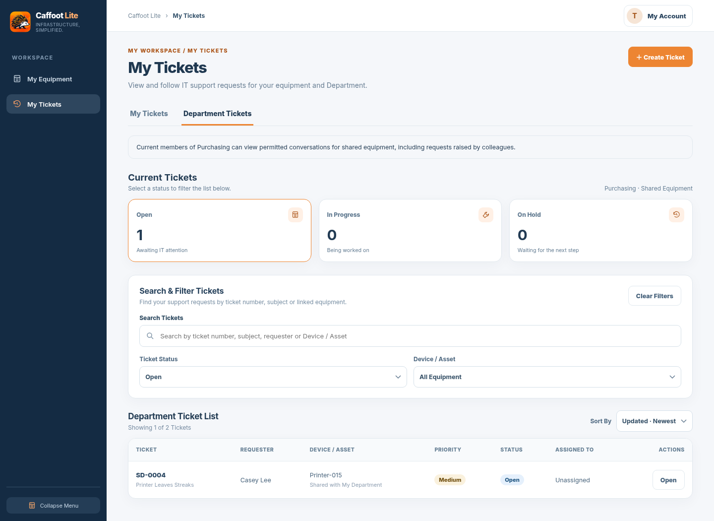
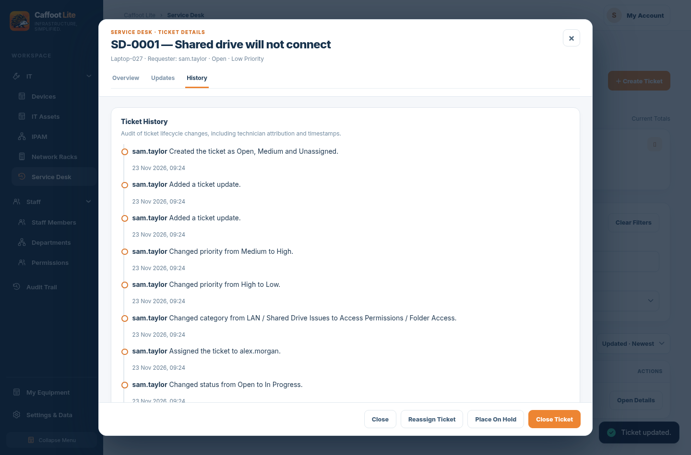
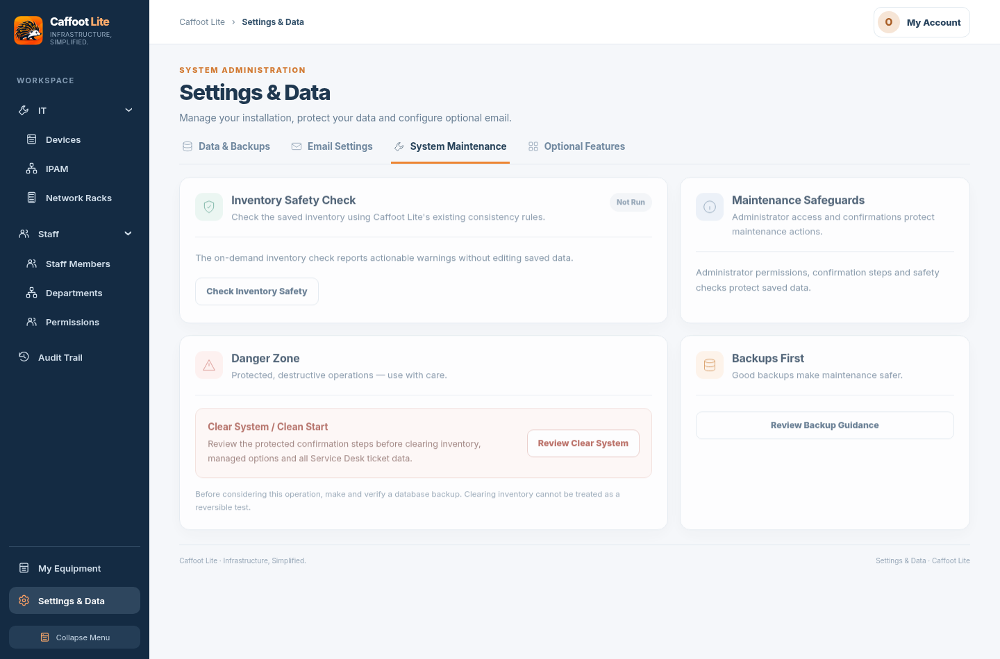

# Administer Service Desk Access And Data

> **Draft v2.2 — Unreleased.** This guide covers access to the employee **My Tickets** and **Department Tickets** views, the authorised **IT → Service Desk** queue, and the effect of equipment changes on stored tickets and files.

## Verify Employee Access

1. In **Staff → Staff Members**, open the employee’s record and check that it is active and linked to the correct enabled sign-in account. Review **Department** if the employee needs shared equipment. Keep the account’s existing sign-in and MFA requirements. [Staff Members](Staff-Members.md)
2. Verify the real equipment’s current assignment. Assign a personal Device to the employee, or shared equipment to the Department, through the existing equipment workflow where appropriate. Check that **Devices** or **IT Assets** is enabled for that equipment. [Device Assignments](Device-Assignments-and-My-Equipment.md) · [Optional Features](Optional-Features-and-Link-To-IPAM.md)
3. Ask the employee to sign in as themselves and open **My Equipment**. Confirm the item appears under **Assigned to Me** or **Shared with My Department**. Choose **Report A Problem** and check that **Create Ticket** opens with the equipment selected. Choose **Cancel** to leave the records as they were.
4. In **My Tickets**, check the appropriate tab and use **Clear Filters** to include Closed tickets. If you are testing a Department assignment, have a current member check an eligible ticket raised by a colleague or by IT. Compare the result with your authorised technician view. The employee can read shared updates and permitted files for that assignment. Internal notes and their files are visible in the authorised IT view.
5. For a returning problem on an eligible Closed ticket, the current assigned employee or any current member of the assigned Department can use **Reopen Ticket**. Confirm that it returns to **Open** and keeps its number, technician and closure history. **Reply To IT** and uploads become available after the reopen. Assigning, closing, changing priority and correcting categories require technician access.

An employee needs no general inventory, directory or Service Desk grant for these personal views. An active linked Staff record lets the employee open **My Tickets** while an equipment feature is enabled. Current assignment determines which tickets and options appear. If the equipment picker is empty, correct a genuine assignment through the existing workflow where appropriate. [Employee instructions](Service-Desk-Tickets.md#raise-a-support-request)

*Verify the view using an employee’s signed-in account. The Department name identifies the active shared audience.* [Capture details](../../../development-handovers/evidence/employee-service-desk/README.md)

## Give A Technician Access

Sign in as an administrator using your authenticator. Check that the prospective technician has an enabled account and the required access to the equipment they support. Devices and IT Assets have independent feature switches and permissions.

1. Open **Staff → Permissions → Manage Roles**. Select **Manage** beside the role you want to change. To grant access to just one authorised person, open them from **User List** and review their section permissions instead.
2. Find **Service Desk**. Choose **Read** for someone who may review the technician queue or **Edit** for someone who may record technician actions. Review their effective **Devices** and **IT Assets** access as well. Each ticket is subject to its equipment section's enabled state and effective Read permission.
3. Review the proposed changes and the accounts affected. The IT Staff role was assigned automatically during an earlier upgrade, so check the actual list before granting access to the whole role. Use an individual grant if the role has members who should have employee access only.
4. Confirm the change when the preview is correct or cancel it to keep the current permissions. Review any individual **No Access** override if an expected inherited permission is missing. The application applies its existing account, MFA and session rules to the change.

Ordinary Staff use equipment-scoped access through their Staff account link. They need no Service Desk, general inventory or Staff Directory grant for that access. The separate Service Desk permission governs the wider technician queue. [Roles, Section Permissions And MFA](Roles-Section-Permissions-and-MFA.md) · [Optional Features](Optional-Features-and-Link-To-IPAM.md)

*The Service Desk permission uses the existing per-account controls. Captured from the draft v2.2 application with fictional data.* [Capture details](../../../development-handovers/evidence/service-desk-foundation/README.md)

## Verify A Technician’s Access

1. Ask the technician to sign in with their own account and open **IT → Service Desk**. With at least one authorised equipment section they should see **Current Workload** and **Ticket Queue**. The queue begins with Open tickets.
2. With **Read**, check that the technician can open **Overview**, **Updates** and **History** and download an authorised attachment. **Create Ticket** and the edit and technician action controls require **Edit**.
3. With **Edit**, open a ticket for the equipment section they support. Confirm they appear as an eligible technician in **Assign Ticket** for that section, unless they are already the assignee. A technician who can support Device tickets may have different permissions for IT Asset tickets.
4. To remove the grant, review their role and individual override, preview and confirm the change. To revoke account access, use the established account controls. Refresh any open screen and confirm that a saved ticket URL or download link now follows the new permissions.

When troubleshooting, check the effective role and individual override, account status, MFA, the equipment feature switch and the equipment section’s Read access. The Service Desk uses the existing permission model and the Devices and IT Assets switches.

## Handle Ticket Files And History

1. Tell technicians to check the audience before attaching files. Files on the original report follow the verified equipment assignment. The **Updates** composer starts internal, and files inherit each update’s visibility.
2. Select a filename in **Ticket Details → Updates** to download it. The server rechecks the signed-in account, equipment access, ticket scope and parent message on every request. A saved link does not grant access.
3. With Service Desk Edit, choose **Remove** beside an attachment and confirm **Remove Attachment**. The file is removed from the ticket’s retained quota. The attributed removal appears in the ticket’s **History**, under the visibility of the parent message. A file already downloaded or captured in a backup can still exist in that copy.
4. Use the organisation’s rules for offline handling and backups. Files are stored with the database. Caffoot Lite checks file contents and sizes and serves them as downloads. Malware scanning is scheduled outside this milestone.

Up to 10 MB is allowed per file and 100 MB retained per ticket. If two technicians upload at the same time and their combined files would exceed the limit, only the first update that fits is saved. The rejected technician can retry after reducing the selection or after an authorised removal. [Technician instructions](Service-Desk-Tickets.md#add-a-note-share-an-update-or-manage-files)

*The integrated Ticket History records the author, time and action. Internal history remains within authorised IT access.* [Capture details](../../../development-handovers/evidence/it-service-desk/README.md)

## What Happens to Service Desk Tickets When Equipment Changes Hands

Caffoot Lite records the equipment and its assignment when a ticket is raised. The original Device or IT Asset keeps its identity as it changes hands. Authorised IT can still review the ticket, its replies, attachments and attributed history under the equipment's section permissions.

After a transfer, **My Tickets** shows eligible tickets from each employee’s current personal assignment. **Department Tickets** uses the current membership and the Department’s current equipment assignment. The ticket number and all original records remain in **IT → Service Desk** for technicians with access.

| Change | Worked example |
| --- | --- |
| Person to Department | Alex returns a scanner which is then assigned to Reception. Alex's earlier personal ticket goes out of employee views. Reception members can see employee-visible tickets raised for the scanner under Reception's assignment. |
| Department to Department | Payroll's printer moves to Finance. Payroll's earlier printer conversations become IT-only. Finance can see eligible conversations raised for its own assignment. |
| Department to Person | Operations' shared laptop is issued to Priya. The earlier Operations tickets become IT-only. Priya can see eligible tickets from her new personal assignment. |
| Department membership changes while the assignment continues | Asha joins Finance while its printer is still assigned to Finance. She can see employee-visible tickets from that same assignment. A colleague who leaves Finance loses the access they had through its membership. |

Internal notes and the attachments to them stay within IT. If a previously returned Device goes back to the same person or Department, tickets from that earlier equipment assignment stay with IT. A quantity-stock correction that restores the outstanding balance after a full return follows the same privacy boundary. The earlier ticket stays with IT and an eligible current holder may raise a new one. [Device Assignments And My Equipment](Device-Assignments-and-My-Equipment.md) · [Correct Movement](IT-Assets-Correct-Movement.md)

## Check Affected Software And Category Corrections

1. On a Laptop or Desktop, check the recorded installed applications in the Device’s existing details if an employee expects to see an application. **Affected Software (Optional)** appears in employee **Create Ticket** after they select **Software / Applications** and an eligible Device.
2. In **IT → Service Desk**, open the submitted ticket and check **Affected Software** in **Overview**. The label records what the employee selected at the time of submission. Employees can leave it blank or choose **Other / Not Listed**.
3. If the ticket needs a different category, a technician with **Service Desk Edit** uses **Edit** next to **Ticket Category**, selects the applicable category and chooses **Save**. **Cancel** leaves the saved category and software selection in place. An incompatible category clears the current software field. **History** retains the former category and affected software together with the correcting account and time.

Changing a ticket’s category does not edit the Device’s installed application records. [Technician classification steps](Service-Desk-Tickets.md#review-and-correct-ticket-details)

## Keep Ticket-Linked Equipment During Deletion Or Import

1. Use the existing Devices workflow for ordinary Device deletion. A Device with retained tickets has a protected history. If Caffoot Lite rejects the deletion, keep the Device record and use the appropriate retirement or equipment workflow where applicable.
2. Before confirming a supported legacy inventory import, check that it includes the current records for all ticket-linked Devices. A compatible import keeps each matching Device in place, including its identity and ticket history.
3. If the import would remove a ticket-linked Device or replace it with a different record, the confirmation is rejected. Review the source and retain the required original records before attempting another import. The rejected import leaves the saved inventory and tickets intact.

Use the normal legacy export review and confirmation steps. A supported inventory import operates on inventory records. Recovery of Service Desk data uses the database or volume backup. [Inventory And Migration](../../../development-guide/05-Inventory-and-Migration.md)

## Clear Operational Data With Clean Start

Clean Start returns Caffoot Lite to an empty operational starting point. Before using it on an installation you need to keep, make and verify your database or volume backup. Use a disposable installation for practice.

1. Sign in as an administrator using MFA. The existing requirement for enabled **Devices**, **IPAM** and **Racks** with Edit access still applies.
2. Open **Settings & Data → System Maintenance**. In **Danger Zone**, select **Review Clear System**.
3. Read the confirmation and the backup guidance. Choose **Cancel** to leave the data in place.
4. Choose **OK** only when you intend to remove the installation's operational records. After a successful reset, review the empty inventory and the reset entry in central **Change History**.

| Area | What Clean Start clears |
| --- | --- |
| Devices, Racks and IPAM | Devices, rack contents, subnets, VLANs and IP allocations. |
| IT Assets and equipment custody | Stock, stock units, movements and corrections, assignments, returns, handovers and equipment associations. |
| Staff and Departments | Departments, membership, operational Staff details and directory entries without a login. Linked Staff identities and their existing eligibility are retained for sign-in accounts. Their names and email are restored from the retained account profile. |
| Suppliers, Purchasing and lifecycle | Suppliers, locations, contacts, notes, issues and updates, equipment and receipt associations, and per-Device lifecycle records. |
| Service Desk | Tickets in every status, replies, internal notes, stored attachments, status and assignment events, and all closure and reopening attempts. |

The reset restores the standard inventory options, category lists and lifecycle defaults. User accounts, roles, permission overrides, sign-in safeguards, Optional Features choices and central **Change History** are retained. The central reset entry records the action without copying ticket contents.

The reset is one database operation, including attachments. An error rolls back the entire operation. Equipment assignments and returns are part of the reset. Ordinary deletion and legacy inventory import continue to protect referenced equipment. [Device Assignments And My Equipment](Device-Assignments-and-My-Equipment.md)

*System Maintenance shows the reset scope before you open the confirmation.* [Capture details](../../../development-handovers/evidence/service-desk-foundation/README.md)

## Check Access When Something Looks Wrong

| Symptom | What to check |
| --- | --- |
| Technician has Service Desk permission but cannot see an equipment ticket | Confirm the account is active, the required MFA is enrolled, and the equipment section is enabled with effective Read access. |
| Staff Member cannot see a personal or shared ticket | Verify their linked Staff record, current Department, current equipment assignment and the equipment feature. Inspect the ticket under technician access before assuming it was removed. |
| A ticket appears in IT history only after an equipment move | The ticket may belong to an ended assignment. Current assignment access starts with eligible tickets for that assignment. |
| Clean Start is rejected | Review the confirmation and administrator permissions first. If the reset reports a database error, the operational records are still available. |

For employee-facing explanations, see [Service Desk Tickets](Service-Desk-Tickets.md). For source and test coverage, see [Service Desk Foundation](../../../development-guide/Service-Desk-Foundation.md).
