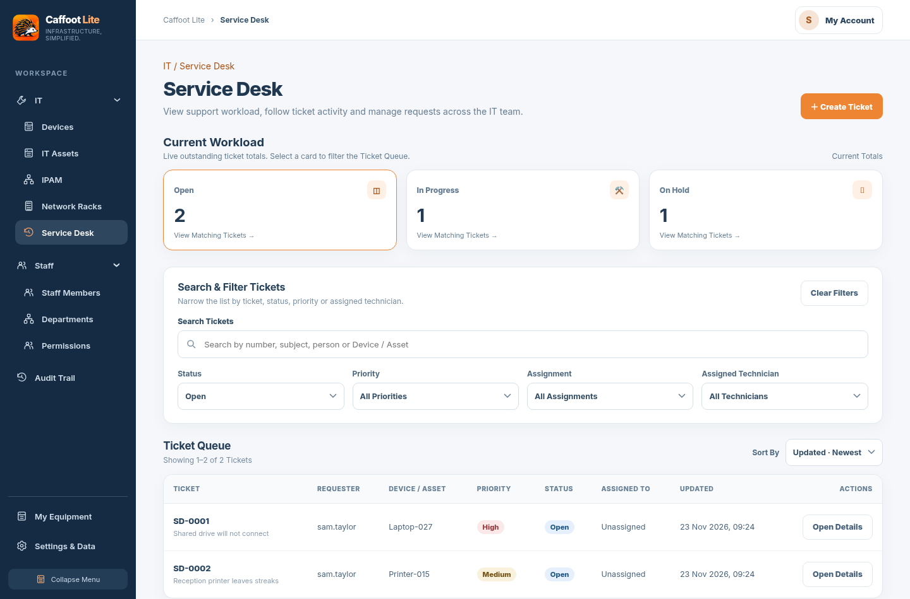
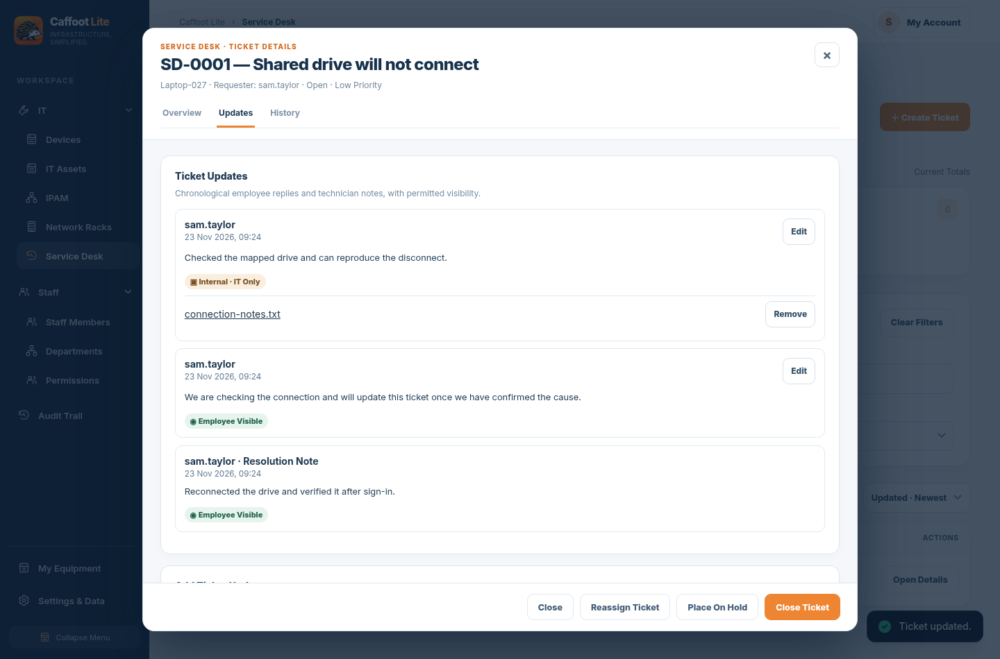

# Service Desk Tickets

> **Draft v2.2 — Unreleased.** Use **IT → Service Desk** to handle support requests if you have technician access. Staff without technician access can check their equipment in **My Equipment** and contact their organisation’s IT team. The employee ticket screens are planned for a later batch.

## Check Which Equipment Is Assigned To You

A service ticket records a problem or a piece of support work on an existing Device or IT Asset. A laptop might be assigned directly to you, while a shared printer might be assigned to your Department.

1. Sign in with the account linked to your Staff Member record. Complete any MFA that your account requires.
2. Open **My Equipment**. Check **Assigned to Me** for your own equipment and **Shared with My Department** for equipment held by your current Department.
3. Check that the item in the list is the one you use. If it is missing, ask IT to check its assignment, your Staff account link and your Department membership. IT can arrange a genuine assignment if appropriate.
4. Follow your organisation’s existing procedure for contacting IT. Include the equipment name and a short description of the problem.

For examples of directly assigned and shared equipment, see [Device Assignments And My Equipment](Device-Assignments-and-My-Equipment.md) and [Departments And Shared Equipment](Departments-and-Shared-Equipment.md).

## Who Can See A Ticket?

| Equipment assignment | Employee ticket visibility |
| --- | --- |
| Assigned directly to you | You can see eligible employee-visible tickets from your current personal assignment in **My Tickets**. |
| Assigned to your current Department | Verified current members of that Department can see eligible employee-visible content for the current assignment in **Department Tickets**. A ticket you raise for shared equipment appears in the Department view. |
| Unassigned or assigned to someone else | An authorised IT technician can handle the ticket within their equipment permissions. |

A new Department member can see eligible conversations from the same ongoing Department assignment. If you leave that Department, access through its membership ends, including access to tickets you raised there. IT keeps the ticket history. Internal notes, internal hold explanations and attachments to internal messages are restricted to authorised technicians.

For example, if Alex's loan laptop is handed to Reception, the ticket Alex raised while holding it stays with IT. Reception can see eligible tickets raised under its own assignment. If Priya joins Reception while its shared printer stays with Reception, she can see eligible conversations for the printer's current assignment. [Equipment handover examples](Service-Desk-Administration.md#what-happens-to-service-desk-tickets-when-equipment-changes-hands)

## How A Ticket Moves Through Support

A ticket begins **Open**, with **Medium** priority and **Unassigned** technician. The equipment assignment identifies who uses the equipment. The technician assignment identifies who is handling the ticket.

| Status | What it means |
| --- | --- |
| **Open** | The issue is available for IT to review. A reopened ticket returns to this status and keeps its earlier history. |
| **In Progress** | A technician has been assigned to handle the issue. |
| **On Hold** | IT has recorded why work is paused. The employee-visible reason may help you understand what is needed. |
| **Closed** | IT has recorded a resolution note. Each closure is kept with its own date and technician. |

The reply facility uses the current ticket's audience. For a Department ticket, write replies with your current Department colleagues as well as IT in mind. A Closed ticket must be reopened before adding a new employee reply. The employee who raised it can reopen it while they still have access. An authorised technician can also reopen it.

## When Equipment Or A Ticket Is Missing

- **The equipment is missing from My Equipment.** Ask IT to check the genuine equipment assignment and confirm which Staff Member and Department are linked to your account. A disabled equipment feature can temporarily hide its records.
- **A colleague can see a shared ticket that you cannot.** Ask IT to check your current Department membership and the equipment's assignment. The ticket may belong to a previous equipment assignment.
- **An attachment is unavailable.** A download follows the visibility of its message and your current access to the ticket. Ask IT to check the conversation if you still need the file.
- **The equipment was returned or moved.** Earlier conversations stay available to authorised IT. A new problem under an eligible new assignment can have its own ticket.

## Find Tickets In The IT Queue

Sign in with **Service Desk Read** or **Edit**. You also need Read access to **Devices**, **IT Assets**, or both, with the corresponding optional feature enabled. A ticket is visible only through the section that owns its equipment. Ask an administrator to check your effective access if the page or expected tickets are missing. [Access and permissions](Service-Desk-Administration.md#give-a-technician-access)

1. Expand **IT** in the sidebar and select **Service Desk**. **Ticket Queue** initially shows **Open** tickets.
2. Select **Open**, **In Progress** or **On Hold** under **Current Workload** to select that status, clear the Assignment filter and jump to the matching part of the Ticket Queue. The cards show totals for your authorised scope, even while a search narrows the table.
3. Enter a ticket number such as `SD-0001`, subject, requester or equipment name in **Search Tickets**. Use **Status**, **Priority**, **Assignment** or **Assigned Technician** for a more specific view. **All Tickets** includes Closed tickets. **Assigned To Me** uses your signed-in account.
4. Use **Sort By** to order the results by newest update, oldest update or descending ticket number. Use **Previous** and **Next** when the results span more than one page. On a narrow screen, scroll the table horizontally to reach all eight columns.
5. Select a ticket number or **Open Details**. **Clear Filters** restores the default Open queue and newest-first sort.

*Current Workload and the Open Ticket Queue, shown with fictional equipment and support requests in the draft application.* [Capture details](../../../development-handovers/evidence/it-service-desk/README.md)

## Create An Equipment Ticket

You need **Service Desk Edit** and access to the Device or IT Asset you want to select. For example, if the Reception printer leaves streaks, use the existing **Printer-015** record.

1. Open **IT → Service Desk → Create Ticket**.
2. Select the real **Device / Asset**. For an issued stock item with multiple current issues, select the entry for the correct recipient and issue. A Device registered from stock uses its Device record.
3. Select one **Ticket Category**. The field starts empty. Use **Other / Not Listed** if none of the listed categories applies.
4. Enter a **Subject** such as *Reception printer leaves streaks*. In **Description**, record what happened and how to reproduce it. The subject can contain up to 200 characters and the description up to 16,000.
5. Optionally add supporting files using **Attachments (Optional)**. The original request and its files follow the equipment’s verified assignment. Check the files for information that the authorised employee audience should not see.
6. Select **Create Ticket**. A successful ticket appears in the Open queue with **Medium** priority and an **Unassigned** technician. **Cancel** or **Close Ticket Window** discards the form without creating a ticket.

If the equipment disappears or the category is unavailable, reopen the form and select a current option. Ask IT to correct an equipment assignment rather than choosing a different item. If the server rejects a file, change the selection and submit again. The form saves the ticket and its files together.

*The integrated Create Ticket form starts with no category selected.* [Capture details](../../../development-handovers/evidence/it-service-desk/README.md)

## Review And Correct Ticket Details

1. Open a ticket. **Overview** shows its status, category, priority, technician, linked equipment, requester and original problem.
2. With **Service Desk Edit**, choose **Edit** beside **Ticket Category** or **Priority** in **Ticket Information**. Select an available category or **Low**, **Medium** or **High**.
3. Choose **Save** to record the correction in **History**. **Cancel** leaves the saved classification in place.
4. Open **Updates** for the conversation and **History** for attributed changes. Use **Close** or Escape to dismiss the details window.

If a colleague changes the ticket while a technician action is open, the application reloads the current details and shows a conflict message. Review the latest status or classification before trying again.

*Overview presents the three tabs and groups technician actions in the footer. Priority and category are corrected within Ticket Information.* [Capture details](../../../development-handovers/evidence/it-service-desk/README.md)

## Assign, Pause, Resolve Or Reopen A Ticket

An authorised technician can update or close tickets handled by a colleague. Actions retain the account that performed them.

| Action | Steps and result |
| --- | --- |
| **Assign Ticket** | Open an Open ticket, select **Assign Ticket**, choose yourself or another eligible technician in **Assign To**, and confirm. The status moves to **In Progress**. |
| **Reassign Ticket** | Select **Reassign Ticket**, choose a different technician, select a **Reason For Reassignment**, and optionally add an explanation. Confirm to save it. The reason and explanation stay within IT. Assigning a reopened Open ticket moves it to **In Progress**. |
| **Place On Hold** | Choose **Place On Hold** on an Open or In Progress ticket. Select **Waiting for User**, **Waiting for Supplier**, **Waiting for Parts** or **Other**. The reason is employee-visible. If you add an explanation, select **Make Explanation Visible To Employee** only if the authorised audience should see it. Confirm **Place On Hold**. |
| **Resume Ticket** | Open an On Hold ticket and choose **Resume Ticket**. Check the status shown in the confirmation. Confirm to restore the exact previous status, **Open** or **In Progress**. Resume first if you intend to close the ticket. |
| **Close Ticket** | Select **Close Ticket** and enter a meaningful **Resolution Note**, for example *Reconnected the mapped drive and verified it after sign-in*. Confirm **Close Ticket**. The note is employee-visible and the closure is recorded as a separate resolution attempt. |
| **Reopen Ticket** | Open the Closed ticket, choose **Reopen Ticket**, and confirm. It returns to **Open** with the same ticket number, previous technician and all earlier closure attempts. |

Use **Cancel** to return to details before submitting. If a reason or resolution note is missing, complete the required field. If your technician no longer appears, check their active account, MFA and equipment access with an administrator.

## Add A Note, Share An Update Or Manage Files

1. Open **Ticket Details → Updates**. The conversation shows the author and time of each update. **Employee Visible** and **Internal · IT Only** identify who can read it.
2. Under **Add Ticket Update**, enter a message. Leave the visibility box clear for an internal note such as a technician’s troubleshooting observations. Select **Make Update Visible To Employee** deliberately for a response such as *We have ordered the replacement part*.
3. Add optional supporting files and select **Add Update**. Files inherit the visibility of that update. A Closed ticket accepts an internal note. Reopen it to send an employee-visible update.
4. To correct a note you wrote, choose **Edit**, revise the text and choose **Save Correction**. History retains the previous text for authorised IT. Resolution Notes remain with their original closure attempts.
5. Select a file name to download the attachment. With Edit access, choose **Remove** next to a file, then **Remove Attachment**. The file stops downloading and **History** retains the attributed removal. **Cancel** leaves it attached.

Files must be genuine PNG, JPEG, PDF, TXT, DOCX or XLSX. Each file may be up to **10 MB**, with **100 MB retained across the ticket**. If a file is rejected, check its actual format and size. If the total is full, remove a file you are authorised to remove, or send the update without attachments. If a download fails, the file may have been removed or your access may have changed.

*Visibility labels identify which conversation and files an authorised employee can access.* [Capture details](../../../development-handovers/evidence/it-service-desk/README.md)

## Find A Ticket From Equipment

- In **IT → Devices → Device Inventory**, open the Device and look for **Linked Tickets** in **Overview**. Select the ticket to open its details. Closing the ticket returns you to the Device.
- In **IT → IT Assets → Stock Inventory**, open the stock item and find **Linked Tickets** in **Stock Item Details**. Individually tracked stock can show tickets for its non-Device units. For equipment registered as a Device, use the Device’s own details.
- If you have equipment access but lack Service Desk Read, the linked-ticket panel is hidden. If the panel is empty, check the canonical equipment record before asking an administrator to review access.

The [administrator guide](Service-Desk-Administration.md) covers access, historical privacy and retention.
