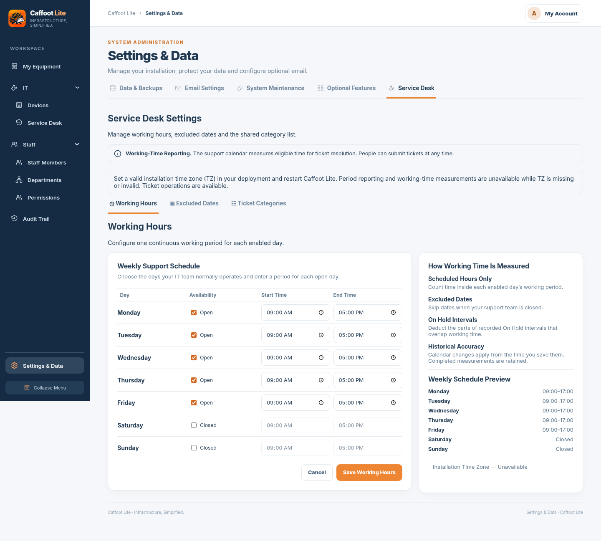

# Set The Service Desk Time Zone

> **Draft v2.2 — Unreleased.** Use these instructions on an authorised v2.2 review installation. For the published v2.1 release, use its [installation guide](../../../../INSTALLATION.md).

> **Documentation Batch 6:** source-inspected at `fdc677920bfc52f48f641b3d6d1344c902a6a9b0` (schema 31). Focused independent reviews are recorded and [owner written/source acceptance of Batches 1–6](https://github.com/Caffoot/Caffoot-Lite/issues/366#issuecomment-7200681167) is recorded. Current visual/privacy/caption/alt approval remains outstanding; [Batch 7 reconciliation and proposed capture packs](../../../development-guide/Milestone-01-Batch-7-Review.md) await independent review and owner acceptance. Capture scope and method need separate authorisation. Desktop capture remains deferred. [Evidence states and screenshot record](../../../development-guide/Milestone-01-Batch-6-Review.md). These are current draft instructions, not newly executed deployment checks.

The Service Desk uses one installation time zone for working hours, excluded dates and reporting dates. A named time zone follows local clock changes automatically. Ticket creation, updates and the live queue remain available while the time zone needs attention.

## Before You Start

- You need permission to edit the existing Portainer stack or Compose configuration. You also need a Caffoot Lite administrator account to verify the setting in the app.
- Find the name for your organisation in the [IANA Time Zone Database](https://www.iana.org/time-zones). Ask whoever manages your server if you are unsure of the right zone. `Europe/London` is an example for the UK. Choose the zone where your support calendar operates.
- Use [draft Installation](Installation.md) for a new isolated review instance. For existing data, record the original matching image/configuration and protect a complete stopped backup before changes that need recovery. Do not replace an existing stack with a new-install template.
- Identify the current stack or Compose project and the existing mount ending in `:/data`. That mount holds the SQLite database and your accounts. Keep the same project, mount, image or build source, HTTPS address, server address, ports and network settings when changing the time zone.

## Update A Portainer Stack

1. In Portainer, open **Stacks** and select your existing Caffoot Lite stack.
2. Open **Editor** and find the Caffoot Lite service beneath `services`. Inside its existing `environment` mapping, add or replace the `TZ` entry at the same indentation as the other environment entries. This line is a **UK example only**.

   ```yaml
   TZ: "Europe/London"
   ```

3. Check that there is one `TZ` entry and that the current `volumes` mapping still points to the same `/data` storage. Check the existing addresses, ports and networks.
4. Keep the verified current image; a time-zone correction does not need a new public image or a fresh volume. Use **Update the stack** to apply the edited configuration. For a Git-managed stack, make the equivalent edit in its actual source and apply it using the stack’s existing update method. The service may be briefly unavailable while the container is recreated.
5. Use [Check The Result](#check-the-result) after Caffoot Lite comes back.

The [draft Portainer example](portainer-v2.2-draft.yaml) shows where `TZ` goes. Its empty entry is intended for you to edit. The example takes an authorised private review image through `CAFFOOT_V22_PREVIEW_IMAGE`.

## Update A Docker Compose Installation

1. On the Docker host, open the directory from which you normally manage the existing Caffoot Lite Compose project.
2. In the Compose file that actually defines the Caffoot Lite service, add or replace `TZ` inside that service’s existing `environment` block. Match the indentation of the other environment entries. This line is a **UK example only**.

   ```yaml
   TZ: "Europe/London"
   ```

3. Check that you have retained your existing `/data` mapping, project name, addresses, ports and networks. Run `docker compose config --quiet` from the same project directory to validate the YAML, using the same `-f` or `-p` options you normally use.
4. Apply the change with `docker compose up -d`, keeping those same project and file options. Compose recreates the service with the updated environment. Restarting the existing container alone keeps its old environment.
5. Use [Check The Result](#check-the-result) after Caffoot Lite comes back.

For a separate review checkout, the [draft Docker Compose example](compose-v2.2-draft.yaml) shows the empty, editable `TZ` entry next to the existing environment and storage settings.

## Check The Result

1. Sign in to Caffoot Lite with your administrator account and authenticator.
2. Open **Settings & Data → Service Desk → Working Hours**. Under **Weekly Schedule Preview**, check that **Installation Time Zone** shows the IANA name you entered. A warning at the top of the settings panel means the app could not apply a valid zone.
3. Open **IT → Service Desk**. Check that **Service Desk Activity** can show period totals and **Technician Activity** again. The average may still be unavailable for a period containing a closure with incomplete working-time history. See [how the dashboard presents each case](Service-Desk-Tickets.md#read-service-desk-activity).



*Set a valid IANA zone in the deployment configuration and recreate the service to clear this warning.* [Capture details](../../../development-handovers/evidence/service-desk-reporting/README.md)

## Automatic Clock Changes And Effective History

Working Hours and Excluded Dates use the chosen installation-wide zone, not each employee's browser zone. IANA rules handle daylight saving automatically; do not manually move the weekly opening times when clocks change. Under the UK example `Europe/London`, Sunday 01:00–03:00 includes **one actual eligible hour in spring** and **three in autumn**. Sunday 01:30–02:30 includes **30 eligible minutes in spring** and **90 in autumn**: each real occurrence of the repeated eligible part counts. Ordinary weekdays remain as configured.

A valid changed `TZ` takes effect when applied at startup. Earlier known calendar/zone portions and completed measurements remain unchanged. Saved Working Hours/Excluded Dates changes similarly apply prospectively: the approved 10:00 opening, 13:00 calendar change and 18:00 closure gives **3 original + 5 new = 8 hours**, without holds/exclusions. A period with unknown/invalid timezone history cannot be reconstructed after correction; an attempt spanning that interval has no complete trustworthy duration. A new valid setting supports future accounting, not retrospective invention.

No completed closures (**—**), a genuine measured zero (**0h 0m**) and an unavailable/incomplete measurement are distinct. Missing/invalid TZ also makes period counts unavailable while ordinary ticket creation, updates, reopening and live workload continue. [Calendar and reporting examples](Service-Desk-Administration.md#understand-working-time-measurements)

## If The Warning Persists

- Check the exact spelling and capitalisation of the IANA name, the indentation and whether the entry is under the Caffoot Lite service. Check that you edited and updated the actual running stack or project.
- Confirm that you are running the authorised v2.2 review build. Use the same storage mount and installation settings when applying a correction.
- A valid zone takes effect when the application applies it during startup. Eligible elapsed time already measured under known settings is retained. A closure that spans a period whose time zone was unknown has no complete duration. Later corrections allow accurate future measurements, including a new resolution attempt if the ticket is reopened.

See [set working hours and excluded dates](Service-Desk-Administration.md#configure-working-hours) for examples of calendar changes and clock changes.

[Draft Installation](Installation.md) · [Service Desk Administration](Service-Desk-Administration.md) · [Backup and recovery](Legacy-Import-and-Docker-Upgrade.md) · [Draft guides](README.md)
