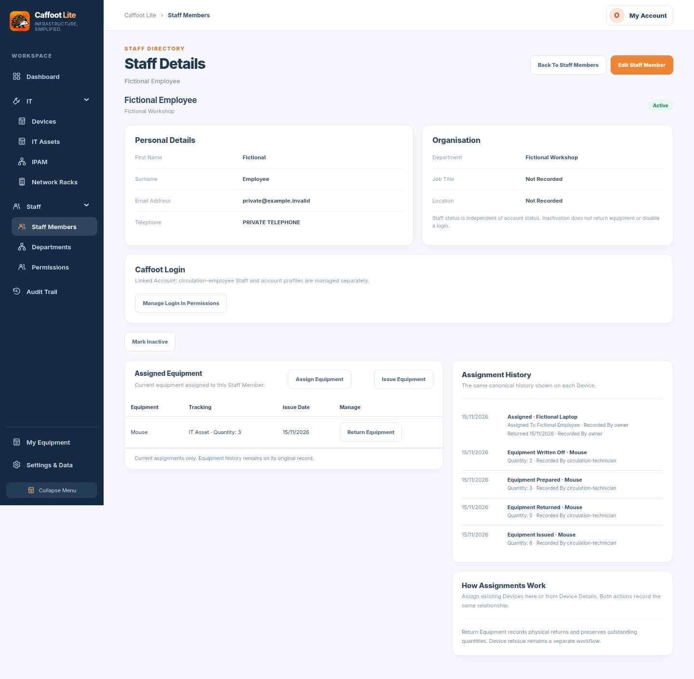

# Staff Members

> **Draft v2.2 — Unreleased.** This guide describes the implementation on `milestone-1` at `753b3266893987addb11406ef8303adb03c3c112`. It is for development review, not production installation, upgrade or restore. Use the [published v2.1 guides](../README.md) for the released application. Native/manual and release acceptance remain separate.

Staff Members is the directory of people who may hold equipment. Use it to record a person's contact details, Department and Staff status, then review their assigned equipment in one place. A person can hold equipment without a Caffoot login.

| Record | Purpose |
| --- | --- |
| Staff Member directory record | The person, optional Department and equipment relationships. |
| Caffoot login | The account used to sign in, with its own profile, password, MFA and access settings. |
| Staff Member role | The baseline security role assigned to ordinary logins. It does not grant access to the Staff directory or general inventory. |

The directory and account can be linked, but changing one does not silently rewrite the other. Department membership grants no application permissions.

## Before You Start

- **Staff Members Read** permits directory viewing. **Staff Members Edit** permits adding people, changing their details and changing Staff status.
- Staff Members and Departments are core sections, subject to permissions. They do not depend on the optional IT Assets switch and need not be populated to use Devices or IPAM.
- Creating a login from a Staff record requires both Staff Members Edit and authorised administrator access. Directory editing rights alone do not permit account administration.
- Devices and IT Assets have independent rights and switches. Read access shows the corresponding equipment on Staff Details; Edit permits its authorised actions. See [Roles, Section Permissions And MFA](Roles-Section-Permissions-and-MFA.md).

Collect known work details before starting. Do not enter passwords, recovery codes or other secrets in directory fields.

## Find A Staff Member

1. Expand **Staff** in the sidebar and choose **Staff Members**.
2. Enter part of the person's name or Department in **Find A Staff Member**. This filters the directory, rather than searching equipment or account usernames.
3. Use **Staff Status** to choose **All Statuses**, **Active** or **Inactive**. Clear the search and check All Statuses if a person seems missing.
4. Choose **View Details** beside the correct person. Check their Department and known details where names are similar.
5. Read **Personal Details**, **Organisation** and, where authorised, **Caffoot Login**. Equipment panels require independent equipment access.
6. Choose **Back To Staff Members** to return to the list.

**No Department**, **No Email Recorded** and **Name Not Recorded** indicate missing details, not necessarily a broken record. Administrators see linked-login information; ordinary directory access does not reveal account security details.

*Approved Batch 3.8 application capture with fictional data. Staff Details separates directory information, login management and equipment history. Equipment panels depend on your access. This historical capture does not illustrate later direct-handover controls.*

## Add A Person Without A Login

1. Open **Staff → Staff Members → + Add Staff Member**.
2. Enter **First Name** and **Surname**. Both are required for a new person.
3. Complete any known optional fields described below.
4. Check **Staff Status**. **Active** permits eligible new equipment assignments; **Inactive** retains a person and their existing relationships without permitting new assignments.
5. Leave **Create Caffoot Login** switched off when no login is needed. A non-administrator cannot enable account creation here.
6. Choose **Save Staff Member**. A successful save opens Staff Details and reports that the Staff Member was saved.
7. Check the saved name, Department and status. Choose **Edit Staff Member** if a correction is needed.

| Field | What to enter or expect |
| --- | --- |
| First Name / Surname | The person's known name. Do not invent names from a username. |
| Email Address | Optional valid contact address. This does not verify or change a linked account's email. |
| Department | One optional active Department, or **No Department**. Departments have no hierarchy. |
| Job Title | Optional description such as Service Coordinator. It grants no security role. |
| Telephone Number | Optional work contact number. |
| Location | Optional directory location. It does not move assigned Devices or change their Location field. |
| Staff Status | The person's directory status, independently of any login's active/disabled state. |

**Cancel** or **Back To Staff Members** leaves the form without saving. If validation rejects a save, correct the displayed problem and try again. A failed save does not leave a partial Staff record.

For a fictional example, create **Alex Morgan**, select **Accounts**, enter `alex.morgan@example.org`, leave Create Caffoot Login off and save. Alex can now receive eligible equipment but has no credentials and cannot open My Equipment. Department membership has granted no application access.

## Create And Link An Optional Caffoot Login

The combined form reuses existing account security and links the login to the person holding their equipment.

1. As an authorised administrator with Staff Members Edit, start **+ Add Staff Member**, or open an existing unlinked person's **Staff Details → Create Login**.
2. Review the Staff details. For an existing person, confirm this is the record holding their equipment.
3. Enable **Create Caffoot Login** if the Create Login action has not already enabled it.
4. Enter a unique **Username**, an **Initial Password** and the same value in **Confirm Initial Password**. Follow the existing [password rules](Roles-Section-Permissions-and-MFA.md).
5. Review the **Staff Member** default-role explanation. Wider roles and individual overrides are managed separately in Permissions.
6. Choose **Save Staff Member**. Staff changes, account creation and their link succeed together. A duplicate username, invalid password or rejected save leaves no unintended partial record/account/link.
7. Check the linked account on Staff Details. Give the person their initial credentials securely and direct them to the [account and MFA instructions](Roles-Section-Permissions-and-MFA.md).

For an already linked record, **Manage Login In Permissions** opens the existing account-management screen. Use it for account status, roles, permission overrides and MFA. Staff editing alone never permits those actions.

The Staff form offers no general merge or relink control for existing accounts. If an account is already linked to a different record, refer the discrepancy to an administrator; do not create a duplicate login or rewrite names to disguise the conflict.

### Existing Accounts And Migrated Details

The Stage 3 implementation creates and links a Staff record for an existing account lacking one, copying available saved first name, surname and email. Unknown details and Department stay blank. Existing valid links and the original account's identity, password, MFA, status, roles and permissions are preserved. This describes implemented data handling, not a production-upgrade instruction.

An older account may appear as **Migrated Record · Details Blank**. Edit that existing linked record when accurate details become available. Migrated blank names can remain during an unrelated edit. Do not recreate an account or invent personal information to remove an empty label.

## Edit Details And Recover From A Conflict

1. Choose **Edit** in the directory, or **Staff Details → Edit Staff Member**.
2. Change the intended directory fields. A Department change updates membership, not a person's equipment holder or a login profile.
3. Choose **Save Staff Member** and check the saved details.
4. If the Staff Member was changed elsewhere, review the message. Your unsaved fields remain available; repeatedly submitting the old form will not resolve the conflict.
5. Note the edits still needed, then choose **Refresh Current Details**. Confirm the warning that this replaces unsaved details, including login fields, with the current saved values.
6. Review the other person's changes, reapply only the required edits and save again.

The saved-version check prevents overwriting a newer edit. Refreshing also updates Department choices after another user changes their status. An existing archived membership can remain during an unrelated edit, but an archived Department cannot receive a new membership.

Staff and linked-account profiles remain separate: changing a directory name, email or status does not silently change an account profile, verified email, password, roles or MFA.

## Mark Inactive Or Reactivate

Staff status and account status are separate. Inactivating a leaver neither disables their login nor records equipment physically coming back.

1. Open **Staff Details** and review **Assigned Equipment** and **Assignment History**, with the necessary equipment access.
2. Choose **Mark Inactive**, read the prompt and confirm. Cancelling the prompt makes no change.
3. Check the **Inactive** badge. The person is excluded from new equipment-recipient choices; outstanding assignments and original dates remain visible to authorised IT users.
4. Resolve equipment through its actual [return/write-off](IT-Assets-Issue-Return-and-Write-Off.md) or [handover](Associated-Equipment.md#reassign-a-workstation-directly) workflow.
5. If login access should end, an authorised administrator must disable the account separately in **Staff → Permissions**.

To restore eligibility, open the inactive person's Staff Details, choose **Reactivate** and confirm. This retains history and does not enable a disabled login. The Staff form's **Staff Status** also changes directory status when saved. The directory offers no permanent-delete action for Staff.

For example, fictional Alex leaves with a laptop and two adapters still recorded against them. Marking Alex Inactive leaves all three outstanding. IT records items actually returned, resolves any missing item through the appropriate Write Off procedure, and separately disables Alex's account. No stock balance increases merely because Staff status changes.

## Work With Equipment

**Assigned Equipment** shows Devices and outstanding IT Assets assigned directly to the person, according to your access. **Assignment History** retains the original relationships and responsible accounts.

With Devices Edit, **Assign Equipment** records an eligible initial Device allocation to an active person. With IT Assets Edit, **Issue Equipment** opens stock issue for them. **Return Equipment** beside outstanding stock remains available for inactive holders. Device returns require both relevant equipment permissions. Follow [Device Assignments And My Equipment](Device-Assignments-and-My-Equipment.md) and the linked stock guides for the full checks.

A linked person opens **My Equipment** for limited personal/shared information without gaining general inventory rights. Changing their Department changes Department-shared visibility on the next request; it does not move personally assigned equipment or reassign the Department's Devices.

## Troubleshooting

| Problem | Check or recovery |
| --- | --- |
| Staff Members is absent | Ask an administrator to check Staff Members access. The baseline role or a directory record alone is insufficient. |
| Create Login is unavailable | Check administrator authority, Staff Members Edit and whether the record already has a login. |
| The initial password is rejected | Follow the password rules, match both entries and check that the username is unused. Retry on the same Staff record. |
| A Department is missing | Check whether it is archived; do not create a duplicate Department. |
| Equipment is absent | Check independent Devices/IT Assets permissions and switches, then the actual holder. A restricted panel does not prove no equipment exists. |
| A leaver can still sign in | Ask an administrator to review account status. Staff inactivation does not disable the login. |
| The connection fails during save | Reopen the record to establish what was saved before retrying. A missing success message does not prove failure. |

## Related Guides And Acceptance Items

- [Roles, Section Permissions And MFA](Roles-Section-Permissions-and-MFA.md)
- [Departments And Shared Equipment](Departments-and-Shared-Equipment.md)
- [Device Assignments And My Equipment](Device-Assignments-and-My-Equipment.md)
- [Issue, Return And Write Off](IT-Assets-Issue-Return-and-Write-Off.md)

The reused image belongs to the [owner-approved Batch 3.8 application captures](https://github.com/Caffoot/Caffoot-Lite/pull/389#issuecomment-6908629303). Current approved Add/Edit and login-form illustrations remain documentation acceptance items; functional HTML previews are not screenshots. The Staff form retains an older hint saying returns are unavailable, although Return Equipment is implemented. Correcting that application hint requires separate application work.

[← Draft v2.2 Guides](README.md) · [Published v2.1 Guides](../README.md)
