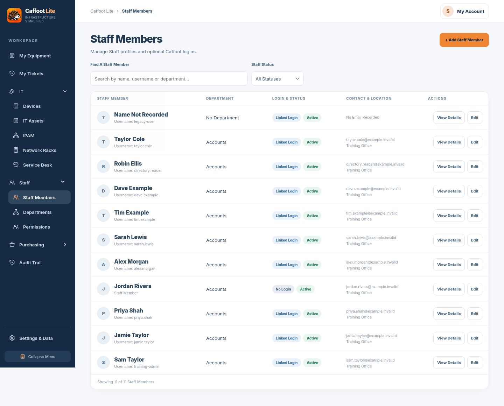
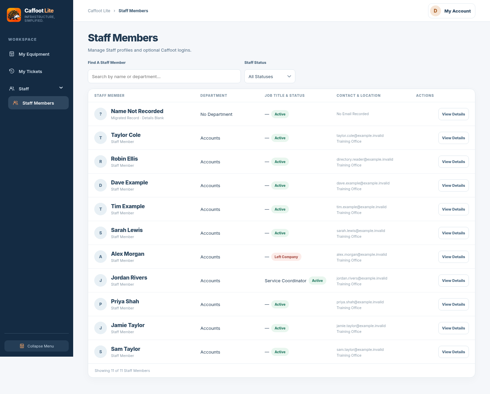
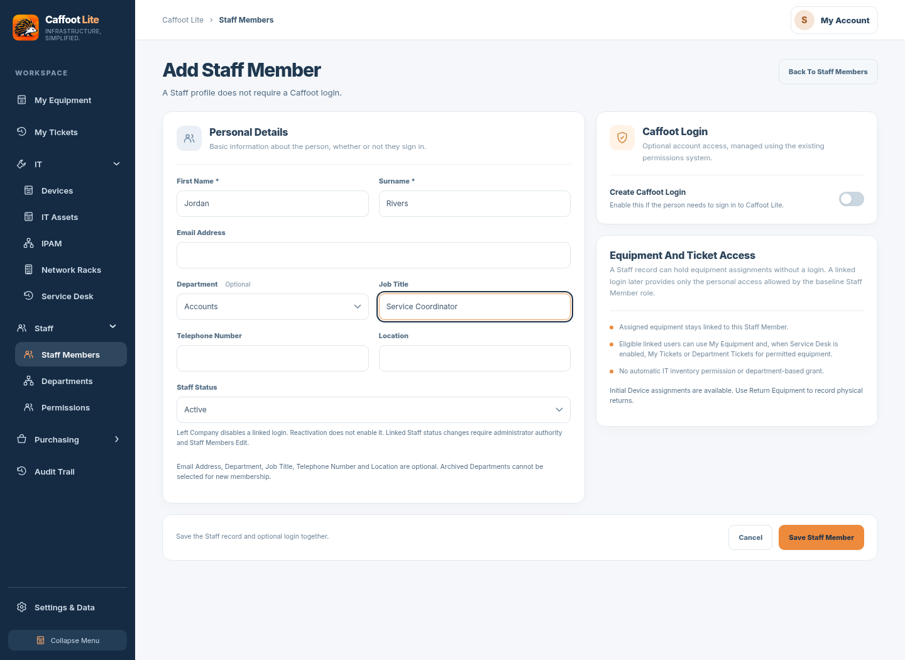
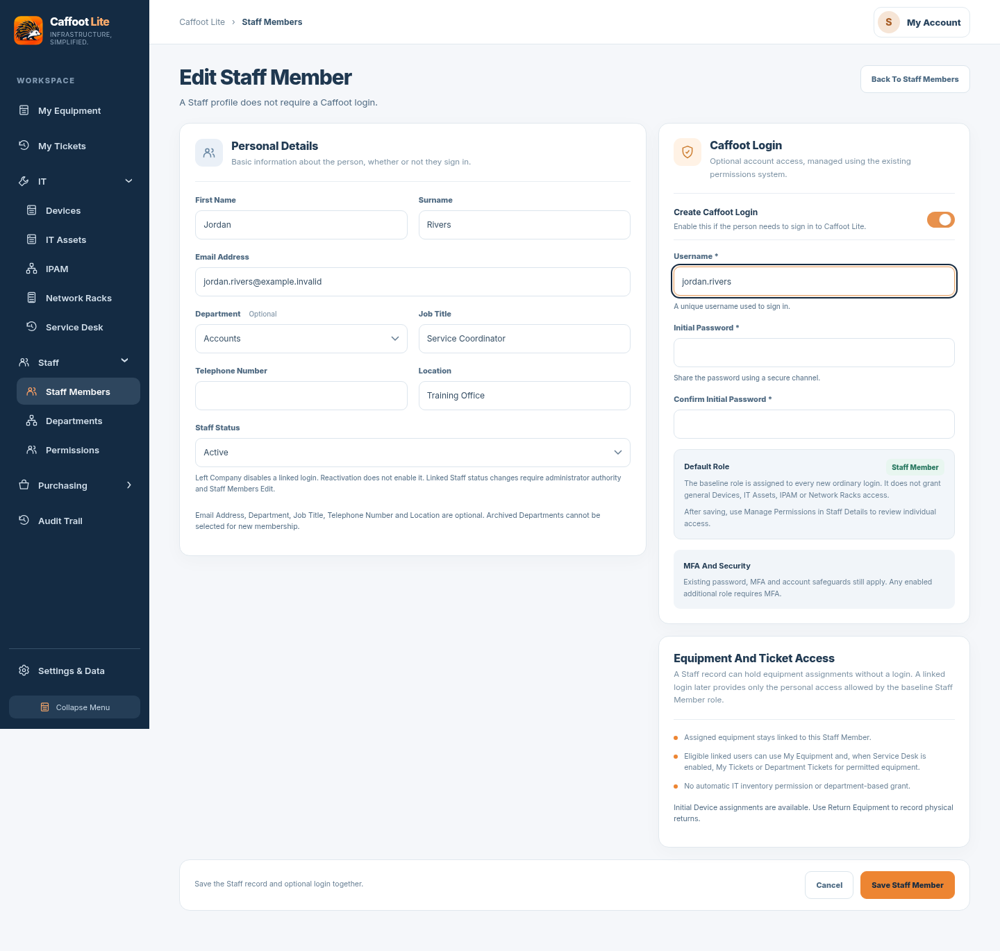
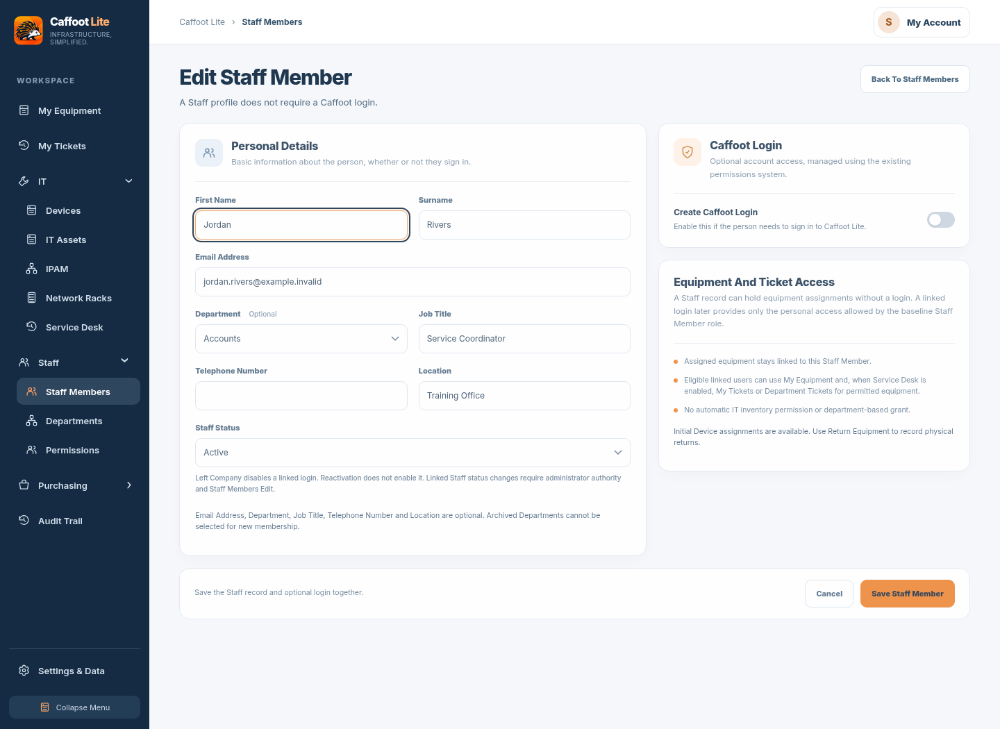
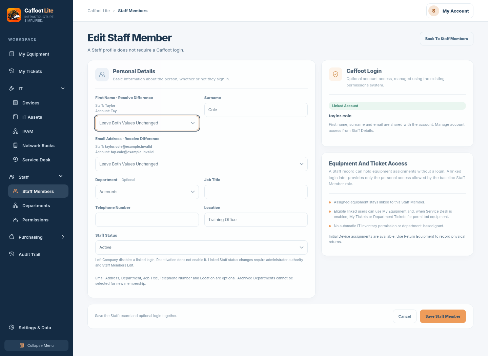
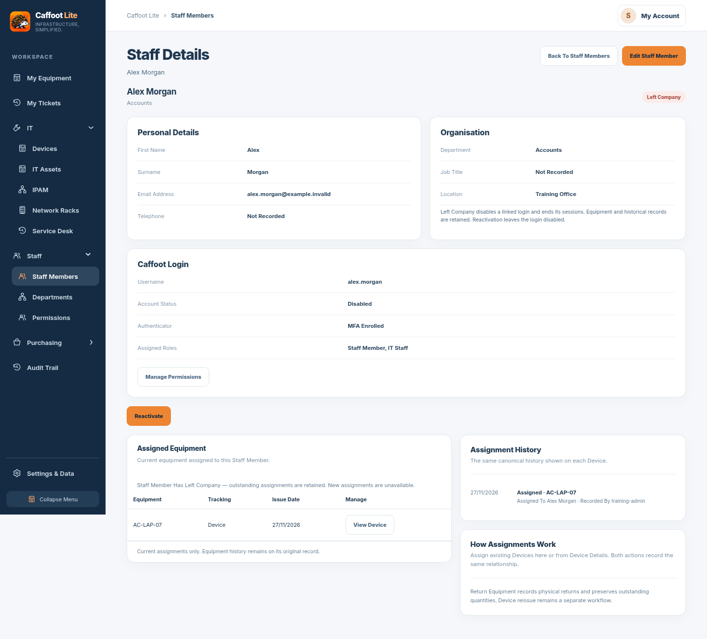
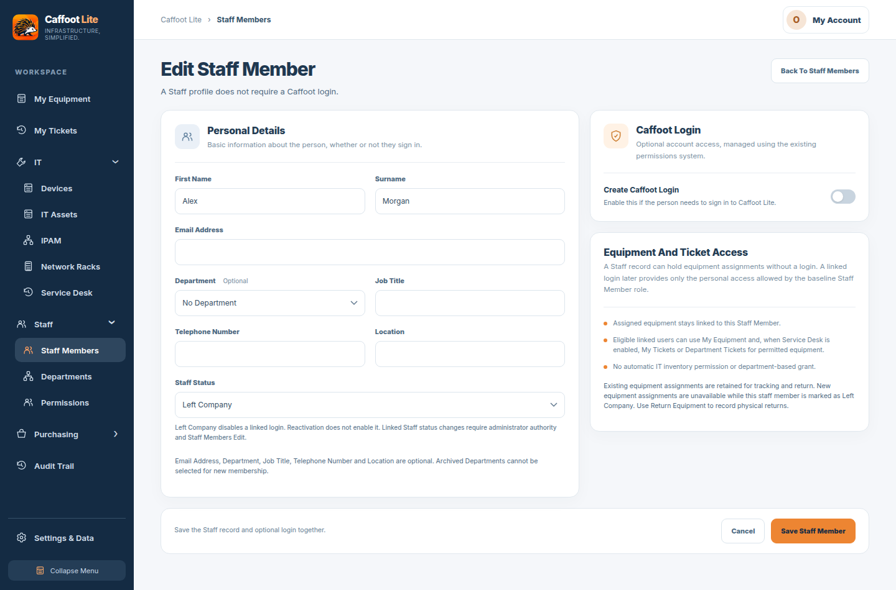
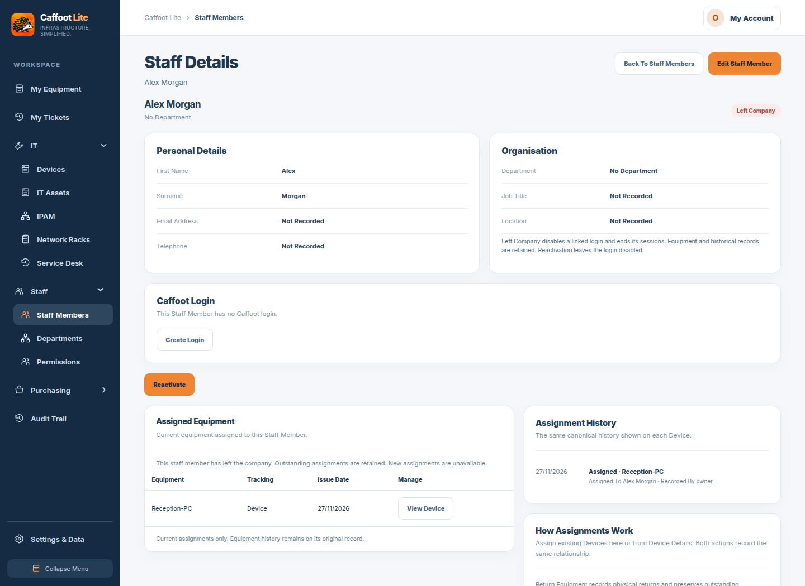

# Staff Members

> **Draft v2.2 — Unreleased.** This guide covers Unified Staff Administration in [PR #453](https://github.com/Caffoot/Caffoot-Lite/pull/453). Use the [published v2.1 guides](../README.md) for the released application.

> **Documentation status — 27 November 2026:** Accepted written/source procedures are preserved. [Batch 7B](screenshots/batch-7b/README.md) adds seven desktop light-theme Staff illustrations under the [owner’s scope and method approval](https://github.com/Caffoot/Caffoot-Lite/issues/366#issuecomment-7211852349). Independent ChatGPT review and separate product-owner visual acceptance recorded in the [27 November decision](https://github.com/Caffoot/Caffoot-Lite/issues/366#issuecomment-7212506766); original provenance and targeted pre-publication refresh limitations remain. [All 16 groups / 79 specifications](screenshots/batch-7b/Coverage.md) remain traceable; no publication approval is implied.

Staff Members is the directory of people who may hold equipment. Use it to record a person’s contact details, Department and Staff status, review their assigned equipment and, with administrator access, manage their optional login and individual permissions. A person can hold equipment without a Caffoot login.

| Record | Purpose |
| --- | --- |
| Staff Member directory record | The person, optional Department and equipment relationships. |
| Caffoot login | The account used to sign in, with a fixed sign-in username, password, MFA and access settings. |
| Staff Member role | The baseline security role assigned to ordinary logins. It does not grant access to the Staff directory or general inventory. |

Linked records share first name, surname and email after any saved differences have been resolved. Staff status, Department and equipment belong to the Staff record. Sign-in status and security belong to the account. Department membership grants no application permissions.

## Before You Start

- **Staff Members Read** permits directory viewing. **Staff Members Edit** permits adding people and managing employment details. It permits employment status changes for people without linked logins. Changing linked Staff status also requires administrator authority.
- Staff Members and Departments are core sections, subject to permissions. They do not depend on the optional IT Assets switch and need not be populated to use Devices or IPAM.
- Creating a login, reviewing individual permissions or resolving linked profile differences requires an active administrator who has enrolled in MFA. Creating or resolving a difference from the Staff form also requires Staff Members Edit. A directory editor can change shared names and unlinked contact emails. Use an administrator or the account owner’s My Account for a linked email change.
- Devices and IT Assets have independent rights and switches. Read access shows the corresponding equipment on Staff Details; Edit permits its authorised actions. See [Roles, Section Permissions And MFA](Roles-Section-Permissions-and-MFA.md).

Collect known work details before starting. Do not enter passwords, recovery codes or other secrets in directory fields.

## Find A Staff Member

1. Expand **Staff** in the sidebar and choose **Staff Members**.
2. Enter part of the person’s name or Department in **Find A Staff Member**. Administrators can also enter part of the linked sign-in username.
3. Use **Staff Status** to choose **All Statuses**, **Active** or **Left Company**. Clear the search and check All Statuses if a person seems missing.
4. Scroll the table sideways on a narrow screen to reach **View Details** and **Edit**. Choose **View Details** beside the correct person. If names are similar, check their Department and, if you are an administrator, their username.
5. Read **Personal Details**, **Organisation** and, where authorised, **Caffoot Login**. Equipment panels require independent equipment access.
6. Choose **Back To Staff Members** to return to the list.

**No matching Staff Members.** means the current search/status combination has no rows; clear the search and choose All Statuses before adding another record.

**No Department**, **No Email Recorded** and **Name Not Recorded** describe missing details. Administrators see linked usernames and **Linked Login** or **No Login** beside the Staff status. Account status, authenticator enrolment and assigned roles appear in the administrator’s Caffoot Login card.

*Draft v2.2 — Administrator view: usernames and login badges help distinguish Staff identities, including a migrated record whose name is not recorded. Independent review and owner visual acceptance recorded; original revision and targeted refresh limitations retained.*

*Draft v2.2 — Staff Members Read view after Alex’s employment change: employment status is visible, while linked usernames, login badges and editing actions are absent. Independent review and owner visual acceptance recorded; original revision and targeted refresh limitations retained.*

## Add A Person Without A Login

1. Open **Staff → Staff Members → + Add Staff Member**.
2. Enter **First Name** and **Surname**. Both are required for a new person.
3. Complete any known optional fields described below.
4. Check **Staff Status**. **Active** permits eligible new equipment assignments; **Left Company** retains a person and their existing relationships without permitting new assignments.
5. Leave **Create Caffoot Login** switched off when no login is needed. A non-administrator cannot enable account creation here.
6. Choose **Save Staff Member**. A successful save opens Staff Details and reports that the Staff Member was saved.
7. Check the saved name, Department and status. Choose **Edit Staff Member** if a correction is needed.

| Field | What to enter or expect |
| --- | --- |
| First Name / Surname | The person's known name. Do not invent names from a username. |
| Email Address | Optional valid contact address. When a login is created, the saved account address starts unverified. |
| Department | One optional active Department, or **No Department**. Departments have no hierarchy. |
| Job Title | Optional description such as Service Coordinator. It grants no security role. |
| Telephone Number | Optional work contact number. |
| Location | Optional directory location. It does not move assigned Devices or change their Location field. |
| Staff Status | Active or Left Company. Left Company disables a linked login; reactivation leaves it disabled. |

Names allow up to 100 characters each; Job Title 120, Telephone Number 100, Location 200 and Email Address 254. Use printable text without control characters. A nonblank email needs an address in a valid form such as `alex.morgan@example.org`; `alex@` is invalid. Existing migrated blank names may remain blank until the true name is known.

**Cancel** or **Back To Staff Members** leaves the form without saving. If validation rejects a save, correct the displayed problem and try again. A failed save does not leave a partial Staff record.

For a fictional example, create **Alex Morgan**, select **Accounts**, enter `alex.morgan@example.org`, leave Create Caffoot Login off and save. Alex can now receive eligible equipment but has no credentials and cannot open My Equipment. Department membership has granted no application access.

*Draft v2.2 — An unsaved Add Staff Member draft using fictional Jordan Rivers. Create Caffoot Login is off; no new Staff record has been saved from this draft. Independent review and owner visual acceptance recorded; original revision and targeted refresh limitations retained.*

## Create And Link An Optional Caffoot Login

The combined form reuses existing account security and links the login to the person holding their equipment.

1. As an authorised administrator with Staff Members Edit, start **+ Add Staff Member**, or open an existing unlinked person's **Staff Details → Create Login**.
2. Review the Staff details and confirm **Staff Status: Active**. Creating or linking a login for Left Company Staff is rejected. For an existing person, confirm this is the record holding their equipment.
3. Enable **Create Caffoot Login** if the Create Login action has not already enabled it.
4. Enter a unique **Username**, an **Initial Password** and the same value in **Confirm Initial Password**. Follow the existing [password rules](Roles-Section-Permissions-and-MFA.md).
5. Review the **Staff Member** default-role explanation. New logins start with the baseline role and have no general inventory access.
6. Choose **Save Staff Member**. Staff changes, account creation and their link succeed together. A duplicate username, invalid password or rejected save leaves no unintended partial record/account/link.
7. Check the linked account on Staff Details. Select **Manage Permissions** whenever you need to review or change individual access. Give the person their initial credentials securely and direct them to the [account and MFA instructions](Roles-Section-Permissions-and-MFA.md).

If **This username is already in use. Please choose another username.** appears beneath **Username**, enter a different username. For example, `Alex.Morgan` conflicts with `alex.morgan`. The form keeps the other Staff details you entered and clears both password fields. Re-enter the two passwords and select **Save Staff Member** again. The existing account keeps its credentials and the rejected save creates no Staff record or login.

The **Caffoot Login** card shows **Username**, **Account Status**, **Authenticator** and **Assigned Roles**. Select **Manage Permissions** just below Assigned Roles to open the account dialogue. Its four tabs are **Personal Details**, **Roles**, **Permissions** and **Account Controls**. Personal Details displays the read-only **Sign-in Username**. Account Controls brings together employment status, login status and the existing security controls. Switching tabs preserves unsaved personal details; use **Save Personal Details** to save them. The header, tabs and **Done** stay visible while the selected content scrolls. Close it with **Close**, **Done** or Escape to return to the same Staff Details. See the [account review procedure](Roles-Section-Permissions-and-MFA.md#review-an-account).

When their Staff link and current equipment make them eligible, linked users can work with permitted equipment in [My Tickets and Department Tickets](Service-Desk-Tickets.md). Wider IT Service Desk or inventory access requires the relevant section permissions.

The Staff form offers no general merge or relink control for existing accounts. If an account is already linked to a different record, refer the discrepancy to an administrator; do not create a duplicate login or rewrite names to disguise the conflict.

*Draft v2.2 — The existing Jordan record has an unsaved optional login draft. The two initial password fields are empty and the default role is Staff Member. Independent review and owner visual acceptance recorded; original revision and targeted refresh limitations retained.*

### Existing Accounts And Migrated Details

The earlier Staff upgrade links accounts that lacked a Staff record, copying available first name, surname and email. In the unified workflow, start-up fills any missing first name or surname from the corresponding saved value. It can also copy a saved account email into an empty Staff contact field. The original links, IDs, history, equipment and account security are preserved.

A Staff email with a blank account email still needs an administrator’s decision before it can become an account address. Two different nonblank values also need a decision. A record with both names blank can stay **Name Not Recorded** until the correct details are known.

## Edit Staff And Shared Personal Details

1. Choose **Edit** in the directory or **Edit Staff Member** on Staff Details.
2. Change the intended fields. For a linked record, a new first name or surname updates both records. For example, changing fictional Alex Morgan’s surname to Rivers updates the Staff name and their personal details in My Account.
3. Change an unlinked contact email with Staff Members Edit. For a linked account email, sign in as an authorised administrator or ask the account owner to change it in **My Account → Overview → Personal Details**. The account owner must verify a changed email to use it for password recovery.
4. Choose **Save Staff Member** and check the saved Staff Details. **Cancel** or **Back To Staff Members** discards unsaved edits.

Changing Department, job title or location does not change account permissions or move equipment. **Left Company** disables a linked login and revokes sessions/proofs; **Reactivate** leaves it disabled, as explained below. Account owners can edit shared names and email in **My Account → Overview → Personal Details → Save Personal Details**. Account display name and photo belong to My Account. The sign-in username stays fixed.

*Draft v2.2 — Edit Staff Member displays Jordan’s existing Department, job title and location. This illustration does not claim an edit has been saved. Independent review and owner visual acceptance recorded; original revision and targeted refresh limitations retained.*

### Resolve A Difference Between Staff And Account Details

1. As an authorised administrator, locate the person in **Staff Members** and choose **Edit**.
2. For each **Resolve Difference** field, compare the saved **Staff** and **Account** values. Check the intended value with the person if it is unclear.
3. Choose **Keep Staff Value** or **Keep Account Value** to use that saved value on both records. For a field you are not resolving, leave **Leave Both Values Unchanged** selected. You can still save unrelated edits.
4. Select **Save Staff Member** and confirm the selections. Dismissing the confirmation preserves the form for review. Saving resolves the selected fields and opens Staff Details.
5. If the account email changed, ask its owner to verify the saved address in My Account. Previous verification and outstanding verification or recovery codes are cleared. Choosing the existing account address preserves its verification status and outstanding codes.

For example, the Staff record for fictional Taylor Cole might still show Taylor while the account shows Tay. After confirming the preferred name, choose **Keep Account Value** for First Name. Leave an unrelated email difference unresolved until Taylor confirms the address. If My Account asks the user to contact an administrator about a field, they can still save other personal details by leaving that field at its saved account value.

*Draft v2.2 — Taylor/Tay and the two fictional email addresses are saved differences. Both resolution selectors still say Leave Both Values Unchanged. Independent review and owner visual acceptance recorded; original revision and targeted refresh limitations retained.*

The native save confirmation asks **“Save the selected personal details to both the Staff record and Caffoot account?”** If you choose the Staff email to replace the account email, it adds **“The account email must be verified before it can be used for password recovery.”** Read the complete message before confirming.

### Recover From A Stale Edit

1. Read the message when the Staff Member was changed elsewhere. Your entries and any selected resolutions stay in the form.
2. Note the edits you still need, choose **Refresh Current Details**, then confirm that you want to replace your unsaved entries with the current saved values.
3. Review the new values and Department choices, reapply the necessary changes and select any resolutions again before saving.

An existing archived Department membership can be retained during an edit. An archived Department is unavailable for a new membership.

Refresh Current Details asks **“Refresh this Staff Member? This will replace your unsaved details, including any login fields, with the current saved values.”** Cancel keeps your current form entries.

## Mark As Left Company Or Reactivate

Use **Left Company** when someone has left, rather than to record a temporary absence. Staff Members Edit permits employment details management and status changes for people without linked logins. A linked person's employment status requires both Staff Members Edit and administrator authority. A directory editor can still save permitted employment details, but the linked status control is unavailable.

1. Open **Staff Details**, confirm the person and review **Assigned Equipment** and **Assignment History** with the necessary equipment access.
2. Choose **Mark As Left Company**, or, for a linked login, open **Manage Permissions → Account Controls** and use the same action under **Employment Status**.
3. Read the confirmation. Confirming sets **Left Company**, disables any linked login and revokes its existing sessions and outstanding email verification, recovery and temporary-password change proofs together. Cancelling makes no change. The server rejects unauthorised or stale changes without saving part of the operation.
4. Check the **Left Company** status. A linked login shows **Disabled**. Existing assignments, equipment custody, tickets and historical records are retained; no physical return or stock increase is invented. New equipment assignments to this person are rejected. On Staff Details, Assigned Equipment explains that the staff member has left the company, outstanding assignments are retained and new assignments are unavailable.
5. Record the equipment actually returned through the existing [return/write-off](IT-Assets-Issue-Return-and-Write-Off.md) or [handover](Associated-Equipment.md#reassign-a-workstation-directly) workflow. Authorised IT retains the relevant history.

To restore employment eligibility, select **Reactivate** and confirm. Reactivation preserves history and leaves the login disabled. An administrator must then explicitly choose **Enable Login** in **Manage Permissions → Account Controls** if sign-in is appropriate. The server prevents enabling a login or creating a new linked login while the Staff Member remains Left Company. Add/Edit Staff uses the same server policy; changing that form does not bypass it. Staff records have no permanent-delete action.

You cannot mark your own signed-in administrator account as Left Company, and the last active administrator cannot be disabled. If a safeguard rejects the action, keep the records intact and ask the product owner to resolve the administrator arrangements; do not work around the rejection.

For example, fictional Alex leaves with a laptop and two adapters recorded against them. Mark As Left Company disables Alex's linked login and ends its sessions, while all three items remain outstanding. IT records only the items physically returned. If Alex returns to the company, Reactivate restores assignment eligibility; the administrator reviews access before explicitly enabling the login.

During an authorised review upgrade, existing Left Company/inactive Staff with enabled logins are reconciled to disabled logins with session and proof revocation. If this would disable every active administrator, startup stops and rolls back the transaction for product owner approval. This is a tested data rule, not an approved production upgrade procedure. See [upgrade safeguards](Legacy-Import-and-Docker-Upgrade.md#left-company-linked-login-reconciliation).

*Draft v2.2 — Saved offboarding result: Alex is Left Company, the linked login is Disabled and AC-LAP-07 remains assigned. No equipment return has been recorded. Independent review and owner visual acceptance recorded; original revision and targeted refresh limitations retained.*

From Alex’s Staff Details, the browser-native confirmation reads **“Mark As Left Company Alex Morgan? Any linked login will be disabled and active sessions ended. Equipment, tickets and history are retained.”** The Add/Edit Staff form instead asks **“Mark As Left Company? Any linked login will be disabled and active sessions ended. Equipment, tickets and history are retained.”** Read the actual wording and choose Cancel if the change is unintended. These native confirmations use the owner-approved written substitution.

## Work With Equipment

> **Correction evidence — 27 November 2026:** The two status views below and their dark variants are owner-approved at `6feba03d`. Earlier Add/Edit Staff, Create Login and Resolve Difference images (including Batch 7B and historical captures) predate the corrected guidance; preserve their provenance and refresh any that show the old guidance before publication. This does not approve the remaining Batch 7B images.

In **Add Staff Member** or **Edit Staff Member**, the **Equipment And Ticket Access** guidance follows the selected Staff Status. For Active, it explains that equipment can be assigned to eligible Staff and that ticket access depends on the linked account and its permissions. For Left Company, it explains that existing assignments remain for tracking and return, and new assignments are unavailable. Changing the selection updates the guidance immediately; it does not change saved status, equipment custody or login access until the existing Save and confirmation workflow succeeds. Use **Return Equipment** to record actual physical returns. Cancel leaves the saved record unchanged.

*Draft v2.2 — Active Staff guidance.* [Dark mode](screenshots/milestone-01-sidebar-device-staff-corrections/staff-active-dark.png)

*Draft v2.2 — Existing assignments remain for tracking and return; changing status is not a physical return.* [Dark mode](screenshots/milestone-01-sidebar-device-staff-corrections/staff-left-company-dark.png) · [Capture provenance](screenshots/milestone-01-sidebar-device-staff-corrections/Provenance.txt) · [Owner-approved correction evidence](https://github.com/Caffoot/Caffoot-Lite/pull/485#issuecomment-7216358365)

**Assigned Equipment** shows Devices and outstanding IT Assets assigned directly to the person, according to your access. **Assignment History** retains the original relationships and responsible accounts.

With Devices Edit, **Assign Equipment** records an eligible initial Device allocation to an active person. With IT Assets Edit, **Issue Equipment** opens stock issue for them. **Return Equipment** beside outstanding stock remains available for Staff who have left. Device returns require both relevant equipment permissions. Follow [Device Assignments And My Equipment](Device-Assignments-and-My-Equipment.md) and the linked stock guides for the full checks.

A linked person opens **My Equipment** for limited personal/shared information without gaining general inventory rights. Changing their Department changes Department-shared visibility on the next request; it does not move personally assigned equipment or reassign the Department's Devices.

## Troubleshooting

| Problem | Check or recovery |
| --- | --- |
| Staff Members is absent | Ask an administrator to check Staff Members access. The baseline role or a directory record alone is insufficient. |
| Manage Permissions is unavailable | Sign in as an active administrator with MFA, and check that the Staff Member has a linked login. |
| Create Login is unavailable | Check administrator authority, Staff Members Edit and whether the record already has a login. |
| The initial password is rejected | Follow the password rules, match both entries and check that the username is unused. Retry on the same Staff record. |
| A Department is missing | Check whether it is archived; do not create a duplicate Department. |
| Equipment is absent | Check independent Devices/IT Assets permissions and switches, then the actual holder. A restricted panel does not prove no equipment exists. |
| A leaver can still sign in | Check the saved employment and login statuses with an administrator. Left Company disables a linked login; a rejected change leaves both records unchanged. |
| The connection fails during save | Reopen the record to establish what was saved before retrying. A missing success message does not prove failure. |

## Related Guides And Acceptance Items

- [Roles, Section Permissions And MFA](Roles-Section-Permissions-and-MFA.md)
- [Departments And Shared Equipment](Departments-and-Shared-Equipment.md)
- [Device Assignments And My Equipment](Device-Assignments-and-My-Equipment.md)
- [Issue, Return And Write Off](IT-Assets-Issue-Return-and-Write-Off.md)

The new illustrations show the running pinned v2.2 development application with fictional data. See the [Batch 7B capture record](screenshots/batch-7b/README.md) for dimensions, source revision and pending independent/owner visual acceptance. The [original Staff-administration evidence](screenshots/staff-administration/README.md) remains preserved with its historical provenance.

[← Draft v2.2 Guides](README.md) · [Published v2.1 Guides](../README.md)

[Connected equipment example — Supplier, stock, assignment and later use](Connected-Equipment-Journey.md).
