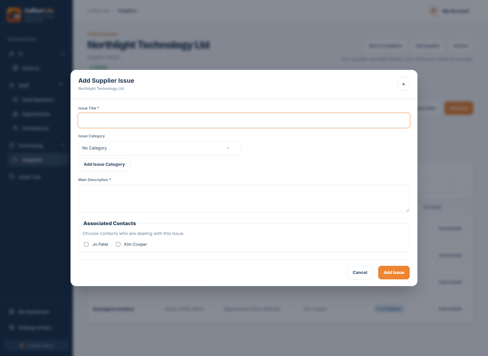
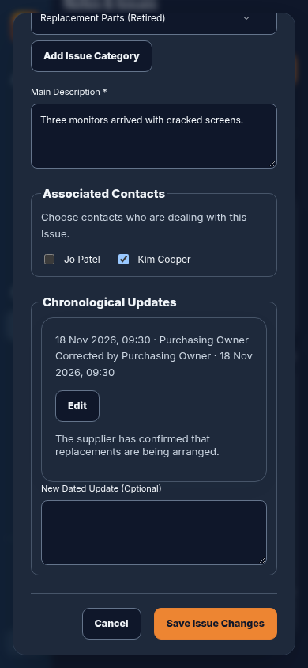
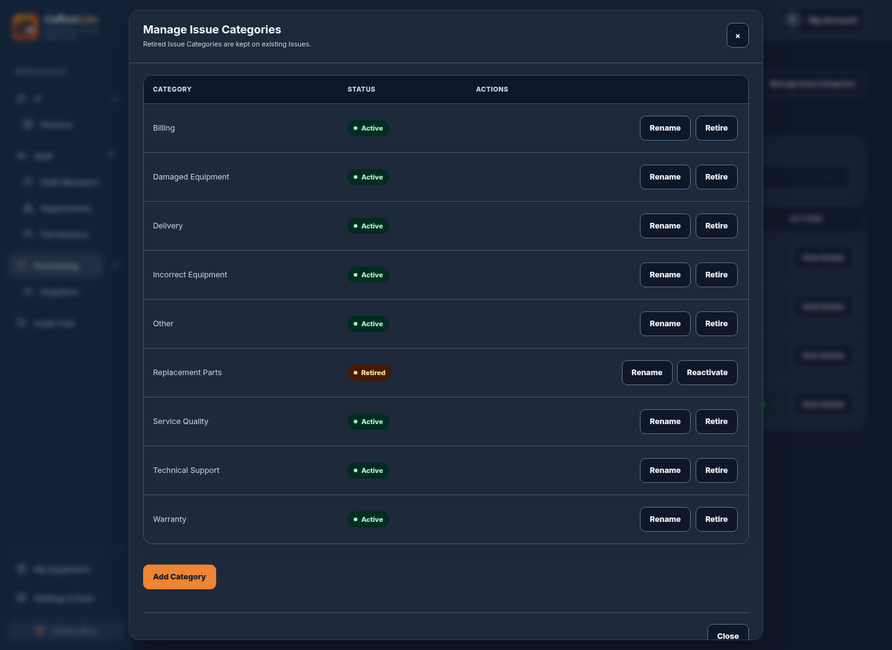
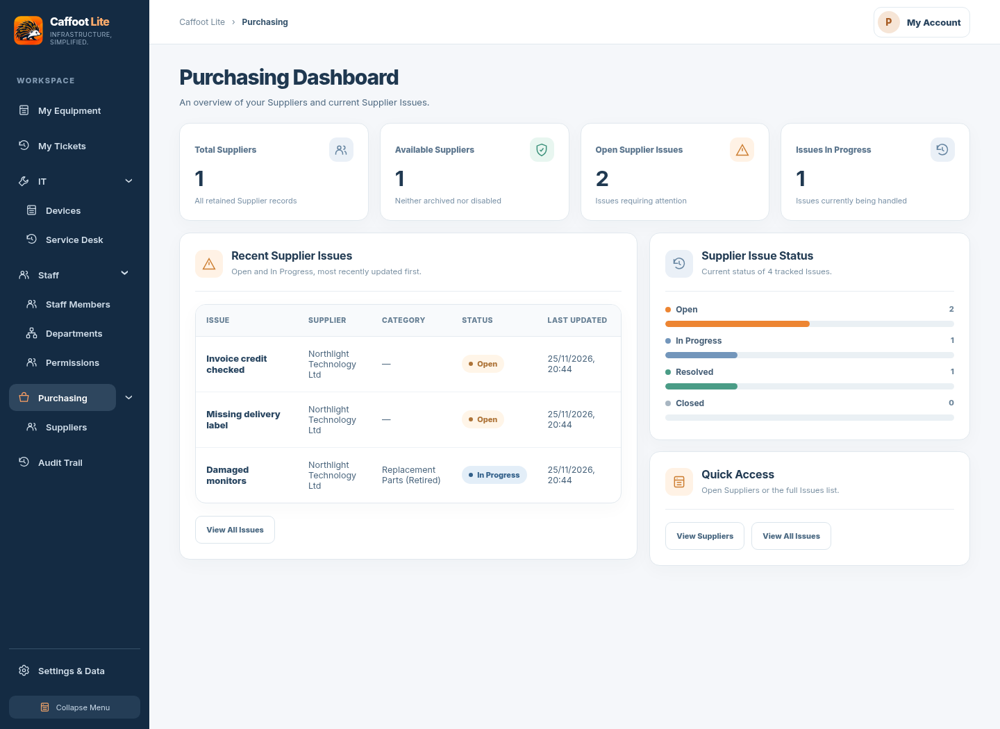
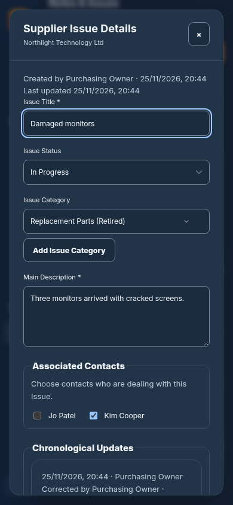

# Supplier Issues And Purchasing

> **Draft v2.2 — Unreleased.** This guide describes Stage 4 Batch 4.2 on the development branch. Use the [published v2.1 guides](../README.md) for the current release.

> **Written/source reconciliation:** Batch 4, application baseline `fdc677920bfc52f48f641b3d6d1344c902a6a9b0` (schema 31). Awaiting independent ChatGPT review and separate owner acceptance. Desktop screenshot reconciliation is deferred to Batch 7; existing images retain their original provenance and are not certified current by this pass. [Source review and exact screenshot requirements](../../../development-guide/Milestone-01-Batch-4-Review.md).

Use Purchasing to track problems with companies you buy from. A Supplier Issue has a title, a main description and a current status. It belongs to the Supplier company for its entire life. You can link the people handling it and keep a dated record of what happened. For an observation that needs no tracked status, use a [Supplier or Contact Note](Supplier-Management.md#record-correct-or-delete-notes).

## What Purchasing Covers

This area is the Supplier directory, Supplier Issues, contacts, notes and their reporting. It does not create purchase orders, budgets, invoices, payment records, approval chains, accounts or automated replenishment. A Billing Issue is a tracked problem category, not an accounting transaction. Keep financial and procurement processing in the organisation's appropriate systems.

Supplier Issues concern the Supplier company and its contacts. Employee **My Tickets / Department Tickets** and the IT **Service Desk** concern support work on permitted equipment, with separate permissions, status rules and privacy. Creating or resolving a Supplier Issue does not create, close or transfer a Service Desk ticket, receive replacement equipment or alter stock. [Service Desk instructions](Service-Desk-Tickets.md)

## Get Access

You need a signed-in account with effective **Suppliers Read** to see Purchasing, Suppliers and their Issues. **Suppliers Edit** also lets you add Issues, correct them, change their status, add or correct updates and maintain the Issue Category catalogue. Administrators manage the organisation's switch and account permissions. Follow your organisation's MFA enrolment requirements. See [Roles, Section Permissions And MFA](Roles-Section-Permissions-and-MFA.md).

1. A verified administrator opens **Settings & Data → Optional Features** and switches on **Suppliers** under **Additional Features**. On a fresh installation, the switch starts off.
2. In **Staff → Permissions**, open **Manage Roles** to grant the appropriate role **Suppliers Read** or **Suppliers Edit**. For an individual exception, open **Manage Permissions** in the person’s **Staff Details** and review its permission overrides. Review and confirm the proposed change. An individual **No Access** override can block a role grant.
3. Verify access in the user's signed-in workspace. **Purchasing** appears after **Staff** for a user with effective Suppliers access. Choose the **Purchasing** heading for its Dashboard or **Suppliers** beneath it for the directory. Use the separate chevrons to expand or collapse each department without leaving the current page.
4. If the feature needs to be suspended, switch **Suppliers** off and confirm. Cancelling that confirmation keeps the current setting. Switching it back on restores access according to the same effective permissions and makes the retained Supplier records, Issues and history available again.

Supplier access is independent of Devices and IT Assets. To see the infrastructure Dashboard, choose **IT** when your account has the applicable IT access. If Purchasing is missing, check the organisation switch, the account's effective permission and its MFA status before contacting your administrator. An IT or Staff role alone does not grant Suppliers access. See [Supplier Management](Supplier-Management.md#enable-suppliers-and-set-access).

## Read The Purchasing Dashboard

1. Choose **Purchasing** in the sidebar. The four summary cards show current totals for the records you can read in Suppliers.
2. Compare **Total Suppliers**, which includes every retained Supplier company, with **Available Suppliers**, which includes only companies that are neither archived nor disabled. Permanent deletion of an eligible unused Supplier removes it from both counts. Choose either card to open the Supplier Directory.
3. **Open Supplier Issues** counts Issues at **Open**. **Issues In Progress** counts Issues at **In Progress**. Choose either card to open the full Issues list with that status already selected.
4. In **Supplier Issue Status**, read the counts for **Open**, **In Progress**, **Resolved** and **Closed**. An Issue contributes once, according to its current status. Archived and disabled companies still contribute the Issues they retain.
5. In **Recent Supplier Issues**, choose an Issue title to open its details. This list shows up to five **Open** or **In Progress** Issues, newest update first. Choose **View All Issues** for the full list across Suppliers, including **Resolved** and **Closed**. **Back To Purchasing Dashboard** returns to the summary.

On a narrow screen, each row in Recent Supplier Issues shows its details beneath the title. In the full Issues list, scroll within the table to reach columns that extend beyond the visible area. **No Active Supplier Issues** means there are no Open or In Progress Issues in the recent list. Use **View All Issues** to check completed records. The **Active Issues** count on a Supplier's **Overview** is local to that company and combines Open and In Progress.

## Record An Issue

You need Suppliers Edit. First check the company's Issues list for an existing record about the same problem.

1. Open **Purchasing → Suppliers** and locate the company. Select its name or **View** to open Supplier Details.
2. Open **Notes & Issues**, select **Issues** and choose **Add Issue**.
3. Enter the required **Issue Title** and **Main Description**. For example, use *Three monitors arrived damaged* and describe which delivery was affected and what was found. Keep the main description focused on the problem so later progress can be recorded separately.
4. Optionally choose one **Issue Category**, such as **Damaged Equipment**. **No Category** is valid. If you need a reusable category, select **Add Issue Category**, enter a distinct **Category Name** and choose **Save Category**. The new category is selected for this Issue. The category is saved separately and stays in the catalogue if you later cancel the Issue. The inline **Cancel** closes just the new category entry.
5. Under **Associated Contacts**, tick any of the company's active contacts who are handling the issue. You can select none, one or several.
6. Choose **Add Issue**. The saved record starts **Open**. If validation rejects a field, fix the reported problem and save again. The footer **Cancel**, header close button and **Escape** use the standard discard confirmation when there are unsaved changes. Choose **Keep Editing** to continue or **Discard Changes** to leave without saving the Issue.

The creation form sets Open automatically. It lets you link active contacts and leave the category blank.

## Find And Update An Existing Issue

1. Open the company's **Notes & Issues → Issues**, or open **Purchasing → View All Issues**. Use **Filter Issues By Status** and **Filter Issues By Category** together to narrow the list. The default **All Statuses** and **All Categories** show the full list. Retired categories remain available for finding earlier assignments.
2. Choose the **Issue Title** or **View Details**. The dialog shows the same Supplier Issue from either list, the Purchasing Dashboard and any associated Contact Details.
3. With Edit access, correct the title or main description if necessary. You can also change the selected category or contacts. Creation time and creator stay with the record. Read users can view current details, contacts and chronological updates and use **Close** to return.
4. To record progress, enter text in **New Dated Update (Optional)** and choose **Save Issue Changes**. The application dates and attributes the new entry. Older entries and the main description remain in place. Use one update per meaningful step so another colleague can follow the timeline.
5. To correct an earlier update, choose its **Edit** control, enter the corrected **Issue Update** and choose **Save Changes**. You can correct updates recorded by a different editor. The corrected text appears in the same chronological position. The original date and author remain visible, along with the correction actor and time. The protected audit keeps the original text and each correction.
6. To leave a form, use **Cancel**, the header close button or **Escape**. If you have unsaved changes, choose whether to keep editing or discard. If a save reports that the record changed, review your unsaved text, reopen the Issue and compare with the latest record before applying your changes.

### Choose The Current Status

| Status | When to use it | Damaged monitors example |
| --- | --- | --- |
| **Open** | The problem has been recorded and needs attention. | Three monitors arrived with cracked screens. |
| **In Progress** | Someone is actively investigating or dealing with the problem. | The supplier is arranging replacements. |
| **Resolved** | A solution is in place and its outcome may still need checking. | The replacement monitors have arrived. |
| **Closed** | The outcome has been checked or accepted and no further work is expected. | The replacement monitors have been tested and accepted. |

1. Open **Supplier Issue Details**, select the appropriate **Issue Status** and choose **Save Issue Changes**.
2. Choose any of the four statuses as the situation requires. To reopen a Closed Issue, select **Open** or **In Progress** and save the same record.
3. If useful, add the reason or outcome through **New Dated Update (Optional)**. Resolved and Closed can be saved without an explanation. Status changes remain attributable in the protected audit history.

Caffoot Lite does not send automatic notifications about these changes. Keep your team's supplier communication in its usual channels.

### Hand Over To A Different Supplier Contact

1. Open the Issue and review **Associated Contacts**.
2. Clear the outgoing contact and tick the replacement. Keep both selected if they are sharing responsibility. If a person is not listed, check whether the contact exists for this company and is available for new links.
3. Choose **Save Issue Changes**. The Issue keeps its identity and complete history.
4. Open **Contacts**, select the new contact and look under **Associated Supplier Issues**. Choose **View Supplier Issue** to confirm it opens the same record. The outgoing contact no longer lists that Issue after removal. That person's ordinary notes remain under **Contact Notes**.

## Manage Issue Categories

The Issue Category catalogue classifies Issues. Supplier company Categories are maintained separately in the Supplier Directory. The starting Issue Categories are **Damaged Equipment**, **Delivery**, **Incorrect Equipment**, **Warranty**, **Billing**, **Technical Support**, **Service Quality** and **Other**.

1. With Suppliers Edit, choose **Manage Issue Categories** on an Issues list.
2. Use **Add Category** to enter a new name. Names must be distinct, regardless of capitalisation. Use **Rename** and **Save Category** to correct a name while keeping its existing assignments.
3. Select **Retire** and confirm **Retire Issue Category** to remove it from new selections. Existing Issues keep the retired category and can still be filtered by it. An Issue already using it can retain that assignment when edited.
4. Select **Reactivate** and confirm **Reactivate Issue Category** to make the same entry available for new assignments. **Cancel** leaves the catalogue as it was before the current action.

The same catalogue keeps retired categories visible for review and reactivation.

## Validation, Empty Lists And Cancellation

Issue Title is required and allows up to 160 characters. Main Description and each dated Issue Update allow up to 12,000 characters; the description and a corrected update cannot be blank. A new dated update is optional when saving other Issue changes. Issue Category names allow up to 70 characters. New category/contact assignments must be active and contacts must belong to the same Supplier. There is no Issue deletion, move-to-another-company or update-deletion control.

**No Issues Match These Filters** is different from **No Active Supplier Issues** on the recent Dashboard. Clear both status/category filters to inspect completed records. **No Contacts Available.** does not prevent an otherwise valid Issue with no contact links. **No Updates Yet.** is valid before a dated update is added. Cancelling an unsaved Issue or update leaves saved records unchanged, while an inline category already saved remains in its separate catalogue. Reopen after a stale-save rejection and review the current version before reapplying text; do not create another Issue to bypass it.

## Review Retention And Audit

- Supplier Issues and their dated updates are retained, including when a company is archived or disabled. Use status and corrections to keep the record accurate. A Supplier or Contact with protected Issue history can be archived rather than permanently deleted.
- Keep work-relevant information in descriptions and updates. Suppliers readers can see the current record. Do not enter passwords, access tokens, payment details or unnecessary personal information. Editing text does not erase the original from protected audit history.
- A verified administrator can review Issue changes through the application audit boundary. When **Audit Trail** is available in the sidebar, open it, search for the Issue title and choose **View Details** on the relevant event. Review the performing user, UTC time and before-and-after values for a correction or transition. A rename is itself attributable, so search for the title used at the time of the event if needed. Audit records are retained when Suppliers is switched off and become accessible again when Suppliers access is restored.

| If you see this | Check this |
| --- | --- |
| Purchasing is missing | Ask your administrator to verify the Suppliers switch, effective access and any required MFA. |
| You can see an Issue but cannot change it | Your account needs Suppliers Edit. Confirm it in the role and individual permission view. |
| A Contact or category is unavailable | Check that it belongs to the right catalogue or company and is active. Existing archived contact links and retired category assignments can remain on the Issue. |
| The Issue is absent from Recent Supplier Issues | Check **View All Issues** and clear the filters. Resolved and Closed appear in the full list and status counts. |
| A save reports that someone else changed the record | Reopen the latest record and check its fields before reapplying your intended correction. |

See the [Batch 3 capture record](../../../development-handovers/evidence/stage-6-6-batch-3/README.md), [Supplier Management](Supplier-Management.md) and [Batch 4.2 approval](https://github.com/Caffoot/Caffoot-Lite/issues/411).

[Connected example: a laptop from Supplier and stock to its final write-off](Connected-Equipment-Journey.md).
