# Supplier Management

> **Current status — 27 November 2026:** Batches 7C, 7D and 7E have separate owner draft-evidence acceptance (41/36/25 new paths; 102 combined; 7E has 23 distinct image contents). Original captures, provenance and requirement mappings remain unchanged; accepted instructions retain the approved merged corrections. Batch 8 editorial findings and publication approval remain outstanding. The exact approved application baseline is now `0251b43a3b5d41d626aa022c6d7f9b4d860433da`, schema 31. 7F/7G are authorised but blocked here by unavailable retained fixtures; no new pack has been delivered. [Current reconciliation and retained editorial limits](../../../development-guide/Milestone-01-7F-7G-Reconciliation.md). Earlier capture-time status notices are historical; publication remains unauthorised.

> **Current Batch 7C capture status — 27 November 2026:** [New desktop light illustrations](screenshots/batch-7c/README.md) use the approved merged schema-31 baseline. Independent ChatGPT review and separate owner visual/privacy/caption/alt acceptance remain pending. Earlier written/source and capture-status paragraphs retain their dated scope; the current pack status controls these new images. Published v2.1 and targeted correction-refresh requirements remain unchanged.

> **Draft v2.2 — unreleased.** These instructions describe Supplier Management in the current integrated development application. Continue to use the [v2.1 guides](../README.md) for the published version. The examples here use fictional businesses and contacts.

> **Written/source reconciliation:** Batch 4, application baseline `fdc677920bfc52f48f641b3d6d1344c902a6a9b0` (schema 31). Focused independent reviews are recorded and [owner written/source acceptance of Batches 1–6](https://github.com/Caffoot/Caffoot-Lite/issues/366#issuecomment-7200681167) is recorded. Current visual/privacy/caption/alt approval remains outstanding; [Batch 7 reconciliation and proposed capture packs](../../../development-guide/Milestone-01-Batch-7-Review.md) await independent review and owner acceptance. Capture scope and method need separate authorisation. Desktop capture remains deferred; existing images retain their original provenance and are not certified current by this pass. [Source review and exact screenshot requirements](../../../development-guide/Milestone-01-Batch-4-Review.md).

Suppliers holds the companies your organisation buys from. A company can have several offices and contacts, one shared company address and separate notes about the company or individual people. Supplier access is independent of Devices and IT Assets. Open **Purchasing → Suppliers** from the workspace sidebar. Supplier Details provides **Overview**, **Locations**, **Contacts** and **Notes & Issues**. If you can read an enabled equipment section, **Supplied Equipment** and the **Supplier Equipment** Overview metric also appear. See [Supplier Issues And Purchasing](Supplier-Issues-and-Purchasing.md) for the tracked Issues workflow.

## Enable Suppliers And Set Access

A verified administrator can enable Suppliers and manage access. Suppliers starts switched off on fresh installations and when upgrading from schema 20.

1. Sign in as an administrator using your authenticator. Open **Settings & Data** → **Optional Features**.
2. In **Additional Features**, switch on **Suppliers**. Wait for the saved confirmation. **Purchasing** and its **Suppliers** link become available in the workspace sidebar whenever the effective permissions allow it.
3. To give access to purchasing staff, open **Permissions**. Use **Manage Roles** to give a suitable role **Suppliers Read** or **Suppliers Edit**. To give an individual a different level, open **Manage Permissions** in the person’s **Staff Details** and review its permission overrides. Apply changes through the existing preview and confirmation process. See [Roles, Section Permissions And MFA](Roles-Section-Permissions-and-MFA.md).
4. Verify the staff member's effective access after sign-in. **Read** shows company records, locations, contacts, categories and notes. **Edit** adds and changes these records and permits local archive, reactivation and eligible deletion. **No Access** keeps the Supplier section and data unavailable. A deliberate No Access override blocks an inherited role grant. No existing role gains Supplier access automatically.
5. To suspend Suppliers for the organisation, return to **Optional Features**, switch it off and confirm. Cancel the confirmation to keep the current setting. Switching it on again makes the stored records, categories, statuses and existing permissions available again.

**Example.** Give your purchasing team Edit through a purchasing role. Give a colleague who needs supplier telephone numbers Read through an individual override. A colleague who receives equipment can keep their existing IT Assets permission. The effective permission view shows each section separately.

If Suppliers is missing, check the organisation's switch, the user's active roles and individual override, and MFA enrolment. If the switch is unavailable, verify that you are a signed-in administrator using the v2.2 development build. An organisation-wide feature change may require colleagues to reopen the workspace.

## Find A Supplier

1. Open **Purchasing → Suppliers**. The **Supplier Directory** lists names, categories, location and contact counts, and status. A town or city appears under the name when recorded for the Main Office. The counts show active locations and contacts.
2. Enter part of the company name or description in **Search Suppliers**. Choose a category in **Filter By Category** to narrow the results. Clear the search or choose **All Categories** to broaden them.
3. Select the supplier name or **View**. **Overview** shows company information and an **At A Glance** summary. Select **Locations** or **Contacts** in that summary to open the respective tab. **Active Issues** opens the company Issues list and counts Open and In Progress records.
4. Choose **Back To Suppliers** to return to your directory search. You can share a Supplier Details link with a colleague who has sign-in and Supplier Read access.

An archived supplier is still searchable. Retired categories remain visible on suppliers that already use them. Use **All Categories** to find a record whose only category is archived.

## Add And Correct A Supplier

You need Suppliers Edit and the feature enabled.

1. In the directory, choose **Add Supplier**. Enter **Supplier Name**. An existing name, including a name on an archived record, remains in use regardless of capitalisation.
2. Enter a **Website** using its full HTTP or HTTPS address, and a **Supplier Description** if useful.
3. Under **Main Office Address**, enter any known **Address**, **Town / City**, **Postcode** and **Country**. These fields are optional. The form starts with United Kingdom in Country, which you can change or clear. Caffoot Lite creates an editable Main Office Location even when the address is blank.
4. Under **Supplier Categories**, tick any applicable categories. A company can have several. You can leave them blank.
5. Under **Contacts**, the first entry is already open. For each contact, enter **Contact Name**, optional **Role / Job Title**, **Telephone Numbers** and **Email Addresses**. Put each telephone number or email address on a separate line. Choose **Main Office** or **Company-wide** in **Contact Scope**. A wholly unused entry can be left blank. A contact with other details requires a name.
6. Select **Add Another Contact** to open a further entry. Use **Remove** on an entry you no longer want to include.
7. Select **Add Supplier** to save the company, address, categories and contacts together. Caffoot Lite opens Overview after a successful save. If the save is rejected, the form keeps what you typed so you can correct the reported field. **Cancel**, the close button or **Escape** opens the discard confirmation when there are changes. Choose **Keep Editing** to return to the form or **Discard Changes** to leave it.
8. To correct an existing company, choose **Edit Supplier** in its details or **Edit** in Company Information. Change the necessary values and select **Save Supplier**. Corrections to the company address update the same location shown in Locations.

**Example.** Add Northlight Technology Ltd with Hardware and Networking. Record Manchester as its Main Office. Enter Kim Cooper as a company-wide account manager and Jo Patel as a Main Office technical support contact. Add a Leeds branch later and assign Jo to both locations.

### Valid Fields And Empty Results

Supplier Name, Location Name and Contact Name are required in their respective forms and allow up to 160 characters. Supplier/Contact role and town/country fields allow 160; Category Name allows 70, Address 400, Postcode 40, Supplier Description 4,000 and notes 12,000. Telephone entries allow 80 characters each; email entries 254 each. Use one valid email per line; `jo@` is invalid. Website/professional-link URLs allow up to 2,048 characters and must begin with HTTP or HTTPS, include a host and contain no embedded username/password or spaces. `example.org` alone and `javascript:` links are rejected. Professional links need both a label and URL.

Choose company-wide scope **or** one or more locations; neither and conflicting scope are rejected. Newly linked categories/locations must be active. Existing archived assignments can remain when editing the same record. A case-only spelling change does not free a name used by another Supplier/category. Invalid values or stale revisions save none of the requested operation.

**No Suppliers Match These Filters**, **No Contacts Match These Filters** and **No Notes Match Your Filter** refer to the current list/filter. Clear the relevant filter and check retained archived records before creating another company or person. A company with no recorded contacts can still be a valid Supplier.

## Manage Supplier Categories

Supplier categories classify companies. Suppliers Edit can create, rename, archive or reactivate categories for this directory.

1. Choose **Manage Categories** on the directory. Review the catalogue and each category's **Active** or **Archived** status.
2. Choose **Add Category**, enter a distinctive **Category Name** and select **Add Category** again to save. Use **Cancel** to return to the catalogue. A duplicate name is rejected, including differences only in capitalisation.
3. Select **Rename** on a category, make the correction and choose **Save Category**. Existing Supplier assignments use the corrected name.
4. Select **Archive** and confirm to remove the category from new selections. Existing assignments keep their original category. Open **Edit Supplier** to keep or remove an existing archived assignment.
5. Choose **Reactivate** and confirm to make the same category available again.

Initial categories include Hardware, Software, Licensing, Networking, Telecommunications, Office Supplies, Professional Services and Other. A rename or archive is retained when the feature is switched off and back on.

## Manage Locations And The Company Address

1. Open **Locations** on Supplier Details. The location marked **Primary Address** supplies the address shown on Overview.
2. Select **Add Location**, fill **Location Name** and any known address fields, then select **Add Location** to save. Use **Cancel** to abandon the entry. A branch such as Leeds Branch can have its own contact list.
3. Choose **Edit Location** and **Save Location** to correct a name or address. Updating the primary location's address immediately updates Company Information as well.
4. If the company moves its main office to another recorded active location, choose **Make Main Office** on that location and confirm. The old location and its contact assignments remain. The new one supplies the company address.
5. Review **Contacts At This Location**. The list includes company-wide people and people explicitly assigned to this location. Use a contact's name or **View** to open the same Contact Details record used elsewhere.

The current primary location is protected from individual permanent deletion. A location with contacts linked directly to it is also protected. See [Archive, Reactivate Or Delete](#archive-reactivate-or-delete).

## Manage Contacts

1. Open **Contacts** on the company. Use **Search Contacts** by name, role or email. **Filter Contacts By Location** can show all contacts, company-wide contacts or those covering a selected location. A location filter includes company-wide contacts automatically.
2. Choose **Add Contact**. Enter the name and, when known, the person's role, telephone numbers and email addresses. Enter one telephone number or email address per line.
3. Add professional links in **Professional / Social Links** as one labelled address per line. For example, enter `Support Profile | https://example.org/support`. The label is what readers select in Contact Details.
4. Tick **Company-wide Contact** or select one or more active locations. Select **Add Contact** to save. If the form asks for a location, choose the locations in scope or tick Company-wide Contact.
5. Select the person's name or **View Details** to see all recorded details and their Contact Notes. Choose **Edit Contact** and **Save Contact** to correct details or change scope. **Cancel** leaves the stored contact unchanged.
6. For a person covering several locations, edit the original Contact and tick the additional locations. Future searches and notes use the same Contact record. Archived locations already assigned to that contact remain identifiable when you edit it.

**Example.** Open Jo Patel's Contact Details, choose **Edit Contact**, select both Main Office and Leeds Branch, and save. Each location lists Jo once. A note on Jo's record is available wherever you open that Contact.

## Record, Correct Or Delete Notes

A Supplier Note belongs to the company. A Contact Note belongs to one contact. Each note has its own creation attribution and date.

1. For a company note, open **Notes & Issues → Notes** and choose **Add Supplier Note**. For a personal contact note, open that person's **Contact Details** and choose **Add Note** in **Contact Notes**.
2. Enter **Note** and select **Save Note**. For example, record that the quarterly licence review takes place in March or that a named contact covers two branches.
3. In the Notes view, choose **All Notes**, **Supplier Notes** or **Contact Notes** from **Filter Notes By Owner**. Use **View Contact** to check who owns a Contact Note.
4. To correct a note, choose **Edit**, make the correction and choose **Save Changes**. Any Suppliers editor can correct it. The original creator, time and owner stay on the note and the current correction shows who edited it and when.
5. To remove an ordinary note, choose **Delete** and confirm. **Cancel** leaves it intact. The application keeps an attributed audit event and the note history still protects the company and, where relevant, the contact against permanent deletion.

Only put work-related information in notes. Keep passwords, tokens, sensitive personal material and payment details in your approved systems. Supplier Read includes access to the contact details and notes stored in this section.

## Archive, Reactivate Or Delete

Review the record and its links before confirming a lifecycle action. Read users can inspect retained records. Suppliers Edit is required to make local lifecycle changes.

1. In the Supplier Details header, on a location card or in Contact Details, choose **Archive** and confirm to keep the record and its existing relationships for reference. Archived locations are unavailable for new contact assignments. Reactivate an archived contact before adding location assignments to it. For a company with Note or Issue history, archiving is the way to take it out of active use.
2. Choose **Reactivate** and confirm to return the original record to active use. Existing identity and history are retained.
3. To remove a genuinely unused record, choose **Delete**, review the named record and confirm. A company without protected history can be deleted together with its unused locations and contacts. Deleting an eligible contact removes its location links. Deleting a single eligible non-primary location removes only that location.
4. When Delete is unavailable, read the explanation with the lifecycle actions. On Supplier Details it appears under the header buttons. Notes protect their company and owning contact even after the note is removed. Issue history protects the company and contacts that have been linked to it. A directly linked location is protected by its contact relationships. The application checks again when you confirm.
5. To abandon an action, select **Cancel** or press **Escape** before confirming. If someone changed the record first, close the rejected dialog, reopen the record and review the new details before retrying.

Records with canonical supply history have stronger permanent retention. Any cross-section **Disable** or **Re-enable** action requires a verified administrator and confirmation of the named affected sections. Batch 4.3 lets equipment editors confirm Supplier links on Devices and stock receipts. Existing free-text receipt names stay as originally recorded. For explicit assignments, the Supplier Equipment total and historical corrections, see [Equipment Supplier Integration](Equipment-Supplier-Integration.md).

## Troubleshooting And Related Tasks

| What you see | What to check |
| --- | --- |
| Supplier controls are missing | Check the Suppliers feature switch and effective access. A Read user can browse records and needs Edit before making changes. |
| A Supplier name is already in use | Clear filters and search for the name in the directory. Open and correct or reactivate the existing company when appropriate. |
| An address looks wrong on both tabs | Correct the Main Office address from Company Information or Locations. They show the same location record. |
| A contact is missing from a location | Open Contact Details and check Contact Scope. A company-wide contact appears at every location. |
| A Category or Location is missing from new choices | Review its status. Archived choices are still visible where they were previously recorded. |
| A save is rejected because the record changed | Preserve your intended changes, cancel the form and reopen the record. Review the latest data before applying a correction. |

See [Optional Features](Optional-Features-and-Link-To-IPAM.md) for organisation-wide settings and [Roles, Section Permissions And MFA](Roles-Section-Permissions-and-MFA.md) for access and sign-in help.

## Application Screenshots

These desktop and mobile examples use fictional Supplier records. See the [Batch 3 capture record](../../../development-handovers/evidence/stage-6-6-batch-3/README.md).

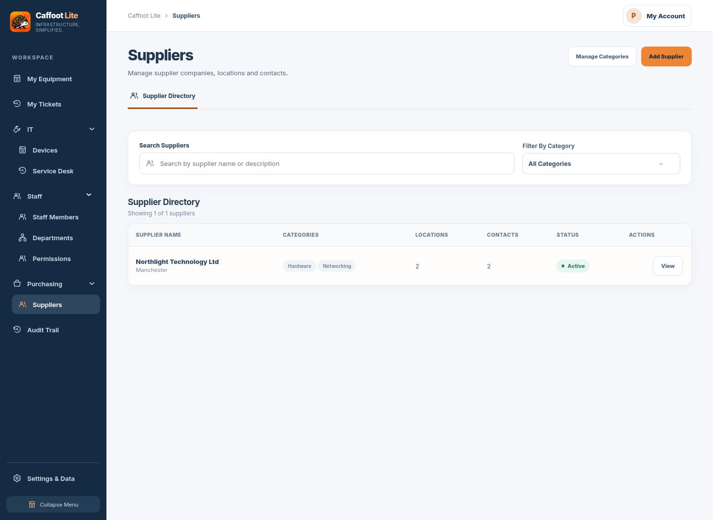

The Supplier Directory presents the main office town alongside each company and provides the live category filter.

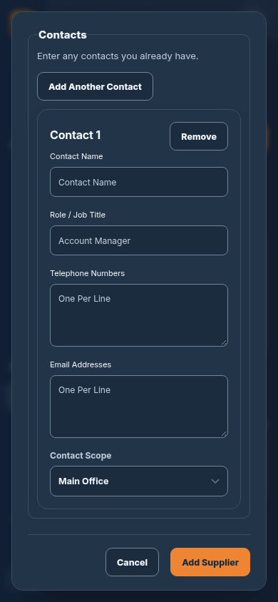

Scroll down to reach the Contact entry and save controls on a narrow screen.

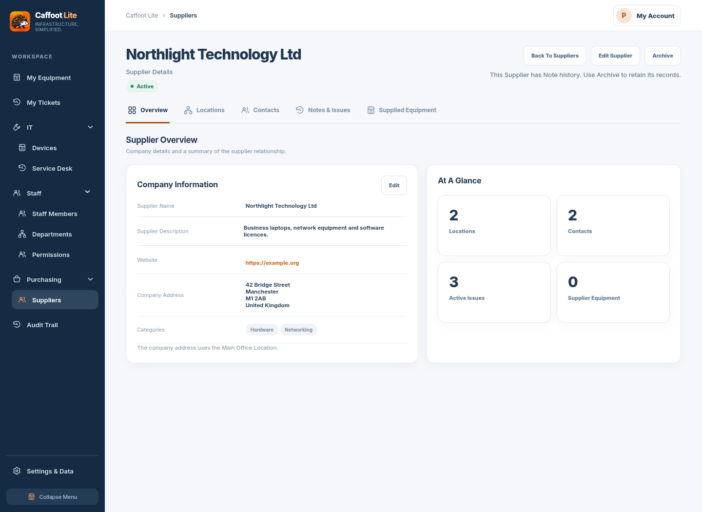

[Connected example: a laptop from Supplier and stock to its final write-off](Connected-Equipment-Journey.md).

## Batch 7C Desktop Illustrations

These images follow the fictional training journey. Read the caption to distinguish a draft, a cancelled preview and a saved outcome. [Complete original coverage and limits](screenshots/batch-7c/Coverage.md).

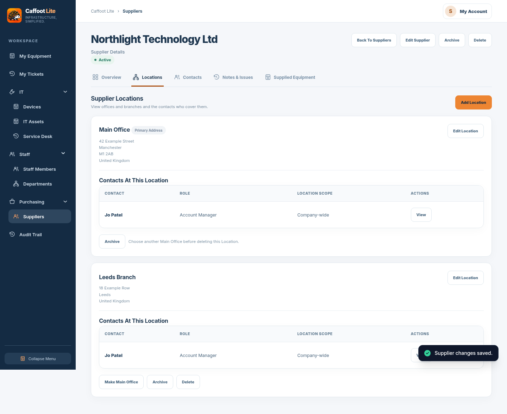

*Draft v2.2 — Northlight has a Main Office and Leeds Branch. Jo is a company-wide contact; the Main Office has protected deletion rules. Independent review and owner visual acceptance pending.*

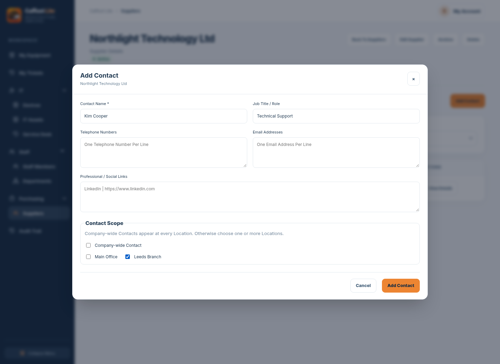

*Draft v2.2 — Kim is an unsaved location-specific contact for Leeds; company-wide and selected-location scopes are independent choices. Independent review and owner visual acceptance pending.*

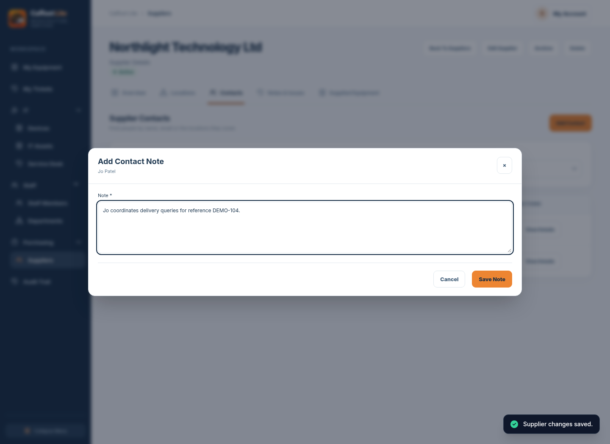

*Draft v2.2 — This unsaved note belongs to Jo, rather than the company. Keep factual work information in the appropriate note owner. Independent review and owner visual acceptance pending.*

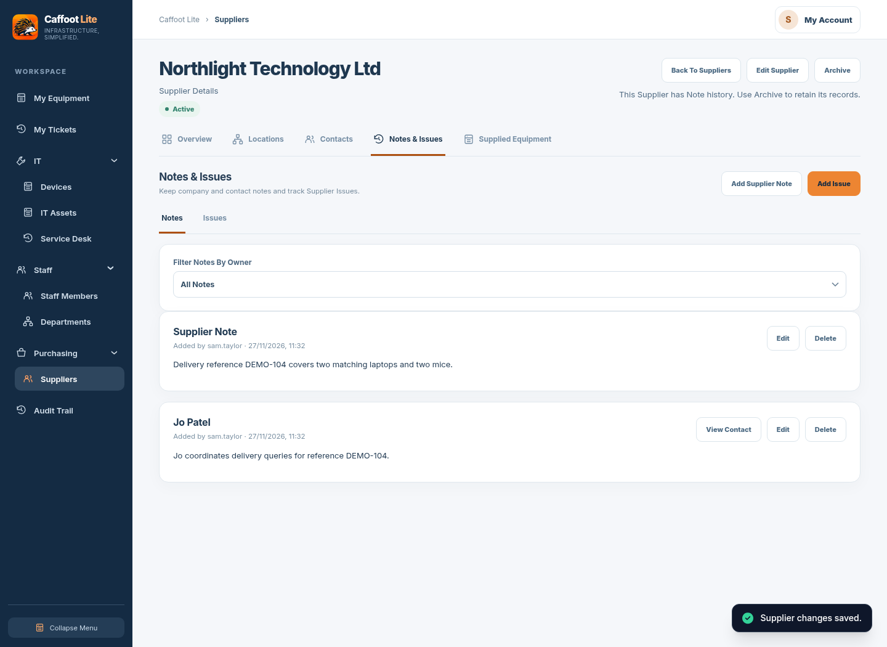

*Draft v2.2 — Saved company and contact notes retain their owners and authors. Supplier Note history protects the company from deletion; Archive retains it. Independent review and owner visual acceptance pending.*

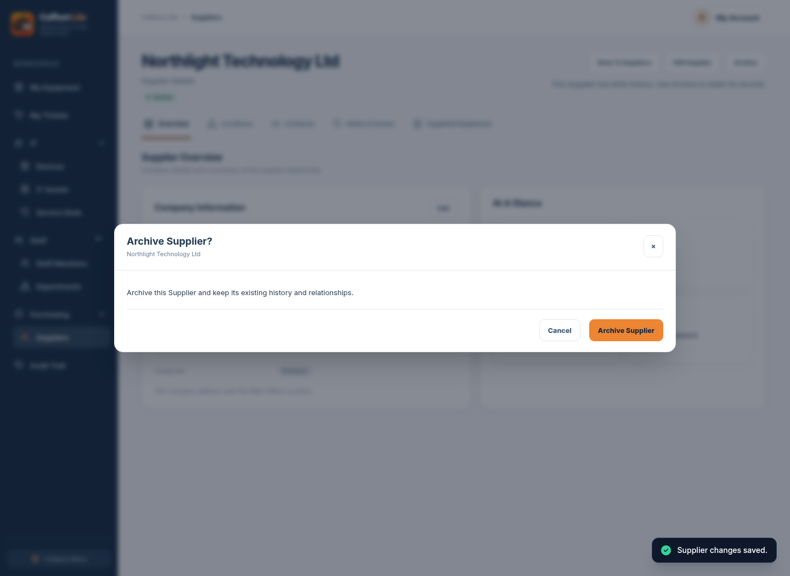

*Draft v2.2 — Archive is a proposed lifecycle action, retaining notes, Issues and equipment links. This confirmation is cancelled for the continuing journey. Independent review and owner visual acceptance pending.*

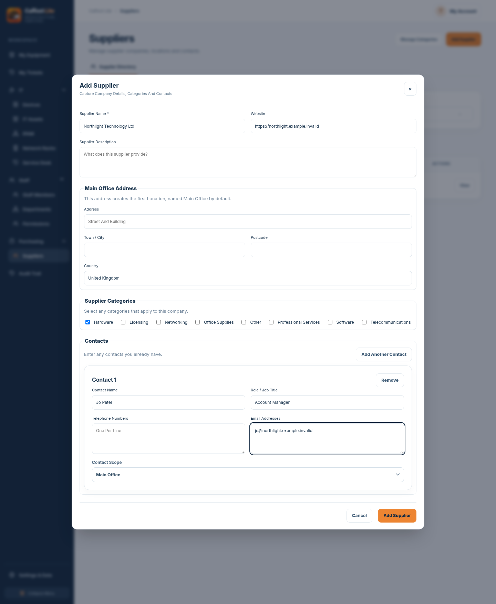

*Draft v2.2 — A representative unsaved Northlight company/contact draft. The continuing journey already has its saved Northlight record; this demonstration draft is discarded, rather than creating a duplicate. Independent review and owner visual acceptance pending.*

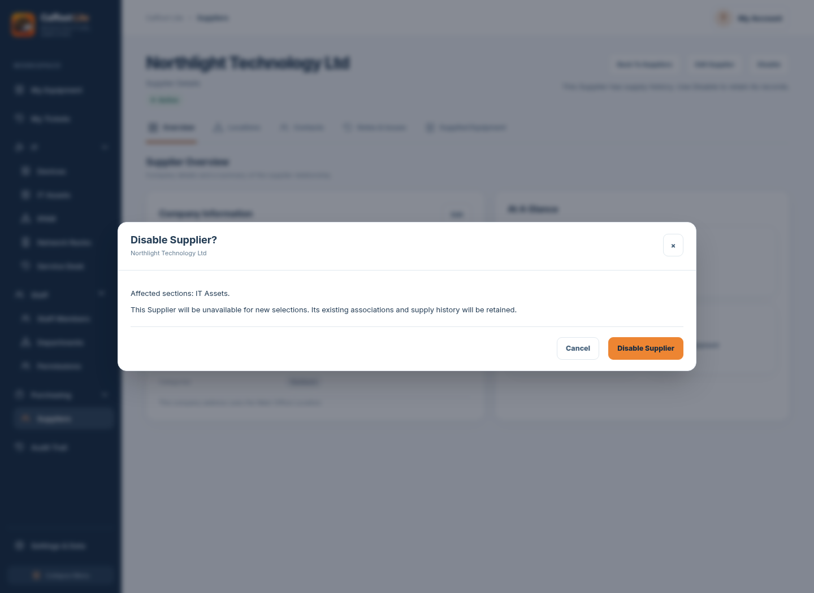

*Draft v2.2 — Only the administrator sees Disable. Review the actual affected sections and retained-history warning before confirming; this preview is cancelled. Independent review and owner visual acceptance pending.*

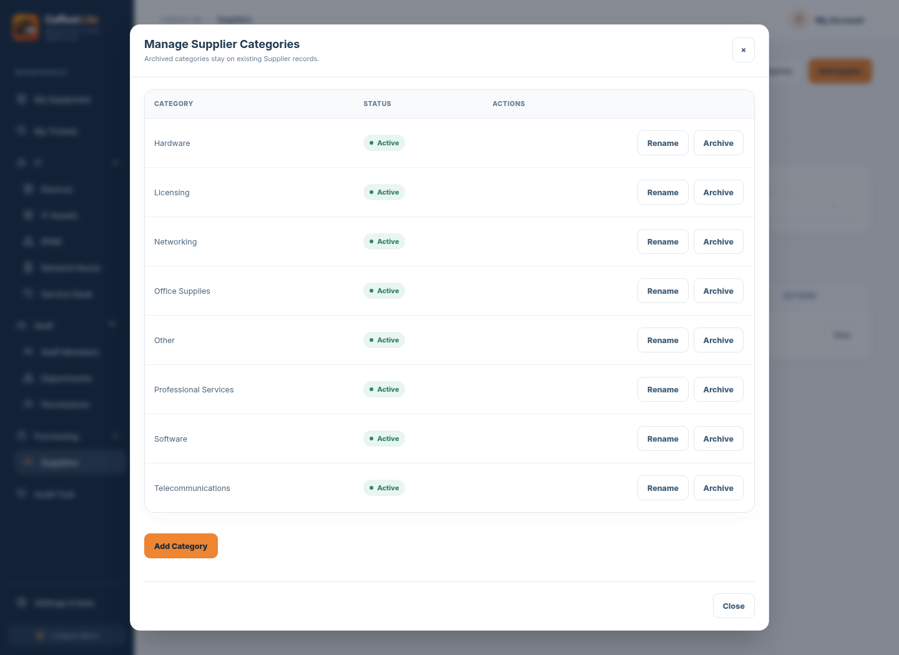

*Draft v2.2 — Supplier company categories have their own Archive and Reactivate controls. This catalogue is independent of Issue Categories and company lifecycle actions. Independent review and owner visual acceptance pending.*

*Draft v2.2 — Original Supplier Directory only: active Northlight, two locations and two contacts. Retain the original fixture, category choices and provenance; this is not a later capture. Independent review and owner visual acceptance pending.*
