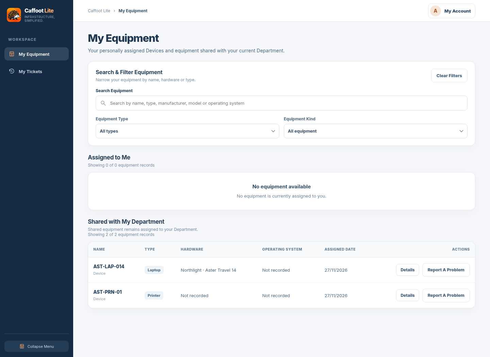
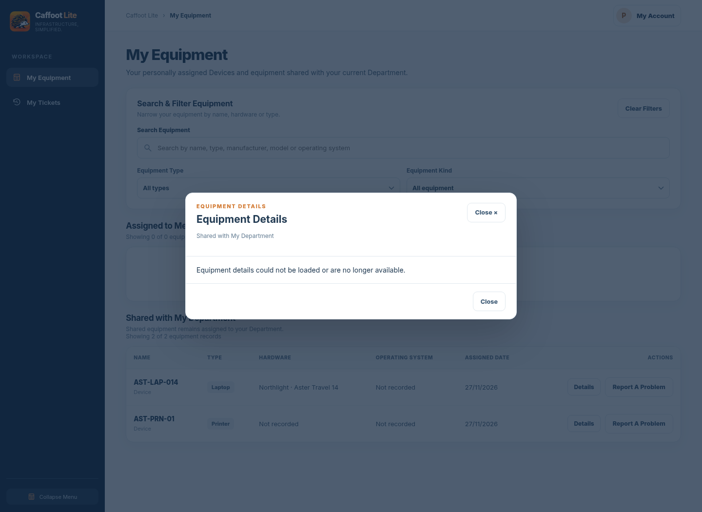
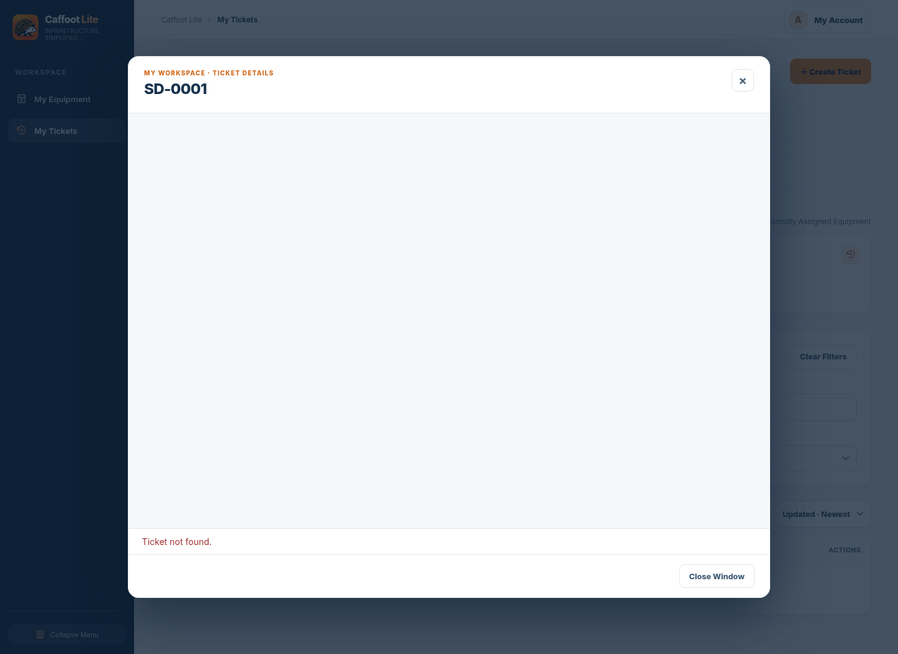

# Batch 7E — Approved R1–R3 Additional Evidence

27 November 2026. [Explicit owner approval](https://github.com/Caffoot/Caffoot-Lite/issues/366#issuecomment-7218233916) authorises exactly three additional images from documentation start `cc82e287ecdf2f5bb3712fda3cc7cc9453f5aafd`. These execute the [review correction proposal](../../../../../development-guide/Milestone-01-Batches-7C-7E-Review-Corrections.md#essential-visual-gaps-and-proposal). Independent review and separate owner visual/privacy/caption/alt acceptance remain pending.

**25 cumulative 7E images and 102 overall; every original 99 image remains unchanged.** This is an explicit cumulative ceiling increase, not a reclassification of historical files or unused 7C spending. My Equipment is 6/6; custody/membership confidentiality 5/5; creation/warnings 5/5, ticket navigation 4/4 and unread/replies 5/5 remain unchanged. 7C remains 41 and 7D remains 36.

[Complete coverage](Coverage.md) · [Manifest and per-image provenance](manifest.json) · [Verification record](Verification.md)

## Isolated Continuation And Exact Before Frames

The existing read-only `pre-handover-with-tickets.sqlite3` snapshot was copied into an isolated disposable local fixture using SQLite's backup API. Its SHA-256 is `e67dc7fb61572ce0706725d6dabbecef615a251976edb670d206a25bb0dca7f1`; the original snapshot remained unchanged. The earlier completed return/Sarah/retirement fixture was not changed. This is fixture preparation, not a product restore or upgrade rehearsal.

The copy retains AST-LAP-014 (`806d2a83-c982-4e8f-914d-ee2828fe4961`), original Alex personal assignment **1**, and original personal ticket **SD-0001** with its unchanged subject and Device identity. Original matching before frames are:

- [Alex's personal equipment list](../batch-7c/alex-before-handover.png): same AST-LAP-014 and baseline employee actor. Reused byte-for-byte, with its original time and provenance.
- [Alex's original SD-0001 list](personal-ticket-saved.png): same original personal-custody ticket. Reused byte-for-byte.
- [Priya's original Accounts membership example](priya-membership-before.png) and [Sales after example](priya-membership-after.png): same Staff/printer identity; these remain earlier examples, not newly captured frames. The R2 copy preserves Priya's actual pre-change Details entry, then performs its own recorded membership change. Its cached background also includes R1's now-shared laptop; it is not portrayed as an exact duplicate of the earlier membership screenshot.

Sam first records the outstanding mouse's actual fictional return separately because unresolved associated equipment blocks direct reassignment. Sam then performs a real checked **Confirm Ready And Reassign** from Alex to **Accounts** for the same canonical AST-LAP-014, dated 27/11/2026. The new current Department assignment is **3**, recorded by `sam.taylor` at **2026-11-27T12:28:24.452408Z**. R1 and R3 both follow this single event. This is not a relabelled photograph of the prior return, Sarah issue or retirement outcome.

Alex remains a current Accounts member with baseline Staff Member access. R1's refreshed projection excludes AST-LAP-014 from Assigned to Me and includes it under Shared with My Department. R3 then opens the original personal-custody SD-0001, which returns 404 to Alex in both personal and Department scopes despite current shared equipment eligibility. Authorised IT retrieval of the same original ticket returns 200 and retains its original Device and subject. **No IT screenshot was taken or implied by this API retention check.**

For R2, Priya's existing AST-PRN-01 equipment Details entry is opened successfully, closed normally and retained in the genuine page. Sam saves Priya's actual Staff Department change from Accounts to Sales. The next read excludes the Accounts printer; its physical custody is unchanged. Clicking the retained Details button causes the application to re-read current equipment and display **Equipment details could not be loaded or are no longer available.** The background is the old pre-change list, not a claim of current eligibility. No DOM substitution, synthetic network response or image manipulation was used.

## New Images

### r1-alex-department-equipment.png

*R1 — Isolated continuation of the preserved personal before-state: the same AST-LAP-014 has genuinely moved from Alex to Accounts Department custody. Alex remains an Accounts member, so the refreshed list now shows it under Shared with My Department, not Assigned to Me. This is not the earlier return/Sarah/retirement journey. Independent review and separate owner acceptance pending.*

### r2-equipment-details-denied.png

*R2 — Priya’s real Accounts-to-Sales membership change leaves the Accounts printer’s custody unchanged. Opening the preserved AST-PRN-01 Details entry re-reads current equipment and displays the genuine unavailable message. The background is the retained pre-change list, not current eligibility. Independent review and separate owner acceptance pending.*

### r3-original-personal-ticket-denied.png

*R3 — After the same R1 personal-to-Accounts handover, Alex can see the shared AST-LAP-014 but the original personal-custody ticket SD-0001 is unavailable. Authorised IT retrieval of the same original ticket returned 200; this screenshot shows only the genuine employee denial, not an IT historical screen. Independent review and separate owner acceptance pending.*

## Provenance

Actual application baseline `000818f42e854e4a1fee8692b9ffaaa52b5c788d`, schema 31. Existing installed Node Playwright **1.62.1**, Chromium **156.0.8078.79**, en-GB, desktop light, 1440 × 1050 viewport and raster, scale 1. Each image's timestamp, hash, actor, exact baseline role/overrides, feature settings, fixture identity and state mappings are in the manifest. Alex and Priya are linked Active Staff with the protected baseline Staff Member role and no general IT grants. Sam has the existing equipment and Staff editing grants with confirmed MFA. All six optional features are enabled in these three captures.

The original capture helper was reused with only its untracked fixture-directory parameter changed. Existing HTTPS/TLS and credentials were reused privately. Capture driver hashes are recorded in `additionalCaptureExecution.captureDriverHashes`. Credentials, MFA/session/CSRF proofs, TLS keys, scripts, databases and the fixture copy remain untracked outside documentation. No dependency or tracked application/configuration/test file changed.

A selector ambiguity between the two genuine Close buttons interrupted R2 preparation before any membership change or R2 screenshot; the resumed helper selected the actual first Close button and completed only R2. R1/R3 were not recaptured or regenerated. The final delivery contains exactly three additional original PNGs.

## Verification

The capture driver checked the actual saved custody event, R1 employee projections, both employee 404 ticket responses, actual IT 200 retention, R2 successful before-Details access, real membership save and unchanged printer custody. These are targeted capture assertions, not broad regression or full application acceptance. All three new images were opened for framing, truthful captions and privacy review. Focused documentation checks passed: three new PNG SHA-256 values and 1440 × 1050 raster/viewport dimensions match the manifest; the original 22 manifest image entries are unchanged; all original 53 7E state ID/label rows and contracts remain in order; 221 original paragraphs in the two affected guides are retained apart from the superseded current-status note; 676 relative destinations and 200 Markdown anchors resolve across nine affected Markdown files. JSON, allocation/count, caption/alt and Git whitespace checks pass. Changes are confined to 13 documentation/evidence paths, including exactly three new PNGs; no 7C/7D pack file or application/dependency/test file changes.

Stop after this checkpoint for independent review and separate owner acceptance. PR #472 remains draft. No further packs, application changes, dependencies, full regression, cloud desktop, private deployment, merge, promotion, release or publication.
