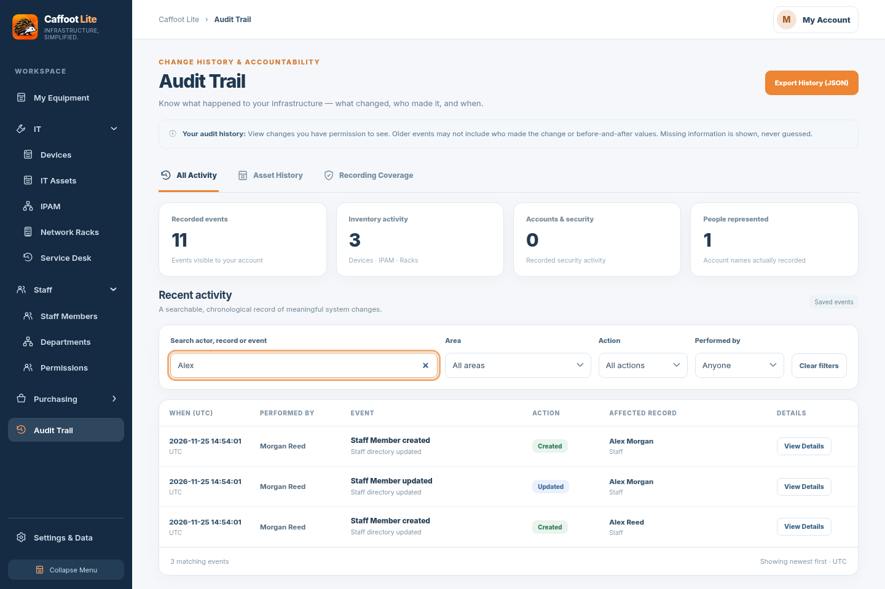
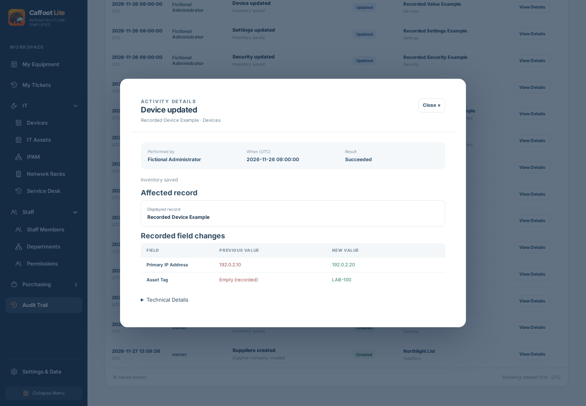
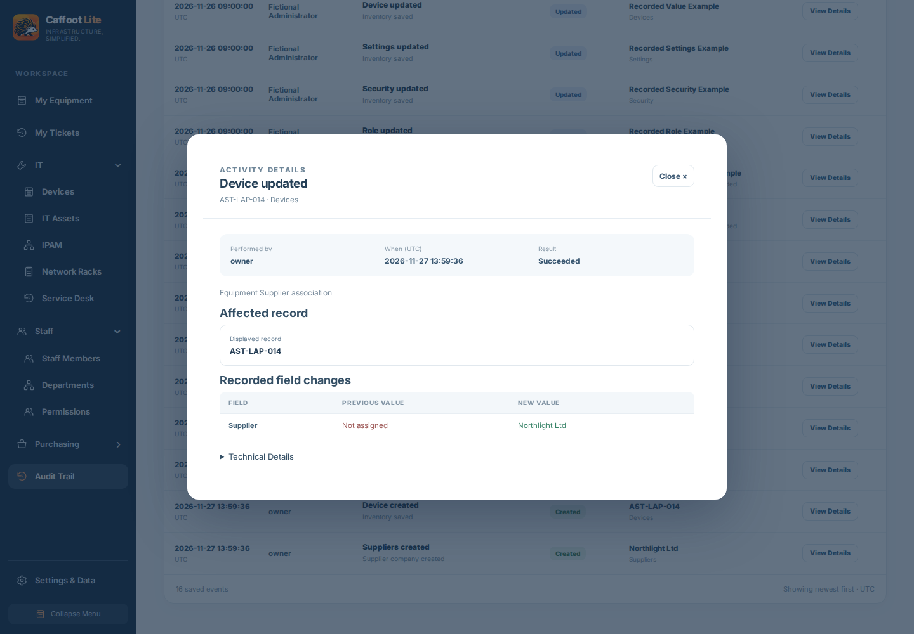
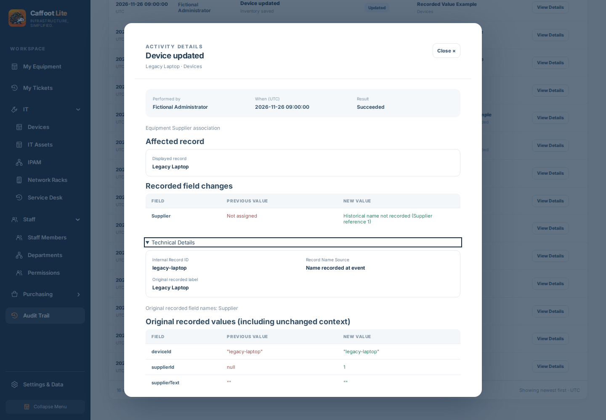
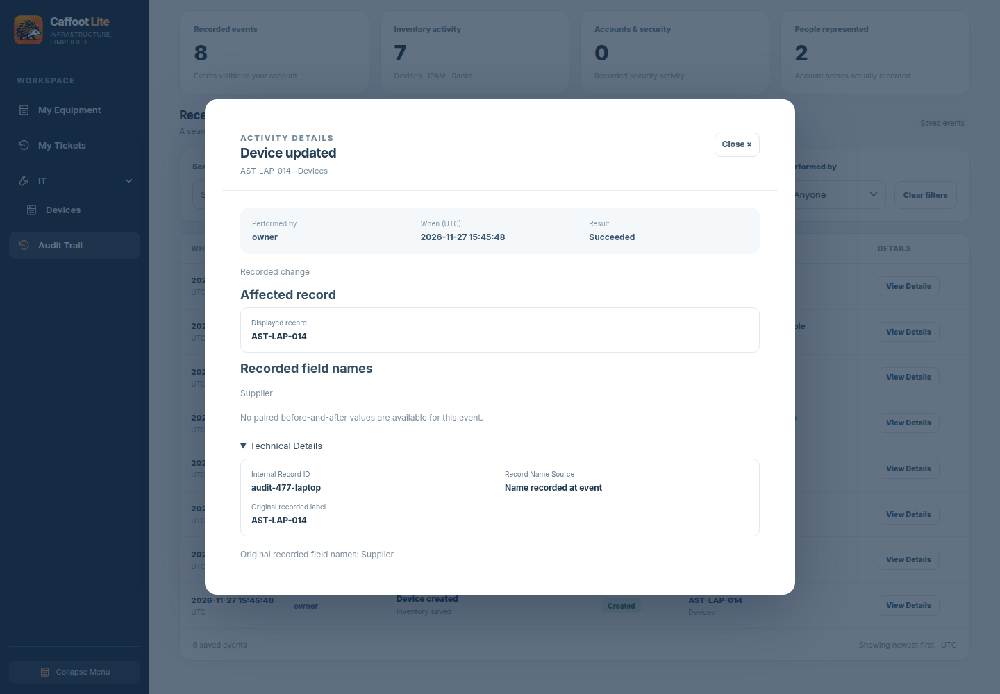
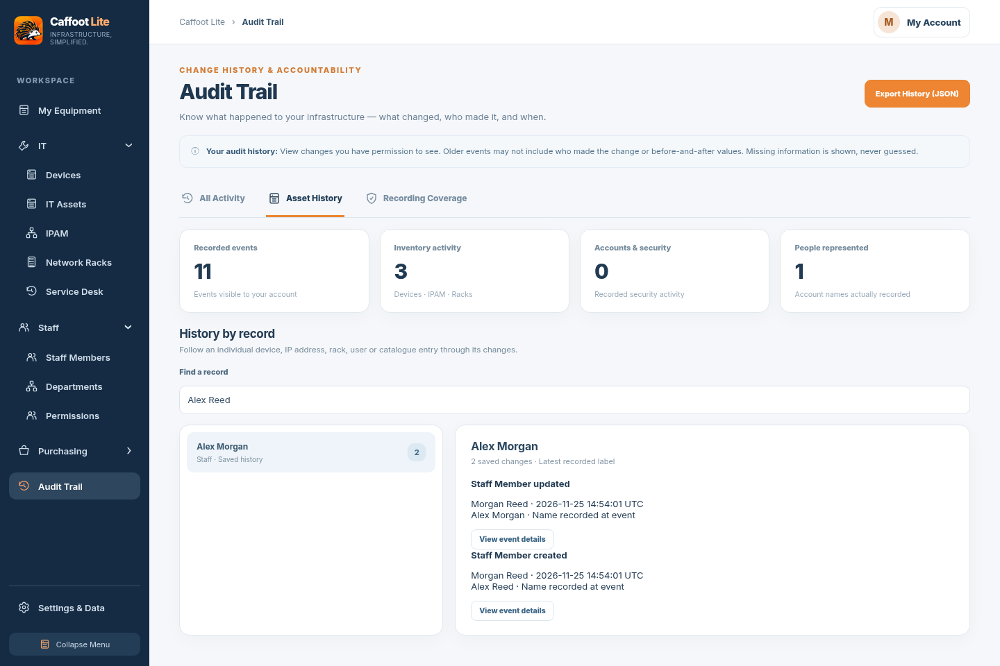

# Read The Audit Trail

> **Draft v2.2 — Unreleased.** These instructions describe v2.2.

The Audit Trail helps you establish what changed, who performed the recorded action and when. An affected-record name describes the record at the time of the saved event, not necessarily its current name. This is a read-only view: searching, opening details or viewing a timeline does not edit the original events.

## Before you start

Sign in using an active account and complete any required MFA. An administrator with confirmed MFA retains essential administration/security history even with optional inventory features off. To open the Audit Trail screen from the current navigation, you need effective Read access to at least one enabled **Devices**, **IPAM** or **Network Racks** section. Independent IT Assets and Suppliers permissions determine which related events and details you may read; those grants alone do not expose the Audit Trail navigation. Staff directory or employee ticket eligibility alone does not grant the general Audit Trail. An administrator with all infrastructure features off retains essential history through the protected history service, but this does not make the Audit Trail screen available. Open **Audit Trail** from the sidebar when it is offered. Your administrator controls the section permissions and optional features that determine which events are available. Some details and complete events may be withheld, including Device-linked stock events when Devices access is unavailable. A missing event or area is not evidence that no change occurred.

## Find an event

1. Open **All Activity**. The list shows authorised saved changes, newest first, with UTC timestamps, recorded actors, actions and affected records.
2. Enter a name, original reference, actor or event wording in **Search actor, record or event**.
3. Select **Area**, **Action** or **Performed by** to narrow the results. The Area choices reflect visible saved history. Staff Member and Department changes appear under Staff; role changes under Users. The Service Desk area covers the existing Clean Start ticket-data summary if visible to you, not ticket conversations.
4. Select **Clear filters** to return to the unfiltered list. If no events match, revise or clear the filters.

For example, a Staff Member named Casey Reed may later be renamed Casey Morgan. The older saved event remains Casey Reed if that name was captured, while the subsequent event displays Casey Morgan. Searching for the original name can still find the earlier recorded change.

*Search and filter saved events, then choose View Details on the relevant row.*

## Understand the affected record

Select **View Details** beside an event. The dialogue retains the original actor, UTC time, result, reason and available field changes, and shows:

- **Displayed record:** the name or original reference used in the list.
- **Recorded field changes:** understandable field labels and genuinely different recorded values. A missing value is **Not recorded**; an explicit null or empty value is identified separately, unless the event's known meaning establishes **Not assigned**. If a before-and-after pair is not available, the saved field names describe the event without claiming an exact difference. **No paired before-and-after values are available for this event** means the values are not available in your view; they may not have been recorded or may be withheld by your permissions.
- **Technical Details:** expand to inspect the **Internal Record ID**, **Record Name Source**, **Original recorded label**, original field names and raw values (including unchanged context). This is collapsed initially. It contains only information already available to your account. A recorded ID alone does not prove continuity across replacement or reset.

*Recorded field changes lists the saved differences for this event.*

### Supplier association changes

For equipment Supplier association events, the **Supplier** row combines the recorded reference and name where supported. A Device with no linked Supplier and an explicitly empty recorded Supplier name is **Not assigned**. A recorded free-text name is shown as entered. A receipt's Supplier association concerns its linked Supplier, not the original receipt text.

New association events record the linked company's bounded name at the time of that change, if available. The previous company's name describes the company at the time of this change, not necessarily its name when first assigned. Subsequent renaming or disabling does not rewrite an earlier event. Older events with only a numeric reference show **Historical name not recorded (Supplier reference …)**, not today's company name. A name unavailable to your account is shown as **Historical name not available**. Technical Details retains the original references and permitted recorded values. No new Supplier name is disclosed to accounts without Suppliers access; other existing permission and redaction rules remain unchanged.

For example, a Device is linked to fictional supplier Northlight Ltd. The new event records that name. If the company later becomes Northlight Services, the first event still displays Northlight Ltd; a subsequent association change may record Northlight Services as the previous company at that later event. Older ID-only events cannot be reconstructed from the current directory.

Older Staff records may contain only an internal identifier. That is not a fault in the current Staff directory. The Audit Trail cannot reconstruct an unrecorded name using today's record, and does not guess. Older Department names can be shown from trustworthy saved event values, including a deleted Department's recorded name. Use **Close** or Escape to return to the event list without changing history.

*The Supplier row shows the company name recorded at the time of the association change.*

*Expand Technical Details to inspect original references and permitted recorded values.*

*Unavailable values are not disclosed by expanding Technical Details.*

## Follow history by record

1. Open **Asset History**.
2. Enter a saved name or canonical reference in **Find a record**. Earlier recorded names can match the history.
3. Select the record in the list. The timeline shows its saved changes and the name attached to each event; **View event details** opens the same detail dialogue.
4. Where identity continuity is verified, the group uses the latest recorded label. Distinct people with the same name are not joined. Where continuity cannot be established, a change is shown independently with **Identity not verified** and **No verified link to other events**. Reused inventory or movement identifiers, imported inventory and Clean Start are reasons to avoid treating an identical identifier as proof of the same historical record.

*Select a record to follow its saved events; each event retains its recorded name.*

## Optional Feature Names

For optional-feature setting changes, the affected record displays **IT Assets**, **Equipment Lifecycle** or **Suppliers** for the saved identifiers `it_assets`, `equipment_lifecycle` and `suppliers`. A friendly name recorded with the event takes precedence. When a name is supplied only by this display mapping, **Record Name Source** in Technical Details explains that it is a friendly name for the recorded identifier.

Open **View Details**, then expand **Technical Details** to inspect **Original recorded label**, any recorded Internal Record ID and the original before/after values. Searching still matches the original identifier. Unknown identifiers and unrelated events retain their existing presentation. The display does not rewrite historical records or change JSON export.

## Check Recording Coverage

1. Open **Recording Coverage**. Read its retention and permission explanation. History has no automatic expiry and the Audit Trail offers no delete/purge control.
2. Use the following recording limits. The panel's account/security rows still say **In development**; those broad labels are not a complete list of the specific writers already implemented.

   | Recorded area | Scope and limits |
   | --- | --- |
   | Inventory | Saved Device, IPAM, Rack/accessory and catalogue changes; supported imports, Clean Start and integrity repairs. Older events can lack actors or complete before/after values; large changes may retain a summary rather than every individual field. |
   | People and access | Staff and Department changes; implemented account creation/status, role/permission and employment/login changes. Access to private administration events is restricted. |
   | Equipment and Suppliers | Implemented custody/Department relationship, stock/movement/correction, Supplier and lifecycle writers, subject to feature and equipment permissions. Not every record shares a provable lifetime identity. |
   | Settings and security | Implemented calendar/category, template draft/publish/default-load, branding and SMTP save/test events; implemented password, MFA enrolment/removal, recovery and blocked-sign-in events. Passwords, authenticator secrets and verification/recovery codes are not recorded as event contents. |

3. Use **All Activity → View Details** to inspect what the individual event actually retained. A saved label or summary does not establish that every action was recorded. Do not assume every successful/failed sign-in, page view, download or JSON export has a matching event; the interface does not promise comprehensive access logging.
4. For a ticket's conversation, use its authorised **Overview**, **Updates** and **History** in the Service Desk. Ticket messages, internal notes, attachments, assignment/status changes and resolution attempts have their own ticket records. They are not copied wholesale into application Audit Trail. Central calendar/template administration and the retained Clean Start summary are separate recorded events.

## Export and recording coverage

1. Review the scope above, then select **Export History (JSON)**. It downloads the loaded authorised history, not just rows matching your current search/filter.
2. Store it in an approved restricted location and share it only with authorised recipients. It can contain historical names, equipment references and other permitted private information.
3. Keep a separate complete installation backup for recovery.

The JSON retains original recorded fields, labels and references, and new bounded subject metadata where recorded and authorised. It is not a complete database backup and does not grant access to redacted fields. Store the downloaded file securely; it may contain authorised historical information. Do not use it as an inventory restore file.

If you cannot find a change, clear filters, check the date in UTC and verify permissions with your administrator. If an original name or reference is missing, preserve the event as recorded. Do not edit database rows to repair an audit label. The existing retention and permission rules remain unchanged. Service Desk conversation text and authentication secrets are not added by this feature.

Related: [Roles, Section Permissions And MFA](Roles-Section-Permissions-and-MFA.md), [Staff Members](Staff-Members.md), [Legacy Import And Docker Upgrade](Legacy-Import-and-Docker-Upgrade.md).

[Follow the connected Aster Services support request](Connected-Service-Desk-Journey.md) · [Draft v2.2 guides](README.md)
