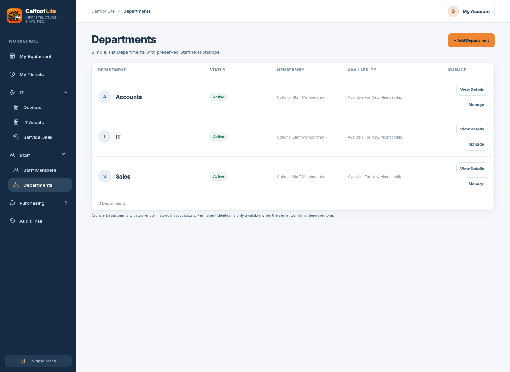
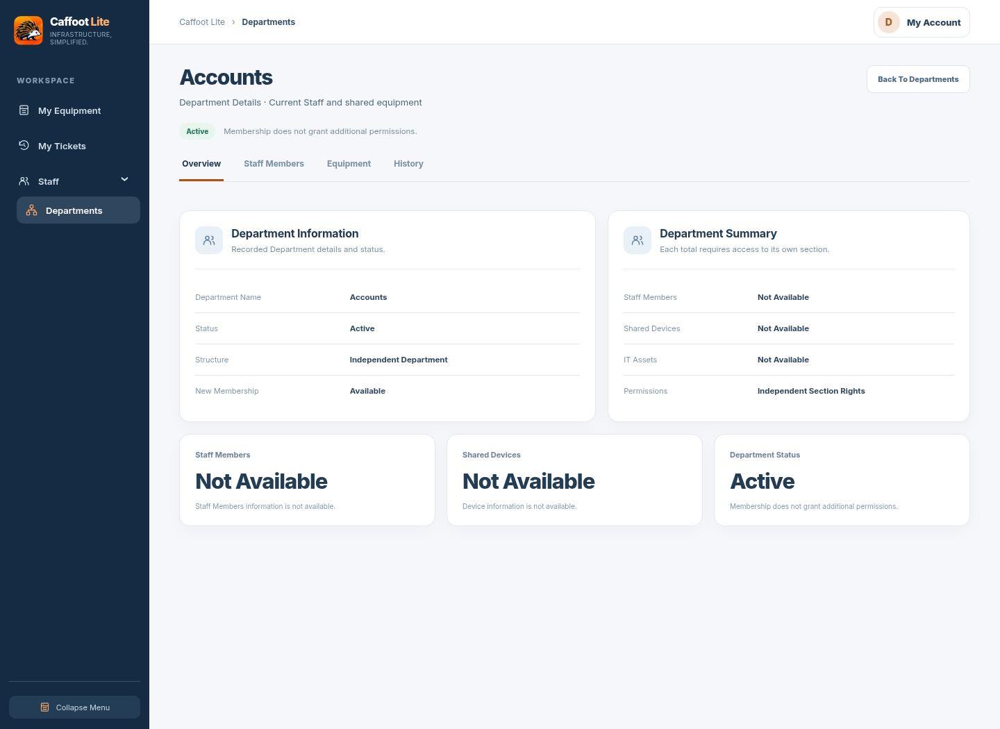
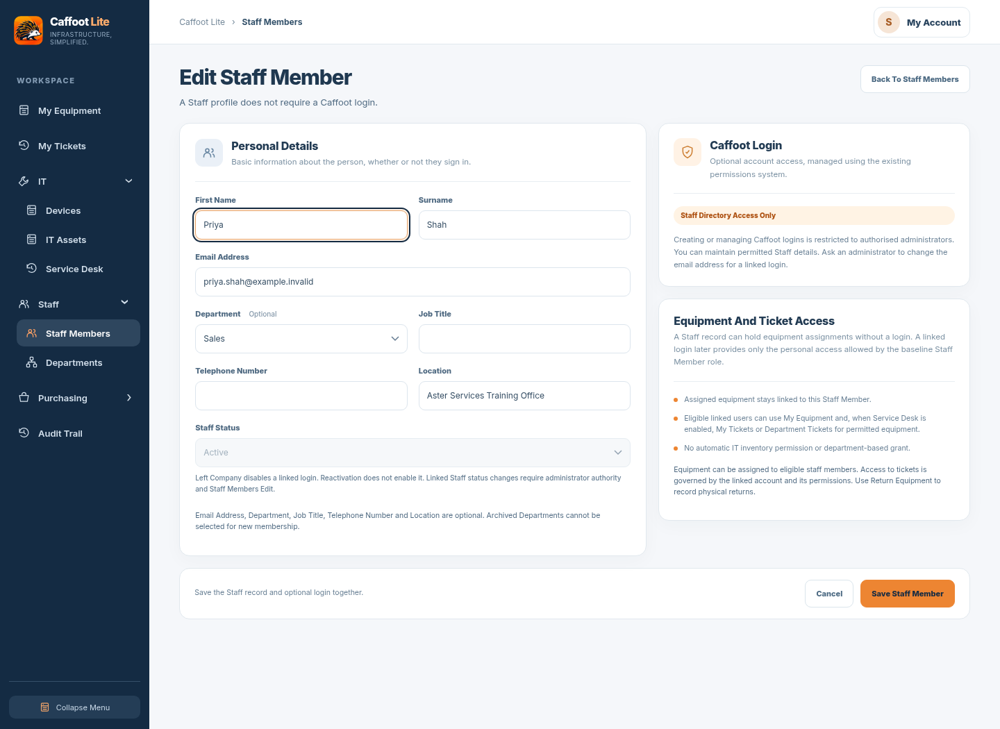
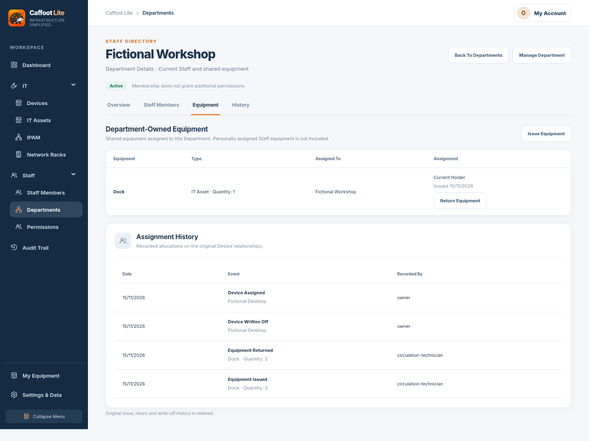
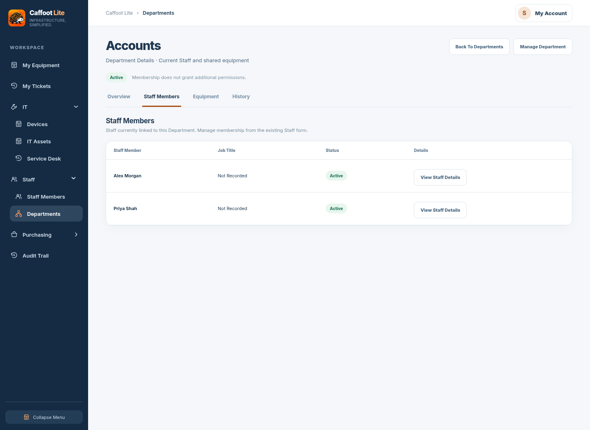
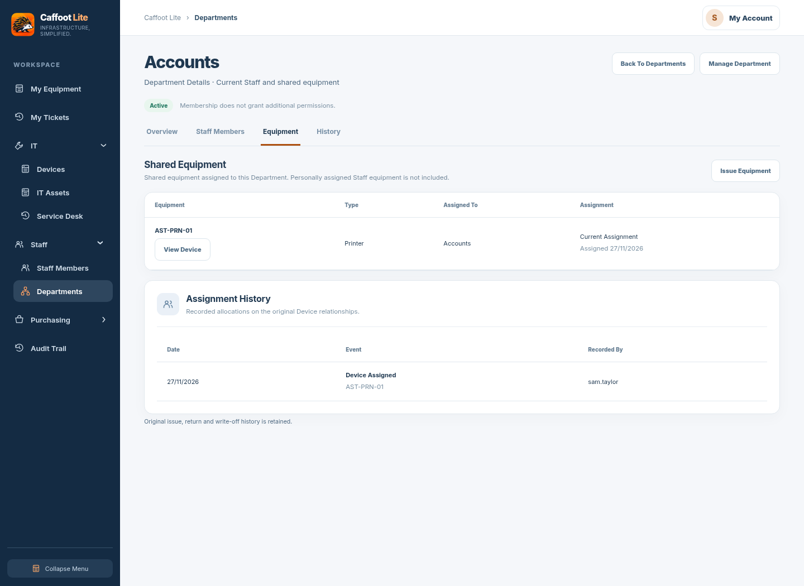
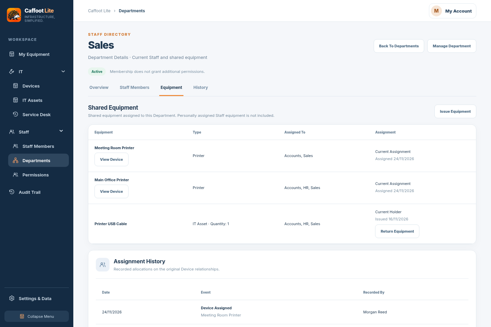
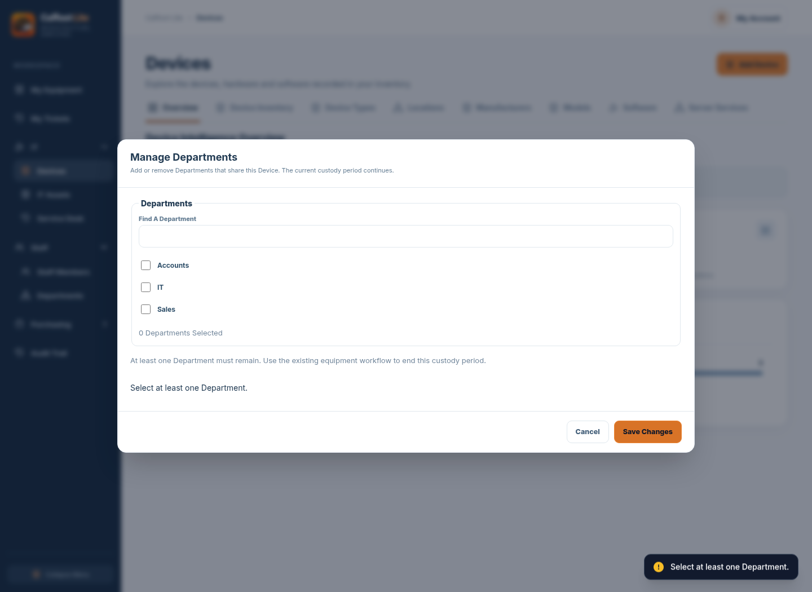
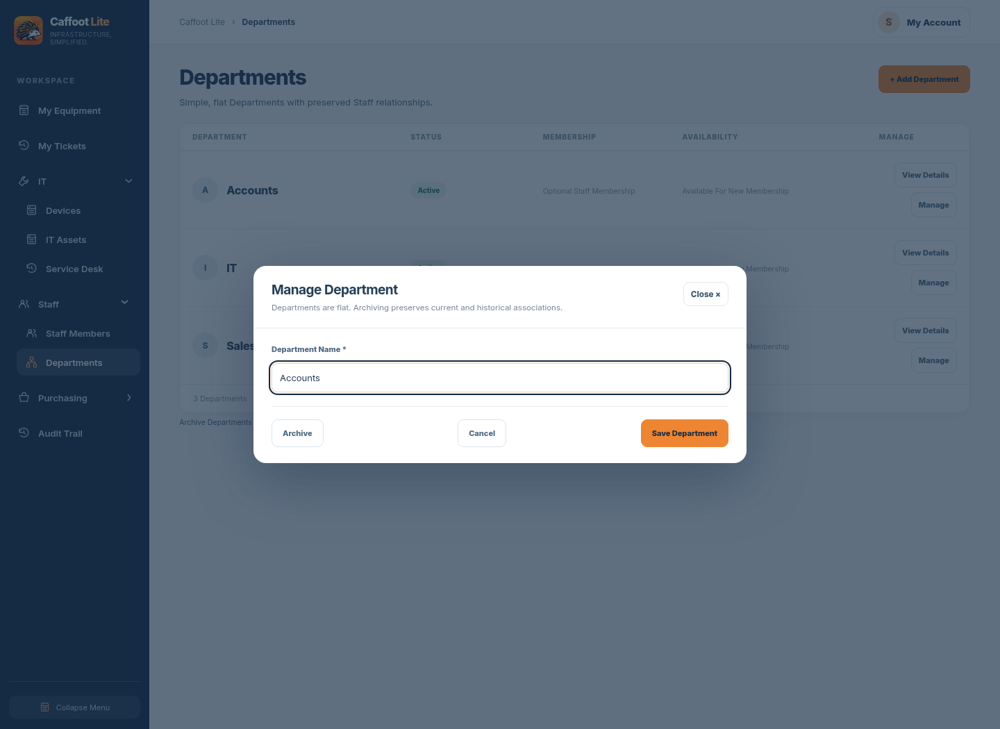

# Departments And Shared Equipment

> **Draft v2.2 — Unreleased.** v2.1 remains the published release. These instructions describe v2.2.

Departments group Staff Members and provide a holder for equipment used collectively, such as an Accounts printer. They are simple independent groups, without subdepartments or management trees. Membership is optional and grants no application permissions.

An eligible Desktop, Laptop or Printer can be shared by several Departments in one physical custody period. Every assigned Department has equal access through its existing membership. Personally assigned equipment and standalone IT Asset issues keep their existing recipient rules.

## Before You Start

| Task | Required access |
| --- | --- |
| View Departments and Department Details | Departments Read. |
| Add, rename, archive, reactivate or delete an unused Department | Departments Edit. |
| View Staff membership in Department Details | Independent Staff Members Read. |
| Change someone's membership | Staff Members Edit, through the existing Staff Add/Edit form. |
| View shared Devices or IT Assets | Read access to the corresponding enabled equipment section. |
| Initially assign an eligible existing Device or manage its assigned Departments | Devices Edit, with Devices enabled. |
| Issue or return IT Assets stock | IT Assets Edit, with IT Assets enabled. Canonical Device stock work also requires Devices Edit and Devices enabled. |

Staff Members and Departments are core sections and do not depend on the IT Assets switch. Individual account administration uses **Staff Members → Staff Details → Manage Permissions**, while reusable roles use **Staff → Permissions → Manage Roles**; Departments Edit does not grant it. See [Roles, Section Permissions And MFA](Roles-Section-Permissions-and-MFA.md) and [Optional Features](Optional-Features-and-Link-To-IPAM.md) if controls are unavailable.

## Find Departments And Interpret Empty Panels

Open **Staff → Departments** to see the list, including **Active** and **Archived** records. The current directory has no search or status-filter control; review the displayed names and status badges. A new installation can show **0 Departments**. Create one only when it represents a real group.

Details can show **No Staff Members In This Department** or **No Recorded Activity Available**. Equipment has its own empty and restricted states. A missing permission or failed load is not evidence that there are no members or equipment. Check the selected tab, feature switches and relevant access, then reopen Details to retry.

*Accounts, Sales and IT are independent flat Departments. Membership grants no security role, and Archive preserves current/history associations.*

*Departments Read alone does not disclose Staff or equipment counts. Not Available means missing independent permission, rather than an empty Department.*

## Add A Department

1. Expand **Staff** in the sidebar and choose **Departments**.
2. Review existing names first. Avoid a near-duplicate caused by a spelling difference.
3. Choose **+ Add Department**.
4. Enter a unique **Department Name**, for example fictional **Accounts**, using no more than 120 characters.
5. Choose **Save Department**. The Department appears as **Active**, with **Available For New Membership**.
6. If the save is rejected, read the message, correct the name or conflict and save again. Empty and duplicate names are not accepted.

**Cancel**, **Close ×** or Escape closes the editor without saving the name. Creating a Department does not add members, assign equipment or grant anyone access.

## Rename A Department

1. Choose **Manage** beside the Department, or open **View Details → Manage Department**.
2. Change **Department Name** and choose **Save Department**.
3. Check the saved name in the directory and Details view.

The Department retains its identity and existing links. Current holder displays use its current name; original assignment history retains the label recorded at the time. Cancelling the editor leaves the saved name unchanged.

## Add, Change Or Remove Staff Membership

1. Open **Staff → Staff Members** and find the correct person.
2. Choose **Edit**, or **View Details → Edit Staff Member**.
3. Under **Department**, select the intended active Department. Select **No Department** to remove current membership.
4. Choose **Save Staff Member**, then verify the saved membership.
5. With Staff Members Read and Departments Read, open the Department's **View Details → Staff Members** to check its current members.

An authorised Staff editor receives the limited Department names needed for this form without gaining the general Departments section. Departments Read alone does not permit Staff membership changes.

Moving someone from Accounts to Sales changes their Department-shared equipment visibility on the next My Equipment request. It does not move the Accounts printer, transfer their laptop or alter either Department's equipment assignments. Use the relevant equipment workflow to change an actual holder.

*Priya’s unsaved Staff edit selects Sales instead of Accounts. Saving membership changes shared visibility but does not assign or move a Device or change her baseline security role.*

## Department Details

1. Open **Staff → Departments → View Details** beside the group.
2. Start with **Overview** to confirm its name and status.
3. Choose the relevant tab below. On narrow screens, scroll the tab row or wide tables sideways. Arrow keys, Home and End also move between tabs.
4. Use **View Staff Details** or **View Device**, where offered, to open the original permitted record.
5. Choose **Back To Departments** to return to the directory. Viewing tabs saves no changes.

| Tab | What it shows |
| --- | --- |
| Overview | Name, status, independent structure and New Membership availability. Staff, Shared Devices and IT Assets summaries require independent access. **Not Available** is not a zero count. |
| Staff Members | Current members, including Left Company Staff whose membership is retained. Change membership through the Staff form. |
| Equipment | Devices shared with the Department and outstanding IT Assets issued to it, followed by recorded equipment history. A Device shared with Sales and Accounts appears in both Departments and opens the same inventory record. Its outstanding explicitly associated accessories appear with the same current Departments when you have Devices and IT Assets access. Personally assigned Staff equipment is excluded. |
| History | Available recorded Department changes and authorised equipment activity, with dates and responsible accounts. Visibility depends on access to the existing history/equipment services. An empty state does not prove no changes have occurred. |

The IT Assets summary counts outstanding issued quantities; it is not stock physically held by IT. Equipment dates and history remain on their original records, rather than being copied into a separate Department inventory.

After a successful equipment assignment, change of shared Departments, reassignment, issue or return in this browser, an open Department view reloads its authorised equipment and history data automatically. Reopening Department Details also requests current data. An older response cannot overwrite a newer reload. No browser refresh or background polling is needed. Changes made in another browser become visible when you reopen Details.

If a panel could not load, reopen Details to retry. Check your access before interpreting a missing count or panel. Devices and IT Assets follow their own switches: disabling one hides its information without removing relationships or preventing authorised use of the other.

*The dock remains assigned to the Department once; the history records its original issue and partial return. Personally assigned Staff equipment is excluded from this view.*

*Authorised Staff Members Read exposes the Department’s current people. Personally held equipment is not the Department’s shared stock.*

*Accounts shared equipment contains the original AST-PRN-01 assignment. A member’s personally held laptop is not copied into this Department table.*

## Change Which Departments Share A Device

Open **Device Details → Assigned To → Manage Departments** with **Devices Edit**. For example, if Finance joins Accounts in using the same printer, tick Finance, leave Accounts selected and choose **Save Changes**. Choose **Cancel** to keep the saved Departments. Use the physical return or handover workflow when the Device actually changes hands.

A saved addition gives eligible Finance members access to employee-visible Device tickets and new associated accessory tickets from the current custody period. Earlier accessory tickets with unverifiable audiences stay with authorised IT. Removing Finance ends that access on the next request. Previous custody-period tickets remain restricted to authorised IT. If Finance is later added back during the same custody period, current-period access resumes. [Manage Departments](Device-Assignments-and-My-Equipment.md#change-the-departments-sharing-a-device) · [Ticket confidentiality](Service-Desk-Tickets.md#shared-device-ticket-confidentiality)

*The Sales row opens the same Main Office Printer that Accounts uses.*

*Manage Departments rejects an empty selection. This is a selection change within the same physical custody, not a return/reissue or transfer of the printer.*

## Assign Shared Equipment

### An Existing Device With No Equipment History

Use initial allocation for an eligible existing Desktop, Laptop or Printer that has never been assigned or recorded in equipment stock.

1. Open the original Device Details view and select **Assigned To**.
2. Choose **Assign Device**, where the Device is eligible and you have Devices Edit.
3. Set **Assign To** to **Department**.
4. Use **Find A Department** and tick one or more active Departments.
5. Choose **Confirm Assignment** and check the holder and **Assignment History**.
6. With Departments Read, open Department Details → **Equipment** to see the same saved relationship.

The Device must be Active, physical and free of previous assignment or equipment-stock history. A recorded stock Device requires [registration/reissue](Device-Stock-Registration-and-Reissue.md); a current holder change may require [direct handover](Associated-Equipment.md#reassign-a-workstation-directly). Follow [Device Assignments And My Equipment](Device-Assignments-and-My-Equipment.md) for full eligibility and rejection behaviour. Initial allocation does not create stock or mark equipment Ready.

### IT Assets Stock

1. Open an active Department's **Department Details → Equipment**.
2. Choose **Issue Equipment** with IT Assets Edit. The Department is preselected.
3. Follow [Issue Equipment](IT-Assets-Issue-Return-and-Write-Off.md) to select genuine Ready stock, enter quantities and review the confirmation.
4. After saving, check the outstanding quantity on Equipment and the original stock movement in IT Assets.

For a registered Device, use its specific registration/reissue route with both equipment permissions. **Return Equipment** beside outstanding Department stock records actual physical returns, including from archived Departments. A missing item is not a physical return; follow the appropriate Write Off procedure.

### Example: Shared Printer And Personal Laptop

This example is fictional. **Accounts** holds printer **AC-PRN-01** and two issued adapters. **Priya Shah**, a member of Accounts, personally holds laptop **AC-LAP-07**.

- Accounts → Equipment shows the printer and two outstanding adapters. It excludes Priya's laptop.
- Priya's My Equipment → **Assigned to Me** shows the laptop.
- **Shared with My Department** shows the Department printer and adapters, subject to their feature switches. Priya does not become their individual holder.
- If Priya moves to Sales, the Accounts shared items disappear from Priya's next personal request. The printer and adapters remain assigned to Accounts; the laptop remains assigned to Priya.

Membership changes create no stock receipt, stock issue or duplicate Device.

## Archive A Department

Archive a Department that should no longer receive new members or equipment, while preserving its existing relationships.

1. Open **Manage** in the directory, or **Manage Department** from Details.
2. Choose **Archive**.
3. Read and confirm the prompt explaining that existing associations are preserved. Cancelling the prompt leaves status unchanged.
4. Check **Archived** in the directory and Details. New membership and new equipment assignments are unavailable.
5. Review existing members and equipment with the necessary access. Change membership or resolve outstanding equipment through its normal workflow.

Archive changes status after its own confirmation; it does not save a changed Department Name typed into the editor. Save any rename separately.

Archiving keeps Staff membership, equipment holders, movement dates and history. It does not move members, return stock, close assignments, disable accounts or change permissions. Existing archived membership can remain during an unrelated Staff edit. Shared equipment stays linked to the archived Department; archive does not manufacture personal assignments for its members.

*Accounts has membership/equipment history. The management dialog explains retention; permanent deletion is unavailable where associations must remain. This draft is cancelled.*

## Reactivate Or Delete An Unused Department

To reactivate, open **Manage** or **Manage Department**, choose **Reactivate** and confirm. The Department becomes eligible for new memberships and assignments again. History stays intact; previous equipment is not automatically reissued.

Permanent deletion is more restricted:

1. Open the Department editor and look for **Delete Department**. It is offered only when the server reports no current or historical associations.
2. Confirm that this is an unused record intended for removal.
3. Choose **Delete Department** and accept the permanent-deletion prompt. Cancel the prompt to retain it.
4. If deletion is rejected because an association exists or was added meanwhile, archive instead. Do not delete Staff or equipment to force deletion.

Moving all current Staff out of a Department does not necessarily make it deletable: historical memberships and equipment relationships are protected too. A deleted record cannot be restored with Reactivate, which applies only to retained archived records.

## Troubleshooting And Safeguards

| Problem | Guidance |
| --- | --- |
| A Department is absent from a picker | Check whether it is archived. Reactivation requires Departments Edit; a new spelling is not a repair for the original relationship. |
| Details shows Not Available | Check rights to the particular Staff, Devices, IT Assets or history source. It is not evidence of an empty Department. |
| A member's laptop is absent from Department Equipment | Personally assigned equipment is excluded. Review Staff Details or the original Device. |
| A rename has not rewritten old assignment text | Historical labels preserve the recorded name; current holder displays use the current name. |
| Archive has not disabled logins | Membership, Department status and account access are separate. Use authorised account administration. |
| Equipment remains after archive | Existing assignments are preserved. Record actual returns, write-offs or eligible handovers to change custody. |
| A connection interruption obscures the save result | Reopen the Department and inspect the saved state before retrying. |

The server rechecks permissions, status and associations at save time. A button in an older open screen does not guarantee the action is still eligible. Unsafe deletion or assignment is rejected without removing existing relationships.

## Related Guides

- [Staff Members](Staff-Members.md)
- [Device Assignments And My Equipment](Device-Assignments-and-My-Equipment.md)
- [Issue, Return And Write Off](IT-Assets-Issue-Return-and-Write-Off.md)
- [Device Stock Registration And Reissue](Device-Stock-Registration-and-Reissue.md)
- [Associated Equipment](Associated-Equipment.md)

[← Draft v2.2 Guides](README.md) · [Published v2.1 Guides](../../../historical/features-and-instructions/v2.1/README.md)

[Connected equipment example — Supplier, stock, assignment and later use](Connected-Equipment-Journey.md).
