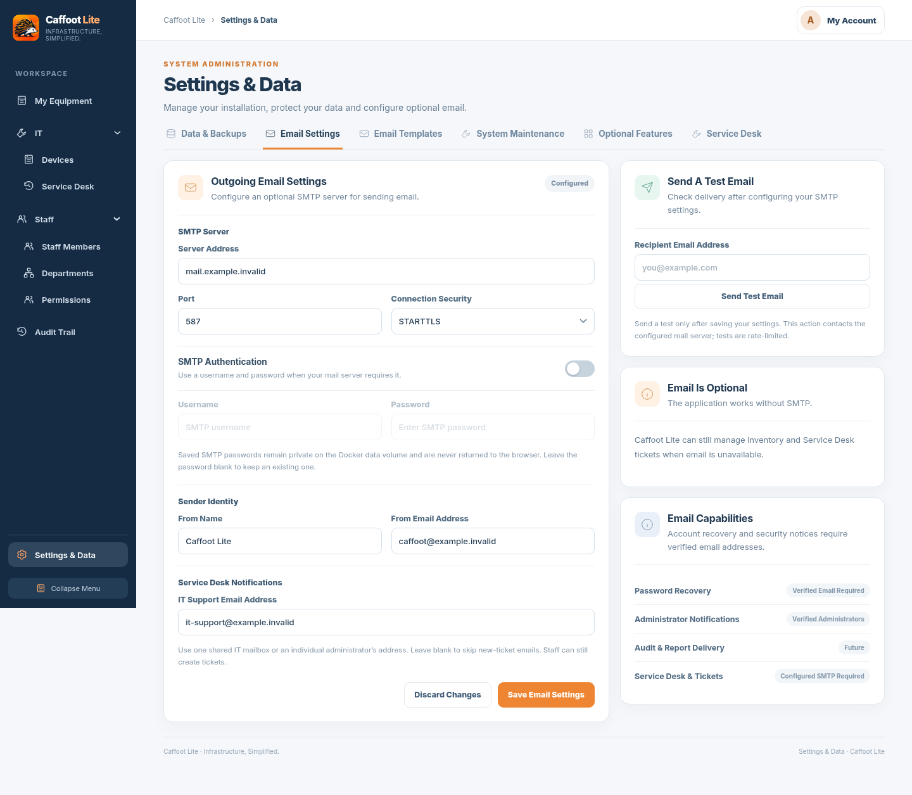
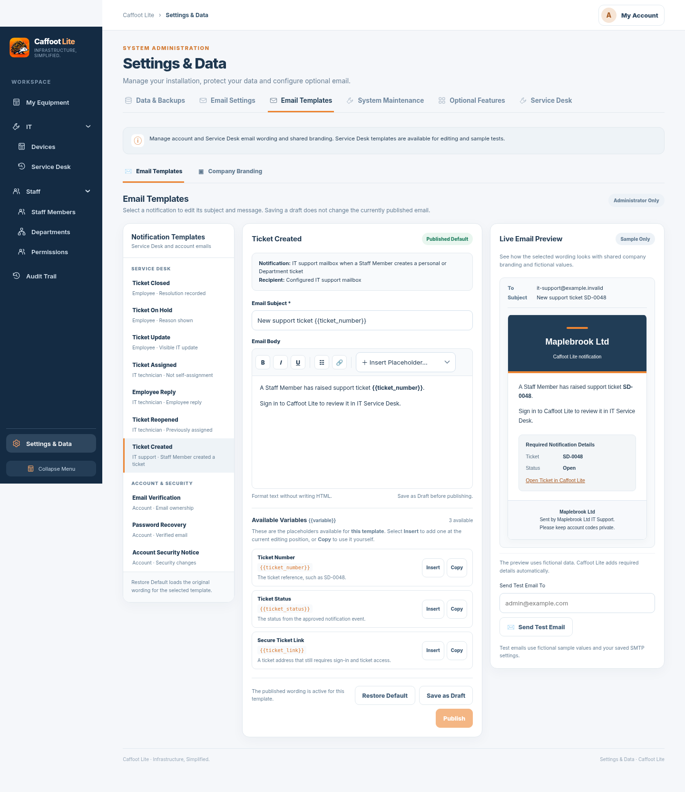
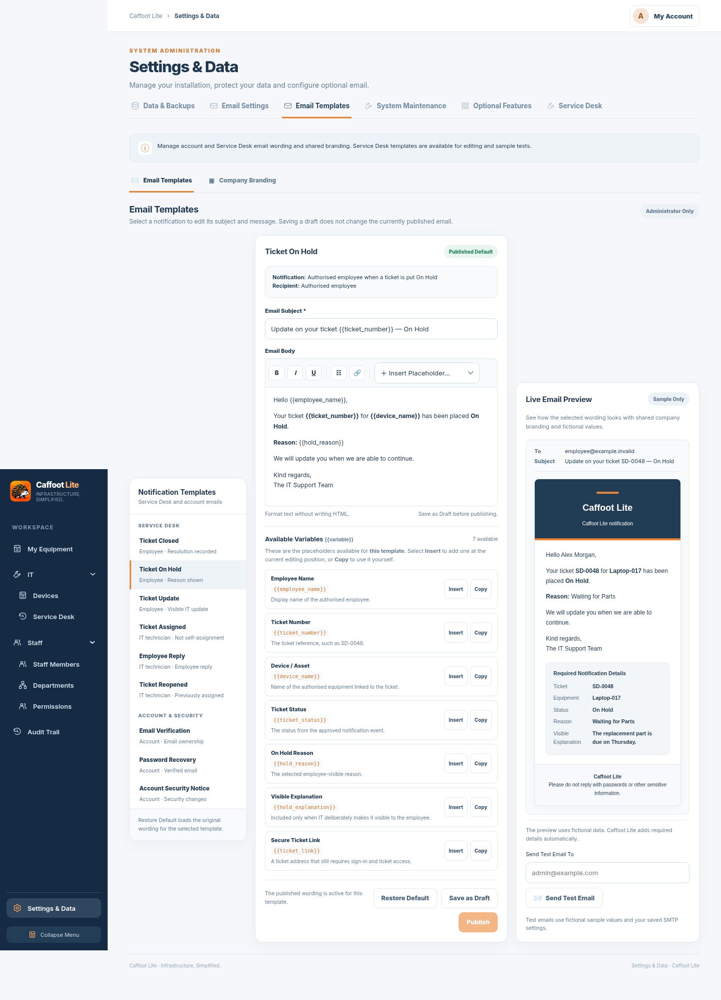
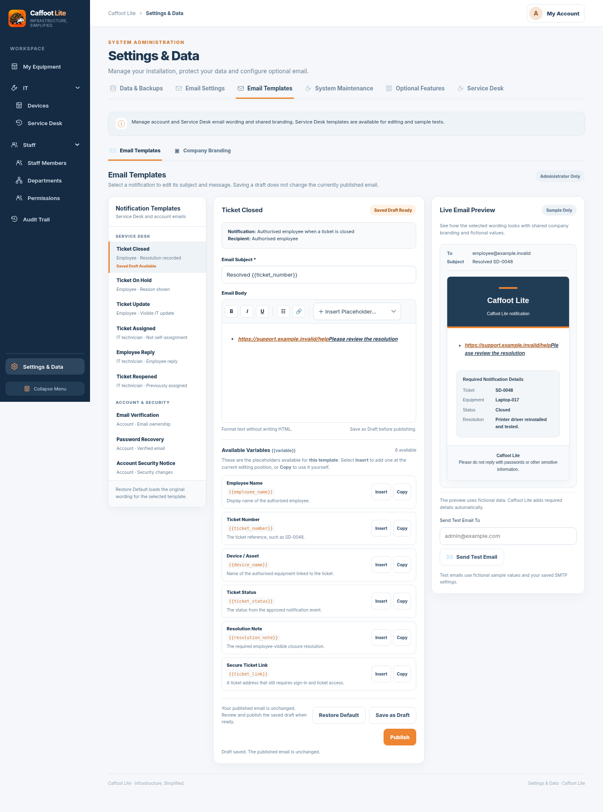
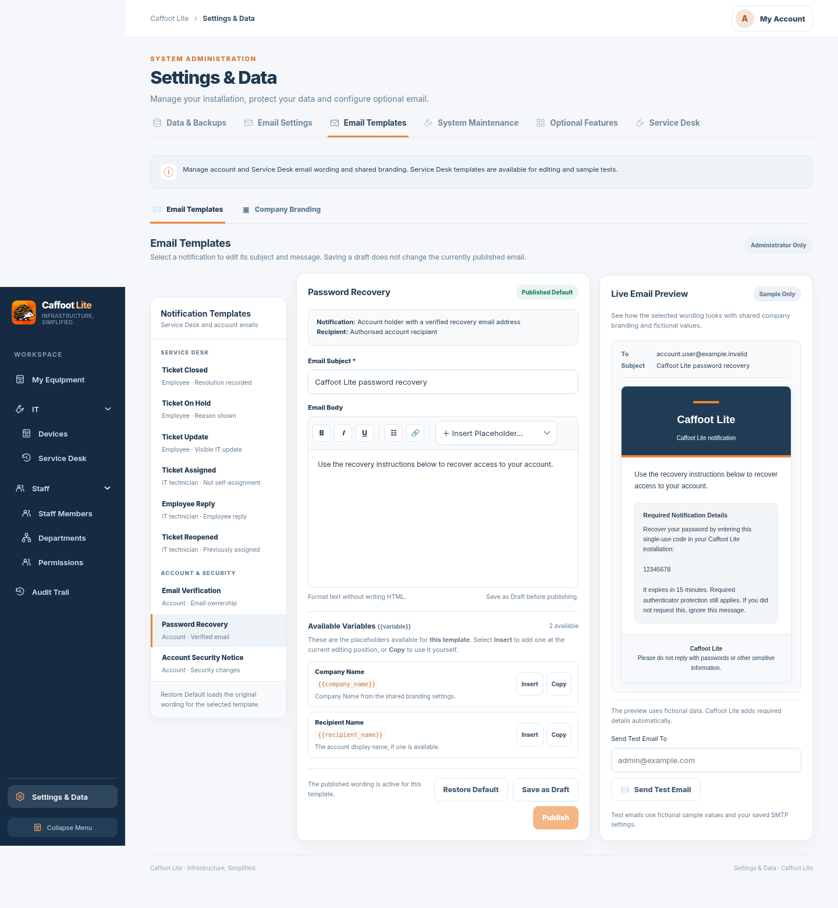
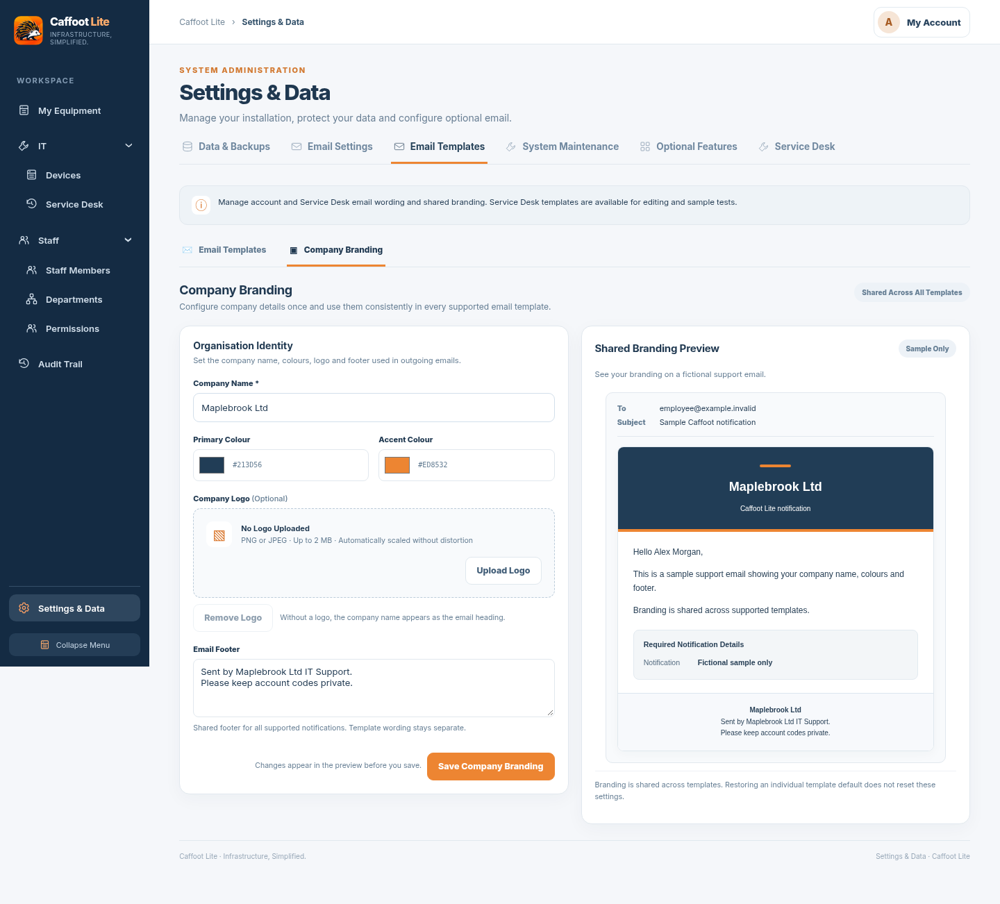
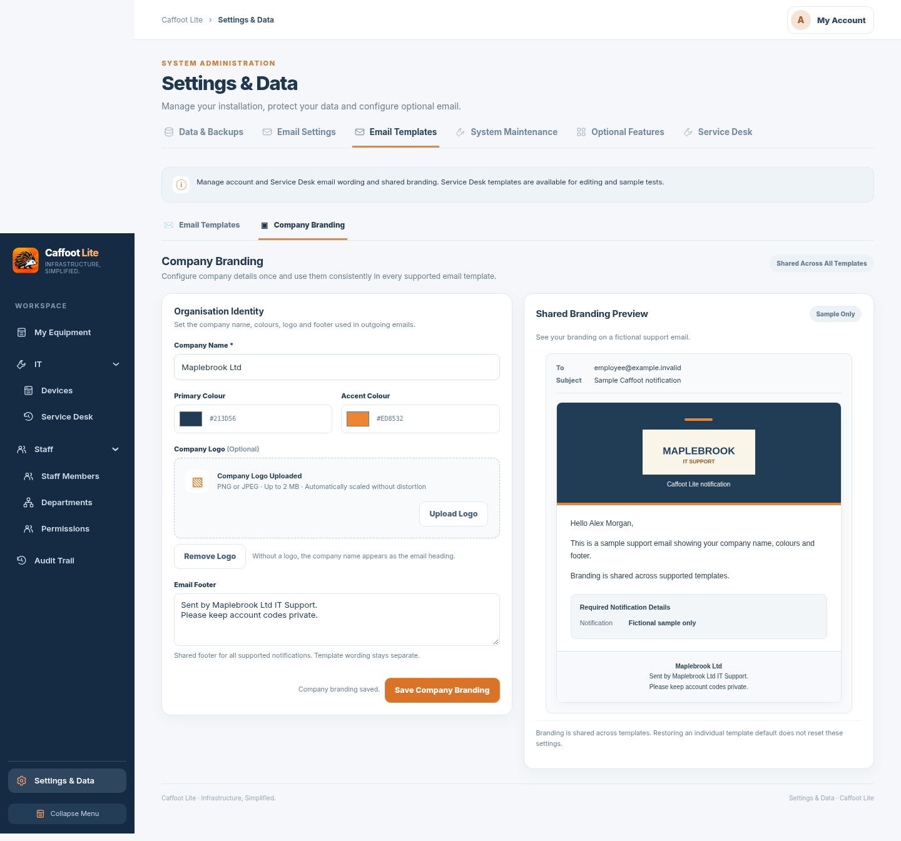

# Manage Email Templates And Company Branding

> **Draft v2.2 — Unreleased.** These instructions describe v2.2.

Use **Email Templates** to change the words and formatting in seven Service Desk notifications and three account and security emails. Use **Company Branding** to give supported emails a shared company name, colours, footer and optional logo. Changing wording never changes notification events, recipients, access rules or required system-managed ticket/security details. [Approved Service Desk events and recipients](Service-Desk-Administration.md#check-which-service-desk-emails-are-sent)

## Configure Outgoing Email (SMTP)

SMTP is the outgoing mail service. Obtain its server, port, transport and relay/sender requirements from your mail administrator before saving. Email is optional: sign-in, inventory and permitted ticket operations continue without it.

1. Sign in as an active administrator with confirmed MFA. Open **Settings & Data → Email Settings → Outgoing Email Settings**.
2. Under **SMTP Server**, complete the following fields. For fictional Aster Services, the server might be `smtp.example.invalid`; this example cannot deliver mail.

   | Field | What to enter |
   | --- | --- |
   | **Server Address** | The SMTP hostname or IP address supplied by the mail administrator; not a web URL or browser address. |
   | **Port** | The provider's port, a whole number from 1 to 65535. The initial setting is 587; do not assume it suits every provider. |
   | **Connection Security** | **STARTTLS** upgrades the SMTP connection to TLS; **SSL / TLS** uses TLS from connection start. Use the exact option and port required by the provider. Certificate validation applies. |
   | **SMTP Authentication** | Enable if the relay requires a username and password. Enter **Username** and **Password**. With authentication enabled and the same saved username, a blank Password retains the saved secret. A changed username requires its password. Disabling authentication clears the saved username/password. |
   | **From Name** | The recognisable sender label, such as `Aster Services IT` (up to 120 characters). |
   | **From Email Address** | One valid sender address authorised by the relay, such as `caffoot@example.invalid`. This is distinct from the receiving support mailbox and an employee's verified account address. |
   | **IT Support Email Address** | One shared or individual IT destination, such as `it-support@example.invalid`, without a display name or address list. Blank skips employee-created new-ticket mail; other approved events retain their own recipient rules. |

3. If considering **Unencrypted (Requires Review)**, obtain the mail administrator's assessment of the actual network. The form requires explicit acknowledgement that contents may be exposed and forbids SMTP authentication without TLS. Prefer the provider's encrypted transport. Do not send credentials through an unencrypted relay.
4. Select **Save Email Settings**. Correct any rejected host, address, port or authentication value before saving again. **Discard Changes** reloads the saved settings. Passwords are kept in a private server-side file beside the database and are never returned to the browser; a blank field is not evidence that no password is stored. Protect host access and backups, and never put credentials in screenshots, ticket text or template wording.
5. Under **Send A Test Email**, enter **Recipient Email Address** for a mailbox you control and choose **Send Test Email**. Save configuration first: this control uses saved SMTP settings. Wait at least 30 seconds between tests, including template tests. Check the real inbox, junk folder and relay delivery records.
6. To change the appearance or wording, use the separate **Email Templates** area below. To investigate eligible ticket alerts, use [events and recipients](Service-Desk-Administration.md#check-which-service-desk-emails-are-sent).

A successful test means SMTP accepted that test message for sending. It does not verify anyone's saved account email address, issue an account recovery code, or establish recovery eligibility. The person verifies their own saved address through **My Account**. Recovery separately requires an active eligible account, a verified saved address and the applicable MFA. A fictional template code cannot verify or recover an account.

*Configure the outgoing server and sender, save the settings, then send a test to a mailbox you control.*

## Open Email Templates

1. Sign in with an active administrator account and complete the authenticator step. A technician or employee account cannot manage these settings, even if it can use the Service Desk.
2. Open **Settings & Data** in the application navigation, then choose **Email Templates**. On a phone you can open the existing navigation menu to find **Settings & Data**.
3. In **Notification Templates**, choose a template under **Service Desk** or **Account & Security**. Check **Notification** and **Recipient** in the editor to see what the template is for. The example addresses in the preview are fictional.
4. Use the **Email Templates** and **Company Branding** tabs to move between the editor and the shared settings. With a keyboard, use Tab to reach the tab bar and the left or right arrow to change tabs. You can open the editor, preview and save changes before setting up SMTP. Configure SMTP in the separate **Email Settings** tab when you are ready to send a test.

*Choose from seven Service Desk and three Account & Security notifications. Edit the wording in the centre and review the sample on the right.*

## Edit The Subject And Message

1. In **Email Subject**, enter a short, single-line description of what the recipient should expect. For example, use `Update on ticket {{ticket_number}}` for **Ticket On Hold**. The subject can contain up to 240 characters.
2. In **Email Body**, type the message as you want people to read it. Use Enter to start a new line. You can paste text from another document, then apply formatting in the editor. The body field accepts up to 30,000 characters of editor content, including formatting.
3. Select the words you want to format, then use one of the five toolbar buttons.

   | Control | What it does |
   | --- | --- |
   | **Bold** | Makes selected words stand out. |
   | **Italic** | Italicises selected words. |
   | **Underline** | Underlines selected words. |
   | **Bullet List** | Turns lines into bullets or removes bullets from the current list. |
   | **Insert Link** | Opens a dialogue for a full `https://` address. Select text first to give the link a label. Without a selection, the address becomes the link text. |

4. In **Insert Link**, enter a trusted address such as `https://support.example.invalid/help` for a fictional example. Choose **Insert Link** to apply it, or **Cancel** or Escape to close the dialogue. Service Desk templates also accept the exact `{{ticket_link}}` token in **Link Address**. Actual ticket access is checked when a signed-in recipient opens a ticket. Links in the on-screen sample are displayed without opening their destinations.
5. Check **Live Email Preview** for the subject, sample recipient, shared branding, wording and **Required Notification Details**. Caffoot Lite adds those details automatically. The preview follows the current editor text, including unsaved changes. If the editor contains an invalid variable or link, correct the message shown below the preview.

## Insert Or Copy A Variable

A variable is a token in double braces. For example, `{{ticket_number}}` becomes `SD-0048` in a sample. When an eligible real message is rendered, only values authorised for that template and recipient are used. An optional value that is missing becomes empty. Write sentences that will still make sense if the optional value is absent.

1. Choose the template and find **Available Variables** below the body. Each entry shows its name, the exact token and what it means.
2. Put the cursor where you want the token in **Email Subject** or **Email Body**. Select **Insert** beside the variable, or choose it from **Insert Placeholder** in the toolbar. When starting from the body with no cursor position, the editor adds the token at the end.
3. To reuse a token, select **Copy** beside it and paste it into the subject or body. If your browser blocks access to the clipboard, select the token text in **Available Variables** and copy it manually.
4. Check the substituted result in the live preview. To format a token, select the full token including both pairs of braces. The editor uses the exact spelling shown in the list.

| Template | Available variables |
| --- | --- |
| Ticket Closed | `{{employee_name}}`, `{{ticket_number}}`, `{{device_name}}`, `{{ticket_status}}`, `{{resolution_note}}`, `{{ticket_link}}` |
| Ticket On Hold | `{{employee_name}}`, `{{ticket_number}}`, `{{device_name}}`, `{{ticket_status}}`, `{{hold_reason}}`, `{{hold_explanation}}`, `{{ticket_link}}` |
| Ticket Update | `{{employee_name}}`, `{{ticket_number}}`, `{{device_name}}`, `{{visible_update}}`, `{{ticket_link}}` |
| Ticket Assigned | `{{technician_name}}`, `{{ticket_number}}`, `{{device_name}}`, `{{ticket_link}}` |
| Employee Reply | `{{technician_name}}`, `{{ticket_number}}`, `{{employee_reply}}`, `{{ticket_link}}` |
| Ticket Reopened | `{{technician_name}}`, `{{ticket_number}}`, `{{device_name}}`, `{{ticket_link}}` |
| Ticket Created | `{{ticket_number}}`, `{{ticket_status}}`, `{{ticket_link}}` |
| Email Verification | `{{company_name}}`, `{{recipient_name}}` |
| Password Recovery | `{{company_name}}`, `{{recipient_name}}` |
| Account Security Notice | `{{company_name}}` |

**Recipient Name** is the account’s authorised display name when one is available. For Service Desk templates, **Visible Explanation** refers to an explanation deliberately made employee-visible. **Employee-Visible Update** and **Employee Reply** refer only to those authorised messages. Internal notes, account codes and proof identifiers are unavailable as editor variables.

*For this fictional ticket, the selected reason is Waiting for Parts. The example also contains an employee-visible explanation.*

## Save A Draft And Publish

1. After editing, check **Unsaved Changes** and preview your wording. Choose **Save as Draft**. The saved version replaces the previous draft for this template. The currently published wording continues to be used for eligible account and Service Desk emails.
2. **Saved Draft Ready** means a draft is stored. You can reopen this template later to continue editing. A draft can be incomplete. Fill in both **Email Subject** and **Email Body**, and save again, to enable **Publish**.
3. Review the sample and, if you can, send a test email. Choose **Publish** when you want Caffoot Lite to use this wording. It becomes the published version, and the saved draft is cleared.
4. Look for **Published** or **Published Default**. **Published Default** means the built-in wording is active. If another administrator changes the template while you are editing it, the app rejects your stale save or publish. Reopen Email Templates, check their changes and apply yours again if needed.
5. If you choose another template while you have unsaved edits, Caffoot Lite asks whether to discard them. Cancel the prompt to stay with those edits. Saved drafts remain available.

*The draft is saved and visible to administrators. Publish applies the reviewed wording.*

## Edit And Publish Ticket Created

1. Sign in as an administrator and go to **Settings & Data → Email Templates → Ticket Created**. **Live Email Preview** uses the fictional reference `SD-0048` and shows the ticket’s **Open** status.
2. Edit **Email Subject** and **Email Body**. For example, use `New IT request {{ticket_number}}` as the subject and ask the recipient to review the ticket in Caffoot Lite. The three available variables are **Ticket Number**, **Ticket Status** and **Secure Ticket Link**. The protected section includes all three details even if the surrounding wording omits the variables.
3. Choose **Save as Draft** and review the preview. If you need a mail-client check, send a fictional test using **Send Test Email To**. The sample address and reference are for review. To test a real alert, use the [mailbox verification steps](Service-Desk-Administration.md#configure-the-it-support-mailbox).
4. Choose **Publish**, then check that **Published** or **Published Default** appears. To abandon unsaved changes, select another template and confirm that you want to discard the edits. To switch back to the built-in wording, load **Restore Default**, save the draft and publish it.

## Restore One Template To Its Default

1. Select the template you want to reset. Choose **Restore Default** and confirm that you want to load the original wording for that template. Cancel the prompt to keep the current editor text.
2. Review the built-in subject and body in the editor. The published wording, any saved draft and shared company branding are still in place at this point.
3. Choose **Save as Draft**, review the preview and then choose **Publish**. The template shows **Published Default** and uses the saved shared branding.
4. To leave the original published version in use, leave the default in the editor without publishing it. A saved draft can be opened again later. The **Audit Trail** records who saved a draft, published or loaded a default and when. The entries describe the action and affected settings without copying the message text.

## Review Account Security Emails

1. Choose **Email Verification**. The sample shows where an eight-digit code and the 15-minute limit appear. An account holder still requests verification through their account and confirms the code there.
2. Choose **Password Recovery**. The sample uses an eight-digit code. Account recovery continues to require an active account with a verified saved address and the authenticator where the account’s rules require it. A successful password recovery revokes the account’s old sessions.
3. Choose **Account Security Notice**. Review the generic warning and the direction to sign in and review the protected **Audit Trail**. The administrator can change the surrounding wording. Caffoot Lite always adds the security instructions.
4. Keep example codes, passwords, confidential ticket details and real customer records out of the editable wording. The code shown in a preview or test is fictional. A real verification or recovery flow issues its own single-use code.

*The code and security instructions are generated by Caffoot Lite.*

For the sign-in and recovery steps, see [Roles, Section Permissions And MFA](Roles-Section-Permissions-and-MFA.md).

## Set Company Branding

1. Go to **Settings & Data → Email Templates → Company Branding**.
2. In **Company Name**, enter the name recipients should recognise, up to 80 characters. For a fictional example, use *Maplebrook Ltd*. The name appears in the footer and in the heading when there is no logo.
3. Choose the **Primary Colour** for the header and the **Accent Colour** for the band and accent line. Use the browser colour picker. The six-digit colour value is displayed beside each picker.
4. Type your common **Email Footer**, up to 2,000 characters. Enter line breaks as you want them shown. For example, enter *Sent by Maplebrook Ltd IT Support* and, on a new line, *Please keep account codes private*.
5. Check **Shared Branding Preview**. It updates as you work and uses a fictional support email. Choose **Save Company Branding** to apply the settings to supported outgoing emails. Individual template wording and draft status stay as saved.
6. Return to **Email Templates** to check how the saved branding looks on an account email. To discard changes before saving, leave the section and confirm that you want to discard your unsaved changes.

*The preview uses the company name as the heading before a logo is selected.*

## Upload, Replace Or Remove A Logo

1. In **Company Branding**, choose **Upload Logo**. Select a PNG or JPEG file up to 2 MB. Use a copy suitable for display at up to 180 × 72 pixels. Large or damaged images may need to be resized or exported again.
2. Check the logo in **Shared Branding Preview**. Caffoot Lite preserves its proportions, scales it down to fit the display area and leaves a smaller image at its original size. On a narrow screen the logo shrinks further if needed.
3. Choose **Save Company Branding**. The managed logo is embedded in supported HTML emails, and recipients can still read a plain-text alternative. An email client’s image settings may affect whether it shows the logo.
4. To replace it, choose **Upload Logo** again, check the replacement and save. To remove it, choose **Remove Logo**, check the company-name heading in the preview and save. The company name, colours and footer keep their current values.
5. If the logo is rejected, check the format, file size and image dimensions. The server rejects images above 16,777,216 pixels to bound the work needed to open them. Renaming a different image format to `.png` or `.jpg` will not change its contents. Try exporting a new PNG or JPEG from your image editor and choose it again.

## Send A Test Through Your SMTP Service

SMTP is the service Caffoot Lite uses to send email. To check the connection first, use the existing **Settings & Data → Email Settings** tab.

1. Enter or check your SMTP server, port, transport security, authentication settings and sender details with your mail administrator. Use **Save Email Settings**, then send a connection test from that tab. Keep credentials private. [Outgoing email settings](#configure-outgoing-email-smtp)
2. Return to **Email Templates** and select a template. Review the current **Live Email Preview**. You can test unsaved wording or a saved draft. Save any new **Company Branding** first if you want it included.
3. In **Send Test Email To**, enter one mailbox you are authorised to use. Choose **Send Test Email**. The service uses your existing SMTP sender and fictional substitutions, including the sample security code for verification or recovery.
4. Wait for **Test email sent**. That message means your SMTP server accepted the test for sending. Check the destination inbox or junk folder for a subject beginning with **[Test]**. If the client offers a plain-text view, check that the wording and protected details are legible there too. Sending a test leaves the saved and published versions in place.
5. Wait at least 30 seconds before sending another test from either email settings area. If Caffoot Lite reports an error, review the issue below before trying again.

## Troubleshoot

| What you see | What to check |
| --- | --- |
| Email Templates is missing or access is refused | Sign in with an active administrator account and complete MFA. A permission to edit tickets does not grant access to these settings. |
| Publish is unavailable | Enter a subject and body, select **Save as Draft**, then check the editor for remaining unsaved changes or validation messages. |
| A subject or body value is blank in an account email | Check whether that template offers the variable and the account has an authorised **Display Name**. For example, a blank display name becomes empty in `{{recipient_name}}`. |
| A draft or branding change was rejected as stale | Reopen **Email Templates**, review the saved changes and reapply yours only where needed. |
| The header still shows an older logo or company name | Save **Company Branding**, then reopen the editor. A message sent before you saved has the previous branding. |
| A test fails immediately | Check the destination, the required subject and body, and that SMTP is configured in **Email Settings**. |
| The SMTP server accepted the message but it has not appeared | Check the address, junk folder, filtering and your SMTP service’s delivery records. Check the saved sender and relay permissions with your mail administrator. |
| Someone reports missing verification or recovery mail | Check the SMTP connection separately. For recovery, ask the person to use their username and check whether their saved address is verified. The request screen uses a generic response. Treat real codes and mail account details as private. |

[Audit Trail](Audit-Trail.md) · [Roles, Section Permissions And MFA](Roles-Section-Permissions-and-MFA.md) · [Service Desk Administration](Service-Desk-Administration.md)

[Follow the connected Aster Services support request](Connected-Service-Desk-Journey.md) · [Draft v2.2 guides](README.md)
