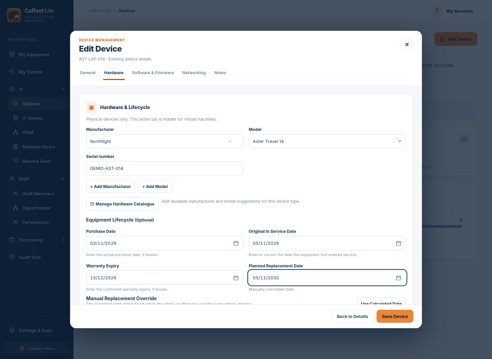
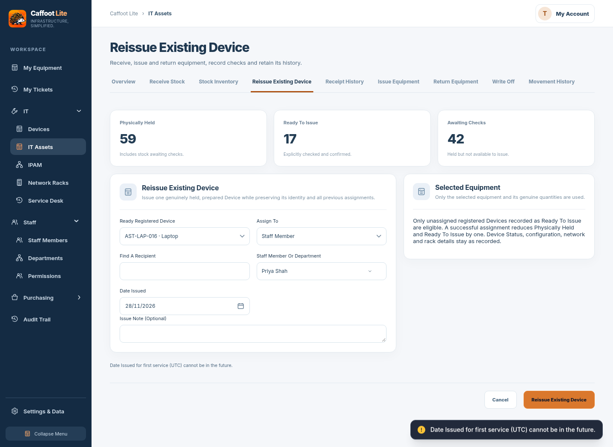
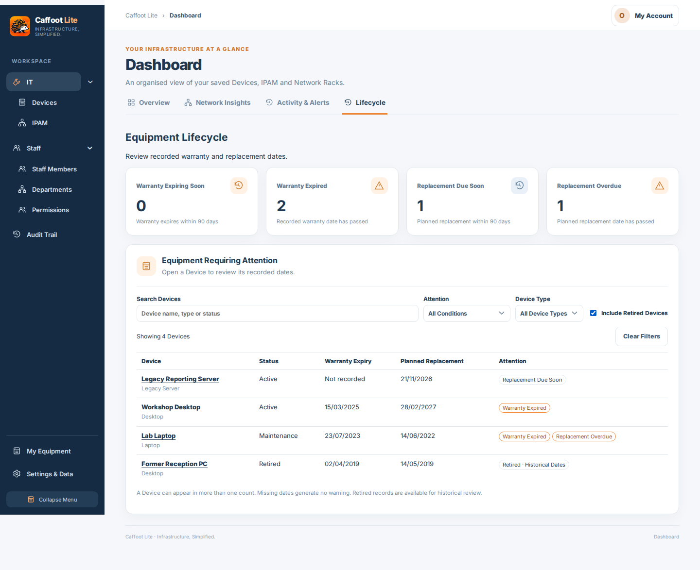
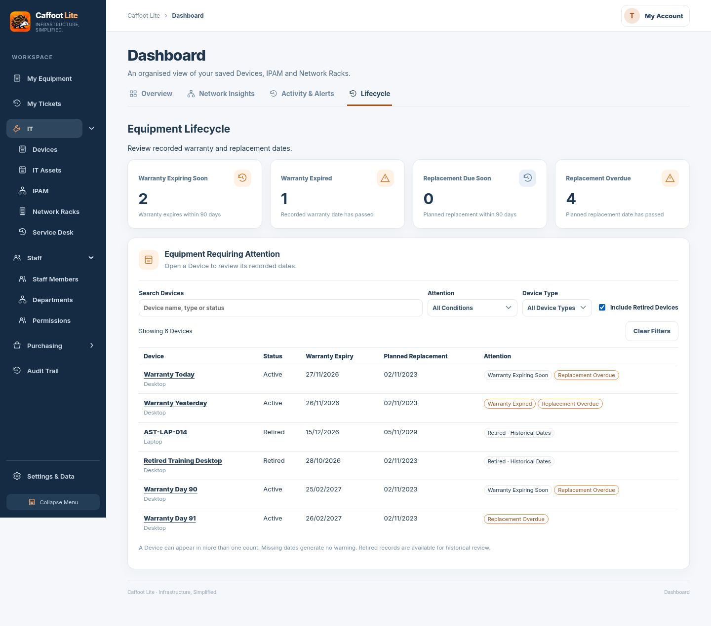
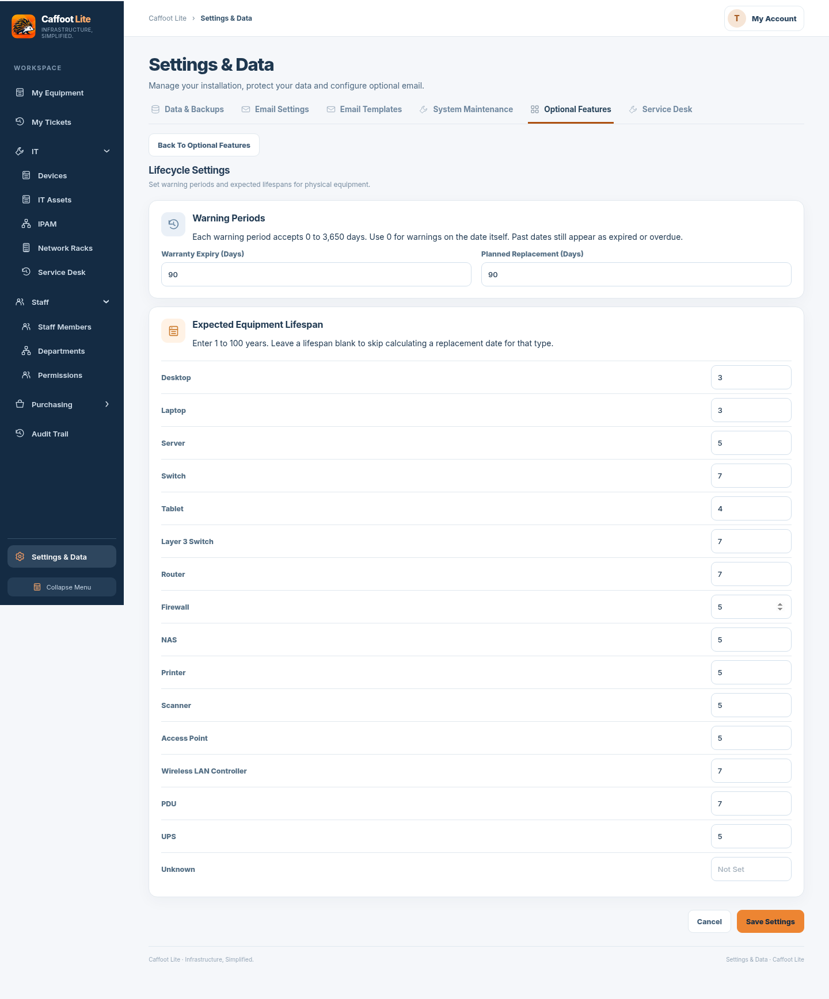

# Equipment Lifecycle

> **Draft v2.2 — Unreleased.** These instructions describe v2.2.

Equipment Lifecycle helps IT staff review warranty cover and plan replacements for physical equipment already recorded in Caffoot Lite. Dates stay with the same Device through moves, returns and reissues. The dates and Dashboard warnings are informational. Device status, rack placement and IP allocations continue to use their existing controls.

## Who Can Use Equipment Lifecycle

- An **Administrator** with the required MFA verification can turn on **Equipment Lifecycle** and save **Lifecycle Settings**. Equipment Lifecycle starts switched off.
- With both **Devices** and **Equipment Lifecycle** enabled, **Devices Read** allows you to see dates on Device Details and use **IT → Lifecycle** on the IT Dashboard. Effective access includes any individual account overrides.
- With **Devices Edit**, you can enter or correct **Purchase Date**, **Original In Service Date** and **Warranty Expiry**. The **Planned Replacement Date** override and **Use Calculated Date** also require Administrator access.
- Stock issue and reissue require the existing **Devices Edit** and **IT Assets Edit** permissions. The automatic first-service record uses those permissions, including when Equipment Lifecycle is switched off. Ordinary staff can use their permitted [My Equipment](Device-Assignments-and-My-Equipment.md) view.

Use an existing physical Device. Standalone quantity/individually tracked IT Asset accessories do not have these per-Device lifecycle date fields. Virtual Machines have no equipment dates or lifespan settings. See [Roles, Section Permissions And MFA](Roles-Section-Permissions-and-MFA.md) for help locating your effective permissions.

## UK Date Format

Enter dates as **DD/MM/YYYY**, such as **15/03/2023** for 15 March 2023. The calendar button uses the same UK order. Enter a complete valid day, month and four-digit year; 29 February is accepted only in leap years. Existing date limits (including no future Purchase Date or Original In Service Date) still apply. Dates continue to be saved internally using ISO `YYYY-MM-DD`, without any change to the real recorded date. For keyboard and calendar navigation, see [UK Date Entry And Calendar Controls](README.md#uk-date-entry-and-calendar-controls).

## Understand The Four Dates

| Field | What To Enter Or Expect |
| --- | --- |
| **Purchase Date** | The date your organisation bought the equipment, if known. |
| **Original In Service Date** | The date this physical asset first entered service. Enter known historical dates or dates for infrastructure commissioned outside the stock issue workflow. Correct an incorrect entry when you have evidence. |
| **Warranty Expiry** | The confirmed expiry date. You can record an expired warranty. Caffoot Lite offers a date 12 calendar months after Purchase Date when Warranty Expiry is blank. Select **Use Suggestion** to accept it. |
| **Planned Replacement Date** | The service date plus the Device Type's lifespan. If the service date is blank, Caffoot Lite uses Purchase Date plus that lifespan. The calculated date is blank when both starting dates are missing or the lifespan is blank. An administrator can set a fixed override, including a date already passed. |

All four dates are optional. Enter a valid calendar date. Purchase Date and Original In Service Date must be the current date or earlier, using the application's UTC calendar date. For second-hand equipment the service date may precede Purchase Date. If a warranty suggestion or replacement calculation starts on 29 February and the result year is not a leap year, the result is 28 February.

**Example.** Your organisation buys a second-hand desktop on 15 March 2024. A commissioning record confirms it first entered service on 29 February 2024. Enter both dates. With the three-year Desktop lifespan, the calculated replacement date is 28 February 2027.

## Review Or Update A Device

1. Open **IT → Devices → Device Inventory** and open the relevant Device Details. You can also open the Device from a Lifecycle Dashboard result.
2. Select **Hardware**. In **Hardware & Lifecycle**, find **Equipment Lifecycle**. Review the four dates and the **Calculated** or **Manual override** label. A blank date is shown as **Not recorded**.
3. Choose **Edit device**, select **Hardware**, and enter the dates you know. To record a warranty from supporting paperwork, type its expiry directly. To use the proposed 12-month date, review it and choose **Use Suggestion**. Changing Purchase Date leaves a recorded warranty in place.
4. Choose **Save Device**. If the application rejects a date, check the message and correct it before trying again. Use **Back to Details** or close the editor to leave without saving. If prompted, **Keep Editing** retains the draft or **Discard Changes** returns to the last saved values.

**Example.** A supplier confirms that a laptop bought on 6 October 2026 has three years of cover. Enter the confirmed 6 October 2029 Warranty Expiry instead of accepting the 12-month suggestion. For a commissioned router with an unknown purchase date, enter the known Original In Service Date and leave Purchase Date blank.

### Set Or Remove A Manual Replacement Override

1. As an Administrator with **Devices Edit**, open **Edit Device → Hardware → Equipment Lifecycle**.
2. Enter the fixed **Planned Replacement Date**. Check the **Manual Replacement Override** indicator, then choose **Save Device**. Later edits to the baseline or type lifespan leave this fixed date in place.
3. To return to normal calculation, reopen the same section and select **Use Calculated Date**. Review the proposed date or **Not recorded**, then select **Save Device**. Cancelling and discarding the draft keeps the previous saved override.

**Example.** A router covered by a contract will be replaced on 30 June 2030. Save that date as an override. If the contract plan changes, select **Use Calculated Date** and save to put the router back on the type lifespan schedule.

*Purchase and evidenced Warranty Expiry are proposed alongside the retained first-service date. A manual replacement override is shown as an unsaved example, then cleared before saving the calculated-date journey.*

## Record First Service From Stock

1. Follow [Receive Stock And Stock Inventory](IT-Assets-Stock-Intake.md) to record the delivery and carry out the applicable checks. Receiving, checking, preparing or registering held equipment leaves the service date blank.
2. Follow [Device Stock Registration And Reissue](Device-Stock-Registration-and-Reissue.md) to register an eligible unit and issue the canonical Device from Ready stock. Use the actual **Date Issued**.
3. For automatic capture, the Device must have a stock-registration record, no previous stock issue or return and no earlier Device assignment, with Original In Service Date still blank. On that qualifying first physical issue, Caffoot Lite saves the date, holder assignment and stock movement together. A Date Issued in the future is rejected when the transaction would capture a first-service date. Correct the date and submit again once the physical issue occurs.
4. For a return, later issue or direct handover of the same equipment, keep using the same Device record. Its previously recorded dates are retained. A legacy Device returned from deployment is not treated as a newly commissioned stock registration. A deliberately cleared service date is not repopulated by a later reissue with prior history. For infrastructure or older equipment whose first use was never recorded, enter a known date in Edit Device. Leave it blank if you cannot verify it.

**Example.** IT receives a batch of desktops on Monday, registers one as Ready on Tuesday and physically issues it on Wednesday. Its first-service date is Wednesday. If Equipment Lifecycle is off on Wednesday, the date is still recorded. An authorised user can see it after the feature is enabled again.

**Duplicate** opens a new Device record with independent dates. The new Device starts without the source's dates, replacement override or history. **Add Device** and **Duplicate Device** have no lifecycle date fields. Use Edit Device after creating the physical record.

For example, AST-LAP-014 retains its original first-service date of 05/11/2026 after reissue. With a three-year Laptop lifespan, its replacement falls in 2029 rather than restarting at Sarah’s issue. The fictional purchase date is 03/11/2026 and warranty date is 15/12/2026.

*With Lifecycle disabled, the qualifying first issue still rejects a future first-service date. No custody or first-service save occurred from this rejected proposal.*

For example, after a valid first issue of AST-LAP-016 to Priya on 27/11/2026 while Lifecycle is off, re-enable Lifecycle and check that **Original In Service Date** is 27/11/2026.

## Use The IT Dashboard

1. Open **IT** and select the **Lifecycle** tab on the Dashboard.
2. Review the four attention indicators. Select one to filter **Equipment Requiring Attention**, or use **Attention** to pick a condition. A Device may count under one warranty and one replacement indicator.
3. Narrow the list using **Search Devices** by name, type or status, or choose a **Device Type**. Use **Clear Filters** to return to all current warnings.
4. Select the Device name to open its existing **Device Details** on **Hardware**.
5. To review historical dates, return **Attention** to **All Conditions**, then select **Include Retired Devices**. Retired rows with lifecycle dates are marked **Retired · Historical Dates**. They are excluded from all four counters.

| Date Compared With Today | Warranty | Planned Replacement |
| --- | --- | --- |
| Date is in the past | **Warranty Expired** | **Replacement Overdue** |
| Today through the configured period, including the last day | **Warranty Expiring Soon** | **Replacement Due Soon** |
| Later than the period or date is blank | No warning | No warning |

With a 90-day warranty warning, a warranty expiring in exactly 90 days appears under **Warranty Expiring Soon**. One expiring in 91 days appears when it reaches the threshold. A zero-day replacement period shows replacements due today and still shows overdue dates. An old expired warranty can continue to appear for an in-use Device. Review the record and confirm its warranty before deciding what action to take.

*The Dashboard with Include Retired Devices selected. The Former Reception PC appears in the list for historical review.*

*Named warranty examples distinguish yesterday, today, day 90 and day 91 under the 90-day rule. Include Retired with All Conditions retains AST-LAP-014 and its 15/12 warranty for historical review, while Retired Devices stay outside the four active counters.*

## Enable And Configure Equipment Lifecycle

1. Sign in as an Administrator and verify MFA. Open **Settings & Data → Optional Features**.
2. Under **Additional Features**, find **Equipment Lifecycle**. Enable it and wait for **Optional feature setting saved**.
3. Select **Lifecycle Settings**. In **Warning Periods**, enter **Warranty Expiry (Days)** and **Planned Replacement (Days)** independently. Both start at **90** and accept whole numbers from **0** to **3,650**.
4. In **Expected Equipment Lifespan**, enter a whole number from **1** to **100** years, or leave the input blank. Custom Device Types and **Unknown** start blank.
5. Choose **Save Settings**. A validation failure leaves the previous settings saved. If another administrator changed the settings or the Device Type Manager changed while the form was open, reopen **Lifecycle Settings** and reapply the intended edits. Select **Cancel** or **Back To Optional Features** to abandon the form, then confirm the discard if asked.

| Default Lifespan | Device Types |
| --- | --- |
| 3 years | Desktop, Laptop |
| 4 years | Tablet |
| 5 years | Server, Firewall, NAS, Printer, Scanner, Access Point, UPS |
| 7 years | Switch, Layer 3 Switch, Router, Wireless LAN Controller, PDU |
| Blank | Unknown and custom types |

**Example.** Set Warranty Expiry to 30 days and Planned Replacement to 90 days. Clear the custom Test Equipment lifespan if the team plans those replacements individually. Existing manual dates remain available for those Devices.

To turn off Lifecycle, return to the card, switch it off and confirm. The Lifecycle Settings entry, Equipment Lifecycle date controls and Dashboard tab are hidden until re-enabled. Settings and dates are retained. Authorised stock transactions continue to capture eligible first-service dates.

*Administrator settings keep independent default 90-day warning periods and per-type lifespans. A blank lifespan is different from a numeric year count. This view makes no settings change.*

## Archive Or Restore A Device Type

You need **Devices Edit** and the Devices feature. Open **IT → Devices → Device Types → Manage Device Types**.

1. Find the type, for example **Legacy Server**, and select **Archive**. The row displays **Archived** and the type is unavailable for new Device selections.
2. Review an existing Device of that type. Its recorded type and calculated replacement date remain in place. The administrator can still see the configured lifespan in Lifecycle Settings.
3. Select **Unarchive** in the same manager to make that same type available again. **Rename** updates the type name and retains its lifespan.
4. For a permanent catalogue removal, use the separate **Delete** action and review its confirmation. It changes affected Devices to **Unknown**. Use **Archive** when the objective is to stop new use and keep the type on existing Devices.

**Example.** Five Devices use the custom **Legacy Server** type with a seven-year lifespan. Archiving the type keeps all five on that lifespan. When the team needs the type for new Devices again, **Unarchive** restores its availability and the seven-year setting.

### Existing Custom Server Types

The standard physical **Server** Device Type uses an internal legacy identity and is displayed as **Server**. In older Caffoot Lite installations, an administrator might already have created a separate custom Device Type named **Server**. Where such an older custom type exists, the application displays its name as **Server (Custom)** to distinguish it from the standard Server type. This is a **display label only**: the original saved type identity, Devices, configured lifespan, history, stock associations and filtering remain unchanged. The existing type can still be managed using its own Archive, Unarchive, Rename and Delete actions.

Creating a new custom type called **Server**, or renaming a different type to **Server**, is blocked because that name is reserved for the standard physical Server type. Administrators do not need to rename or reclassify any existing Devices to apply this distinction. On the Add/Edit Device form, **Server** and **Server (Custom)** are separate choices when both existing type identities are available; selecting either retains its corresponding saved identity.

## Missing Dates, Rejections And Effects On Equipment

Clearing an optional Purchase Date, Original In Service Date or Warranty Expiry is supported through Edit Device and normal Save. To clear a fixed replacement override, an administrator uses **Use Calculated Date** and saves. A blank baseline or lifespan gives no calculated replacement; a calculation beyond the supported four-digit calendar range also gives no date. Blank warranty/replacement dates generate no corresponding warning, so an empty warning list is not a complete-date or safe-equipment certificate.

For example, **29/02/2024** is valid, **29/02/2023** is rejected, and tomorrow is invalid for Purchase Date/Original In Service Date under UTC today. Warranty Expiry and an administrator's manual Planned Replacement Date can be in the past or future; there is no additional mandatory purchase/service/warranty chronological ordering. A lifespan of zero, a fractional year, 101 years or negative warning days is rejected. Blank lifespan is allowed; zero warning days means due today plus already overdue/expired items. **No Devices match the current selection.** can result from filters, missing dates or no warnings; Clear Filters restores the default warning selection, not every Device without dates.

A warning never performs retirement, write-off, purchase, renewal, data wiping, equipment movement, email or scheduled reminder. Review the underlying facts and follow the separate authorised [physical return/write-off](IT-Assets-Issue-Return-and-Write-Off.md) and [Device status](Devices.md) procedures. Feature disable retains saved dates/settings and hides controls, apart from the expressly approved automatic first-service capture during an otherwise eligible stock issue.

## Audit, Backup And Troubleshooting

The existing **Audit Trail** records successful changes to lifecycle dates and settings, including the affected Device or setting, previous and new values, actor and time. Lifecycle settings audit details require Administrator access. Device history follows the existing Audit Trail and Devices permissions. Rejected saves or discarded drafts do not create successful change records.

Lifecycle dates and settings are part of the full application database. Keep the persistent data volume using the draft [backup and restore guidance](Legacy-Import-and-Docker-Upgrade.md#back-up-a-complete-installation). Legacy inventory JSON import has no lifecycle date fields to restore and does not infer a service date for old equipment.

| What You See | What To Check |
| --- | --- |
| No Lifecycle tab or Device dates | Check that Devices and Equipment Lifecycle are enabled, that you have Devices Read, and that the Device is physical. |
| Can't enter a replacement override | Ask an Administrator with Devices Edit to make the change. |
| The expected calculated date is blank | Record a known service or purchase date and ask the administrator to check the Device Type lifespan. |
| The warranty suggestion is absent | Check that Purchase Date is filled and the Warranty Expiry field is blank. |
| First-service date is blank after reissue | Check whether the original issue was documented. Correct a verifiable historical date through Edit Device. |
| A warning total is higher than the number of rows | One Device can qualify for both a warranty and a replacement warning. The totals also cover all eligible Devices, including those outside your current search or filter. |
| An archived type is missing on a new Device | Select a currently available type or ask a Devices editor to unarchive the correct one. |

Related procedures include [Optional Features](Optional-Features-and-Link-To-IPAM.md), [Stock Registration And Reissue](Device-Stock-Registration-and-Reissue.md), [Associated Equipment And Direct Handovers](Associated-Equipment.md) and [Equipment Supplier Integration](Equipment-Supplier-Integration.md).

[Connected example: a laptop from Supplier and stock to its final write-off](Connected-Equipment-Journey.md).
