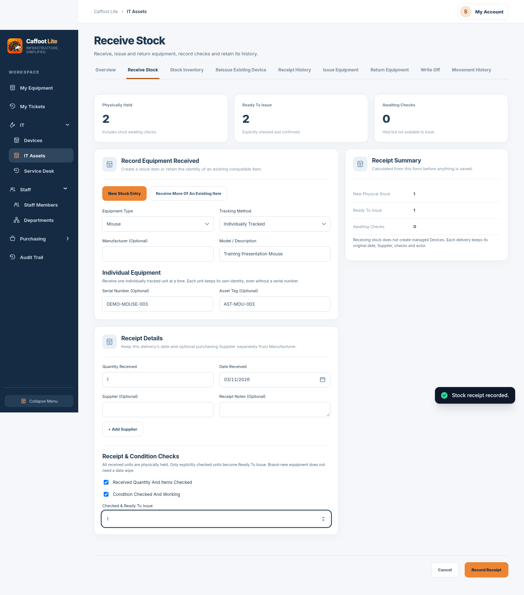
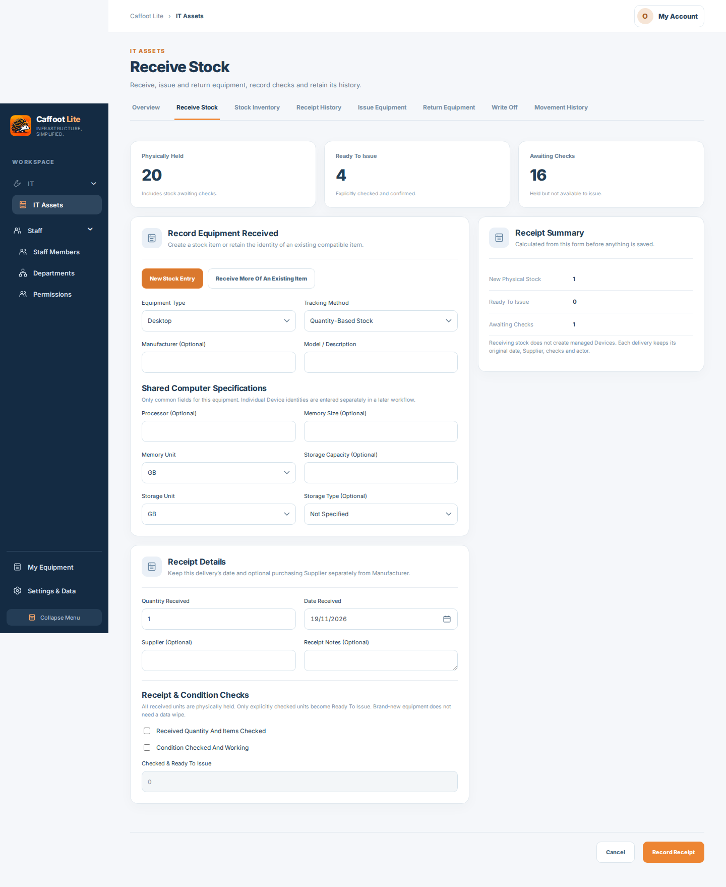
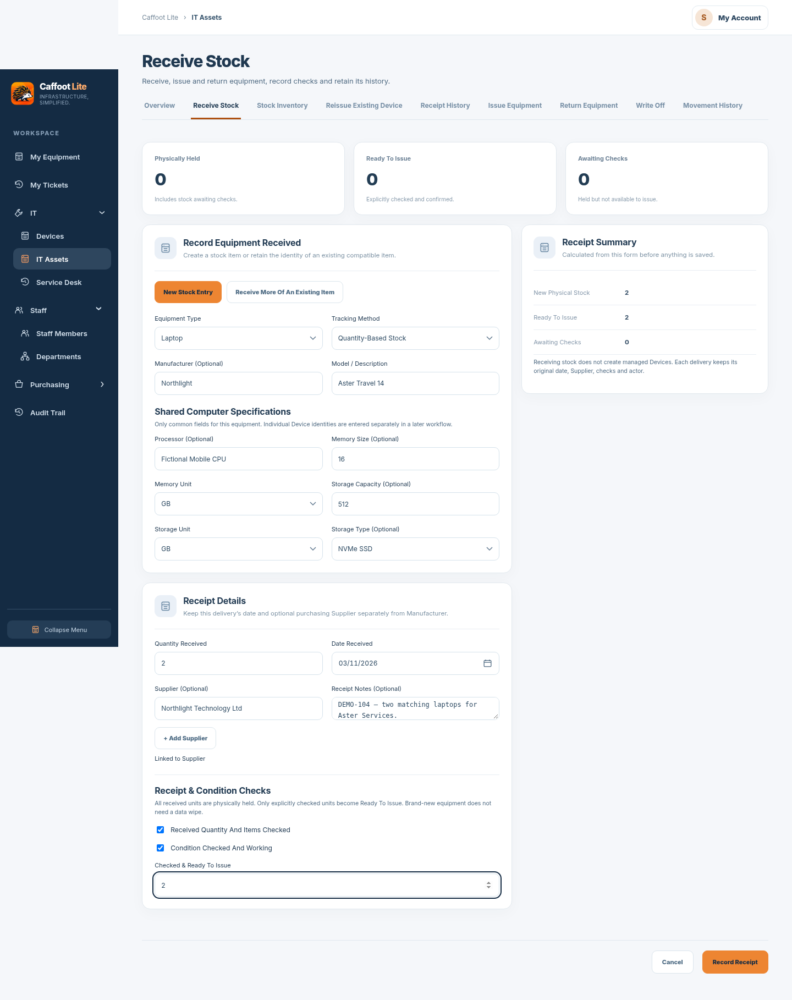
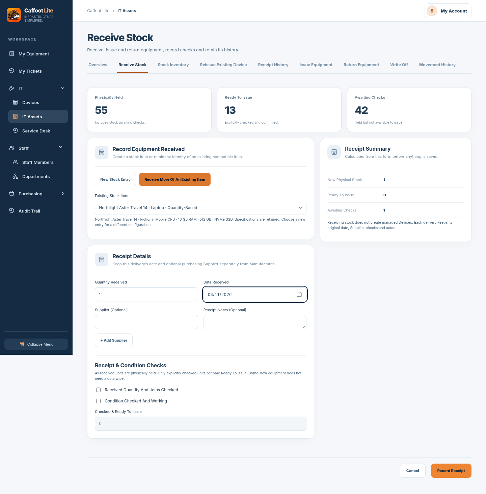
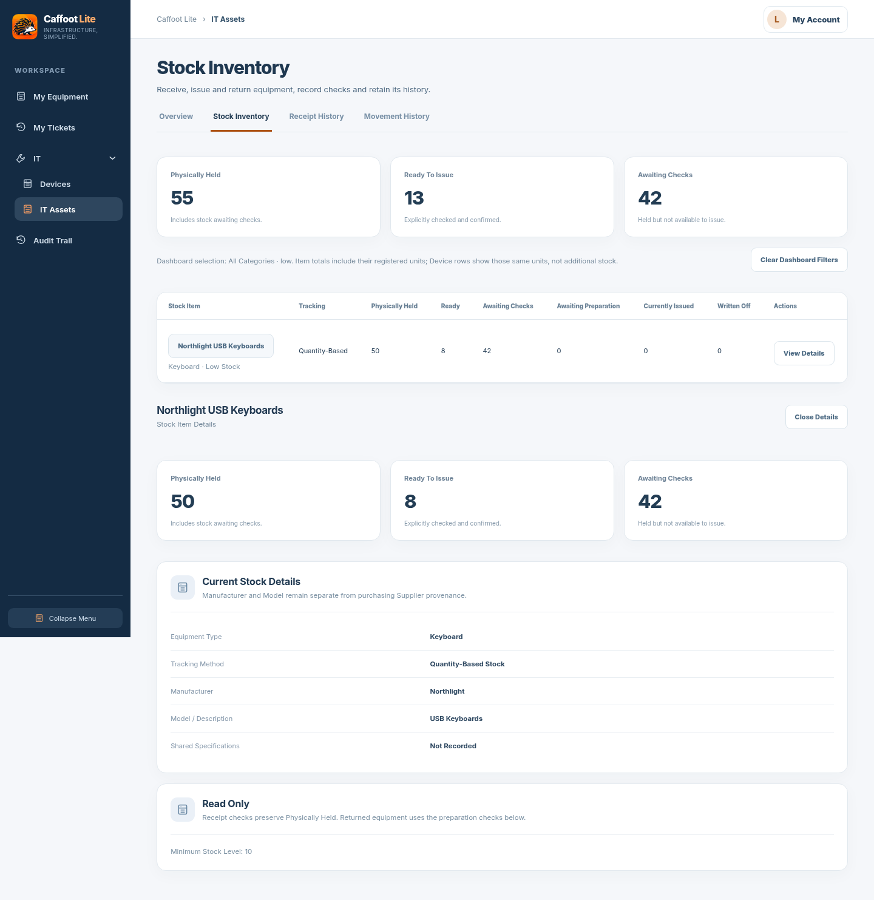
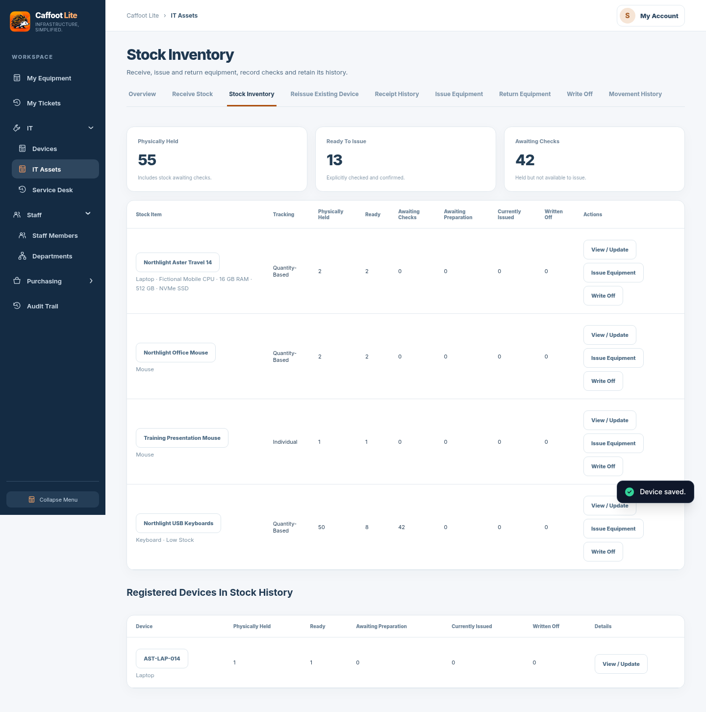
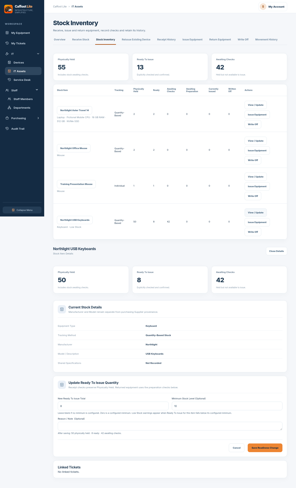
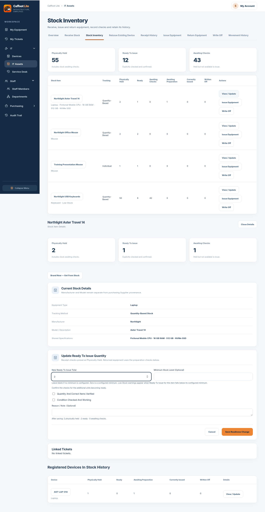
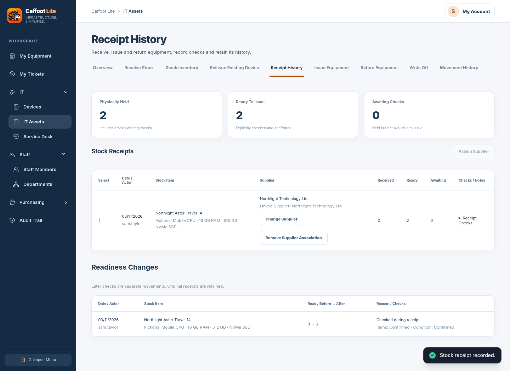

# IT Assets: Receive Stock And Stock Inventory

> **Draft v2.2 — Unreleased.** These instructions describe v2.2.

> For the Supplier selector and retrospective receipt corrections, see [Equipment Supplier Integration](Equipment-Supplier-Integration.md#record-a-supplier-when-equipment-arrives).

## What Stock Intake Records

Use **Receive Stock** when equipment actually arrives in your organisation's possession. A receipt records what arrived, how many units arrived, when they arrived, the purchasing Supplier if known, and the checks completed. **Stock Inventory** then shows what is physically held, what is ready to issue and what still needs attention.

Receiving ten computers does not create ten managed Devices or assign them to employees. A stock item describes equipment with the same common specification; a canonical Device is the permanent record for one managed machine. To create that individual record from computer stock, use [Brand New — Get From Stock](Device-Stock-Registration-and-Reissue.md). To give equipment to someone, use [Issue Equipment or Reissue Existing Device](IT-Assets-Issue-Return-and-Write-Off.md).

## Date Format For Receipts

Enter **Date Received** using UK **DD/MM/YYYY** (for example, **18/11/2026**) or choose the date with the calendar button. The system retains the existing ISO `YYYY-MM-DD` value in the saved receipt and movement history. Invalid day/month combinations are rejected rather than silently swapped. See [UK Date Entry And Calendar Controls](README.md#uk-date-entry-and-calendar-controls) for keyboard instructions.

## Before You Start

You need an account with effective **IT Assets Edit** permission to receive stock or change readiness. **IT Assets Read** allows viewing permitted stock and history. These rights do not grant Devices, Staff Members, Departments, account administration or permission management access. Role assignments, individual overrides, MFA and current sign-in requirements still apply.

An administrator enables the feature as follows:

1. Open **Settings & Data → Optional Features**.
2. Under **Additional Features**, find **IT Assets**. It starts disabled.
3. Turn on **Enable Feature** and wait for the saved confirmation. The switch saves the change immediately; there is no separate Save button.
4. Grant the relevant role or individual the required IT Assets permission through **Staff → Permissions → Manage Roles**, or **Staff Members → Staff Details → Manage Permissions** for an individual override, following the [roles and access guide](Roles-Section-Permissions-and-MFA.md).
5. Open **IT → IT Assets**. Its **Overview** is the reporting entry point; choose **Receive Stock**, **Stock Inventory** or **Receipt History** for the procedures below.

Enabling the feature makes it available to authorised accounts; it does not give every account access. Devices, IPAM and Network Racks have independent switches and permissions. Ordinary stock receipts do not require those sections. Creating or reissuing a managed Device requires the additional access explained in the [registration guide](Device-Stock-Registration-and-Reissue.md).

Disabling IT Assets hides its functions and blocks stock access while retaining saved equipment, balances, permissions and history. Cancelling the disable confirmation keeps it enabled. Re-enabling restores permitted access to the existing records; do not re-enter old receipts to make them appear again.

## Decide How To Describe And Track The Equipment

Choose the tracking method before recording the first receipt. Category alone does not decide it: monitors, for example, may be tracked individually or by quantity. Once movements exist, do not expect to switch methods or convert existing history.

| Field Or Choice | How To Use It |
| --- | --- |
| **Equipment Type** | Choose **Desktop**, **Laptop**, **Server**, **Monitor**, **Keyboard**, **Mouse**, **Docking Station** or **Other / Not Listed**, as appropriate |
| **Quantity-Based Stock** | Keep one stock item and quantities for interchangeable units with the same recorded specification. This is also the source used to register new Desktop, Laptop and Physical Server Devices |
| **Individually Tracked** | Keep a distinct identity for each physical unit. Receive one unit at a time, with its own optional Serial Number and Asset Tag |
| **Manufacturer (Optional)** | The maker of the equipment. Leave it blank if unknown |
| **Model / Description** | Identify the model or describe the equipment clearly enough for another technician to select the right item |
| **Shared Computer Specifications** | For Desktop, Laptop and Physical Server stock, record common Processor, Memory Size and Unit, Storage Capacity and Unit, and Storage Type where known |
| **Supplier (Optional)** | The purchasing or delivery source for this particular receipt. It is separate from Manufacturer and can remain free text without the Suppliers directory. With Suppliers enabled, explicitly select an available company to make a canonical link; exact typed text alone does not link it |

Use separate stock items for materially different recorded specifications. Five fictional Aster desktop computers with 8 GB memory and five with 16 GB memory need separate entries. Different delivery dates or Suppliers alone do not require duplicate items: record another receipt against the matching existing item.

Shared fields must describe every unit represented by the item. Do not put an employee name, unique computer name, serial number, IP address or rack position into a shared specification. Unknown optional values can remain blank. When entering a capacity, use a positive number with its correct unit; do not enter zero as a substitute for unknown.

*A separate individually tracked demonstration mouse is an unsaved one-unit receipt. It is additional to the journey’s two quantity-based mice.*

## Record The First Receipt

*Review the Supplier, quantity and preparation checks before confirming the receipt.*

Have the actual equipment, delivery information and any completed checks available before submitting the form.

1. Open **IT → IT Assets → Receive Stock**.
2. Select **New Stock Entry**.
3. Choose **Equipment Type** and **Tracking Method**. Enter **Model / Description** and, if known, **Manufacturer (Optional)**.
4. For computer stock, enter the applicable **Shared Computer Specifications**. Verify memory and storage units carefully: 512 GB and 512 TB describe very different equipment.
5. For **Quantity-Based Stock**, enter the whole **Quantity Received**. For **Individually Tracked**, the quantity is fixed at one; enter a real **Serial Number (Optional)** and **Asset Tag (Optional)** if available. Each unit keeps a separate internal identity even when both are blank.
6. Check **Date Received** and enter the optional Supplier and **Receipt Notes (Optional)**. Use the actual delivery date; do not replace it with the date of a later readiness check.
7. Under **Receipt & Condition Checks**, confirm **Received Quantity And Items Checked** and **Condition Checked And Working** only for checks actually completed.
8. With both checks confirmed, enter the number genuinely **Checked & Ready To Issue**. This can be zero, part of the delivery or the full delivery, but cannot exceed Quantity Received. If checks are outstanding, leave the ready quantity at zero. Genuinely brand-new computers do not require a data wipe as a receipt check.
9. Review **Receipt Summary**: **New Physical Stock**, **Ready To Issue** and **Awaiting Checks** must describe the actual delivery. These are proposed figures until saved.
10. Choose **Record Receipt**. On success, the application reports that the stock receipt was recorded and opens **Receipt History**. Check the new entry before recording another delivery.

A successful receipt adds every received unit to Physically Held. Only explicitly confirmed units become Ready To Issue; the remainder stays Awaiting Checks. Saving retains the original delivery information and responsible account. It does not create a Device, allocate networking, assign a recipient or change another Device's operational Status.

**Cancel** abandons the unsaved form and returns to Stock Inventory after any unsaved-change confirmation. It cannot reverse a saved receipt. If validation rejects the form, read the message and correct the relevant value; the receipt is saved as a complete operation or not saved at all. If the outcome is uncertain after a connection interruption, inspect Receipt History before starting a new receipt for the same delivery.

*The unsaved receipt records two checked, Ready laptops with an explicitly selected Northlight link. The summary is a proposal, not saved stock.*

## Receive More Of An Existing Item

1. Open **Receive Stock → Receive More Of An Existing Item**.
2. Select **Existing Stock Item**. Read its displayed specification and confirm it matches the equipment that arrived.
3. Enter this delivery's Quantity Received, Date Received, optional Supplier and Receipt Notes. For an individually tracked item, record the new unit separately with its actual identifiers.
4. Confirm the checks completed for this delivery and its Checked & Ready To Issue quantity.
5. Review Receipt Summary and choose **Record Receipt**.
6. In Receipt History, verify that this is a separate delivery with its own date, quantity, Supplier and account.

The existing item's common specifications remain unchanged. Earlier receipts, registered Devices and assignments keep their own identity and history. An identical **New Stock Entry** is rejected with a message directing you to **Receive More Of An Existing Item**. A genuinely different specification needs a new item instead.

*Receive More retains the laptop’s matching identity and shared specifications. This extra delivery draft is cancelled; the saved journey remains two laptops.*

## Understand Stock Inventory

Open **Stock Inventory** to compare recorded balances. **View / Update** opens an item's details for an editor; read-only users see **View Details**. The stock-item name also opens details. Use **Close Details** when finished.

| Column Or State | Meaning |
| --- | --- |
| **Physically Held** | Equipment recorded as on hand: Ready plus equipment Awaiting Checks or Awaiting Preparation |
| **Ready** | The item's Ready To Issue total: equipment explicitly checked and available for an authorised issue |
| **Awaiting Checks** | Received equipment still waiting for receipt/condition checks |
| **Awaiting Preparation** | Returned equipment waiting for the applicable cleaning, working and data-preparation checks |
| **Currently Issued** | Outstanding equipment with its recorded recipient; it is outside held stock |
| **Written Off** | Equipment removed from usable stock while its history remains; it is outside held and ready stock |

**Registered Devices In Stock History** shows individual managed machines and their genuine stock states. A Device registered from an item is already included in that item's totals. The Device row explains the same unit; do not add it to the item's count again. Existing, imported, unassigned or directly created Devices do not become held stock merely because they exist in the Devices inventory.

### Find A Stock Item And Recognise An Empty View

Stock Inventory currently has no standalone text-search or category-filter toolbar. Use **Overview → Equipment Category** and an authorised card/category drill-down to open a filtered stock list. Read **Dashboard selection**, then choose **Clear Dashboard Filters** to remove that selection. A Stock Inventory table showing **No Stock Received** has no rows in its current view; check any dashboard selection, permissions and the registered-Device table before concluding that no equipment is held. The existing-item chooser can show **No Stock Items Recorded**; do not enter a second receipt to recover a hidden or failed-to-load record.

The receiving form requires Model / Description (up to 120 characters), a recognised Equipment Type and Tracking Method, positive whole Quantity Received, valid Date Received and explicit check/ready values. Manufacturer allows 120 characters; Processor 200; Supplier text, Serial Number and Asset Tag 200 each; Receipt Notes 2,000. Nonblank memory/storage must be positive finite values with the displayed unit. Blank is unknown; zero or a negative capacity is invalid. Quantity Received and Minimum Stock Level use whole numbers up to 9,007,199,254,740,991, with the corresponding stock limits also checked at save. Minimum permits zero; receipt quantity does not. Dates must describe completed physical receipt; the ordinary receipt field does not impose a universal no-future-date rule.

Shared specifications and tracking are not a general editable catalogue in this screen. There is no **Edit Specifications** action in this screen. Correct a supported movement quantity through its specialised workflow and a Supplier association through Receipt History; refer other factual metadata problems to the administrator with the receipt reference.

*IT Assets Read can inspect stock details and recorded checks, but cannot change readiness or receive or issue stock.*

*The laptop item still represents two held units: one unregistered Ready unit plus AST-LAP-014 as a registered Ready Device. Never add the Device row to the item total again.*

## Complete Receipt Checks Later

The readiness form is for receipt checks on stock that has not yet passed them. Returned equipment uses **Prepare Returned Equipment**, described in the [return and preparation guide](IT-Assets-Issue-Return-and-Write-Off.md).

1. Open **Stock Inventory** and choose **View / Update** for the correct item.
2. Check the current held, ready and awaiting quantities, including any separately identified registered Devices.
3. For quantity stock, enter **New Ready To Issue Total** as the resulting total, including equipment already ready. For individually tracked equipment, select the actual units under **Confirmed Ready**; the total follows those selections.
4. When increasing readiness, confirm **Quantity And Correct Items Verified** and **Condition Checked And Working** for the additional units checked.
5. Add **Reason / Note** where useful. Read the proposed after-saving summary.
6. Choose **Save Readiness Change**, then verify the new total.

For example, fictional Aster Services receives ten identical keyboards and checks four on arrival. Stock shows ten held, four ready and six awaiting checks. After checking three more, enter **7**, not **3**, as New Ready To Issue Total. Held stays ten; ready becomes seven and awaiting checks becomes three. The later checks have their own attributed readiness record; the original receipt is preserved.

The quantity form cannot change the registered Ready portion of a computer item's balance. Use the relevant individual Device workflow for registered machines. It also cannot bypass preparation requirements for returned units. A rejected change leaves the previous saved readiness intact; **Cancel** discards unsaved edits.

*Fifty keyboards are physically held; only eight are Ready against minimum ten. The minimum compares Ready units, rather than the full held quantity.*

## Move Ready Stock Back For Rechecking

If equipment previously marked ready needs checking again:

1. Open its **View / Update** details.
2. Reduce New Ready To Issue Total, or clear the relevant individual Ready selections.
3. Enter a meaningful **Reason / Note**, for example “Two keyboards require further key testing”. A reduction requires a reason.
4. Check the summary and select **Save Readiness Change**.

The held total does not change. Equipment that has not been returned moves back to Awaiting Checks; equipment with a recorded return follows the applicable preparation state. This records a dated readiness change, not a delivery, physical return or Write Off. If equipment has actually been issued or permanently disposed of, use the corresponding movement workflow instead.

*The returned registered Device cannot be made Ready by increasing the stock item’s receipt-readiness total. Its own Prepare Returned Equipment checks are required; this out-of-range draft is discarded.*

## Set A Minimum Stock Level

Minimums apply separately to **Quantity-Based Stock** items.

1. Open the item through **Stock Inventory → View / Update**.
2. Enter a whole, non-negative **Minimum Stock Level (Optional)**. Leave it blank for no threshold. Zero is a configured minimum.
3. Leave readiness unchanged if only changing the threshold, then choose **Save Readiness Change**.
4. Compare the item's Ready total with its minimum. **Low Stock** appears only when Ready To Issue is strictly below the minimum. Equality does not trigger it.
5. Use **Overview → Items Below Minimum** to inspect affected items; see the [dashboard guide](IT-Assets-Dashboard.md).

For a minimum of five, five ready is sufficient and four ready produces a warning. Ten physically held with only four ready still produces that warning: awaiting equipment is not available. A threshold-only save records an attributed setting change without inventing a stock movement. There is no compulsory global minimum, automatic purchase or email alert.

The current readiness hint states that Low Stock compares Ready To Issue with this item's configured minimum.

## Check History And Resolve Mistakes

**Receipt History → Stock Receipts** retains each delivery's date, quantity, Supplier, common specifications, checks and account. Expand **Receipt Checks** for its check confirmations, Receipt Notes, recorded time and individual identifiers where applicable. **Readiness Changes** lists later changes separately, including quantities, checks and reasons.

Use [Movement History and Correct Movement](IT-Assets-Correct-Movement.md) to investigate or correct an eligible mistaken movement. Corrections preserve the original entry and require their own explanation and validation. Do not record a fictitious receipt, return or issue merely to force a displayed balance. Manufacturer, Model and shared specifications are read-only in the readiness form; it is not a general catalogue editor.

| Problem | What To Check |
| --- | --- |
| IT Assets is missing | Ask an administrator to check its independent feature switch and your effective Read/Edit rights |
| Ready quantity is unavailable | Both receipt checks must be confirmed, and the ready count must be a whole number within the delivery quantity |
| No computer stock appears in Get From Stock | Only compatible quantity-based computer stock with an unregistered Ready balance is eligible |
| Readiness cannot be increased | Check whether the equipment is returned, already registered, issued or written off; returned equipment needs preparation |
| Stock changed before saving | Reload the item, review the latest balances and repeat only the intended change |
| An earlier receipt appears wrong | Check its original facts in history, then use the eligible correction workflow rather than entering another delivery |
| A read-only account cannot record a receipt | Read access intentionally permits viewing; request the appropriate authorised Edit grant |

Keep notes factual and relevant to equipment handling. Supplier names, serials, asset tags and staff-related movement information may be sensitive; avoid passwords or unrelated personal information. The server checks permission and stock state again when saving, so an open form does not preserve rights that have since been removed.

*The original two-laptop receipt is saved with its checks, date, Sam and Supplier. Later associations and readiness history are separate records.*

## Related Guidance

Continue with [Device registration and reissue](Device-Stock-Registration-and-Reissue.md), [Issue, Return and Write Off](IT-Assets-Issue-Return-and-Write-Off.md), [Associated Equipment](Associated-Equipment.md), [dashboard reporting](IT-Assets-Dashboard.md), [Optional Features](Optional-Features-and-Link-To-IPAM.md) and [roles and MFA](Roles-Section-Permissions-and-MFA.md).

[Connected example: a laptop from Supplier and stock to its final write-off](Connected-Equipment-Journey.md).
