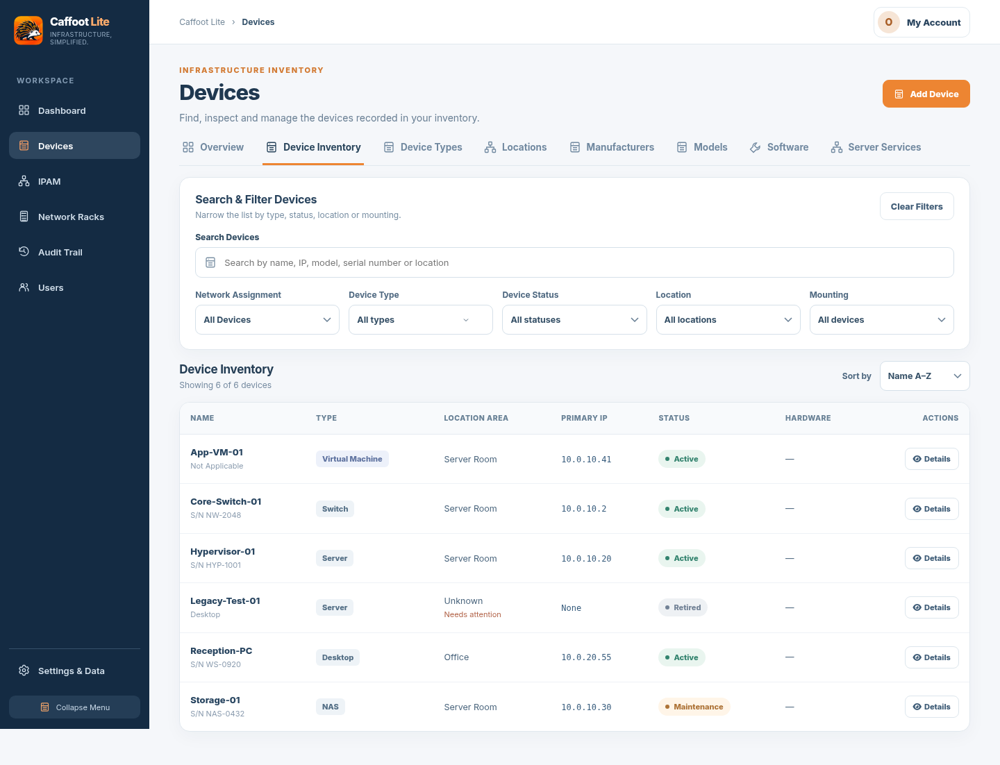
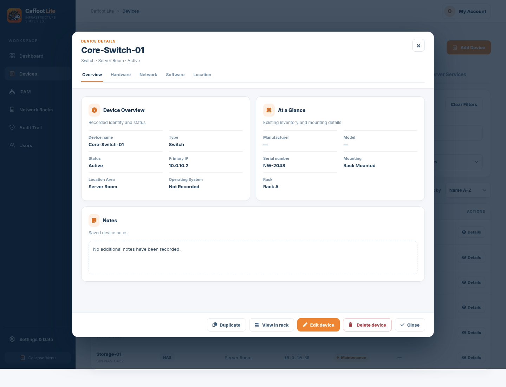

# Published v2.1 screenshots — approved

These **genuine captures of published v2.1** were visually approved by the product owner in the Caffoot Lite project conversation on **15 November 2026**. The nine guide images and the README IPAM image are now used in the documentation on the draft correction branch. Original screenshots remain at their existing public paths. **Image approval does not authorise merging PR #384.**

## Source and capture conditions

- Exact source: [`v2.1`, c3237114108cad9f7d4e57657b6aed5e0091a5ef](https://github.com/Caffoot/Caffoot-Lite/tree/v2.1), exported into an isolated working directory without source modifications.
- Local Python HTTPS server and disposable schema-10 SQLite database. No Docker build, release image change, production data, deployment or Raspberry Pi.
- Fictional demonstration inventory and test account from that tag's [`tests/visual_fixtures.py`](https://github.com/Caffoot/Caffoot-Lite/blob/v2.1/tests/visual_fixtures.py). Legacy demonstration subnets deliberately display **Not assigned** purpose; this does not remove the purpose requirement for new subnets. The retired legacy Device similarly illustrates retained historical data, not new-Device validation.
- Chromium, light appearance, 1440 × 1050 viewport, device scale 1, full-page PNG captures. The rack's own scroll area is scrolled to show mounted equipment. No mock-ups, response substitution, DOM restyling or subsequent image editing.
- [Capture metadata and SHA-256 hashes](capture-metadata.json) record the source, browser, dimensions and files. Each image was opened and visually inspected for its named screen, legibility and fictional data. No JavaScript page errors were recorded during the final capture run.

These desktop light captures do not establish dark/mobile presentation or formal pixel-level acceptance. Existing interface text is captured as released, including any inherited capitalisation. Do not edit application screens to improve an image.

## Approval and integration

The product owner approved all ten captures and their proposed documentation use on 15 November 2026. The approved images are linked from the published v2.1 guides (both maintained paths) and the root README in this draft PR. The original nine guide screenshots and original README IPAM crop are retained unchanged. The IPAM views retain the application's scrollable allocation area without browser controls; the replacement image is a full-page genuine capture, not an invented crop.

This is **visual approval only**. The wording and final PR still require review and separate merge authorisation. Dark and mobile screenshots were not captured or accepted as part of this correction.

## Approved screenshot gallery

### Sign-in form with empty credentials

**Approved 15 November 2026.** Used in: `Getting-Started.md`.

### Dashboard → Network Insights with fictional inventory

**Approved 15 November 2026.** Used in: `Getting-Started.md`.

### Devices → Device Inventory, showing six fictional records

**Approved 15 November 2026.** Used in: `Devices.md`.

### Read-only Core-Switch-01 details on Overview

**Approved 15 November 2026.** Used in: `Devices.md`.

### IPAM → Manage Subnets with fictional networks

**Approved 15 November 2026.** Used in: `IPAM.md`.

### IPAM → IP Addresses with fictional allocations

**Approved 15 November 2026.** Used in: `IPAM.md`.

### Network Racks → Rack Inventory → Rack View, scrolled to mounted fictional equipment

**Approved 15 November 2026.** Used in: `Racks.md`.

### My Account → Help & Guides

**Approved 15 November 2026.** Used in: `Settings-and-Change-History.md`.

### Users → Overview, with one fictional administrator

**Approved 15 November 2026.** Used in: `Users-Permissions-and-MFA.md`.

### IPAM → IP Addresses, without browser tabs or address bar

**Approved 15 November 2026.** Used in: `README.md`.

