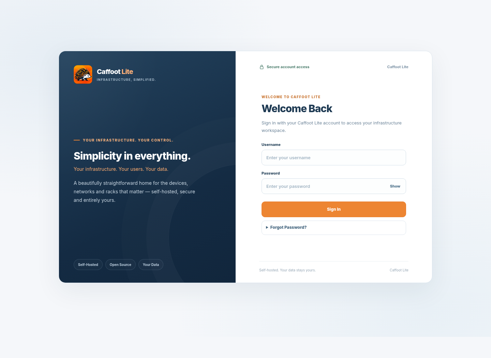
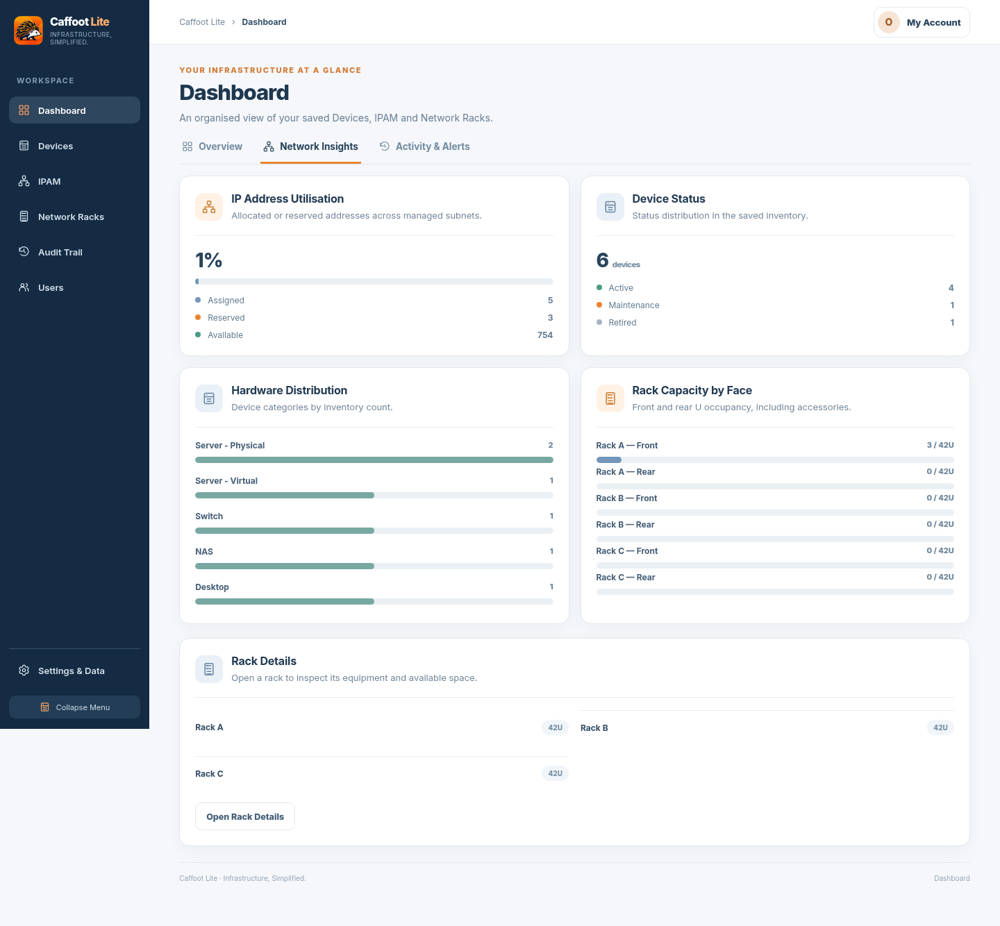
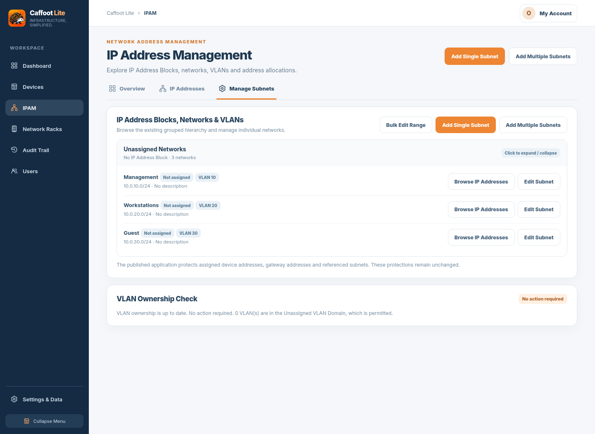
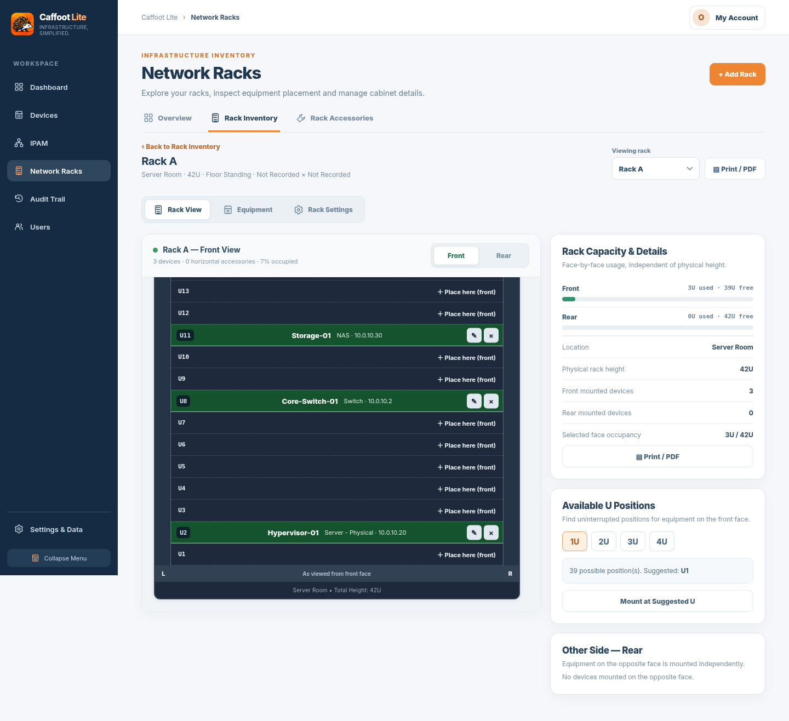
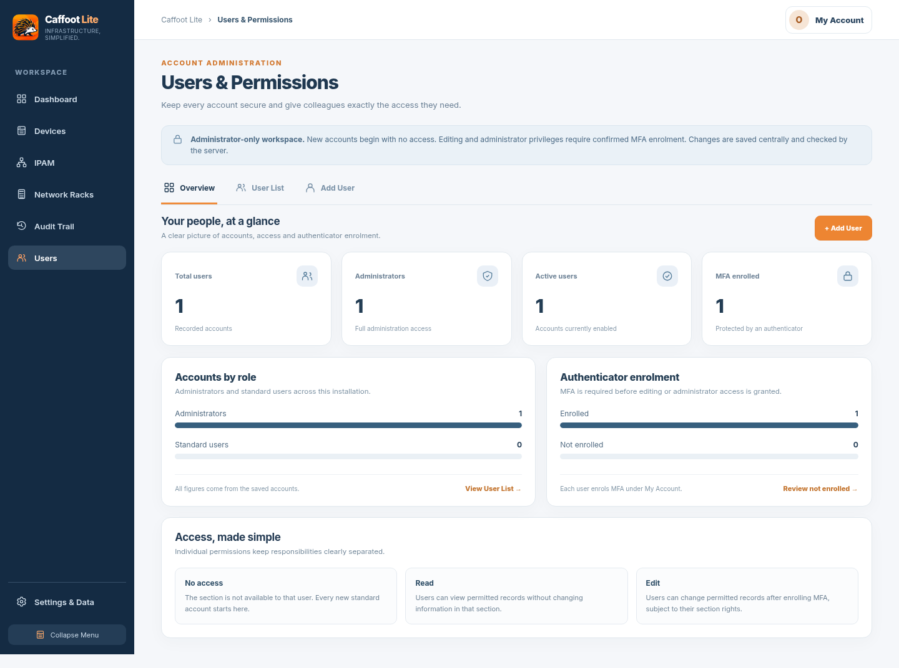
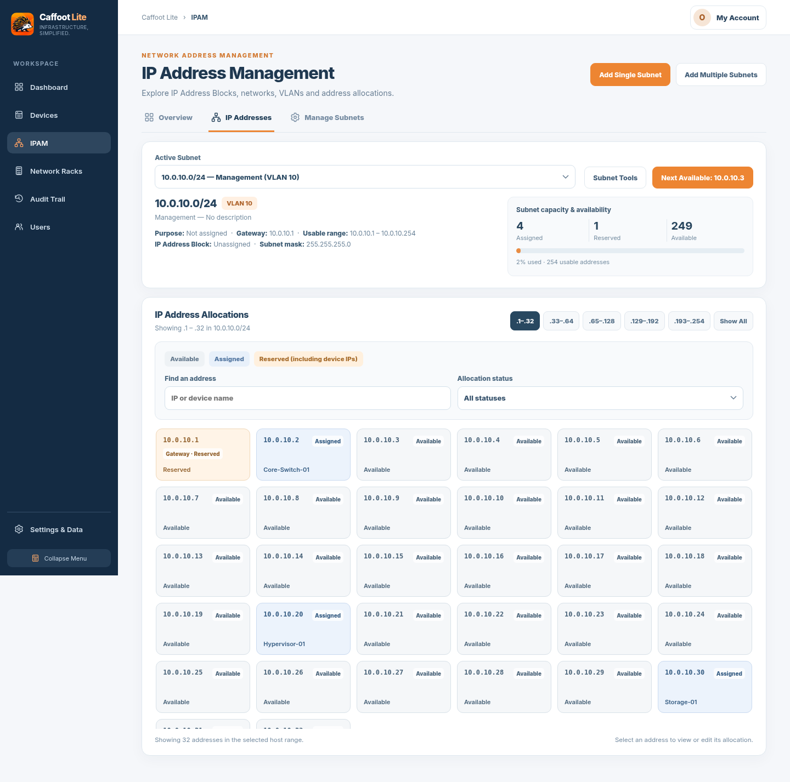

# v2.1 screenshot candidates — visual approval pending

These are **genuine captures of published v2.1**, prepared for separate product-owner review. They are not accepted replacements and are not used as current guide or README illustrations. Original images remain at their existing public paths.

## Source and capture conditions

- Exact source: [`v2.1`, c3237114108cad9f7d4e57657b6aed5e0091a5ef](https://github.com/Caffoot/Caffoot-Lite/tree/v2.1), exported into an isolated working directory without source modifications.
- Local Python HTTPS server and disposable schema-10 SQLite database. No Docker build, release image change, production data, deployment or Raspberry Pi.
- Fictional demonstration inventory and test account from that tag's [`tests/visual_fixtures.py`](https://github.com/Caffoot/Caffoot-Lite/blob/v2.1/tests/visual_fixtures.py). Legacy demonstration subnets deliberately display **Not assigned** purpose; this does not remove the purpose requirement for new subnets. The retired legacy Device similarly illustrates retained historical data, not new-Device validation.
- Chromium, light appearance, 1440 × 1050 viewport, device scale 1, full-page PNG captures. The rack's own scroll area is scrolled to show mounted equipment. No mock-ups, response substitution, DOM restyling or subsequent image editing.
- [Capture metadata and SHA-256 hashes](capture-metadata.json) record the source, browser, dimensions and files. Each image was opened and visually inspected for its named screen, legibility and fictional data. No JavaScript page errors were recorded during the final capture run.

These desktop light captures do not establish dark/mobile presentation or formal pixel-level acceptance. Existing interface text is captured as released, including any inherited capitalisation. Do not edit application screens to improve an image.

## Approval checklist

For each candidate, the owner should confirm the correct screen/version, fictional content, readable size, framing and proposed caption. The IPAM views retain the application's own scrollable allocation area; they have no browser chrome. The README and guide IPAM candidates show the same view with matching framing. Request another genuine capture if a different crop, visible panel or demonstration record is preferred.

After explicit visual approval, update each guide and its compatibility copy together. Preserve the original assets and approved release evidence. Do not treat inclusion in this draft PR as visual acceptance.

## Candidate gallery

### Sign-in form with empty credentials

**Pending approval.** Proposed destination: `Getting-Started.md / sign-in.png`.

### Dashboard → Network Insights with fictional inventory

**Pending approval.** Proposed destination: `Getting-Started.md / dashboard.png`.

### Devices → Device Inventory, showing six fictional records

**Pending approval.** Proposed destination: `Devices.md / devices-inventory.png`.

### Read-only Core-Switch-01 details on Overview

**Pending approval.** Proposed destination: `Devices.md / device-details.png`.

### IPAM → Manage Subnets with fictional networks

**Pending approval.** Proposed destination: `IPAM.md / ipam-subnets.png`.

### IPAM → IP Addresses with fictional allocations

**Pending approval.** Proposed destination: `IPAM.md / ipam-addresses.png`.

### Network Racks → Rack Inventory → Rack View, scrolled to mounted fictional equipment

**Pending approval.** Proposed destination: `Racks.md / racks.png`.

### My Account → Help & Guides

**Pending approval.** Proposed destination: `Settings-and-Change-History.md / help-guides.png`.

### Users → Overview, with one fictional administrator

**Pending approval.** Proposed destination: `Users-Permissions-and-MFA.md / users.png`.

### IPAM → IP Addresses, without browser tabs or address bar

**Pending approval.** Proposed destination: `Root README / caffoot-v2.1-ipam-light-cropped.png`.

